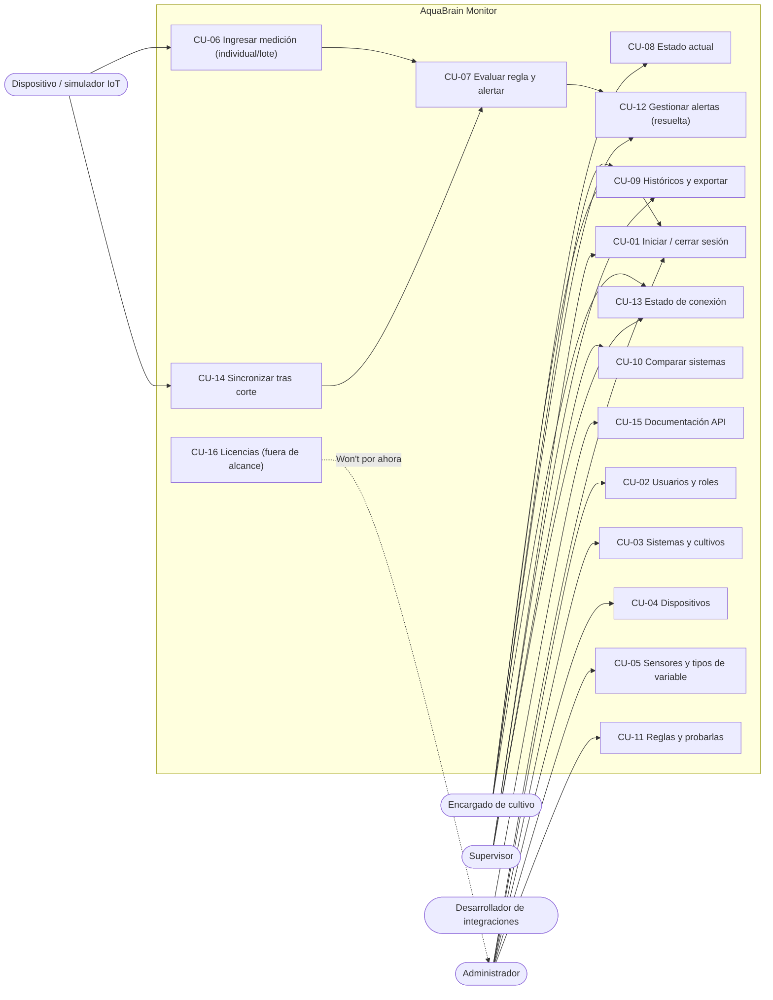

# 4+1 · Vista de Escenarios (+1)

**Pregunta que responde:** ¿Para qué sirve y qué flujos soporta?
**Audiencia:** Cliente y todo el equipo.
**Fuente:** `docs/ES2/02-arquitectura-4mas1.md` §2 — Casos de uso CU-01…CU-16 de ES1.

---

## 1. Diagrama de casos de uso (actores y CU)

> **Nota (UML):** todos los casos protegidos `<<include>>` autenticarse (CU-01). **CU-07 (evaluar regla y alertar)**
> es un `<<extend>>` de **CU-06 (ingresar medición)**, que a su vez puede derivar en CU-12 (resolver alerta).
> CU-16 se incluye solo para mostrar que el licenciamiento quedó **fuera de alcance** (*Won't por ahora*).

---

## 2. Escenarios arquitectónicamente significativos

| Escenario | Descripción | Componentes que atraviesa | Requisitos |
|---|---|---|---|
| **E-1 · Ingesta y alerta** | El dispositivo reporta una medición; se valida, persiste, evalúa reglas y se genera alerta | Gateway IoT → Servicio de mediciones → Motor de reglas → Repositorios → Cola de notificación | RF06, RF11, RF12, CU-06, CU-07, HU08 |
| **E-2 · Estado actual** | El encargado abre el dashboard y ve la última medición por sensor con frescura del dato | SPA → API de lectura → Servicio de consultas → Vista de última medición | RF07, CU-08, HU01 |
| **E-3 · Histórico y comparación** | Filtra un rango y exporta; el supervisor compara varios sistemas | SPA → API de históricos → Agregación SQL y caché | RF08, RF09, CU-09, CU-10, HU02, HU04, RNF03 |
| **E-4 · Autenticación y autorización** | Inicia sesión y cada petición se autoriza por permiso | SPA → Servicio de identidad → Guardia de autorización → Repositorio de usuarios | RF01, RF02, CU-01, CU-02, HU05, RNF01 |
| **E-5 · Sincronización offline** | Tras una caída, el dispositivo reenvía un lote con timestamps originales | Buffer local → Gateway IoT → Servicio de mediciones (idempotente) → Motor de reglas | RF06, RF14, CU-14, HU10, RN-10 |
| **E-6 · Estado de conexión** | Se detecta un dispositivo que dejó de reportar y se refleja en dashboard | Job programado → Servicio de dispositivos → Servicio de alertas | RF14, CU-13, RN-05 |
| **E-7 · Integración documentada** | El desarrollador consume la API versionada desde la app Android | Cliente externo → OpenAPI `/api/docs` → Endpoints `/api/v1` | RF13, CU-15, HU11, RNF08 |

---

## 3. Cómo los escenarios justifican las decisiones

- **E-1** exige separar la **persistencia** de la **evaluación de reglas** y del **guardado crudo** (RA-05): el endpoint responde `201` apenas el dato está validado y persistido.
- **E-2 y E-3** exigen una **vista de lectura optimizada** para "última medición" y **agregación en base de datos** (RA-06, RNF03).
- **E-4** exige que la autorización sea **declarativa por permiso** (`@RequirePermission`), no dispersa en controladores.
- **E-5** exige **idempotencia** con `(dispositivo_id, id_externo)` único (RA-06) y validación de tiempo (RA-03).
- **E-7** exige tratar el **contrato OpenAPI como parte del diseño** (D-13), no como documentación tardía.
