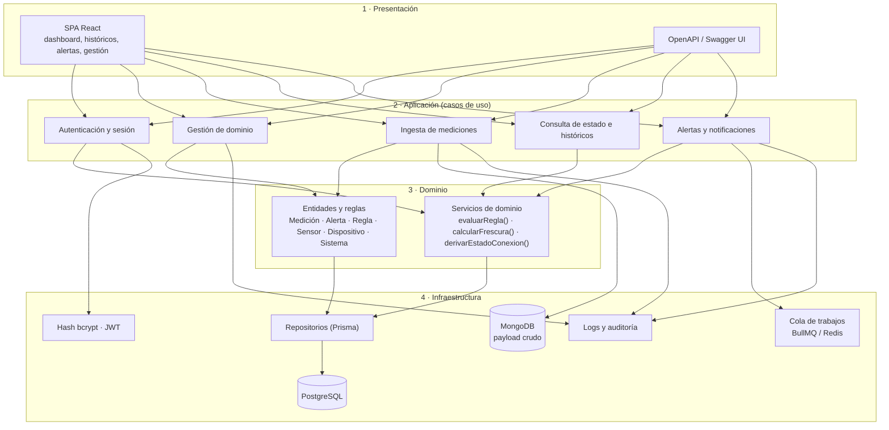
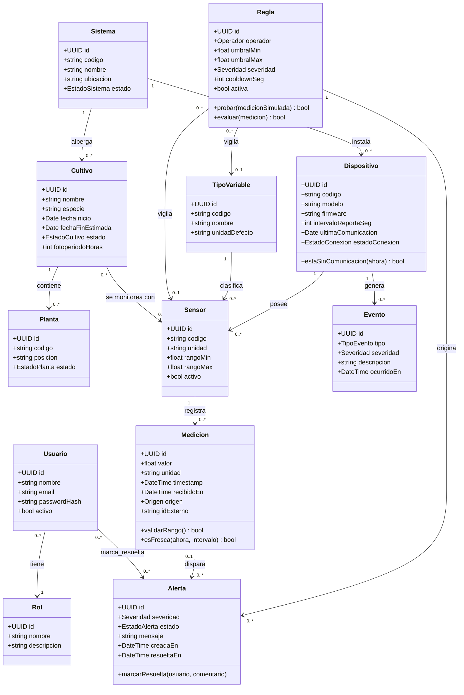

# 4+1 · Vista Lógica

**Pregunta que responde:** ¿Qué componentes y responsabilidades existen?
**Audiencia:** Desarrolladores.
**Fuente:** `docs/ES2/02-arquitectura-4mas1.md` §3.

Arquitectura **en capas** con módulos de dominio cohesivos (estilo *modular monolith*), de modo que una futura
extracción a servicios sea mecánica si la escala lo exige (NEC-09).

---

## 1. Capas

> **Regla de dependencia:** las capas externas dependen de las internas, nunca al revés. El dominio no conoce HTTP,
> SQL ni MongoDB: por eso puede probarse de forma unitaria y pura (RNF06).

---

## 2. Módulos y responsabilidades

| Módulo | Capa | Responsabilidad | Requisitos | Depende de |
|---|---|---|---|---|
| `auth` | Aplicación | Login, refresco, logout, hash **bcrypt**, emisión de JWT | RF01, RNF01 | `usuarios`, `seguridad` |
| `rbac` | Aplicación | Guardias por rol/permiso y matriz de autorización | RF01, RF02, RNF01 | `auth` |
| `usuarios` | Dominio/Infra | CRUD de usuarios y roles, bloqueo por intentos fallidos | RF01, RF02, HU05 | — |
| `sistemas` | Dominio/Infra | CRUD de sistemas/instalaciones y cultivos/plantas | RF03, NEC-01 | — |
| `dispositivos` | Dominio/Infra | CRUD de dispositivos y sensores, API keys, estado y última comunicación | RF04, RF05, RF14 | `sistemas` |
| `mediciones` | Aplicación | Ingesta individual y por lote, validación de tiempo/formato, idempotencia, escritura en *landing zone* y tablas relacionales | RF06 | `dispositivos`, `alertas` |
| `alertas` | Aplicación/Dominio | Motor de reglas, CRUD de reglas, generación y gestión de alertas, *cooldown* | RF10, RF11, RF12 | `mediciones`, `notificaciones` |
| `consultas` | Aplicación | Estado actual, históricos agregados, comparación multi-sistema, exportación CSV | RF07, RF08, RF09 | `mediciones` |
| `notificaciones` | Infra | Cola de trabajos, aviso en interfaz (extensión a correo/webhook opcional) | RF11 | `alertas` |
| `auditoria` | Infra | Registro de accesos y cambios críticos | RNF11, RF10, RF12 | — |
| `api-docs` | Presentación | Publicación del contrato OpenAPI versionado | RF13, RNF08 | — |

> `licencias` (RF15/HU09/CU-16) **no se implementa**: queda como *Won't por ahora* (supuesto `SUP-09`).

---

## 3. Modelo de dominio (clases conceptuales)

> **Nota de alcance (`SUP-05`):** ES1 define `sistema → dispositivo → sensor` (RF03–RF05). Las entidades `Cultivo` y
> `Planta` **extienden NEC-01** para dar contexto agronómico, pero su cardinalidad real aún no está confirmada.
