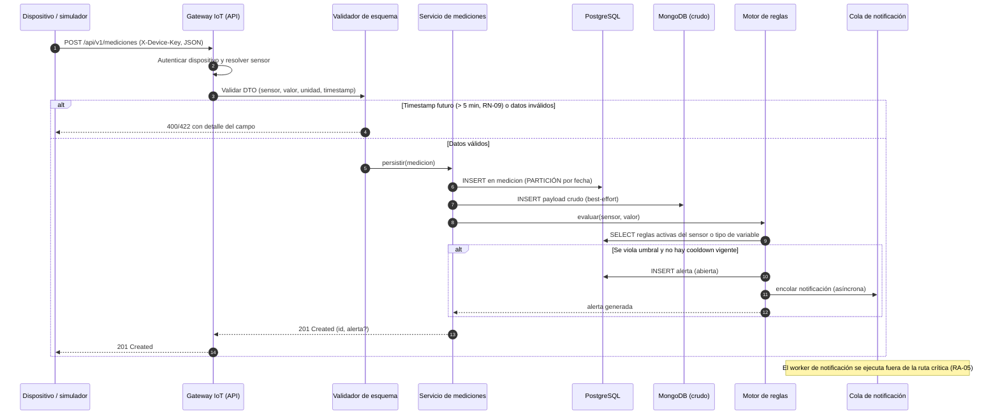
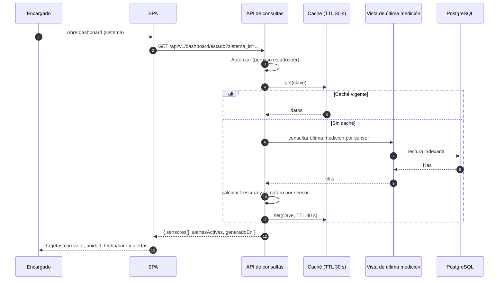
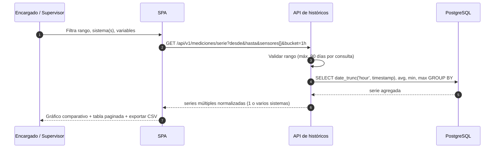
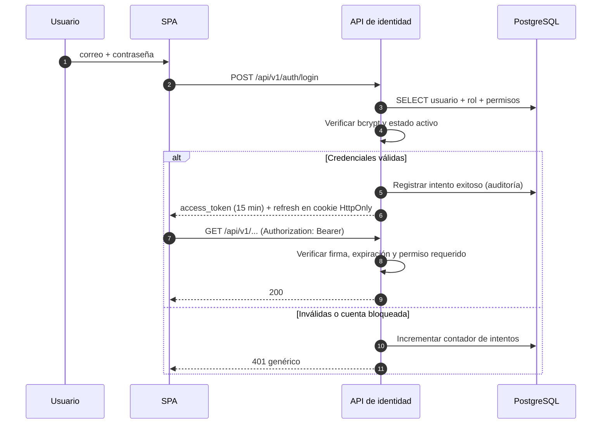
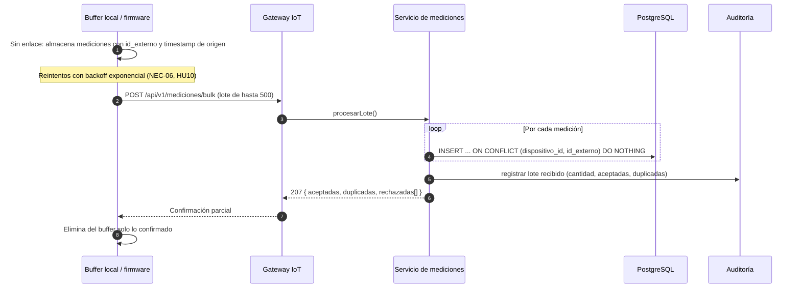
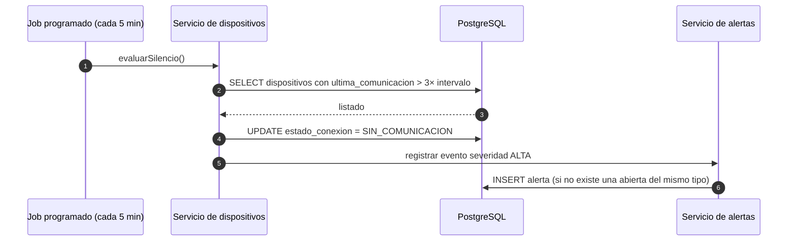
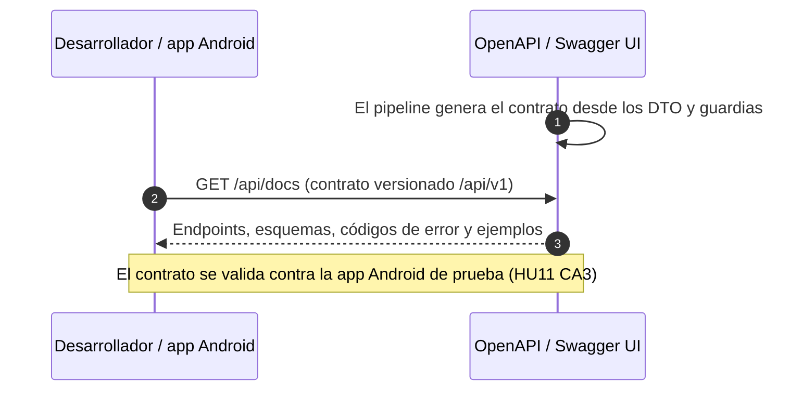

# 4+1 · Vista de Procesos

**Pregunta que responde:** ¿Cómo colaboran y qué pasa en tiempo de ejecución?
**Audiencia:** Desarrolladores y QA.
**Fuente:** `docs/ES2/02-arquitectura-4mas1.md` §4.

Muestra el comportamiento en tiempo de ejecución: concurrencia, asincronía y tolerancia a fallos.

---

## Proceso 1 — Ingesta de medición y evaluación de alerta (E-1)

---

## Proceso 2 — Dashboard de estado actual (E-2)

---

## Proceso 3 — Histórico, exportación y comparación (E-3)

---

## Proceso 4 — Autenticación y autorización (E-4)

---

## Proceso 5 — Sincronización tras pérdida de conectividad (E-5)

> La sincronización acepta **timestamps pasados** (RN-10) y conserva `origen = OFFLINE`, de modo que el histórico
> sigue siendo fiel a cuándo se midió, no a cuándo llegó.

---

## Proceso 6 — Detección de dispositivo sin comunicación (E-6)

---

## Proceso 7 — Publicación del contrato de API (E-7)

