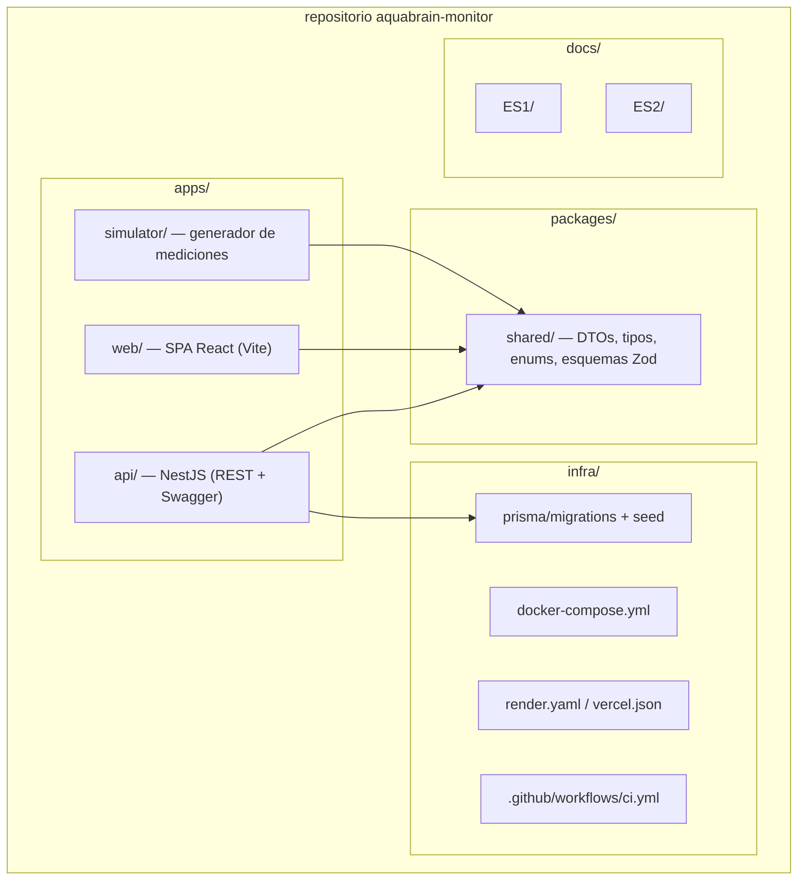
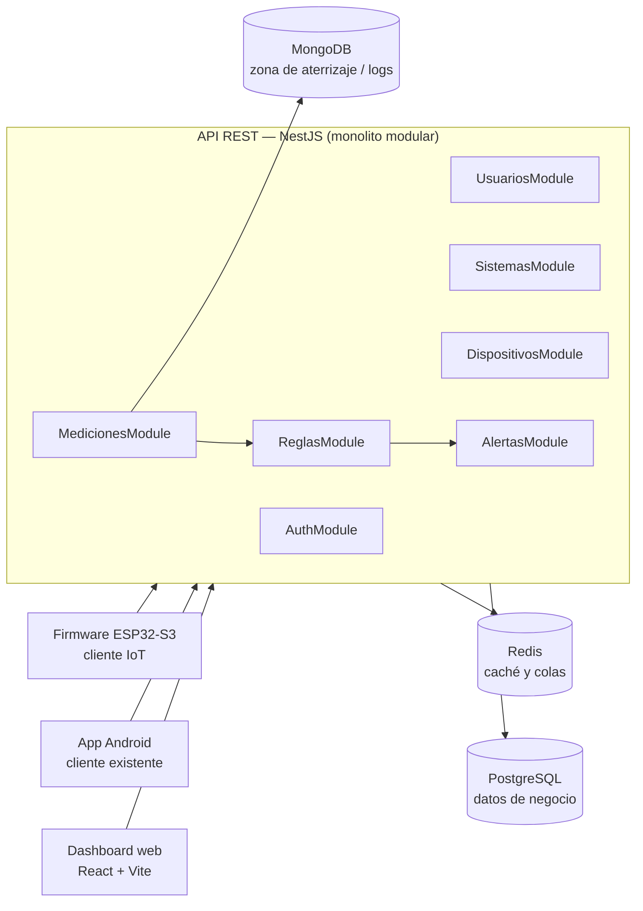

# 4+1 · Vista de Desarrollo

**Pregunta que responde:** ¿Cómo se organiza el código y el trabajo?
**Audiencia:** Equipo.
**Fuente:** `docs/ES2/02-arquitectura-4mas1.md` §5.

---

## 1. Organización del código (monorepo)

---

## 2. Diagrama de componentes (UML)

Los tres clientes consumen una **API REST única**: así el contrato `/api/v1` se mantiene estable para web, Android y
firmware (RA-02, D-13). Los módulos `MedicionesModule → ReglasModule → AlertasModule` muestran la cadena de la
decisión RA-05 (la evaluación de alertas no bloquea la respuesta de ingesta).

---

## 3. Convenciones de trabajo

| Aspecto | Definición |
|---|---|
| Estrategia de ramas | `main` (protegida, entregable) ← `develop` ← `feature/<id-hu>-<descripcion>` |
| Commits | Conventional Commits (`feat(mediciones): ingesta por lote`) referenciando `HU08` / `RF06` |
| Pull Request | Obligatorio, 1 aprobador distinto del autor, plantilla con checklist de seguridad y pruebas |
| Versionado | SemVer para la API (`/api/v1`) |
| Estilo | ESLint + Prettier + TypeScript `strict`; reglas compartidas en `packages/shared` |
| Documentación | ADR por decisión arquitectónica + README por app |

---

## 4. Cómo esta vista habilita el trabajo en equipo

- **Dos frentes paralelos** gracias a `packages/shared`: backend y frontend pueden avanzar contra tipos ya acordados (con mocks) sin bloquearse.
- **CI única** que valida todo el monorepo en cada PR (lint, tests, build), evitando "funciona en mi máquina".
- **Módulos de dominio** permiten que cada integrante sea *owner* de un módulo con frontera clara.
- **Contrato OpenAPI primero**: el firmware y la app Android se integran contra un contrato estable (RA-02, RNF08).
