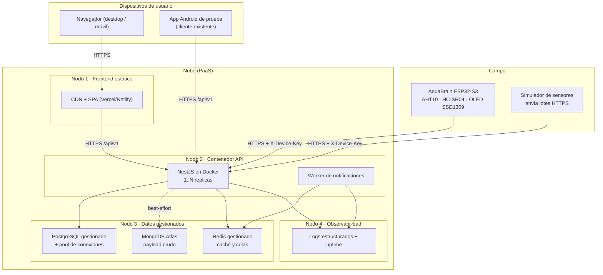

# 4+1 · Vista Física (Despliegue)

**Pregunta que responde:** ¿Dónde se ejecuta todo?
**Audiencia:** DevOps / infraestructura.
**Fuente:** `docs/ES2/02-arquitectura-4mas1.md` §6.

---

## 1. Nodos y despliegue

---

## 2. Entornos

| Entorno | Propósito | Infraestructura | Datos |
|---|---|---|---|
| **Local** | Desarrollo diario | `docker-compose` (API + PostgreSQL + Redis + MongoDB) | Semilla (`seed`) + simulador |
| **Desarrollo/Staging** | Demo interna, pruebas de integración y de carga | PaaS gratuito, una réplica | Semilla ampliada (100 dispositivos) |
| **Producción académica** | Evaluación ES3/ES4 | PaaS, HTTPS, BD gestionada | Datos simulados cargados y respaldados |

---

## 3. Atributos de calidad por nodo

| Nodo | Atributo | Cómo se consigue |
|---|---|---|
| Frontend | Disponibilidad y rapidez de carga | CDN, *build* estático, *code splitting* |
| API | Rendimiento (RNF03) | Contenedor sin estado, escalado horizontal, caché Redis, paginación y agregación en BD |
| PostgreSQL | Integridad y capacidad de histórico | Particionado por fecha, índice `(sensor_id, timestamp)`, respaldos (RNF02) |
| MongoDB | Flexibilidad de payload y desacople (RA-05) | Escritura *best-effort*: si falla, la medición ya está en PostgreSQL |
| Redis | Latencia de consultas repetidas y asincronía | TTL corto en dashboard; cola BullMQ fuera de la ruta crítica (RA-05) |
| Observabilidad | Auditabilidad | Logs estructurados con `correlation-id`, alertas de uptime |
| App Android | Interoperabilidad sin cambios (RNF08) | Contrato `/api/v1` estable y versionado (SUP-10) |
