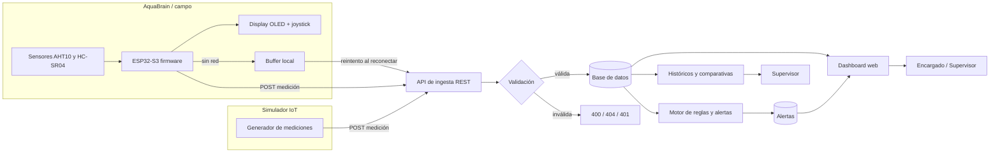

# 02 · Caracterización del ecosistema y de los actores

## 2.1. El ecosistema físico-digital

El ecosistema de AquaPlants se organiza en **tres capas** que el desafío pide comprender antes de
construir software:

| Capa | Elementos | Rol en el ecosistema |
|---|---|---|
| **Física / de cultivo** | Torre hidropónica vertical, plantas, solución nutritiva | El objeto monitoreado; su estado depende de variables medibles |
| **Electrónica / AquaBrain** | Placa con **ESP32-S3**, sensores **AHT10** y **HC-SR04**, display **OLED SSD1309** y **joystick** | Sensa variables, permite operación local y transmite datos hacia la nube |
| **Digital** | Plataforma web (frontend + API + base de datos) y **app Android de prueba** | Centraliza, persiste, visualiza y alerta sobre los datos del cultivo |

Comprender estas capas permite traducir el contexto físico en decisiones de software: qué se mide,
con qué frecuencia, cómo se comunica y quién consume la información.

## 2.2. Hardware y clientes reales entregados por la empresa

La empresa no parte de cero: existe hardware y software que la plataforma debe respetar. Cada
elemento tiene una **implicancia directa de software**:

| Elemento | Antecedente | Implicancia de software |
|---|---|---|
| **ESP32-S3** (firmware propio) | Dispositivo AquaBrain real que sensa y transmite | La API debe recibir el **formato del firmware real**, no solo el del simulador |
| **AHT10** | Mide temperatura y humedad | Tipos de variable reales `TEMPERATURA` (°C) y `HUMEDAD` (%) |
| **HC-SR04** | Mide distancia, usada como referencia de nivel | Tipo de variable `DISTANCIA`/`NIVEL` (cm) |
| **OLED SSD1309 + joystick** | Operación local autónoma del dispositivo | La plataforma debe tolerar cortes y ser **consistente** con lo que muestra el display |
| **App Android 14 (prueba)** | Cliente ya construido que se conecta al dispositivo | API-first versionada y documentada para **no duplicar lógica ni romper clientes** |

> Consecuencia de diseño: la plataforma **no es el único cliente**. Debe exponer un contrato estable
> para que firmware y app móvil convivan, y no puede contradecir la información que el usuario ve en
> el display local.

## 2.3. Variables de cultivo: reales y simuladas

El documento del desafío menciona variables como **nutrientes, caudal, consumo hídrico y
fotoperiodo**, además de las de los sensores reales. Como el hardware entregado solo cubre
temperatura, humedad y distancia, la distinción entre **real** y **simulado** es parte del
diagnóstico y evita atribuir al sistema datos que no puede producir:

| Variable | Origen en el prototipo | Fundamento |
|---|---|---|
| Temperatura (°C) | **Real** (AHT10) | Sensor entregado por la empresa |
| Humedad (%) | **Real** (AHT10) | Sensor entregado por la empresa |
| Distancia / nivel (cm) | **Real** (HC-SR04) | Sensor entregado por la empresa |
| pH | **Simulado** | Mencionado en el desafío; sin sensor físico disponible |
| Caudal (L/min) | **Simulado** | Mencionado en el desafío; sin sensor físico disponible |
| Nutrientes / fotoperiodo | **Simulado / conceptual** | Mencionados en el desafío; se modelan como tipo de variable |

Esta separación es coherente con el criterio del desafío: *«Los sensores reales no son
obligatorios: una API o simulador puede generar mediciones»*, y con el compromiso de **no inventar**
mediciones reales donde no hay sensor.

## 2.4. Flujo dispositivo → dato → aplicación

El desafío pide demostrar que el equipo entiende el flujo completo (medición simulada → API →
almacenamiento → dashboard/alerta). El siguiente diagrama resume ese flujo, incluido el camino de
sincronización posterior a un corte de red:

El diagrama distingue los **dos orígenes de datos** (firmware real y simulador), el **punto único de
validación y persistencia**, el **motor de reglas** que convierte datos en alertas, y los **actores
que consumen** la información. La existencia del buffer local y del reintento responde a la regla
operacional de conectividad intermitente.

## 2.5. Actores y sus necesidades

Los actores surgen de los antecedentes de la empresa y del propio desafío:

| Actor | Necesidad inicial | Tipo |
|---|---|---|
| **Encargado de cultivo** | Ver estado actual, históricos y alertas; operar el cultivo | Humano |
| **Supervisor** | Comparar sistemas, analizar tendencias e indicadores | Humano |
| **Administrador** | Gestionar usuarios, roles, sistemas, dispositivos, sensores y reglas | Humano |
| **Dispositivo / AquaBrain (ESP32-S3)** | Enviar mediciones por API y operar localmente sin conectividad | Máquina |
| **Simulador IoT** | Generar mediciones en ausencia de hardware | Máquina |
| **Desarrollador de integraciones** | Consumir la API documentada (app Android, firmware, futuros clientes) | Humano/técnico |

> A diferencia de un backlog genérico, se reconoce explícitamente a **la máquina como actor**: el
> dispositivo y el simulador tienen necesidades propias (enviar datos, reintentar, sincronizar) que
> se traducen en historias de usuario y requerimientos.

## 2.6. Puente hacia las necesidades TI

La caracterización anterior es la base del capítulo siguiente: cada capa y cada actor produce una o
más **necesidades TI** con evidencia concreta. Por ejemplo, del display OLED y del joystick nace la
necesidad de **operación local tolerante a cortes**; de la app Android, la necesidad de una **API
documentada y versionada**; del HC-SR04, un **tipo de variable real** que la base de datos debe
soportar. Así, el diagnóstico no se apoya en supuestos genéricos, sino en el material entregado.
