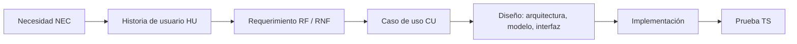

# 08 · Trazabilidad y relaciones entre artefactos

## 8.1. Modelo de trazabilidad

El criterio de calidad del desafío es que **la evidencia sea trazable y coherente**: una necesidad se
relaciona con una o más historias; estas con requerimientos; los requerimientos con casos de uso y
diseño; y todo ello con la implementación y las pruebas. El modelo adoptado tiene **siete eslabones**:

Identificadores utilizados (únicos y estables):

| Prefijo | Significado | Rango |
|---|---|---|
| `NEC` | Necesidad TI | NEC-01 … NEC-09 |
| `HU` | Historia de usuario | HU01 … HU11 |
| `RF` / `RNF` | Requerimiento funcional / no funcional | RF01 … RF15 · RNF01 … RNF11 |
| `CU` | Caso de uso | CU-01 … CU-16 |
| `RN` | Regla de negocio | RN-01 … RN-12 |
| `TS` | Caso de prueba | TS-01 … TS-44 |

> **Nota de honestidad.** Este capítulo es la **matriz de trazabilidad viva** que el desafío pide
> mantener durante todo el semestre. Como ES1 es el diagnóstico, las columnas de **diseño**,
> **implementación** y **prueba** se completaron a medida que avanzaron ES2 y ES3; se incluyen aquí
> para demostrar que la cadena cierra de extremo a extremo. No implican que ES1 haya diseñado o
> implementado esas piezas.

## 8.2. Matriz principal: necesidad → historia → requisito → caso de uso → diseño → implementación → prueba

| NEC | HU | RF/RNF | CU | Diseño (referencia ES2) | Implementación (referencia ES3) | Prueba |
|---|---|---|---|---|---|---|
| NEC-07 | HU05 | RF01, RF02, RNF01 | CU-01, CU-02 | Arquitectura §4.4 · Modelo §3.1 (`usuario`, `rol`, `refresh_token`) · Seguridad §2.1/§3 | Módulos `auth`, `usuarios`, `rbac` · `/auth/login`, `/auth/refresh`, `/auth/logout`, `/usuarios` | TS-12, TS-13, TS-14, TS-15, TS-16, TS-18, TS-19, TS-35 |
| NEC-01 | HU06 | RF03, RF04, RF05 | CU-03, CU-04, CU-05 | Modelo §3.2–§3.3 (`sistema`, `cultivo`, `planta`, `dispositivo`, `sensor`, `tipo_variable`) | Módulos `sistemas`, `dispositivos` · `/sistemas`, `/dispositivos`, `/sensores` | TS-07, TS-21, TS-26, TS-28, TS-35 |
| NEC-02 | HU01 | RF07 | CU-08 | Arquitectura §4.2 (secuencia de dashboard) · Modelo §5 (`mv_ultima_medicion`) | `consultas` · `GET /dashboard/estado` · página `/dashboard` | TS-08, TS-37, TS-43 |
| NEC-03 | HU03 | RF11, RF12 | CU-07, CU-12 | Arquitectura §3.2/§4.1 (motor de reglas) · Modelo §3.4 (`regla_alerta`, `alerta`) | `alertas` · `/alertas`, `/alertas/{id}/resolver` | TS-01, TS-02, TS-03, TS-27, TS-35 |
| NEC-03 | HU07 | RF10 | CU-11 | Modelo §3.4 (`regla_alerta`, `Regla.probar()`) · Seguridad §3.4 | `alertas` (reglas) · `/reglas`, `/reglas/probar` | TS-04, TS-05, TS-06, TS-27 |
| NEC-04 | HU08 | RF06, RN-11 | CU-06 | Arquitectura §4.1 (secuencia de ingesta) · Modelo §3.4 (`medicion`) y §7 (payload crudo) | `mediciones` · `POST /mediciones`, `/mediciones/bulk` · `apps/simulator` | TS-07, TS-10, TS-22, TS-25, TS-26, TS-30, TS-34, TS-36 |
| NEC-05 | HU11 | RF13, RNF08 | CU-15 | Stack §1 (OpenAPI) · Arquitectura §4.7 (publicación del contrato) | `@nestjs/swagger` en `/api/docs` · validación contra la app Android | TS-42 |
| NEC-06 | HU10 | RF06, RF14 | CU-13, CU-14 | Arquitectura §4.5/§4.6 · Modelo §3.4 (`id_externo`, índice único parcial) | `mediciones` (idempotencia) + `dispositivos` (estado) + job · `apps/simulator` (buffer) | TS-09, TS-11, TS-36, TS-40, TS-41 |
| NEC-08 | HU02 | RF08, RNF03 | CU-09 | Arquitectura §4.3 · Modelo §8.3 (agregación) | `consultas` · `GET /mediciones/serie`, `?formato=csv` | TS-38, TS-43 |
| NEC-08 | HU04 | RF09 | CU-10 | Arquitectura §4.3 | `consultas` · `GET /mediciones/serie?sistemas[]` | TS-39 |
| NEC-09 | — (transversal) | RNF04, RNF06 | — | Modelo §6 (particionado) y §8 (normalización) | Índices, particionado mensual, monorepo y documentación | Revisión del modelo + TS-24, TS-43, TS-44 |
| — (contrato) | — (transversal) | RNF01, RNF11 | — | Seguridad §2–§6 · Modelo §3.1 (`auditoria`) | Guards, interceptor de auditoría, validación compartida | TS-12…TS-21, TS-27, TS-29, TS-31, TS-33 |
| — (Won't) | HU09 | RF15 | CU-16 | Modelo §10 (forma de licencia, fuera de alcance) · supuesto `SUP-09` | **No implementado** (decisión *Won't por ahora*) | — (postergado) |

**Lectura:** cada fila conecta una necesidad del negocio con su evidencia final. Las necesidades
**Must** y **Should** están cubiertas de extremo a extremo; las líneas marcadas como *Won't* se
declaran explícitamente sin evidencia de prueba, porque no se implementaron.

## 8.3. Cobertura de los criterios de aceptación por historia

Toda historia tiene al menos un requerimiento y una prueba que verifica sus criterios de aceptación:

| HU | Cubierta por | Pruebas de sus criterios de aceptación |
|---|---|---|
| HU01 | RF07 | TS-37 (CA①, CA②, CA④), TS-08 (CA③) |
| HU02 | RF08 | TS-38 (CA①, CA②, CA③) |
| HU03 | RF11, RF12 | TS-01/TS-02 (CA①), TS-35 (CA②, CA③, CA④) |
| HU04 | RF09 | TS-39 (CA①, CA②, CA③) |
| HU05 | RF01, RF02 | TS-12 (CA③), TS-19 (CA④), TS-35 (CA①, CA②) |
| HU06 | RF03, RF04, RF05 | TS-07, TS-21, TS-35 (CA①, CA②, CA③) |
| HU07 | RF10 | TS-06 (CA③), TS-04 (CA②) |
| HU08 | RF06 | TS-10 (CA③), TS-22 (CA④), TS-07 (CA②) |
| HU09 | RF15 (Won't) | — (postergado, `SUP-09`) |
| HU10 | RF06, RF14 | TS-11 (CA①), TS-41 (CA②, CA③, CA④) |
| HU11 | RF13 | TS-42 (CA①, CA②, CA③, CA④) |

## 8.4. Trazabilidad de los requerimientos no funcionales

| RNF | Decisión de diseño que lo sostiene | Verificación |
|---|---|---|
| RNF01 (seguridad) | bcrypt, JWT corto + refresh rotativo, RBAC, API key de dispositivo, TLS, límites de tasa, validación de entrada | TS-12…TS-16, TS-20, TS-21, TS-23, TS-25, TS-26, TS-29, TS-31, TS-33 |
| RNF02 (disponibilidad) | Base de datos como fuente de verdad, *health check*, respaldos, degradación controlada | TS-32, TS-34, TS-44 |
| RNF03 (rendimiento) | Caché con TTL, agregación en BD, paginación por cursor, índices, vista de última medición | TS-43 |
| RNF04 (escalabilidad — Won't) | Particionado mensual, índices, normalización, contenedor sin estado | Revisión del modelo |
| RNF05 (usabilidad + OLED) | Guía visual, componentes con estados, responsive, accesibilidad, semántica alineada con el display | Checklist manual + TS-37 |
| RNF06 (mantenibilidad) | Monorepo, tipado estricto, lint, pruebas, integración continua, documentación | Pipeline + cobertura ≥ 70 % (TS-44) |
| RNF07 (portabilidad) | Contenedores + variables de entorno + migraciones + semilla + README | Prueba de levantamiento desde cero |
| RNF08 (interoperabilidad) | API REST versionada con OpenAPI 3 publicado; contrato validado contra la app de prueba | TS-42 |
| RNF09 (autonomía local — Won't) | Estrategia *store-and-forward*; la web tolera datos tardíos (origen OFFLINE) | TS-41 (parte web) |
| RNF10 (cobertura ≥ 70 % + integración y carga) | Pruebas unitarias y de integración; carga; umbral de cobertura como criterio de salida | TS-44 |
| RNF11 (privacidad y cumplimiento) | Tabla de auditoría, minimización, retención, logs sin datos sensibles, Ley 19.628/21.719 | TS-27, TS-29 + revisión de política de datos |

## 8.5. Casos de uso (CU-01…CU-16)

| ID | Caso de uso | Actor primario | HU | RF |
|---|---|---|---|---|
| CU-01 | Iniciar / cerrar sesión | Usuario autorizado | HU05 | RF01 |
| CU-02 | Gestionar usuarios y roles | Administrador | HU05 | RF01, RF02 |
| CU-03 | Gestionar sistemas/instalaciones y cultivos | Administrador | HU06 | RF03 |
| CU-04 | Gestionar dispositivos | Administrador | HU06 | RF04 |
| CU-05 | Gestionar sensores y tipos de variable | Administrador | HU06 | RF05 |
| CU-06 | Ingresar medición (individual o lote) | Dispositivo / Simulador IoT | HU08 | RF06 |
| CU-07 | Evaluar regla y generar alerta | Sistema (evento interno) | HU03 | RF11 |
| CU-08 | Consultar estado actual (dashboard) | Encargado de cultivo | HU01 | RF07 |
| CU-09 | Consultar históricos y exportar | Encargado de Cultivo | HU02 | RF08 |
| CU-10 | Comparar sistemas en un mismo gráfico | Supervisor | HU04 | RF09 |
| CU-11 | Configurar reglas de alerta y probarlas | Administrador | HU07 | RF10 |
| CU-12 | Gestionar alertas (marcar resuelta) | Encargado de Cultivo | HU03 | RF12 |
| CU-13 | Monitorear estado de conexión y última comunicación | Encargado / Supervisor | HU10 | RF14 |
| CU-14 | Sincronizar mediciones tras corte de red | Dispositivo / Simulador IoT | HU10 | RF06, RF14 |
| CU-15 | Consultar documentación de la API | Desarrollador de Integraciones | HU11 | RF13 |
| CU-16 | Administrar licencias *(fuera de alcance)* | Administrador / Comercial | HU09 | RF15 |

## 8.6. Reglas de negocio (RN-01…RN-12)

Las reglas de negocio son restricciones que el software debe respetar; nacen del dominio, de la
trazabilidad o de las reglas operacionales entregadas por la empresa:

| ID | Regla | Origen |
|---|---|---|
| RN-01 | Toda medición pertenece a un sensor, que pertenece a un dispositivo, que pertenece a un sistema | Modelo de dominio |
| RN-02 | Una medición nunca se modifica ni se elimina: el histórico es inmutable (solo *append*) | Trazabilidad |
| RN-03 | La corrección de un dato se registra como medición nueva y la anterior se marca como anulada | Integridad |
| RN-04 | Una alerta se genera solo si la regla está activa y se respeta su *cooldown* | Evitar fatiga de alertas |
| RN-05 | Un dispositivo sin comunicación por más de 3× su intervalo de reporte se marca "sin comunicación" | Operación AquaPlants |
| RN-06 | El rol determina las acciones permitidas; ningún usuario puede elevar su propio rol ni eliminar su propia cuenta | HU05 CA④ |
| RN-07 | Los umbrales son configurables por sensor o por tipo de variable (el sensor tiene prioridad) | NEC-03 |
| RN-08 | Las marcas de tiempo se almacenan en UTC y se muestran en la zona horaria del usuario | Trazabilidad |
| RN-09 | Se rechaza toda medición con marca de tiempo futura (tolerancia por defecto: 5 min de desfase) | HU08 CA③ |
| RN-10 | Se aceptan marcas de tiempo pasadas para permitir la sincronización de datos generados offline | HU10 CA① |
| RN-11 | El sistema de mediciones debe conservar el formato del firmware real (ESP32-S3) además del formato del simulador | NEC-04, RF06 |
| RN-12 | La información del dashboard no debe contradecir lo que muestra el display OLED local del AquaBrain | RNF05 |

## 8.7. Verificación de cobertura y huecos

| Comprobación | Resultado |
|---|---|
| ¿Toda necesidad (NEC-01…NEC-09) tiene al menos una historia? | ✅ (NEC-09 se cubre como transversal con RNF04/RNF06) |
| ¿Toda HU tiene al menos un RF y un criterio de aceptación? | ✅ (HU09 → RF15, postergado) |
| ¿Todo RF tiene al menos una prueba asignada (salvo el Won't)? | ✅ |
| ¿Todo RNF tiene una decisión de diseño y una forma de verificación? | ✅ |
| ¿Todo CU tiene al menos una prueba (salvo CU-16 Won't)? | ✅ |
| ¿Existe alguna prueba sin necesidad asociada? | ✅ Ninguna: todas las pruebas tienen origen |

**Huecos detectados y su tratamiento** (transparencia sobre lo que no pudo confirmarse):

| # | Hueco | Tratamiento |
|---|---|---|
| H-01 | El desafío menciona variables sin unidad definida; el hardware real solo cubre temperatura, humedad y distancia | Real = AHT10/HC-SR04; pH y caudal se declaran **simulados** (`SUP-01`) |
| H-02 | No se conoce el tiempo de retención real de los históricos | Se fija en 24 meses como supuesto (`SUP-06`), parametrizable |
| H-03 | No se confirmó si el acceso debe restringirse por sistema | Simplificación documentada y supuesto (`SUP-05`) |
| H-04 | La notificación externa (correo/SMS) no está exigida | Se diseña la cola; se implementa como aviso en la interfaz |
| H-05 | No está claro si un sensor puede asociarse a varios cultivos | Se permite relación N:M, lo más flexible (`SUP-04`) |
| H-06 | El contrato que consume hoy la app Android no está disponible | Se asume `/api/v1` validado con la app de prueba (`SUP-10`) |
| H-07 | El licenciamiento no está respaldado por el desafío | HU09/RF15/CU-16 quedan *Won't por ahora* (`SUP-09`) |

> La verificación de cobertura demuestra dos cosas: que **ninguna necesidad queda sin evidencia** y
> que **ninguna prueba queda sin origen**. La matriz se mantiene viva y se actualiza al cambiar el
> alcance, siguiendo la regla de que el catálogo ES1 es la fuente de verdad que se propaga a ES2.
