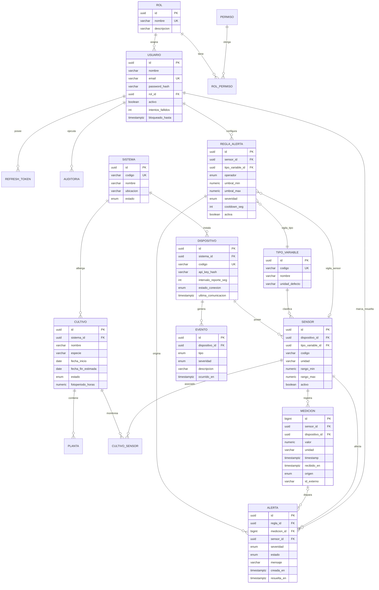

# ES2 · 05 — Modelo de datos

Contiene el **modelo conceptual** (DER), el **modelo lógico** con claves e integridad, el **diccionario de datos**,
la **justificación de normalización, índices y particionado**, y la **decisión de qué datos van a SQL y qué a
almacenamiento no relacional**. Los requisitos citados pertenecen al catálogo corregido de ES1.

> **Convención de nombres:** la entidad principal se llama **`sistema`** (equivalente a "instalación" en el lenguaje
> del cliente). Los tres clientes de la API son el **firmware ESP32-S3**, la **app Android** y el **dashboard web**.

---

## 1. Criterios de modelado

> Identificadores `MC-01…MC-09` (*model criteria*). No confundir con las correcciones `C-01…C-08` de ES1
> (`docs/ES1/01-correcciones-aplicadas.md`).

| # | Criterio | Regla aplicada |
|---|---|---|
| MC-01 | Trazabilidad temporal | Toda medición tiene `timestamp` (origen) y `recibido_en` (recepción), ambos `timestamptz` en UTC (RN-08) |
| MC-02 | Histórico inmutable | `medicion` es *append-only*: sin `UPDATE` ni `DELETE` de negocio; la corrección se registra como medición nueva y la anterior se marca anulada (RN-02, RN-03) |
| MC-03 | Integridad referencial | Todas las relaciones se declaran como claves foráneas con política explícita `ON DELETE` |
| MC-04 | Identificadores | Claves primarias `UUID v7` para entidades de dominio (evita enumeración y permite generación en cliente); `BIGSERIAL` para tablas de alto volumen (`medicion`, `auditoria`) |
| MC-05 | Enumeraciones | Los estados se modelan como `ENUM` nativo de PostgreSQL, no como texto libre |
| MC-06 | Magnitudes | Valores numéricos con `NUMERIC`, nunca `FLOAT`, para evitar errores de redondeo en mediciones |
| MC-07 | Volumen | `medicion` particionada por rango de `timestamp` (RNF04) |
| MC-08 | Idempotencia | `(dispositivo_id, id_externo)` único parcial para reenvíos desde buffer offline (HU10) |
| MC-09 | Formato del firmware | El modelo admite el payload real del ESP32-S3 (AHT10/HC-SR04) y el del simulador (RN-11) |

---

## 2. Modelo conceptual (DER)



> **Alcance:** `LICENCIA` (HU09/RF15) **no** forma parte del modelo vigente por ser *Won't por ahora*; su forma se documenta como supuesto en §10.

---

## 3. Modelo lógico — diccionario de datos

Convenciones: `uuid` = UUID v7 · `timestamptz` en UTC · `snake_case` en base de datos, `camelCase` en código.

### 3.1. Seguridad y usuarios

#### `rol`
| Columna | Tipo | Nulo | Clave/Regla | Descripción |
|---|---|---|---|---|
| `id` | uuid | no | PK | Identificador |
| `nombre` | varchar(30) | no | UNIQUE | `ADMINISTRADOR`, `SUPERVISOR`, `ENCARGADO` |
| `descripcion` | varchar(200) | sí | | Propósito del rol |
| `creado_en` | timestamptz | no | DEFAULT now() | |

#### `permiso`
| Columna | Tipo | Nulo | Clave/Regla | Descripción |
|---|---|---|---|---|
| `id` | uuid | no | PK | |
| `codigo` | varchar(60) | no | UNIQUE | Ej. `medicion:leer`, `usuario:escribir` |
| `descripcion` | varchar(200) | sí | | |

#### `rol_permiso`
| Columna | Tipo | Nulo | Clave/Regla |
|---|---|---|---|
| `rol_id` | uuid | no | PK, FK → `rol(id)` ON DELETE CASCADE |
| `permiso_id` | uuid | no | PK, FK → `permiso(id)` ON DELETE CASCADE |

#### `usuario`
| Columna | Tipo | Nulo | Clave/Regla | Descripción |
|---|---|---|---|---|
| `id` | uuid | no | PK | |
| `nombre` | varchar(120) | no | | Nombre completo |
| `email` | varchar(180) | no | UNIQUE (sin distinguir mayúsculas) | Identificador de acceso |
| `password_hash` | varchar(60) | no | | **bcrypt** (cost 12); nunca texto plano (RNF01, HU05 CA③) |
| `rol_id` | uuid | no | FK → `rol(id)` ON DELETE RESTRICT | |
| `activo` | boolean | no | DEFAULT true | Usuario desactivado no inicia sesión |
| `intentos_fallidos` | smallint | no | DEFAULT 0 CHECK ≥ 0 | Control de fuerza bruta |
| `bloqueado_hasta` | timestamptz | sí | | Bloqueo temporal |
| `ultimo_acceso` | timestamptz | sí | | |
| `creado_en` / `actualizado_en` | timestamptz | no | DEFAULT now() | |

Restricciones de negocio: **no puede existir cero administradores activos**; **un administrador no puede eliminar su propia cuenta** (HU05 CA④, RN-06) → validación transaccional en el servicio + pruebas TS-18, TS-19.

#### `refresh_token`
| Columna | Tipo | Nulo | Clave/Regla | Descripción |
|---|---|---|---|---|
| `id` | uuid | no | PK | |
| `usuario_id` | uuid | no | FK → `usuario(id)` ON DELETE CASCADE | |
| `token_hash` | varchar(255) | no | UNIQUE | Solo se almacena el hash |
| `expira_en` | timestamptz | no | | 7 días |
| `revocado_en` | timestamptz | sí | | Rotación: al usar uno, se revoca |
| `user_agent`, `ip` | varchar(255), inet | sí | | Contexto de seguridad |
| `creado_en` | timestamptz | no | DEFAULT now() | |

#### `auditoria`
| Columna | Tipo | Nulo | Clave/Regla |
|---|---|---|---|
| `id` | bigserial | no | PK |
| `usuario_id` | uuid | sí | FK → `usuario(id)` ON DELETE SET NULL |
| `accion` | varchar(40) | no | `LOGIN_OK`, `LOGIN_FALLO`, `CREAR`, `ACTUALIZAR`, `DESACTIVAR`, `MARCAR_RESUELTA`, `REGLA_CAMBIADA` |
| `entidad` / `entidad_id` | varchar(40) / varchar(64) | sí | |
| `datos_antes` / `datos_despues` | jsonb | sí | Sin campos sensibles |
| `ip` | inet | sí | |
| `ocurrido_en` | timestamptz | no | DEFAULT now() |

### 3.2. Dominio de sistema y cultivo

#### `sistema`
| Columna | Tipo | Nulo | Clave/Regla |
|---|---|---|---|
| `id` | uuid | no | PK |
| `codigo` | varchar(30) | no | UNIQUE (`INV-NORTE-01`) |
| `nombre` | varchar(120) | no | |
| `descripcion` | varchar(255) | sí | |
| `ubicacion` | varchar(80) | sí | Región / sector |
| `latitud` / `longitud` | numeric(9,6) | sí | CHECK lat ∈ [-90,90], lon ∈ [-180,180] |
| `estado` | enum `estado_sistema` | no | `ACTIVO`, `MANTENCION`, `INACTIVO` |
| `creado_en` / `actualizado_en` | timestamptz | no | |

#### `cultivo` *(extiende NEC-01; cardinalidad por validar, `SUP-05`)*
| Columna | Tipo | Nulo | Clave/Regla |
|---|---|---|---|
| `id` | uuid | no | PK |
| `sistema_id` | uuid | no | FK → `sistema(id)` ON DELETE RESTRICT |
| `nombre` | varchar(120) | no | |
| `especie` / `variedad` | varchar(80) | no / sí | |
| `fecha_inicio` | date | no | |
| `fecha_fin_estimada` | date | sí | CHECK ≥ `fecha_inicio` |
| `estado` | enum `estado_cultivo` | no | `ACTIVO`, `COSECHADO`, `CERRADO` |
| `fotoperiodo_horas` | numeric(4,1) | sí | CHECK 0–24 |
| `creado_en` | timestamptz | no | |

#### `planta` *(extiende NEC-01; `SUP-05`)*
| Columna | Tipo | Nulo | Clave/Regla |
|---|---|---|---|
| `id` | uuid | no | PK |
| `cultivo_id` | uuid | no | FK → `cultivo(id)` ON DELETE CASCADE |
| `codigo` | varchar(30) | no | UNIQUE (`cultivo_id`, `codigo`) |
| `posicion` | varchar(30) | sí | Nivel/bandeja |
| `estado` | enum `estado_planta` | no | `SANA`, `EN_RIESGO`, `RETIRADA` |
| `creado_en` | timestamptz | no | |

> **Nota de alcance:** ES1 (RF03) exige el CRUD de **sistemas/instalaciones**; `cultivo` y `planta` se incluyen para dar contexto agronómico a NEC-01, pero su relación exacta con `sistema`, `dispositivo` y `sensor` es el supuesto `SUP-05` a validar con la contraparte (ver `09-feedback-prototipo.md`).

### 3.3. Dispositivos y sensores

#### `dispositivo`
| Columna | Tipo | Nulo | Clave/Regla |
|---|---|---|---|
| `id` | uuid | no | PK |
| `sistema_id` | uuid | no | FK → `sistema(id)` ON DELETE RESTRICT |
| `codigo` | varchar(40) | no | UNIQUE (`DEV-01`) |
| `modelo` / `firmware` | varchar(60) / varchar(30) | no / sí | `AquaBrain` / `1.4.2` |
| `intervalo_reporte_seg` | int | no | DEFAULT 300, CHECK > 0 |
| `api_key_hash` | varchar(255) | no | Hash **bcrypt** de la API key (RNF01) |
| `api_key_ultimos4` | varchar(4) | sí | Ayuda a identificar la credencial sin exponerla |
| `estado_conexion` | enum `estado_conexion` | no | `EN_LINEA`, `SIN_COMUNICACION`, `INACTIVO`, `DESCONOCIDO` |
| `ultima_comunicacion` | timestamptz | sí | Actualizada en cada ingesta (RF14) |
| `activo` | boolean | no | DEFAULT true |
| `creado_en` / `actualizado_en` | timestamptz | no | |

#### `tipo_variable`
| Columna | Tipo | Nulo | Clave/Regla |
|---|---|---|---|
| `id` | uuid | no | PK |
| `codigo` | varchar(30) | no | UNIQUE |
| `nombre` | varchar(80) | no | |
| `unidad_defecto` | varchar(20) | no | |
| `origen_dato` | enum `origen_dato` | no | `REAL` (AHT10/HC-SR04) o `SIMULADO` |
| `valor_min` / `valor_max` | numeric(12,4) | sí | Rango nominal global |

Catálogo inicial (alineado con el hardware real y las variables declaradas):

| `codigo` | `nombre` | `unidad_defecto` | `origen_dato` | Sensor / fuente |
|---|---|---|---|---|
| `TEMPERATURA` | Temperatura | `°C` | REAL | AHT10 (ESP32-S3) |
| `HUMEDAD` | Humedad relativa | `%` | REAL | AHT10 (ESP32-S3) |
| `DISTANCIA` | Nivel (distancia) | `cm` | REAL | HC-SR04 (ESP32-S3) |
| `PH` | pH | `pH` | SIMULADO | Simulador / sensor futuro |
| `CAUDAL` | Caudal | `L/min` | SIMULADO | Simulador / sensor futuro |

> Las variables `REAL` provienen del hardware entregado; las `SIMULADO` se rotulan como tales en la interfaz (ver `06-seguridad.md` §7.3). Esto responde a la exigencia de distinguir dato real controlado de dato simulado (`SUP-01`, `SUP-08`).

#### `sensor`
| Columna | Tipo | Nulo | Clave/Regla |
|---|---|---|---|
| `id` | uuid | no | PK |
| `dispositivo_id` | uuid | no | FK → `dispositivo(id)` ON DELETE CASCADE |
| `tipo_variable_id` | uuid | no | FK → `tipo_variable(id)` ON DELETE RESTRICT |
| `codigo` | varchar(40) | no | UNIQUE (`dispositivo_id`, `codigo`) |
| `nombre` | varchar(80) | no | |
| `unidad` | varchar(20) | no | Hereda de `tipo_variable` y puede especializarse |
| `rango_min` / `rango_max` | numeric(12,4) | sí | CHECK `rango_min` < `rango_max`; validación de ingesta (RNF01) |
| `ubicacion_fisica` | varchar(80) | sí | Ej. "bandeja 2 / línea A" |
| `activo` | boolean | no | DEFAULT true |
| `creado_en` | timestamptz | no | |

#### `cultivo_sensor` (N:M)
| Columna | Tipo | Nulo | Clave/Regla |
|---|---|---|---|
| `cultivo_id` | uuid | no | PK, FK → `cultivo(id)` ON DELETE CASCADE |
| `sensor_id` | uuid | no | PK, FK → `sensor(id)` ON DELETE CASCADE |

### 3.4. Mediciones, reglas y alertas

#### `medicion` (particionada por rango de `timestamp`)
| Columna | Tipo | Nulo | Clave/Regla | Descripción |
|---|---|---|---|---|
| `id` | bigserial | no | PK (con `timestamp`) | Secuencia global |
| `sensor_id` | uuid | no | FK → `sensor(id)` ON DELETE RESTRICT | |
| `dispositivo_id` | uuid | no | FK → `dispositivo(id)` ON DELETE RESTRICT | Desnormalización deliberada (§8) |
| `valor` | numeric(12,4) | sí | CHECK (`valor` IS NOT NULL OR `valor_texto` IS NOT NULL) | |
| `valor_texto` | varchar(120) | sí | | Para variables de estado discreto |
| `unidad` | varchar(20) | no | | Copiada del sensor al momento de medir (histórico fiel) |
| `timestamp` | timestamptz | no | Parte de la PK de partición | Hora de origen (RN-08, RN-10) |
| `recibido_en` | timestamptz | no | DEFAULT now() | Hora de recepción |
| `origen` | enum `origen_medicion` | no | DEFAULT `ONLINE` | `ONLINE`, `OFFLINE`, `MANUAL` |
| `id_externo` | varchar(80) | sí | UNIQUE parcial (`dispositivo_id`,`id_externo`) | Idempotencia (HU10) |
| `calidad` | enum `calidad_medicion` | no | DEFAULT `OK` | `OK`, `SOSPECHOSA`, `ANULADA` |
| `alerta_generada` | boolean | no | DEFAULT false | Acelera consultas de auditoría |
| `payload_crudo_id` | varchar(64) | sí | | Referencia al documento en MongoDB |

**Validación de tiempo en la ingesta:** se **rechaza** `timestamp` futuro (> 5 min de desfase, RN-09) y se **acepta** `timestamp` pasado (RN-10).

#### `regla_alerta`
| Columna | Tipo | Nulo | Clave/Regla |
|---|---|---|---|
| `id` | uuid | no | PK |
| `sensor_id` | uuid | sí | FK → `sensor(id)` ON DELETE CASCADE |
| `tipo_variable_id` | uuid | sí | FK → `tipo_variable(id)` ON DELETE CASCADE |
| `nombre` | varchar(120) | no | |
| `operador` | enum `operador_regla` | no | `MAYOR_QUE`, `MENOR_QUE`, `FUERA_DE_RANGO`, `DENTRO_DE_RANGO`, `SIN_DATOS` |
| `umbral_min` / `umbral_max` | numeric(12,4) | sí | Coherentes con el operador |
| `severidad` | enum `severidad` | no | `ALTA`, `MEDIA`, `BAJA`, `INFO` |
| `cooldown_seg` | int | no | DEFAULT 900, CHECK ≥ 60 |
| `activa` | boolean | no | DEFAULT true |
| `creado_por` | uuid | no | FK → `usuario(id)` |
| `creado_en` / `actualizado_en` | timestamptz | no | |

**Restricción XOR:** exactamente uno de `sensor_id` o `tipo_variable_id` debe estar definido (RN-07).
**Precedencia:** si existen reglas para el sensor y para el tipo de variable, **gana la del sensor** (RN-07).
**Prueba de regla (HU07 CA③):** "probar la regla" evalúa una medición simulada contra la condición configurada **sin persistir** ni generar alertas; es una función del dominio (`Regla.probar()`), no un registro en la base.

#### `alerta`
| Columna | Tipo | Nulo | Clave/Regla |
|---|---|---|---|
| `id` | uuid | no | PK |
| `regla_id` | uuid | sí | FK → `regla_alerta(id)` ON DELETE SET NULL |
| `medicion_id` | bigint | sí | FK lógica → `medicion(id)`; nula para alertas de tipo `SIN_DATOS` |
| `sensor_id` | uuid | no | FK → `sensor(id)` ON DELETE RESTRICT |
| `sistema_id` | uuid | no | Desnormalización para filtrado rápido |
| `tipo` | enum `tipo_alerta` | no | `UMBRAL`, `SIN_COMUNICACION`, `SINCRONIZACION`, `ERROR_DISPOSITIVO` |
| `severidad` | enum `severidad` | no | |
| `estado` | enum `estado_alerta` | no | `ACTIVA`, `RESUELTA` |
| `mensaje` | varchar(300) | no | Texto útil para el usuario |
| `valor_detectado` / `umbral_aplicado` | numeric(12,4) / varchar(60) | sí | Evidencia del disparo |
| `creada_en` | timestamptz | no | DEFAULT now() |
| `resuelta_por` / `resuelta_en` | uuid / timestamptz | sí | FK → `usuario(id)` |
| `comentario_resolucion` | text | sí | Comentario al marcar resuelta (RF12) |

**Regla de estado:** `ACTIVA → RESUELTA`; una alerta resuelta **conserva su registro histórico** (HU03 CA④).
**Regla de deduplicación:** no puede existir más de una alerta `ACTIVA` para la misma `regla_id` + `sensor_id` (índice único parcial), lo que implementa el *cooldown* (RN-04).

#### `evento`
| Columna | Tipo | Nulo | Clave/Regla |
|---|---|---|---|
| `id` | uuid | no | PK |
| `dispositivo_id` | uuid | sí | FK → `dispositivo(id)` ON DELETE SET NULL |
| `sistema_id` | uuid | no | FK → `sistema(id)` |
| `tipo` | enum `tipo_evento` | no | `SIN_COMUNICACION`, `RECONEXION`, `REINTENTO_SINCRONIZACION`, `ERROR_SENSOR`, `CAMBIO_CONFIGURACION`, `DESPLIEGUE` |
| `severidad` | enum `severidad` | no | |
| `descripcion` | varchar(300) | no | |
| `datos` | jsonb | sí | Contexto adicional |
| `ocurrido_en` | timestamptz | no | DEFAULT now() |

---

## 4. Integridad, restricciones y reglas

| Tipo | Implementación | Regla de negocio |
|---|---|---|
| Integridad de entidad | PK en todas las tablas | — |
| Integridad referencial | FK con `ON DELETE` explícito (RESTRICT para datos maestros, CASCADE para dependientes) | RN-01 |
| Integridad de dominio | `ENUM`, `CHECK` (> 0, rangos, coherencia de fechas) | RNF01 |
| Integridad de usuario | UNIQUE de `email`, `codigo`, `(sensor_id, codigo)` | RF01…RF05 |
| Unicidad parcial | `UNIQUE (regla_id, sensor_id) WHERE estado = 'ACTIVA'` en `alerta`; la idempotencia de ingesta usa la tabla de apoyo `medicion_idempotencia` con `PRIMARY KEY (dispositivo_id, id_externo)`, porque PostgreSQL exige la clave de partición en los índices únicos de `medicion` | RN-04, HU10 |
| Integridad de tiempo | `CHECK` de desfase de `timestamp` en la ingesta; no se rechaza el pasado | RN-09, RN-10 |
| Integridad de proceso | Transición de estado de alerta validada en el servicio dentro de una transacción | RF12 |
| Inmutabilidad | Permisos `INSERT`/`SELECT` para el usuario de la API sobre `medicion`; sin `UPDATE`/`DELETE` (el rol de migración sí los tiene) | RN-02, RN-03 |
| Borrado lógico | `activo = false` para usuarios, dispositivos, sensores y sistemas con historial | RF02…RF05 |

---

## 5. Índices y su justificación

| # | Índice | Tabla | Consulta que optimiza | Justificación |
|---|---|---|---|---|
| I-01 | `(sensor_id, timestamp DESC)` | `medicion` | Serie histórica de un sensor y "última medición" | Consulta dominante del dashboard e históricos (RF07, RF08) |
| I-02 | `(dispositivo_id, timestamp DESC)` | `medicion` | Diagnóstico por dispositivo y detección de silencio | RF14 |
| I-03 | `(timestamp)` por partición | `medicion` | Depuración y `date_trunc` por rango | Particionado por rango |
| I-04 | PRIMARY KEY `(dispositivo_id, id_externo)` | `medicion_idempotencia` | Reenvío idempotente | Evita duplicados en sincronización (HU10); tabla de apoyo por la partición de `medicion` |
| I-05 | `(estado, severidad, creada_en DESC)` | `alerta` | Bandeja filtrada por estado y severidad | RF12, HU03 |
| I-06 | UNIQUE parcial `(regla_id, sensor_id) WHERE estado='ACTIVA'` | `alerta` | Verificación de cooldown | RN-04 |
| I-07 | `(activa, sensor_id)` y `(activa, tipo_variable_id)` | `regla_alerta` | Búsqueda de reglas al ingerir | Motor de reglas en la ruta de ingesta (RF11) |
| I-08 | `(sistema_id, estado_conexion)` | `dispositivo` | Listado de dispositivos por sistema/estado | RF14 |
| I-09 | UNIQUE `(email)` | `usuario` | Login | RF01 |
| I-10 | `(ocurrido_en DESC)` | `auditoria`, `evento` | Revisión cronológica | RNF11 |
| I-11 | `(expira_en)` | `refresh_token` | Limpieza de tokens | Seguridad |
| I-12 | PRIMARY KEY `(sensor_id)` | `estado_sensor_actual` | Dashboard «último valor por sensor» | Tabla de estado actualizada en la misma transacción de ingesta (DN-05, RNF03) |

**Anti-patrón evitado:** se decide **no** indexar `valor` ni crear índices sobre columnas de baja cardinalidad de forma aislada; cada índice declarado responde a una consulta concreta, porque cada índice adicional encarece la escritura de ingesta (RNF03).

---

## 6. Particionado y capacidad

### 6.1. Estrategia

```sql
-- Esquema simplificado y didáctico (el DDL completo de referencia está en §11 y en `aquaplants_schema.sql`)
CREATE SEQUENCE medicion_id_seq AS BIGINT;

CREATE TABLE medicion (
  id               BIGINT NOT NULL DEFAULT nextval('medicion_id_seq'),
  sensor_id        UUID        NOT NULL REFERENCES sensor(id)      ON DELETE RESTRICT,
  dispositivo_id   UUID        NOT NULL REFERENCES dispositivo(id) ON DELETE RESTRICT,
  valor            NUMERIC(12,4),
  valor_texto      VARCHAR(120),
  unidad           VARCHAR(20) NOT NULL,
  timestamp        TIMESTAMPTZ NOT NULL,
  recibido_en      TIMESTAMPTZ NOT NULL DEFAULT now(),
  origen           origen_medicion NOT NULL DEFAULT 'ONLINE',
  id_externo       VARCHAR(80),
  calidad          calidad_medicion NOT NULL DEFAULT 'OK',
  alerta_generada  BOOLEAN NOT NULL DEFAULT false,
  payload_crudo_id VARCHAR(64),
  PRIMARY KEY (id, timestamp),                -- la PK incluye la clave de partición
  CONSTRAINT medicion_valor_presente
    CHECK (valor IS NOT NULL OR valor_texto IS NOT NULL)
) PARTITION BY RANGE (timestamp);

CREATE TABLE medicion_2026_09 PARTITION OF medicion
  FOR VALUES FROM ('2026-09-01') TO ('2026-10-01');

CREATE INDEX idx_medicion_sensor_ts      ON medicion (sensor_id, timestamp DESC);
CREATE INDEX idx_medicion_dispositivo_ts ON medicion (dispositivo_id, timestamp DESC);

-- PostgreSQL exige la clave de partición en los índices únicos de una tabla particionada;
-- por eso la idempotencia (dispositivo_id, id_externo) vive en una tabla de apoyo.
CREATE TABLE medicion_idempotencia (
  dispositivo_id UUID NOT NULL REFERENCES dispositivo(id) ON DELETE CASCADE,
  id_externo     VARCHAR(80) NOT NULL,
  medicion_id    BIGINT NOT NULL,
  timestamp      TIMESTAMPTZ NOT NULL,
  recibido_en    TIMESTAMPTZ NOT NULL DEFAULT now(),
  PRIMARY KEY (dispositivo_id, id_externo)
);
```

| Aspecto | Decisión |
|---|---|
| Grano de partición | Mensual |
| Creación | Job programado crea la partición del mes siguiente y la del mes en curso si falta |
| Retención | Datos crudos en PostgreSQL: 24 meses; agregados diarios se conservan indefinidamente |
| Depuración | `DETACH` + `DROP` de particiones antiguas (operación O(1), sin `DELETE` masivo) |
| Particiones por defecto | Existe `medicion_default` para no rechazar datos con fecha anómala; se revisa periódicamente |

### 6.2. Estimación de capacidad (para dimensionar la prueba de carga de RNF03)

| Variable | Valor |
|---|---|
| Base de prueba de RNF03 | **50.000 registros en 1 mes** (umbral de ES1) |
| Dispositivos en prueba de volumen | 100 |
| Sensores por dispositivo | 3 (temperatura, humedad, distancia) |
| Intervalo de reporte | 5 min → 288 mediciones/sensor/día |
| Mediciones por día | 100 × 3 × 288 = **86 400** |
| Mediciones por mes | ≈ **2,6 millones** |
| Tamaño aproximado por fila | ≈ 120 bytes (con índice ≈ 200 bytes) |
| Crecimiento mensual | ≈ 0,52 GB |
| **Objetivo de prueba** | Consulta de históricos de **1 mes < 5 s** con **50.000 registros** (RNF03) |

---

## 7. Decisión SQL vs. almacenamiento no relacional

| Dato | ¿Dónde vive? | Por qué |
|---|---|---|
| Usuarios, roles, permisos, auditoría | **PostgreSQL** | Requiere integridad referencial, unicidad y transacciones |
| Sistemas, cultivos, plantas | **PostgreSQL** | Entidades maestras, relaciones N:M y consultas con `JOIN` |
| Dispositivos y sensores | **PostgreSQL** | Unicidad de códigos, FK y estados controlados |
| Reglas y alertas | **PostgreSQL** | Estados con transiciones, unicidad parcial y necesidad de reportes agregados |
| **Mediciones (curadas)** | **PostgreSQL particionada** | Es el dato consultado por el dashboard y los históricos; se beneficia de índices, `GROUP BY`, `date_trunc` y del particionado para retención |
| **Payload crudo del dispositivo** | **MongoDB** (*landing zone*) | Esquema variable por versión de firmware/modelo (AHT10 vs. HC-SR04 vs. simulador); alto volumen de escritura *append*; no requiere relaciones; sirve para auditoría técnica y reproceso si cambia una regla de validación |
| Eventos crudos de conectividad | **MongoDB** (índice TTL 90 días) | Volumen alto y valor decreciente en el tiempo |
| Caché de dashboard y colas de trabajo | **Redis** | Latencia y asincronía (RA-05) |

**Por qué no todo NoSQL:** el dominio (usuarios, reglas, alertas con estados, permisos) exige integridad referencial y transacciones; modelarlo en documentos obligaría a validar por aplicación y perdería garantías que la rúbrica pide explícitamente (claves, cardinalidades, integridad).

**Por qué no todo SQL para el payload crudo:** un *payload* que cambia con la versión del firmware provocaría una migración de esquema por cada versión de dispositivo; el modelo documental absorbe esa variabilidad y permite **reprocesar** datos si una regla de validación cambia.

**Garantía de consistencia entre ambos:** la medición útil se escribe **primero** en PostgreSQL (fuente de verdad, transaccional); la copia cruda en MongoDB es *best-effort* y asíncrona. Si MongoDB falla, no se pierde el dato ni se degrada la operación (RA-05, RNF02). El campo `medicion.payload_crudo_id` enlaza ambas representaciones cuando la escritura cruda tuvo éxito.

**Formato del documento crudo (ejemplo del firmware real ESP32-S3 con AHT10):**

```json
{
  "_id": "ObjectId('66f1...')",
  "dispositivo": { "codigo": "DEV-01", "firmware": "1.4.2" },
  "sensor": { "codigo": "TEMP-01", "tipo": "TEMPERATURA", "unidad": "°C" },
  "valor": 22.7,
  "timestamp": "2026-09-15T14:02:11Z",
  "recibido_en": "2026-09-15T14:02:13Z",
  "origen": "ONLINE",
  "id_externo": "DEV-01-1726408931",
  "headers": { "user-agent": "AquaBrain/1.4.2", "ip": "191.0.0.5" },
  "ttl": "2026-12-14T14:02:13Z"
}
```

### 7.1. Consultas SQL funcionales (PostgreSQL)

**Última medición por sensor** (la consume el dashboard; apoya D-15):

```sql
SELECT DISTINCT ON (sensor_id) sensor_id, valor, unidad, timestamp
FROM medicion
WHERE sensor_id = ANY($1)          -- sensores del sistema activo
ORDER BY sensor_id, timestamp DESC;
```

**Histórico de un rango (p. ej. 1 mes) para un sensor** (RNF03):

```sql
SELECT timestamp, valor, unidad
FROM medicion
WHERE sensor_id = $1
  AND timestamp BETWEEN $2 AND $3
ORDER BY timestamp;
```

**Serie agregada por hora** (tendencias y comparación):

```sql
SELECT date_trunc('hour', timestamp) AS hora,
       avg(valor) AS promedio, max(valor) AS maximo
FROM medicion
WHERE sensor_id = $1 AND timestamp >= now() - interval '30 days'
GROUP BY 1
ORDER BY 1;
```

**Alertas activas de un sistema** (§3.4 del modelo):

```sql
SELECT a.id, a.severidad, a.fecha_creacion, s.tipo_variable
FROM alerta a
JOIN regla_alerta r ON r.id = a.regla_id
JOIN sensor s       ON s.id = r.sensor_id
WHERE a.sistema_id = $1 AND a.estado = 'ACTIVA'
ORDER BY a.fecha_creacion DESC;
```

### 7.2. Operaciones NoSQL funcionales

**Redis — caché del dashboard y control de tasa** (D-15, RNF01):

```text
SET  ultimas:sys:<sistema_id> <json> EX 30    # caché "última medición", TTL 30 s
INCR rate:<ip> EX 60                           # límite de tasa por IP
```

**MongoDB — evento de auditoría/seguridad:**

```json
{ "tipo": "login_fallido", "usuario": "encargado@aqua.cl", "ip": "10.0.0.5",
  "timestamp": "2026-09-15T10:00:00Z", "metadata": { "user_agent": "..." } }
```

**Criterio de migración a TimescaleDB:** cuando `medicion` supere ~10 M de filas o las consultas históricas excedan
5 s (umbral de RNF03) pese al particionado, se convierte `medicion` en *hypertable* de TimescaleDB (compatible con
PostgreSQL) sin cambiar el modelo de la aplicación.

---

## 8. Normalización y optimización

### 8.1. Formas normales

| Forma | Cumplimiento | Detalle |
|---|---|---|
| **1FN** | ✅ | Todos los atributos son atómicos: no hay listas ni campos repetidos. Los sensores de un cultivo se resuelven con la tabla asociativa `cultivo_sensor`, no con un arreglo |
| **2FN** | ✅ | Las claves primarias compuestas (`rol_permiso`, `cultivo_sensor`) solo contienen atributos que dependen de la totalidad de la clave; las tablas con PK simple cumplen por definición |
| **3FN** | ✅ | No hay dependencias transitivas: `unidad` y `rango` se derivan de `tipo_variable`, pero se copian a `sensor` **solo** porque un mismo tipo puede parametrizarse distinto por sensor; `medicion.unidad` se copia deliberadamente como fotografía histórica (§8.2) |
| **BCNF** | ✅ | En las tablas con más de una clave candidata (p. ej. `dispositivo.codigo`, `sistema.codigo`), los determinantes son claves candidatas |

### 8.2. Desnormalizaciones deliberadas y justificadas

| # | Desnormalización | Justificación | Riesgo controlado |
|---|---|---|---|
| DN-01 | `medicion.dispositivo_id` (se deduce de `sensor.dispositivo_id`) | Evita un `JOIN` en la consulta de mayor volumen y permite particionar/consultar por dispositivo | Consistencia garantizada por la ingesta: se resuelve el dispositivo al validar el sensor |
| DN-02 | `medicion.unidad` copiada del sensor | Si mañana cambia la unidad del sensor, el histórico debe seguir siendo fiel a lo medido | Solo el servicio de ingesta escribe `medicion` |
| DN-03 | `alerta.sistema_id` | Filtrado del dashboard por sistema sin `JOIN` a `sensor → dispositivo` | Se asigna en el momento de crear la alerta |
| DN-04 | `alerta.valor_detectado` y `umbral_aplicado` | La alerta debe ser autoexplicativa aunque la regla cambie o se elimine (HU03 CA②) | Snapshot inmutable |
| DN-05 | `mv_ultima_medicion` (vista materializada o tabla de estado) | La consulta "último valor por sensor" es la más frecuente del dashboard (RNF03) | Se actualiza en la misma transacción de ingesta |

### 8.3. Optimización

- **Agregación en base de datos** con `date_trunc` y `GROUP BY` para los históricos; el backend nunca transporta miles de filas (RNF03).
- **Paginación por cursor** (`timestamp`, `id`) en la tabla de mediciones, en lugar de `OFFSET` profundo.
- **Caché de lectura** en Redis con TTL de 30 s para el dashboard, invalidada al generar una alerta.
- **`LIMIT` obligatorio** en endpoints de listado; máximo de 90 días por consulta de series.
- **VACUUM/ANALYZE** periódico y `autovacuum` ajustado en las tablas de alto volumen.

---

## 9. Migraciones y datos de prueba

| Aspecto | Definición |
|---|---|
| Herramienta | Prisma Migrate; cada cambio se versiona en `infra/prisma/migrations` |
| Regla | Ninguna alteración se aplica a mano en producción; los cambios pasan por migración revisada en PR |
| Semilla mínima (`seed`) | 3 roles, permisos base, 1 administrador, 1 supervisor, 1 encargado, 2 sistemas, 3 cultivos, 2 dispositivos, 10 sensores (temperatura, humedad, distancia, pH, caudal), 5 reglas, 30 días de mediciones sintéticas |
| Datos sensibles | La semilla nunca contiene credenciales reales; las claves de dispositivo se generan y se muestran una sola vez |
| Reproceso | El simulador (`apps/simulator`) puede regenerar el histórico de forma determinista con semilla fija, para pruebas reproducibles |

---

## 10. Alcance excluido: licenciamiento (HU09 / RF15)

Por decisión de ES1, el licenciamiento queda como **Won't (por ahora)** y supuesto `SUP-09`. Si la contraparte lo confirma, la extensión mínima sería:

| Entidad propuesta | Atributos | Relación |
|---|---|---|
| `licencia` | `id`, `cliente`, `sistema_id` (opcional), `vigente_desde`, `vigente_hasta`, `estado`, `creado_en` | `1 sistema → N licencias` en el tiempo |
| `licencia_historial` | `id`, `licencia_id`, `cambio`, `usuario_id`, `ocurrido_en` | Trazabilidad de cambios |

**Impacto si se activa:** un filtro de vigencia en el guardia de autorización y una pantalla de administración. No afecta el modelo de mediciones ni la ingesta. Se documenta aquí para que la decisión quede explícita, no para implementarla en ES3.

---

## 11. Anexo — DDL de referencia (PostgreSQL 15+)

Script ejecutable del esquema físico, alineado con §2–§9 de este documento. La copia lista para ejecutar está en
[`docs/ES2/aquaplants_schema.sql`](aquaplants_schema.sql); se reproduce aquí para que el documento sea autocontenido.

```sql
-- ============================================================
-- AQUAPLANTS / AQUABRAIN — Esquema físico de referencia
-- ES2 · doc 05 (Modelo de datos) · PostgreSQL 15+
-- Archivo: docs/ES2/aquaplants_schema.sql
-- ============================================================
-- Convenciones (doc 05 §3):
--   * PK UUID en entidades de dominio (MC-04). La aplicación genera
--     UUID v7; en base de datos se usa gen_random_uuid() como respaldo.
--   * BIGINT + secuencia para tablas de alto volumen (medicion, auditoria).
--   * Enumeraciones como TYPE nativo (MC-05); NUMERIC para magnitudes (MC-06).
--   * medicion es APPEND-ONLY y está PARTICIONADA por rango de timestamp (MC-07).
-- Trazabilidad: MC-01…MC-09 · RN-01…RN-12 · RF01…RF15 · RNF01…RNF11.
-- ============================================================

-- Limpieza (solo desarrollo): descomenta para recrear desde cero.
-- DROP TABLE IF EXISTS medicion, medicion_idempotencia, estado_sensor_actual,
--   alerta, regla_alerta, evento, cultivo_sensor, sensor, tipo_variable,
--   dispositivo, planta, cultivo, sistema, auditoria, refresh_token, usuario,
--   rol_permiso, permiso, rol CASCADE;
-- DROP TYPE IF EXISTS estado_sistema, estado_cultivo, estado_planta,
--   estado_conexion, origen_dato, origen_medicion, calidad_medicion,
--   operador_regla, severidad, estado_alerta, tipo_alerta, tipo_evento CASCADE;

CREATE EXTENSION IF NOT EXISTS pgcrypto;   -- gen_random_uuid()

-- ------------------------------------------------------------
-- 0) TIPOS ENUMERADOS (MC-05)
-- ------------------------------------------------------------
CREATE TYPE estado_sistema   AS ENUM ('ACTIVO','MANTENCION','INACTIVO');
CREATE TYPE estado_cultivo   AS ENUM ('ACTIVO','COSECHADO','CERRADO');
CREATE TYPE estado_planta    AS ENUM ('SANA','EN_RIESGO','RETIRADA');
CREATE TYPE estado_conexion  AS ENUM ('EN_LINEA','SIN_COMUNICACION','INACTIVO','DESCONOCIDO');
CREATE TYPE origen_dato      AS ENUM ('REAL','SIMULADO');
CREATE TYPE origen_medicion  AS ENUM ('ONLINE','OFFLINE','MANUAL');
CREATE TYPE calidad_medicion AS ENUM ('OK','SOSPECHOSA','ANULADA');
CREATE TYPE operador_regla   AS ENUM ('MAYOR_QUE','MENOR_QUE','FUERA_DE_RANGO','DENTRO_DE_RANGO','SIN_DATOS');
CREATE TYPE severidad        AS ENUM ('ALTA','MEDIA','BAJA','INFO');
CREATE TYPE estado_alerta    AS ENUM ('ACTIVA','RESUELTA');
CREATE TYPE tipo_alerta      AS ENUM ('UMBRAL','SIN_COMUNICACION','SINCRONIZACION','ERROR_DISPOSITIVO');
CREATE TYPE tipo_evento      AS ENUM ('SIN_COMUNICACION','RECONEXION','REINTENTO_SINCRONIZACION',
                                      'ERROR_SENSOR','CAMBIO_CONFIGURACION','DESPLIEGUE');

-- ============================================================
-- 1) SEGURIDAD Y USUARIOS  (doc 05 §3.1 · doc 06 §2–§3)
-- ============================================================
CREATE TABLE rol (
  id           UUID PRIMARY KEY DEFAULT gen_random_uuid(),
  nombre       VARCHAR(50)  NOT NULL UNIQUE,
  descripcion  VARCHAR(200),
  creado_en    TIMESTAMPTZ NOT NULL DEFAULT now()
);

CREATE TABLE permiso (
  id           UUID PRIMARY KEY DEFAULT gen_random_uuid(),
  codigo       VARCHAR(60) NOT NULL UNIQUE,   -- formato 'recurso:accion'
  descripcion  VARCHAR(200)
);

CREATE TABLE rol_permiso (
  rol_id      UUID NOT NULL REFERENCES rol(id)     ON DELETE CASCADE,
  permiso_id  UUID NOT NULL REFERENCES permiso(id) ON DELETE CASCADE,
  PRIMARY KEY (rol_id, permiso_id)
);

-- Un rol por usuario (doc 05 §3.1). Si más adelante se requiere N:M,
-- la extensión es una tabla usuario_rol y se conserva rol_id como rol primario.
CREATE TABLE usuario (
  id                 UUID PRIMARY KEY DEFAULT gen_random_uuid(),
  nombre             VARCHAR(120) NOT NULL,
  email              VARCHAR(180) NOT NULL,
  password_hash      VARCHAR(60)  NOT NULL,   -- bcrypt cost 12 (RNF01)
  rol_id             UUID NOT NULL REFERENCES rol(id) ON DELETE RESTRICT,
  activo             BOOLEAN NOT NULL DEFAULT TRUE,
  intentos_fallidos  SMALLINT NOT NULL DEFAULT 0 CHECK (intentos_fallidos >= 0),
  bloqueado_hasta    TIMESTAMPTZ,
  ultimo_acceso      TIMESTAMPTZ,
  creado_en          TIMESTAMPTZ NOT NULL DEFAULT now(),
  actualizado_en     TIMESTAMPTZ NOT NULL DEFAULT now()
);
CREATE UNIQUE INDEX uq_usuario_email ON usuario (lower(email));   -- I-09 · RF01

CREATE TABLE refresh_token (
  id          UUID PRIMARY KEY DEFAULT gen_random_uuid(),
  usuario_id  UUID NOT NULL REFERENCES usuario(id) ON DELETE CASCADE,
  token_hash  VARCHAR(255) NOT NULL UNIQUE,
  expira_en   TIMESTAMPTZ NOT NULL,
  revocado_en TIMESTAMPTZ,
  user_agent  VARCHAR(255),
  ip          INET,
  creado_en   TIMESTAMPTZ NOT NULL DEFAULT now()
);
CREATE INDEX idx_refresh_token_expira ON refresh_token (expira_en);   -- I-11

CREATE TABLE auditoria (
  id             BIGINT GENERATED ALWAYS AS IDENTITY PRIMARY KEY,
  usuario_id     UUID REFERENCES usuario(id) ON DELETE SET NULL,
  accion         VARCHAR(40) NOT NULL,
  entidad        VARCHAR(40),
  entidad_id     VARCHAR(64),
  datos_antes    JSONB,
  datos_despues  JSONB,
  ip             INET,
  ocurrido_en    TIMESTAMPTZ NOT NULL DEFAULT now()
);
CREATE INDEX idx_auditoria_ocurrido ON auditoria (ocurrido_en DESC);              -- I-10
CREATE INDEX idx_auditoria_usuario  ON auditoria (usuario_id, ocurrido_en DESC);

-- ============================================================
-- 1) DOMINIO: SISTEMAS, CULTIVOS, DISPOSITIVOS Y SENSORES
-- ============================================================
CREATE TABLE sistema (
  id              UUID PRIMARY KEY DEFAULT gen_random_uuid(),
  codigo          VARCHAR(30) NOT NULL UNIQUE,
  nombre          VARCHAR(120) NOT NULL,
  descripcion     VARCHAR(255),
  ubicacion       VARCHAR(80),
  latitud         NUMERIC(9,6) CHECK (latitud  BETWEEN  -90 AND  90),
  longitud        NUMERIC(9,6) CHECK (longitud BETWEEN -180 AND 180),
  estado          estado_sistema NOT NULL DEFAULT 'ACTIVO',
  creado_en       TIMESTAMPTZ NOT NULL DEFAULT now(),
  actualizado_en  TIMESTAMPTZ NOT NULL DEFAULT now()
);

CREATE TABLE cultivo (
  id                  UUID PRIMARY KEY DEFAULT gen_random_uuid(),
  sistema_id          UUID NOT NULL REFERENCES sistema(id) ON DELETE RESTRICT,
  nombre              VARCHAR(120) NOT NULL,
  especie             VARCHAR(80)  NOT NULL,
  variedad            VARCHAR(80),
  fecha_inicio        DATE NOT NULL,
  fecha_fin_estimada  DATE,
  estado              estado_cultivo NOT NULL DEFAULT 'ACTIVO',
  fotoperiodo_horas   NUMERIC(4,1) CHECK (fotoperiodo_horas BETWEEN 0 AND 24),
  creado_en           TIMESTAMPTZ NOT NULL DEFAULT now(),
  CONSTRAINT cultivo_fechas_ok CHECK (fecha_fin_estimada IS NULL OR fecha_fin_estimada >= fecha_inicio)
);

CREATE TABLE planta (
  id          UUID PRIMARY KEY DEFAULT gen_random_uuid(),
  cultivo_id  UUID NOT NULL REFERENCES cultivo(id) ON DELETE CASCADE,
  codigo      VARCHAR(30) NOT NULL,
  posicion    VARCHAR(30),
  estado      estado_planta NOT NULL DEFAULT 'SANA',
  creado_en   TIMESTAMPTZ NOT NULL DEFAULT now(),
  UNIQUE (cultivo_id, codigo)
);

CREATE TABLE dispositivo (
  id                     UUID PRIMARY KEY DEFAULT gen_random_uuid(),
  sistema_id             UUID NOT NULL REFERENCES sistema(id) ON DELETE RESTRICT,
  codigo                 VARCHAR(40) NOT NULL UNIQUE,
  modelo                 VARCHAR(60) NOT NULL DEFAULT 'AquaBrain',
  firmware               VARCHAR(30),
  intervalo_reporte_seg  INTEGER NOT NULL DEFAULT 300 CHECK (intervalo_reporte_seg > 0),
  api_key_hash           VARCHAR(255) NOT NULL,   -- bcrypt de la API key (RNF01)
  api_key_ultimos4       VARCHAR(4),
  estado_conexion        estado_conexion NOT NULL DEFAULT 'DESCONOCIDO',
  ultima_comunicacion    TIMESTAMPTZ,
  activo                 BOOLEAN NOT NULL DEFAULT TRUE,
  creado_en              TIMESTAMPTZ NOT NULL DEFAULT now(),
  actualizado_en         TIMESTAMPTZ NOT NULL DEFAULT now()
);
CREATE INDEX idx_dispositivo_sistema_estado ON dispositivo (sistema_id, estado_conexion);   -- I-08

CREATE TABLE tipo_variable (
  id              UUID PRIMARY KEY DEFAULT gen_random_uuid(),
  codigo          VARCHAR(30) NOT NULL UNIQUE,
  nombre          VARCHAR(80) NOT NULL,
  unidad_defecto  VARCHAR(20) NOT NULL,
  origen_dato     origen_dato NOT NULL,   -- REAL (AHT10/HC-SR04) o SIMULADO (pH, caudal)
  valor_min       NUMERIC(12,4),
  valor_max       NUMERIC(12,4)
);

CREATE TABLE sensor (
  id               UUID PRIMARY KEY DEFAULT gen_random_uuid(),
  dispositivo_id   UUID NOT NULL REFERENCES dispositivo(id) ON DELETE CASCADE,
  tipo_variable_id UUID NOT NULL REFERENCES tipo_variable(id) ON DELETE RESTRICT,
  codigo           VARCHAR(40) NOT NULL,
  nombre           VARCHAR(80) NOT NULL,
  unidad           VARCHAR(20) NOT NULL,
  rango_min        NUMERIC(12,4),
  rango_max        NUMERIC(12,4),
  ubicacion_fisica VARCHAR(80),
  activo           BOOLEAN NOT NULL DEFAULT TRUE,
  creado_en        TIMESTAMPTZ NOT NULL DEFAULT now(),
  UNIQUE (dispositivo_id, codigo),
  CONSTRAINT sensor_rango_ok CHECK (rango_min IS NULL OR rango_max IS NULL OR rango_min < rango_max)
);

CREATE TABLE cultivo_sensor (
  cultivo_id  UUID NOT NULL REFERENCES cultivo(id) ON DELETE CASCADE,
  sensor_id   UUID NOT NULL REFERENCES sensor(id)  ON DELETE CASCADE,
  PRIMARY KEY (cultivo_id, sensor_id)
);

-- ============================================================
-- 3) MEDICIONES (append-only, PARTICIONADA — MC-07)
-- ============================================================
CREATE SEQUENCE medicion_id_seq AS BIGINT;

CREATE TABLE medicion (
  id               BIGINT NOT NULL DEFAULT nextval('medicion_id_seq'),
  sensor_id        UUID NOT NULL REFERENCES sensor(id) ON DELETE RESTRICT,
  dispositivo_id   UUID NOT NULL REFERENCES dispositivo(id) ON DELETE RESTRICT,   -- DN-01
  valor            NUMERIC(12,4),
  valor_texto      VARCHAR(120),
  unidad           VARCHAR(20) NOT NULL,           -- copiada del sensor (DN-02)
  timestamp        TIMESTAMPTZ NOT NULL,           -- hora de origen (RN-08/RN-10)
  recibido_en      TIMESTAMPTZ NOT NULL DEFAULT now(),
  origen           origen_medicion NOT NULL DEFAULT 'ONLINE',
  id_externo       VARCHAR(80),                    -- idempotencia (HU10)
  calidad          calidad_medicion NOT NULL DEFAULT 'OK',
  alerta_generada  BOOLEAN NOT NULL DEFAULT FALSE,
  payload_crudo_id VARCHAR(64),                    -- enlace al documento en MongoDB
  PRIMARY KEY (id, timestamp),                     -- la PK incluye la clave de partición
  CONSTRAINT medicion_valor_presente CHECK (valor IS NOT NULL OR valor_texto IS NOT NULL),
  CONSTRAINT medicion_no_futuro      CHECK (timestamp <= recibido_en + INTERVAL '5 minutes')  -- RN-09
) PARTITION BY RANGE (timestamp);

-- Particiones mensuales (el job las crea por adelantado — doc 05 §6)
CREATE TABLE medicion_2026_09 PARTITION OF medicion FOR VALUES FROM ('2026-09-01') TO ('2026-10-01');
CREATE TABLE medicion_2026_10 PARTITION OF medicion FOR VALUES FROM ('2026-10-01') TO ('2026-11-01');
CREATE TABLE medicion_default  PARTITION OF medicion DEFAULT;

CREATE INDEX idx_medicion_sensor_ts      ON medicion (sensor_id, timestamp DESC);       -- I-01
CREATE INDEX idx_medicion_dispositivo_ts ON medicion (dispositivo_id, timestamp DESC);  -- I-02
CREATE INDEX idx_medicion_timestamp      ON medicion (timestamp);                       -- I-03

-- Idempotencia de reenvíos offline (MC-08). PostgreSQL exige que todo índice
-- único de una tabla particionada incluya la clave de partición; por eso la
-- unicidad (dispositivo_id, id_externo) vive en esta tabla de apoyo, que el
-- servicio de ingesta inserta en la MISMA transacción que la medición.
CREATE TABLE medicion_idempotencia (
  dispositivo_id UUID NOT NULL REFERENCES dispositivo(id) ON DELETE CASCADE,
  id_externo     VARCHAR(80) NOT NULL,
  medicion_id    BIGINT NOT NULL,
  timestamp      TIMESTAMPTZ NOT NULL,
  recibido_en    TIMESTAMPTZ NOT NULL DEFAULT now(),
  PRIMARY KEY (dispositivo_id, id_externo)
);

-- Estado actual por sensor (DN-05, I-12): la consulta más frecuente del dashboard.
-- La mantiene el servicio de ingesta dentro de la misma transacción.
CREATE TABLE estado_sensor_actual (
  sensor_id      UUID PRIMARY KEY REFERENCES sensor(id) ON DELETE CASCADE,
  dispositivo_id UUID NOT NULL REFERENCES dispositivo(id) ON DELETE CASCADE,
  valor          NUMERIC(12,4),
  valor_texto    VARCHAR(120),
  unidad         VARCHAR(20) NOT NULL,
  timestamp      TIMESTAMPTZ NOT NULL,
  actualizado_en TIMESTAMPTZ NOT NULL DEFAULT now()
);

-- ============================================================
-- 4) REGLAS, ALERTAS Y EVENTOS
-- ============================================================
CREATE TABLE regla_alerta (
  id               UUID PRIMARY KEY DEFAULT gen_random_uuid(),
  sensor_id        UUID REFERENCES sensor(id) ON DELETE CASCADE,
  tipo_variable_id UUID REFERENCES tipo_variable(id) ON DELETE CASCADE,
  nombre           VARCHAR(120) NOT NULL,
  operador         operador_regla NOT NULL,
  umbral_min       NUMERIC(12,4),
  umbral_max       NUMERIC(12,4),
  severidad        severidad NOT NULL,
  cooldown_seg     INTEGER NOT NULL DEFAULT 900 CHECK (cooldown_seg >= 60),
  activa           BOOLEAN NOT NULL DEFAULT TRUE,
  creado_por       UUID NOT NULL REFERENCES usuario(id) ON DELETE RESTRICT,
  creado_en        TIMESTAMPTZ NOT NULL DEFAULT now(),
  actualizado_en   TIMESTAMPTZ NOT NULL DEFAULT now(),
  CONSTRAINT regla_alerta_alcance CHECK (                    -- XOR (RN-07)
    (sensor_id IS NOT NULL AND tipo_variable_id IS NULL) OR
    (sensor_id IS NULL     AND tipo_variable_id IS NOT NULL)
  )
);
CREATE INDEX idx_regla_activa_sensor ON regla_alerta (activa, sensor_id);          -- I-07
CREATE INDEX idx_regla_activa_tipo   ON regla_alerta (activa, tipo_variable_id);   -- I-07

CREATE TABLE alerta (
  id                     UUID PRIMARY KEY DEFAULT gen_random_uuid(),
  regla_id               UUID REFERENCES regla_alerta(id) ON DELETE SET NULL,
  medicion_id            BIGINT,                       -- FK lógica → medicion(id); nula para SIN_DATOS
  sensor_id              UUID NOT NULL REFERENCES sensor(id) ON DELETE RESTRICT,
  sistema_id             UUID NOT NULL REFERENCES sistema(id) ON DELETE RESTRICT,   -- DN-03
  tipo                   tipo_alerta NOT NULL DEFAULT 'UMBRAL',
  severidad              severidad NOT NULL,
  estado                 estado_alerta NOT NULL DEFAULT 'ACTIVA',
  mensaje                VARCHAR(300) NOT NULL,
  valor_detectado        NUMERIC(12,4),                -- DN-04
  umbral_aplicado        VARCHAR(60),                  -- DN-04
  creada_en              TIMESTAMPTZ NOT NULL DEFAULT now(),
  resuelta_por           UUID REFERENCES usuario(id) ON DELETE SET NULL,
  resuelta_en            TIMESTAMPTZ,
  comentario_resolucion  TEXT
);
CREATE INDEX idx_alerta_estado ON alerta (estado, creada_en DESC);                 -- I-05
CREATE UNIQUE INDEX uq_alerta_activa ON alerta (regla_id, sensor_id)
  WHERE estado = 'ACTIVA';                                                          -- I-06 / RN-04

CREATE TABLE evento (
  id             UUID PRIMARY KEY DEFAULT gen_random_uuid(),
  dispositivo_id UUID REFERENCES dispositivo(id) ON DELETE SET NULL,
  sistema_id     UUID NOT NULL REFERENCES sistema(id) ON DELETE RESTRICT,
  tipo           tipo_evento NOT NULL,
  severidad      severidad NOT NULL,
  descripcion    VARCHAR(300) NOT NULL,
  datos          JSONB,
  ocurrido_en    TIMESTAMPTZ NOT NULL DEFAULT now()
);
CREATE INDEX idx_evento_ocurrido ON evento (ocurrido_en DESC);                     -- I-10

-- ============================================================
-- 5) DATOS INICIALES (seed mínimo — doc 05 §9)
-- ============================================================
INSERT INTO rol (nombre, descripcion) VALUES
  ('Administrador','Gestión completa de la plataforma'),
  ('Supervisor','Comparación entre sistemas y análisis de tendencias'),
  ('Encargado','Operación diaria del cultivo');

-- Catálogo de permisos = doc 06 §3.2
INSERT INTO permiso (codigo, descripcion) VALUES
  ('usuario:leer','Ver usuarios'),
  ('usuario:escribir','Crear, editar y desactivar usuarios'),
  ('rol:leer','Ver roles'),
  ('rol:asignar','Asignar roles'),
  ('sistema:leer','Ver sistemas/instalaciones'),
  ('sistema:escribir','Gestionar sistemas/instalaciones'),
  ('cultivo:leer','Ver cultivos'),
  ('cultivo:escribir','Gestionar cultivos'),
  ('dispositivo:leer','Ver dispositivos'),
  ('dispositivo:escribir','Gestionar dispositivos'),
  ('dispositivo:rotar_clave','Rotar credencial de dispositivo'),
  ('sensor:leer','Ver sensores'),
  ('sensor:escribir','Gestionar sensores'),
  ('medicion:leer','Consultar mediciones'),
  ('medicion:escribir','Enviar mediciones'),
  ('alerta:leer','Ver alertas'),
  ('alerta:resolver','Marcar alertas como resueltas'),
  ('regla:leer','Ver reglas de alerta'),
  ('regla:escribir','Gestionar reglas de alerta'),
  ('estado:leer','Ver estado de conexión'),
  ('auditoria:leer','Consultar auditoría');

-- Administrador: todos los permisos
INSERT INTO rol_permiso (rol_id, permiso_id)
SELECT r.id, p.id FROM rol r CROSS JOIN permiso p WHERE r.nombre = 'Administrador';

-- Supervisor y Encargado: solo lectura + resolver alertas (doc 06 §3.3)
INSERT INTO rol_permiso (rol_id, permiso_id)
SELECT r.id, p.id
FROM rol r
JOIN permiso p ON p.codigo IN (
  'sistema:leer','cultivo:leer','dispositivo:leer','sensor:leer',
  'medicion:leer','alerta:leer','alerta:resolver','regla:leer','estado:leer')
WHERE r.nombre IN ('Supervisor','Encargado');

-- Usuarios (hashes de ejemplo: REEMPLAZAR por bcrypt real en el despliegue)
INSERT INTO usuario (nombre, email, password_hash, rol_id)
SELECT 'Administrador Demo','admin@aqua.cl',
       '$2b$12$REEMPLAZAR_CON_HASH_BCRYPT_REAL_000000000000000000000000', id
FROM rol WHERE nombre='Administrador';
INSERT INTO usuario (nombre, email, password_hash, rol_id)
SELECT 'Supervisor Demo','supervisor@aqua.cl',
       '$2b$12$REEMPLAZAR_CON_HASH_BCRYPT_REAL_000000000000000000000000', id
FROM rol WHERE nombre='Supervisor';
INSERT INTO usuario (nombre, email, password_hash, rol_id)
SELECT 'Encargado Demo','encargado@aqua.cl',
       '$2b$12$REEMPLAZAR_CON_HASH_BCRYPT_REAL_000000000000000000000000', id
FROM rol WHERE nombre='Encargado';

-- Catálogo de variables (doc 05 §3.3)
INSERT INTO tipo_variable (codigo, nombre, unidad_defecto, origen_dato) VALUES
  ('TEMPERATURA','Temperatura','°C','REAL'),
  ('HUMEDAD','Humedad relativa','%','REAL'),
  ('DISTANCIA','Nivel (distancia)','cm','REAL'),
  ('PH','pH','pH','SIMULADO'),
  ('CAUDAL','Caudal','L/min','SIMULADO');

-- 2 sistemas
INSERT INTO sistema (codigo, nombre, ubicacion, descripcion) VALUES
  ('INV-NORTE-01','Sistema Norte','Laboratorio INACAP','Sistema aeropónico de prueba'),
  ('INV-SUR-01','Sistema Sur','Invernadero de práctica','Sistema para comparación');

-- 3 cultivos
INSERT INTO cultivo (sistema_id, nombre, especie, variedad, fecha_inicio)
SELECT id,'Lechuga romana','Lactuca sativa','Romana',DATE '2026-03-01' FROM sistema WHERE codigo='INV-NORTE-01';
INSERT INTO cultivo (sistema_id, nombre, especie, variedad, fecha_inicio)
SELECT id,'Albahaca','Ocimum basilicum','Genovesa',DATE '2026-03-10' FROM sistema WHERE codigo='INV-NORTE-01';
INSERT INTO cultivo (sistema_id, nombre, especie, variedad, fecha_inicio)
SELECT id,'Lechuga romana','Lactuca sativa','Romana',DATE '2026-03-05' FROM sistema WHERE codigo='INV-SUR-01';

-- 2 dispositivos (uno por sistema)
INSERT INTO dispositivo (sistema_id, codigo, modelo, firmware, api_key_hash, api_key_ultimos4, estado_conexion, ultima_comunicacion)
SELECT id,'DEV-01','AquaBrain','1.4.2','$2b$12$REEMPLAZAR_CON_HASH_BCRYPT_REAL_000000000000000000000000','0001','EN_LINEA',now()
FROM sistema WHERE codigo='INV-NORTE-01';
INSERT INTO dispositivo (sistema_id, codigo, modelo, firmware, api_key_hash, api_key_ultimos4, estado_conexion, ultima_comunicacion)
SELECT id,'DEV-02','AquaBrain','1.4.2','$2b$12$REEMPLAZAR_CON_HASH_BCRYPT_REAL_000000000000000000000000','0002','EN_LINEA',now()
FROM sistema WHERE codigo='INV-SUR-01';

-- 10 sensores = 2 dispositivos × 5 variables
INSERT INTO sensor (dispositivo_id, tipo_variable_id, codigo, nombre, unidad, activo)
SELECT d.id, tv.id,
       upper(left(replace(tv.codigo,'_','-'), 9)) || '-' || right(d.codigo, 2),
       tv.nombre, tv.unidad_defecto, TRUE
FROM dispositivo d CROSS JOIN tipo_variable tv
ORDER BY d.codigo, tv.codigo;

-- 5 reglas de alerta sobre los sensores de DEV-01
WITH admin AS (SELECT id FROM usuario WHERE email='admin@aqua.cl')
INSERT INTO regla_alerta (sensor_id, nombre, operador, umbral_min, umbral_max, severidad, creado_por)
SELECT s.id, r.nombre, r.operador::operador_regla, r.umbral_min, r.umbral_max, r.severidad::severidad, admin.id
FROM (VALUES
  ('TEMPERATURA','Temperatura alta','MAYOR_QUE',      30.0, NULL, 'ALTA'),
  ('HUMEDAD',    'Humedad baja',    'MENOR_QUE',      40.0, NULL, 'MEDIA'),
  ('DISTANCIA',  'Nivel bajo',      'MENOR_QUE',      15.0, NULL, 'ALTA'),
  ('PH',         'pH fuera de rango','FUERA_DE_RANGO', 5.5,  6.5, 'INFO'),
  ('CAUDAL',     'Caudal bajo',     'MENOR_QUE',       0.5,  NULL,'MEDIA')
) AS r(tipo, nombre, operador, umbral_min, umbral_max, severidad)
JOIN tipo_variable tv ON tv.codigo = r.tipo
JOIN sensor s        ON s.tipo_variable_id = tv.id
JOIN dispositivo d   ON d.id = s.dispositivo_id AND d.codigo = 'DEV-01'
CROSS JOIN admin;

-- 30 días de mediciones sintéticas (1 por hora) para los sensores de temperatura
INSERT INTO medicion (sensor_id, dispositivo_id, valor, unidad, timestamp, origen)
SELECT s.id, s.dispositivo_id,
       round((20 + random()*6)::numeric, 2), s.unidad, g.ts, 'ONLINE'
FROM sensor s
JOIN tipo_variable tv ON tv.id = s.tipo_variable_id AND tv.codigo = 'TEMPERATURA'
CROSS JOIN LATERAL generate_series(now() - INTERVAL '30 days', now(), INTERVAL '1 hour') AS g(ts);

-- Puebla el estado actual a partir de la última medición (denormalización DN-05)
INSERT INTO estado_sensor_actual (sensor_id, dispositivo_id, valor, valor_texto, unidad, timestamp)
SELECT DISTINCT ON (sensor_id) sensor_id, dispositivo_id, valor, valor_texto, unidad, timestamp
FROM medicion
ORDER BY sensor_id, timestamp DESC
ON CONFLICT (sensor_id) DO UPDATE
  SET dispositivo_id = EXCLUDED.dispositivo_id,
      valor          = EXCLUDED.valor,
      valor_texto    = EXCLUDED.valor_texto,
      unidad         = EXCLUDED.unidad,
      timestamp      = EXCLUDED.timestamp,
      actualizado_en = now();

-- ------------------------------------------------------------
-- Verificación rápida (opcional)
-- ------------------------------------------------------------
-- SELECT 'roles', count(*) FROM rol
-- UNION ALL SELECT 'permisos', count(*) FROM permiso
-- UNION ALL SELECT 'sensores', count(*) FROM sensor
-- UNION ALL SELECT 'reglas', count(*) FROM regla_alerta
-- UNION ALL SELECT 'mediciones', count(*) FROM medicion;
```
