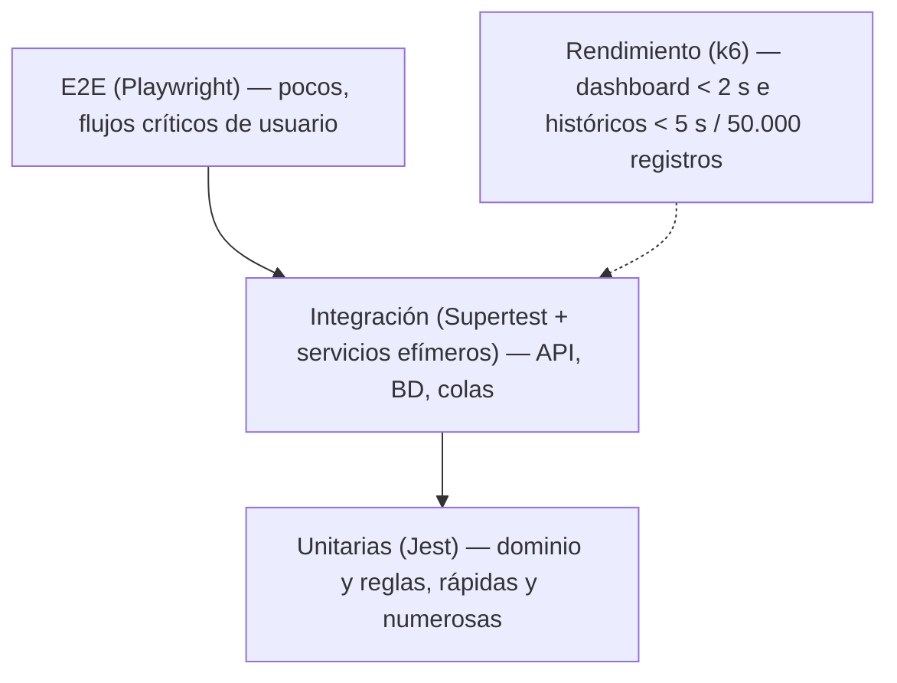
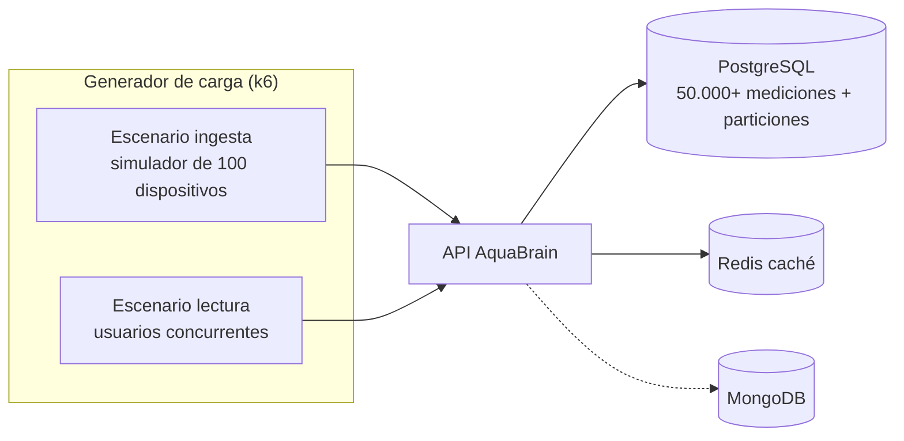
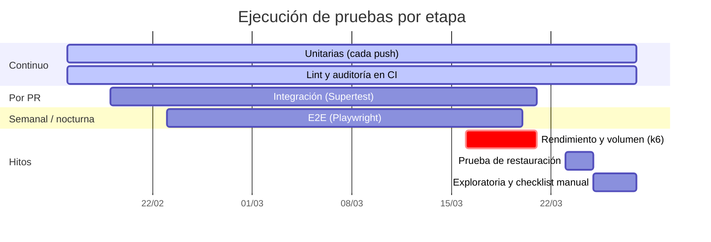

# ES2 · 07 — Plan de pruebas

El plan está **vinculado a los requisitos y casos de uso de ES1**: cada caso de prueba declara qué requisito verifica,
de modo que nunca exista una prueba huérfana ni un requisito sin prueba (verificación cruzada en `08-trazabilidad.md`).
El catálogo define **TS-01…TS-44**, citado por el resto de los documentos de ES2.

---

## 1. Objetivo y alcance

**Objetivo:** definir cómo se verificará que la implementación de ES3 cumple los requisitos funcionales y no funcionales de ES1, con evidencia reproducible y trazable.

**En alcance:**

- Lógica de negocio: autenticación, autorización por rol, validación de mediciones (incluido el tiempo), motor de reglas, gestión de alertas, detección de silencio de dispositivos, sincronización offline.
- API REST: contrato, códigos de estado (`201`/`400`/`401`), validación, errores e idempotencia.
- Persistencia: integridad, índices, particionado y volumen de datos.
- Interfaz web: procesos principales (login, dashboard, históricos/exportación, comparación, alertas, gestión).
- Rendimiento: dashboard (< 2 s) e históricos de 1 mes (< 5 s para 50.000 registros) — RNF03.
- Seguridad: controles técnicos y pruebas negativas (ver `06-seguridad.md` §5).

**Fuera de alcance:** regrabar el firmware del ESP32-S3 y modificar la app Android, penetración ofensiva formal, certificación de accesibilidad con usuarios reales, pruebas en navegadores obsoletos.

---

## 2. Estrategia de pruebas

### 2.1. Enfoque basado en riesgo

Se prueba con mayor profundidad y densidad lo que puede causar mayor daño:

| Prioridad de prueba | Área | Motivo |
|---|---|---|
| P1 | Ingesta + motor de reglas + alertas | Un fallo aquí invalida el propósito del sistema (dato perdido o alerta no emitida) |
| P1 | Autenticación y autorización | Un fallo aquí expone la operación completa |
| P2 | Consistencia del histórico y sincronización offline | Datos falsamente completos llevan a decisiones erróneas |
| P2 | Rendimiento de dashboard e históricos | Es el uso más frecuente y sensible a la escala (RNF03) |
| P3 | Gestión de datos maestros (CRUD) | Fallo molesto, con bajo impacto operacional |
| P3 | Cosméticos y accesibilidad avanzada | Se validan en la revisión de interfaz |

### 2.2. Pirámide de pruebas

| Nivel | Propósito | Herramienta | Cantidad objetivo | Frecuencia |
|---|---|---|---|---|
| **Unitarias** | Verificar la lógica de dominio aislada (reglas, frescura, validaciones de tiempo) | Jest | ~60 % del total de pruebas | Cada `commit` (pre-push) y CI |
| **Integración** | Verificar módulo + base de datos + autenticación reales | Jest + Supertest + PostgreSQL/Redis en contenedor | ~30 % | Cada PR en CI |
| **E2E** | Verificar el flujo visible para el usuario | Playwright | ~10 % (5 flujos críticos) | CI nocturna y antes de demo |
| **Rendimiento** | Verificar RNF02, RNF03 | k6 | 3 escenarios | Antes de ES3/ES4 |
| **Manual / exploratoria** | Evaluar usabilidad, accesibilidad y consistencia con el OLED | Checklist humano | Sesiones por sprint | Sprint Review |

### 2.3. Criterios de aceptación de ES1 que se traducen en casos

| Criterio de ES1 | Caso(s) de prueba |
|---|---|
| HU01 CA④ fecha y hora de la última medición | TS-37 |
| HU02 CA③ exportar los datos consultados | TS-38 |
| HU03 severidad + timestamp + marcar resuelta + registro histórico | TS-01, TS-02, TS-35 |
| HU04 comparación multi-sistema con leyenda y filtro de fechas | TS-39 |
| HU05 bcrypt y no eliminar la propia cuenta | TS-12, TS-19 |
| HU07 CA③ probar la regla con medición simulada | TS-06 |
| HU08 CA③/④ timestamp futuro, 201/400/401 | TS-10, TS-22 |
| HU10 CA① timestamps pasados | TS-11, TS-41 |
| HU11 documentación OpenAPI validada contra la app Android | TS-42 |
| RNF03 dashboard < 2 s; históricos 1 mes < 5 s / 50.000 registros | TS-43 |
| RNF10 cobertura ≥ 70 % | TS-44 |

### 2.4. Casos que el desafío exige cubrir explícitamente

| Aspecto exigido | Casos de prueba |
|---|---|
| Datos válidos e inválidos | TS-07, TS-20, TS-21, TS-30, TS-38 |
| Generación de alertas | TS-01…TS-06, TS-35 |
| Permisos | TS-16, TS-17, TS-18, TS-26 |
| Última comunicación del dispositivo | TS-09, TS-40 |
| Históricos | TS-38, TS-39 |
| Fallas de conexión simuladas | TS-32, TS-34, TS-41 |

---

## 3. Criterios de entrada, salida y suspensión

| Criterio | Definición |
|---|---|
| **Entrada** (para iniciar pruebas de un incremento) | Build compilado, migraciones aplicadas, semilla cargada, pipeline en verde y requisitos del incremento marcados como terminados |
| **Salida** (para declarar un incremento probado) | 100 % de casos P1 ejecutados y aprobados · 0 defectos de severidad Crítica o Alta abiertos · **cobertura de backend ≥ 70 % (RNF10)** · pipeline reproducible · evidencia registrada |
| **Suspensión** | Se detiene la ejecución si el entorno no está disponible, si un defecto Crítico bloquea más del 30 % de los casos o si los datos de prueba están inconsistentes |
| **Reanudación** | Tras corregir el bloqueo y volver a ejecutar los casos afectados más una regresión del área |

---

## 4. Entornos y datos de prueba

| Entorno | Uso | Datos |
|---|---|---|
| **Local** | Desarrollo y pruebas unitarias | Semilla mínima + datos generados por prueba |
| **CI (efímero)** | Integración en cada PR | Contenedores nuevos por ejecución; base de datos recreada; datos generados por la propia prueba |
| **Staging** | E2E, rendimiento y demo | Semilla ampliada: 100 dispositivos, 300 sensores, 50.000+ mediciones |
| **Producción académica** | Evaluación | Datos simulados cargados, claramente identificados como tales |

**Datos de prueba — reglas:**

- Se generan con semilla fija (`faker` con `seed`) para que un defecto sea reproducible.
- Nunca se usan datos personales reales ni credenciales reales de la empresa.
- Se precargan casos de borde: valor exactamente igual al umbral, valor en el límite del rango del sensor, medición duplicada, **timestamp en el futuro**, **timestamp en el pasado (offline)**, valor no numérico para una variable numérica, sensor inactivo, dispositivo desactivado.
- Los datos simulados se marcan como simulados en la interfaz (ver `06-seguridad.md` §7.3).

---

## 5. Catálogo de casos de prueba (TS-01…TS-44)

Leyenda · **Tipo:** U = unitaria, I = integración, E = E2E, P = rendimiento, M = manual.
**Prioridad:** P1 / P2 / P3 · **Automatización:** A = automatizada, M = manual.

### 5.1. Dominio y reglas de negocio

| ID | Descripción | Tipo | Prio | Auto | Requisito | Esperado |
|---|---|---|---|---|---|---|
| TS-01 | Regla `MAYOR_QUE`: medición 31 con umbral 30 en temperatura | U | P1 | A | RF11, RN-04 | Se genera alerta de la severidad configurada |
| TS-02 | Regla `FUERA_DE_RANGO`: medición 6,1 con rango [6,3; 7,5] | U | P1 | A | RF11 | Se genera alerta indicando el umbral aplicado |
| TS-03 | Dos mediciones que violan la misma regla dentro del cooldown | U/I | P1 | A | RF11, RN-04 | Solo se crea **una** alerta activa |
| TS-04 | Regla con `activa = false` | U | P1 | A | RF10, RF11 | No se genera ninguna alerta |
| TS-05 | Existen regla de sensor y de tipo de variable para el mismo sensor | U | P1 | A | RN-07 | Prevalece la regla del sensor |
| TS-06 | **Probar la regla** con una medición simulada antes de guardar | U/I | P1 | A | RF10, HU07 CA③ | Indica si dispararía, **sin** crear alerta ni persistir medición |
| TS-07 | Medición fuera del rango declarado del sensor | U/I | P1 | A | RF06, RNF01 | Se registra con `calidad = SOSPECHOSA` o se rechaza según configuración, sin corromper el histórico |
| TS-08 | Frescura del dato: 1 min, 4 min y 20 min con intervalo de 5 min | U | P1 | A | RF07, RN-05 | Fresco, fresco y **desactualizado** respectivamente |
| TS-09 | Derivación del estado de conexión según última comunicación | U | P1 | A | RF14, RN-05 | `EN_LINEA`, `SIN_COMUNICACION`, `INACTIVO` correctos |
| TS-10 | Envío de medición con **timestamp futuro** (> 5 min) | I | P1 | A | RN-09, HU08 CA③, RF06 | Rechazada; no se persiste |
| TS-11 | Envío de medición con **timestamp pasado** (offline) | I | P1 | A | RN-10, HU10 CA①, RF06 | Aceptada y persistida con su hora de origen |

### 5.2. Autenticación, autorización y seguridad

| ID | Descripción | Tipo | Prio | Auto | Requisito | Esperado |
|---|---|---|---|---|---|---|
| TS-12 | Política de contraseña y almacenamiento **bcrypt** | U | P1 | A | RNF01, HU05 CA③ | Hash bcrypt verificable; contraseña < 10 caracteres rechazada |
| TS-13 | 5 intentos fallidos de login en 15 min | I | P1 | A | RF01, RNF01 | Bloqueo temporal; respuesta genérica; auditoría de los intentos |
| TS-14 | Access token expirado | I | P1 | A | RF01, RNF01 | `401`; el refresh permite renovar |
| TS-15 | Reutilización de un refresh ya rotado | I | P1 | A | RNF01 | Se revoca la cadena de sesión y se exige login nuevo |
| TS-16 | Llamada a endpoint sin el permiso requerido | U/I | P1 | A | RF01, RNF01 | `403`, sin filtrar información |
| TS-17 | IDOR: encargado solicita una alerta o regla fuera de su ámbito/rol | I | P1 | A | RNF01 | `403`/`404`; la operación no se ejecuta |
| TS-18 | Un encargado intenta asignarse el rol administrador | I | P1 | A | RN-06, RF02 | `403`; el rol permanece sin cambios y queda auditoría |
| TS-19 | Un administrador intenta eliminar su propia cuenta | I | P1 | A | HU05 CA④, RN-06, RF02 | `403`/`409`; la cuenta permanece activa |
| TS-20 | Inyección en filtros de consulta (`?codigo=' OR 1=1--`) | I | P1 | A | RNF01 | No se ejecuta SQL inyectado; respuesta vacía o `422` |
| TS-21 | Petición con campo desconocido o de tipo incorrecto | I | P1 | A | RNF01 | `422` con detalle del campo; no se persiste nada |
| TS-22 | Códigos de respuesta de `POST /api/v1/mediciones` | I | P1 | A | HU08 CA④, RF06 | `201` en éxito, `400` en error de validación, `401` sin autenticación |
| TS-23 | Cabeceras de seguridad y CORS | I | P2 | A | RNF01 | Cabeceras presentes; origen no permitido rechazado |
| TS-24 | Análisis de dependencias | P/M | P2 | A | RNF06 | Sin vulnerabilidades altas o críticas sin mitigar |
| TS-25 | Intento de modificar o eliminar una medición vía API | I | P1 | A | RN-02, RF06 | No existe el endpoint; el usuario de API no tiene permiso en la base |
| TS-26 | Dispositivo intenta reportar con el sensor de otro dispositivo | I | P1 | A | RF06, RNF01 | `403`/`409`; no se persiste |
| TS-27 | Auditoría de cambio de regla y de marcado de alerta como resuelta | I | P1 | A | RNF11, RF10, RF12 | Registro con usuario, acción, entidad y hora |
| TS-28 | Rotación de API key de dispositivo | I | P1 | A | RF14, RF04 | La clave anterior deja de funcionar de inmediato |
| TS-29 | Escaneo de secretos en el repositorio | P/M | P2 | A | RNF01 | Sin secretos detectados |
| TS-30 | Envío de lote de 501 mediciones o cuerpo sobredimensionado | I | P2 | A | RNF01 | `413`/`422`; nada parcialmente persistido |
| TS-31 | Forzar un error interno | I | P2 | A | RNF01 | `500` genérico sin *stack trace*; el detalle queda en el log |
| TS-32 | *Health check* con el almacén no relacional caído | I | P2 | A | RNF02 | El servicio se declara operativo en modo degradado |
| TS-33 | Intento de XSS a través del mensaje de una alerta | I | P2 | A | RNF01 | El contenido se escapa; no se ejecuta script |
| TS-34 | Falla de MongoDB durante la ingesta | I | P1 | A | RA-05, RNF02 | La medición se persiste en PostgreSQL y se responde `201`; todo queda registrado |

### 5.3. Integración y flujos de extremo a extremo

| ID | Descripción | Tipo | Prio | Auto | Requisito | Esperado |
|---|---|---|---|---|---|---|
| TS-35 | Flujo completo: login → crear sistema/dispositivo/sensor → ingesta → alerta → marcar resuelta | E | P1 | A | RF01…RF12 | Cada paso con el estado y los registros esperados |
| TS-36 | Lote de 500 mediciones con 10 duplicados | I | P1 | A | RF06 | `207` con `aceptadas = 490`, `duplicadas = 10`, `rechazadas = 0` |
| TS-37 | Dashboard de estado actual | I | P1 | A | RF07, HU01 | Última medición por sensor, **fecha/hora**, frescura correcta y conteo de alertas activas |
| TS-38 | Histórico con agregación horaria y **exportación CSV** | I | P1 | A | RF08, HU02 CA③ | Serie agregada correcta; el CSV contiene los datos filtrados; rango > 90 días rechazado con `422` |
| TS-39 | Comparación multi-sistema de una variable común | I/E | P2 | A | RF09, HU04 | Series superpuestas con leyenda y filtro por rango de fechas |
| TS-40 | Job de detección de dispositivo sin comunicación | I | P2 | A | RF14, RN-05 | El dispositivo pasa a `SIN_COMUNICACION` y se crea evento/alerta |
| TS-41 | Sincronización offline con timestamps originales | I | P1 | A | RF06, RF14, RN-10 | Se conserva el `timestamp` de origen y `origen = OFFLINE` |
| TS-42 | Documentación OpenAPI versionada validada contra la app Android | I/M | P2 | A | RF13, HU11, RNF08 | Contrato en `/api/docs` con endpoints, esquemas, errores y ejemplos; responde como espera la app de prueba |

### 5.4. Rendimiento (detalle en §6)

| ID | Descripción | Tipo | Prio | Auto | Requisito | Umbral |
|---|---|---|---|---|---|---|
| TS-43 | Dashboard e históricos con volumen de la meta ES1 | P | P1 | A | RNF03 | Dashboard < **2 s**; históricos de 1 mes < **5 s** con **50.000 registros** |
| TS-44 | Disponibilidad y cobertura de pruebas | P/M | P1 | A/M | RNF02, RNF10 | Uptime ≥ **99 %** en 8:00–20:00 durante la ventana de prueba; cobertura de backend ≥ **70 %** |

---

### 5.5. Formato extendido de caso y estado de ejecución

El catálogo §5.1–§5.4 es el **resumen**; para la evidencia de ES3 cada caso se documenta con el formato completo:

| Campo | Contenido |
|---|---|
| ID | TS-xx |
| Título | Descripción breve |
| Requisito / CU | RFxx / CU-xx |
| Tipo y prioridad | U/I/E/P/M · P1/P2/P3 |
| Precondiciones | Estado del entorno y datos necesarios |
| Pasos | Secuencia numerada de acciones |
| Resultado esperado | Qué debe ocurrir |
| Resultado obtenido | Qué ocurrió realmente |
| Estado | Aprobado / Fallido / Bloqueado / No ejecutado |
| Evidencia | Reporte Jest/Supertest/k6/ZAP, captura o log con `correlation-id` |

**Ejemplos con el formato completo** (la columna "resultado obtenido" queda pendiente: se ejecuta en ES3):

| ID | Pasos | Resultado esperado | Resultado obtenido | Estado | Evidencia |
|---|---|---|---|---|---|
| TS-12 | 1) Registrar usuario con contraseña de 9 caracteres · 2) reintentar con 12 · 3) verificar el hash en la BD | 9 caracteres rechazado; 12 aceptado; el hash bcrypt ≠ contraseña | — | Pendiente (ES3) | Reporte Jest + captura |
| TS-01 | 1) Crear sensor de temperatura y regla `MAYOR_QUE 30` · 2) ingresar 31 · 3) consultar alertas | Alerta con la severidad configurada creada | — | Pendiente (ES3) | Reporte Jest |
| TS-43 | 1) Cargar 50.000 mediciones · 2) ejecutar k6 sobre dashboard e históricos | Dashboard < 2 s; históricos de 1 mes < 5 s | — | Pendiente (ES3) | Reporte k6 |

> **Nota de alcance:** ES2 es la fase de **diseño**; por eso el catálogo define pasos y resultados **esperados**, y las
> columnas "resultado obtenido / estado / evidencia" se completan en **ES3** (implementación), conforme al registro de
> ejecución de §8. No se declaran resultados que no se hayan ejecutado.

## 6. Prueba de rendimiento y de volumen

### 6.1. Escenario de carga

| Parámetro | Valor |
|---|---|
| Volumen precargado | **≥ 50.000 mediciones** en 1 mes de histórico, 300 sensores, 100 dispositivos |
| Escenario 1 — ingesta | Solicitudes/s del simulador de 100 dispositivos durante 5 minutos, *ramp-up* de 30 s |
| Escenario 2 — lectura | Usuarios virtuales alternando dashboard y consulta de históricos de 1 mes |
| Escenario 3 — mixto | 20 % ingesta / 80 % lectura durante 5 minutos (representa la operación real) |
| Éxito por solicitud | HTTP 2xx dentro del umbral de RNF03 |
| Métricas | p50, p95, p99, tasa de error, *throughput*, uso de CPU/memoria del contenedor |

### 6.2. Umbrales de aceptación (valores de ES1 / RNF03 y RNF02)

| Métrica | Objetivo | Requisito |
|---|---|---|
| `GET /dashboard/estado` | < **2 s** | RNF03 |
| `GET /mediciones/serie` (1 mes, agregación) con **50.000 registros** | < **5 s** | RNF03 |
| Tasa de error bajo carga nominal | < 1 % | RNF03 |
| Disponibilidad en horario 8:00–20:00 | ≥ **99 %** | RNF02 |
| Cobertura de pruebas del backend | ≥ **70 %** | RNF10 |

### 6.3. Volumen simulado a documentar (ES3)

El informe deberá registrar: cantidad de dispositivos, sensores, mediciones, rango temporal, intervalo de reporte, tamaño de la base antes y después, y recursos consumidos. Esto da respuesta directa a la exigencia del desafío de **dejar documentado el volumen simulado** y de **realizar una prueba de carga razonable**.

---

## 7. Herramientas: qué se automatiza y qué se prueba manualmente

| Herramienta | Tipo | Qué cubre | Por qué se elige |
|---|---|---|---|
| **Jest** | A | Pruebas unitarias (dominio, reglas, validaciones, guardas) | Integrado con TypeScript, rápido, ampliamente documentado |
| **Supertest** | A | Pruebas de integración de la API contra base de datos real | Ejercita el contrato HTTP completo sin navegador |
| **Playwright** | A | 5 flujos E2E críticos (login, dashboard, histórico+exportación, alerta, gestión de regla con prueba) | Multi-navegador, espera activa, capturas como evidencia |
| **k6** | A | Rendimiento y volumen (RNF03) | Escenarios en JavaScript, métricas p95/p99 y umbrales declarativos |
| **Postman / Swagger UI** | A/M | Exploración manual del contrato durante el desarrollo y validación con la app Android | Retroalimentación inmediata al programar |
| **GitHub Actions** | A | Ejecución en CI: lint, unitarias, integración, build, cobertura, auditoría de dependencias y secretos | Bloquea el *merge* si algo falla |
| **npm audit + Dependabot** | A | Vulnerabilidades en dependencias | Bajo costo, alto valor |
| **gitleaks** | A | Secretos filtrados en el repositorio | Previene fuga de credenciales (RSK-05) |
| **Revisión manual con checklist** | M | Usabilidad, accesibilidad, consistencia visual y **consistencia con el OLED**, mensajes de error | Ninguna herramienta reemplaza el juicio sobre la experiencia |
| **Sesión exploratoria guiada** | M | Casos no previstos y combinaciones raras | Descubre lo que el catálogo no anticipó |
| **Prueba de restauración de respaldo** | M | RNF02 | Verifica que el respaldo sirve, no solo que existe |

### 7.1. Distribución de la ejecución

---

## 8. Gestión de defectos

| Severidad | Definición | Ejemplo | Plazo de corrección |
|---|---|---|---|
| **Crítica** | Impide usar una función esencial o compromete la seguridad/integridad | No se generan alertas; un rol puede administrar usuarios; pérdida de mediciones | Inmediata, bloquea la entrega |
| **Alta** | Una función principal falla sin alternativa razonable | El dashboard no muestra la última medición; la sincronización duplica datos | Antes del cierre de la iteración |
| **Media** | Función secundaria con alternativa de trabajo | El filtro de fecha no recuerda el rango; exportación CSV con formato imperfecto | Iteración siguiente |
| **Baja** | Cosmético o de bajo impacto | Texto desalineado; ícono incorrecto | Cuando haya capacidad |

**Ciclo de vida:** `Nuevo → Confirmado → En corrección → En verificación → Cerrado` (o `Rechazado` con justificación).
**Evidencia obligatoria:** pasos de reproducción, resultado esperado, resultado obtenido, entorno, captura y `correlation-id` del log.

**Registro de ejecución (formato que se usará en ES3):**

| Campo | Descripción |
|---|---|
| ID del caso | TS-xx |
| Fecha y ejecutor | Quién y cuándo |
| Versión/build | Commit o etiqueta |
| Resultado esperado | Del catálogo |
| Resultado obtenido | Observado |
| Estado | Aprobado / Fallido / Bloqueado / No ejecutado |
| Evidencia | Captura, log, reporte de k6 |
| Observaciones | Desviaciones y causa probable |

---

## 9. Métricas y cobertura

| Métrica | Objetivo |
|---|---|
| Cobertura de líneas del backend | ≥ **70 %** (RNF10) |
| Cobertura del módulo de reglas y validaciones | ≥ 85 % (es el corazón del negocio) |
| Requisitos `Must` con al menos una prueba | 100 % |
| Casos P1 ejecutados al cierre de ES3 | 100 % |
| Defectos Críticos/Altos abiertos al cierre | 0 |
| Cobertura objetivo de pruebas | Trazabilidad RF → TS sin huecos (ver `08-trazabilidad.md`) |

---

## 10. Riesgos del plan de pruebas

| ID | Riesgo | Impacto | Mitigación |
|---|---|---|---|
| RP-01 | El volumen de datos no cabe en el plan gratuito | RNF03 no verificable | Ejecutar la prueba en local con `docker-compose` y documentar el ambiente usado |
| RP-02 | Pruebas de integración lentas y frágiles | Menos ejecuciones | Base efímera por suite, datos deterministas, paralelización por módulo |
| RP-03 | El E2E depende de datos precargados | Falsos fallos | Cada prueba crea su propio dato vía API antes de interactuar con la interfaz |
| RP-04 | Falta de tiempo en la última semana | Pruebas P3 sin ejecutar | Congelar alcance y priorizar P1/P2; el resto se documenta como pendiente |
| RP-05 | Nadie ejecuta la prueba de restauración | RNF02 sin verificar | Se agenda como tarea con responsable nominado antes de ES3 |
| RP-06 | El formato del firmware real difiere del simulador | Falsos negativos en ingesta | Se prueba con un payload real capturado del ESP32-S3 (RN-11) |
