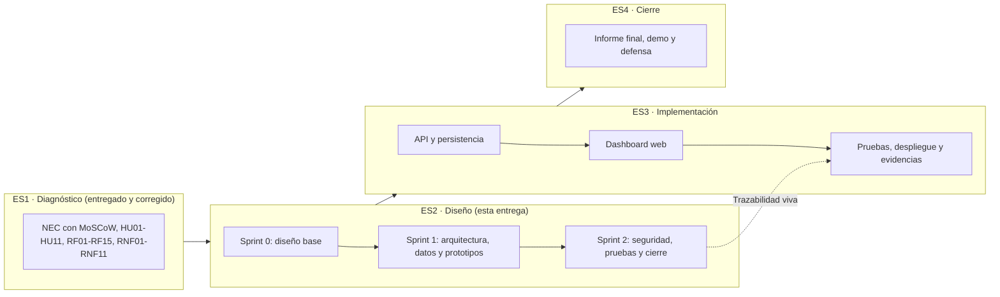
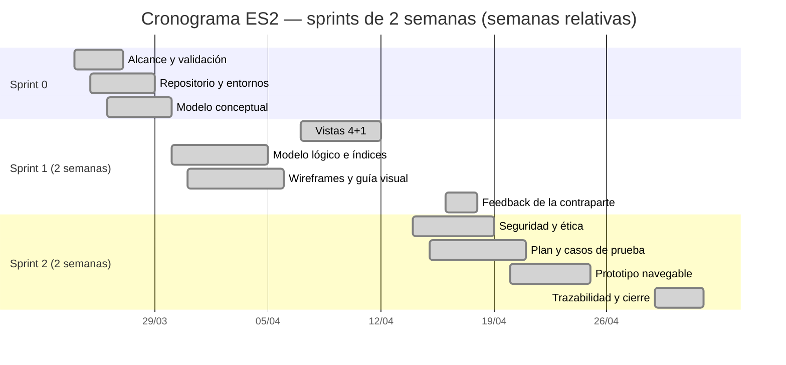
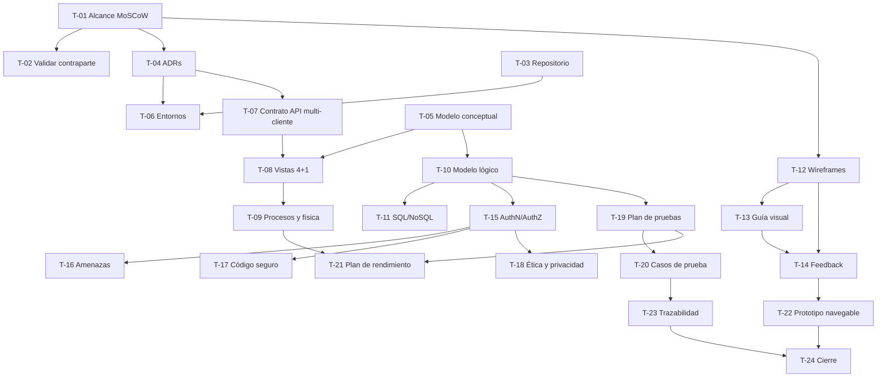

# 02 · Metodología, cronograma y dependencias

## 2.1. Metodología seleccionada: Scrum con sprints de dos semanas

La metodología fue seleccionada y justificada en ES1 mediante una comparación con criterios y puntajes
homogéneos (escala 1–5). ES2 **no la reabre**: la adopta, describe **cómo se opera** y la traduce en un
cronograma con responsables, entregables y fechas.

### 2.1.1. Criterios y puntajes (los mismos de ES1, para mantener la coherencia)

| Criterio (escala 1–5) | Scrum | Scrumban | Kanban |
|---|:--:|:--:|:--:|
| Adaptabilidad a cambios | 4 | 5 | 5 |
| Trazabilidad y puntos de revisión | 5 | 4 | 3 |
| Claridad de roles | 5 | 3 | 2 |
| Manejo de incertidumbre técnica (hardware, API, integración) | 4 | 5 | 4 |
| Entregables demostrables por iteración | 5 | 4 | 3 |
| Adecuación a equipo pequeño | 4 | 4 | 5 |
| **Total** | **27** | **25** | **22** |

**Decisión (D-01):** **Scrum**. Obtiene el mayor puntaje y garantiza hitos de revisión obligatorios,
condición necesaria para un equipo de tres integrantes que debe integrarse con hardware real, una API y
clientes ya existentes. Scrumban y Kanban son más flexibles, pero no aseguran esos puntos de control.

### 2.1.2. Cómo se aplica Scrum en este proyecto

| Elemento | Definición en este proyecto |
|---|---|
| **Product Backlog** | `docs/ES1/00-backlog-base.md` — HU01…HU11 priorizadas con MoSCoW |
| **Sprint Backlog** | Subconjunto de HU/RF comprometidos por iteración (§2.3) |
| **Sprint** | **2 semanas** |
| **Sprint Planning** | 90 minutos al inicio de cada sprint; se selecciona por MoSCoW y capacidad |
| **Daily** | 15 minutos asíncrono + 1 checkpoint presencial semanal |
| **Sprint Review** | Demo funcional al cierre; queda como evidencia de la iteración |
| **Retrospectiva** | 30 minutos; una acción de mejora concreta con responsable |
| **Rol Product Owner** | Rodrigo Terraza — prioriza el backlog y valida con la contraparte |
| **Rol Scrum Master** | Benjamín Espinoza — facilita ceremonias y elimina bloqueos |
| **Equipo de desarrollo** | Los tres integrantes implementan y revisan |
| **Tablero** | GitHub Projects: `Backlog · To Do · In Progress · Review · Done`, *swimlane* por HU |
| **Definición de Terminado (DoD)** | Código aprobado por *pull request* de otro integrante, pruebas del nivel correspondiente en verde, contrato OpenAPI actualizado, documentación al día y trazabilidad marcada |

### 2.1.3. Por qué no Scrumban ni Kanban (justificación cualitativa)

| Metodología | Ventajas | Desventajas | Decisión |
|---|---|---|---|
| **Scrum** | Estructura clara, roles definidos, revisiones constantes, avances demostrables | Reuniones frecuentes y mayor disciplina | **Seleccionada** |
| Scrumban | Alta flexibilidad, buena para tareas inciertas como la integración con hardware | Depende de la autodisciplina al no tener reuniones fijas | Descartada: se priorizan los puntos de revisión |
| Kanban | Proceso simple, mínima carga | Sin hitos de revisión es difícil detectar desviaciones tempranas | Descartada: menor trazabilidad para este contexto |

**Capacidad considerada:** 3 integrantes × ~12 h/semana = **36 h/semana → 72 h por sprint de 2 semanas**.

### 2.1.4. Ceremonias, duración y artefactos

Cada ceremonia existe para producir un artefacto concreto, y la DoD se verifica en cada *Review*.

| Ceremonia | Frecuencia | Duración | Artefacto que produce |
|---|---|---|---|
| Refinamiento de backlog | Semanal | 1 h | Backlog priorizado y estimado |
| Sprint Planning | Inicio de cada sprint | 2 h | Sprint Backlog y meta del sprint |
| Daily Scrum | Diario (asíncrono) + 1 checkpoint semanal | 15 min | Tablero actualizado y bloqueos identificados |
| Sprint Review | Cierre de cada sprint | 1 h | Incremento demostrable (demo funcional) |
| Sprint Retrospective | Cierre de cada sprint | 45 min | Plan de mejora con una acción concreta y responsable |
| Revisión cruzada (*pull request*) | Continuo | — | Código revisado y trazabilidad marcada |

## 2.2. Fases y relación con las evaluaciones

## 2.3. Cronograma por iteraciones

> `S1 … S5` = semanas relativas. La fecha absoluta de cada semana es `24-mar-2026 + (Semana − 1) × 7
> días` (fecha de inicio acordada). Referencias de MoSCoW: **(M)** Must · **(S)** Should · **(C)**
> Could · **(W)** Won't.

### 2.3.1. Calendario con fechas exactas

Fecha de inicio acordada: **lunes 24-mar-2026** (cada sprint dura dos semanas / 10 días hábiles). Si el
calendario académico cambia el inicio, todas las fechas se desplazan de forma uniforme.

| Sprint | Inicio (lun) | Fin (vie) | Review / Demo | Objetivo | Entregable |
|---|---|---|---|---|---|
| **Sprint 0** | 24-mar-2026 | 03-abr-2026 | 03-abr-2026 | Preparación y diseño base | Alcance, ADR, modelo conceptual, entornos |
| **Sprint 1** | 06-abr-2026 | 17-abr-2026 | 17-abr-2026 | Arquitectura, datos y prototipos | Vistas 4+1, DER, wireframes, guía visual |
| **Sprint 2** | 20-abr-2026 | 01-may-2026 | 01-may-2026 | Seguridad, pruebas y cierre | **Entrega del documento ES2** |
| **Sprint 3** | 04-may-2026 | 15-may-2026 | 15-may-2026 | Identidad y datos maestros (ES3) | RF01–RF05 |
| **Sprint 4** | 18-may-2026 | 29-may-2026 | 29-may-2026 | Ingesta, dashboard y alertas (ES3) | RF06, RF07, RF10–RF12 |
| **Sprint 5** | 01-jun-2026 | 12-jun-2026 | 12-jun-2026 | Históricos, endurecimiento y cierre (ES3) | RF08, RF09, RF13, RF14 |

> El diseño (Sprints 0–2) se entrega como **ES2**; la implementación (Sprints 3–5) corresponde a **ES3**.

### 2.3.2. Actividades por sprint

**Sprint 0 — Preparación y diseño base · Semanas 1–2**

| # | Actividad | Responsable | Entregable | Depende de | Prioridad |
|---|---|---|---|---|---|
| T-01 | Confirmar alcance ES2 contra el backlog corregido y fijar MoSCoW de la iteración | Rodrigo (PO) | Backlog ES2 priorizado | ES1 corregido | M |
| T-02 | Validar con la contraparte la interpretación de RF15, del contrato de la app Android y de las variables (SUP-01/09/10) | Rodrigo (PO) | Acta de validación | T-01 | M |
| T-03 | Crear monorepo, ramas protegidas, plantilla de PR y tablero | Benjamín (SM) | Repositorio operativo | — | M |
| T-04 | Registrar decisiones de arquitectura (ADR-001…ADR-015) | Benjamín, Luis | `docs/` con ADR | T-01 | M |
| T-05 | Modelo conceptual del dominio revisado contra el hardware real | Luis | Borrador de entidades y cardinalidades | ES1 corregido | M |
| T-06 | Entornos: `docker-compose`, `.env.example`, base local y nube de desarrollo | Luis | Entorno reproducible | T-03 | M |
| T-07 | Definir la estrategia de contrato API para los tres clientes | Benjamín | Decisión D-13 documentada | T-04 | S |

**Sprint 1 — Arquitectura, datos y prototipos · Semanas 3–4**

| # | Actividad | Responsable | Entregable | Depende de | Prioridad |
|---|---|---|---|---|---|
| T-08 | Vistas 4+1: escenarios y lógica | Benjamín | Cap. 03 §3.3–§3.4 | T-05 | M |
| T-09 | Vistas 4+1: procesos y física | Luis | Cap. 03 §3.5–§3.7 | T-08 | M |
| T-10 | Modelo lógico: tablas, claves, integridad, índices y particionado | Luis | DER + diccionario de datos | T-05 | M |
| T-11 | Decisión SQL/NoSQL y *landing zone* del payload del firmware | Luis | Cap. 06 §6.7 | T-10 | S |
| T-12 | Wireframes: dashboard, históricos, comparación, alertas, reglas y dispositivos | Rodrigo | Wireframes + mapa de navegación | T-01 | M |
| T-13 | Guía visual, tokens, componentes y contraste con el display OLED | Rodrigo | Guía visual aplicable | T-12 | M |
| T-14 | Revisión del prototipo con la contraparte y un usuario del perfil "encargado" | Rodrigo (PO) | Registro de feedback FB-xx | T-12, T-13 | S |

**Sprint 2 — Seguridad, pruebas y cierre de la entrega · Semanas 5–6**

| # | Actividad | Responsable | Entregable | Depende de | Prioridad |
|---|---|---|---|---|---|
| T-15 | Políticas de autenticación y autorización, roles, permisos y matriz por endpoint | Benjamín | Cap. 07 §7.2–§7.3 | T-10 | M |
| T-16 | Amenazas (OWASP Top 10 + STRIDE) y riesgos priorizados | Benjamín | Cap. 07 §7.5 | T-15 | M |
| T-17 | Estándares de codificación segura y checklist de PR | Luis | Cap. 07 §7.6 | T-15 | M |
| T-18 | Impacto ético, privacidad y cumplimiento — **RNF11** | Rodrigo | Cap. 07 §7.7 | T-15 | M |
| T-19 | Plan de pruebas: niveles, herramientas, criterios de entrada/salida | Luis | Cap. 08 §8.2–§8.4 | T-10, T-15 | S |
| T-20 | Casos de prueba trazados a RF/CU | Luis, Benjamín | Catálogo TS-01…TS-44 | T-19 | S |
| T-21 | Plan de rendimiento con los umbrales de RNF03 | Benjamín | Cap. 08 §8.6 | T-19, T-09 | S |
| T-22 | Prototipo navegable de alta fidelidad de los flujos principales | Rodrigo | Prototipo + cambios aplicados | T-14 | M |
| T-23 | Matriz de trazabilidad completa y verificación de huecos | Rodrigo | Cap. 09 sin celdas vacías | T-20 | M |
| T-24 | Revisión cruzada del documento ES2 y checklist de entrega | Todos | Checklist de calidad | T-23, T-22 | M |

> **Régimen de trabajo:** cada sprint cierra con una demostración. En Sprint 1 se demuestran los
> wireframes y el modelo de datos; en Sprint 2, el prototipo navegable, la matriz de seguridad y el plan
> de pruebas.

### 2.3.3. Vista temporal (Gantt)

## 2.4. Dependencias entre tareas

**Ruta crítica:** `T-01 → T-05 → T-10 → T-15 → T-19 → T-20 → T-23 → T-24` y, en paralelo, la rama de
prototipos `T-01 → T-12 → T-13 → T-14 → T-22 → T-24`. Un atraso en **T-05 (modelo conceptual)** o
**T-10 (modelo lógico)** afecta simultáneamente seguridad y pruebas: por eso el modelo se congela al
final de Sprint 1 y todo cambio posterior pasa por ADR y migración versionada.

### 2.4.1. Matriz de dependencias (predecesor → sucesor)

Tipo de relación: **Fin–Inicio** (la sucesora no comienza hasta que termina la predecesora).

| Tarea predecesora | Tarea(s) sucesora(s) | Tipo |
|---|---|---|
| T-01 Alcance ES2 | T-02; T-04; T-12 | Fin–Inicio |
| T-03 Repositorio | T-06 Entornos | Fin–Inicio |
| T-04 ADR | T-06 Entornos; T-07 Contrato API | Fin–Inicio |
| T-05 Modelo conceptual | T-08 Vistas 4+1; T-10 Modelo lógico | Fin–Inicio |
| T-07 Contrato API | T-08 Vistas 4+1 | Fin–Inicio |
| T-08 Vistas lógica/escenarios | T-09 Procesos y física | Fin–Inicio |
| T-09 Procesos y física | T-21 Plan de rendimiento | Fin–Inicio |
| T-10 Modelo lógico | T-11; T-15; T-19 | Fin–Inicio |
| T-15 AuthN/AuthZ | T-16; T-17; T-18 | Fin–Inicio |
| T-12 Wireframes | T-13 Guía visual; T-14 Feedback | Fin–Inicio |
| T-13 Guía visual | T-14 Feedback | Fin–Inicio |
| T-14 Feedback | T-22 Prototipo navegable | Fin–Inicio |
| T-19 Plan de pruebas | T-20 Casos de prueba; T-21 | Fin–Inicio |
| T-20 Casos de prueba | T-23 Trazabilidad | Fin–Inicio |
| T-22; T-23 | T-24 Cierre del documento | Fin–Inicio |

### 2.4.2. Riesgos de cronograma

| ID | Riesgo | Prob. | Impacto | Mitigación / contingencia |
|---|---|---|---|---|
| RC-01 | Cambia el modelo de datos por validación tardía con la contraparte | Media | Alto | Congelar al cierre de Sprint 1; cambios con ADR y migración versionada |
| RC-02 | Subestimar la curva de NestJS/Prisma y del contrato de la app Android | Media | Alto | Tutorial interno en Sprint 0; si hay desviación, se prioriza Must y se recorta Could (RF09) |
| RC-03 | No se obtiene el contrato real de la app Android (SUP-10) | Media | Medio | Documentar `/api/v1` y dejar capa de compatibilidad si fuese necesario |
| RC-04 | Planes gratuitos con hibernación o cuota | Alta | Medio | *Health check* programado; `docker-compose` local como respaldo para la demo |
| RC-05 | Semana de evaluaciones en paralelo | Alta | Medio | La carga alta se concentra en Sprint 1; el cierre de Sprint 2 es mayormente documental |

## 2.5. Prioridades y compromiso de alcance (MoSCoW)

| Prioridad | Alcance | Requisitos |
|---|---|---|
| **Must (comprometido)** | Auth + RBAC, gestión de usuarios/sistemas/dispositivos/sensores, ingesta API, dashboard, reglas y alertas | RF01–RF07, RF10–RF12 · RNF01, RNF05, RNF06, RNF11 |
| **Should (si la capacidad lo permite)** | Históricos con filtros y exportación, documentación OpenAPI, estado de conexión, disponibilidad, rendimiento, portabilidad, interoperabilidad y pruebas | RF08, RF13, RF14 · RNF02, RNF03, RNF07, RNF08, RNF10 |
| **Could (deseable)** | Comparativa gráfica multi-sistema | RF09 |
| **Won't (por ahora)** | Licenciamiento; escalabilidad masiva y autonomía local (solo se documentan) | RF15 · RNF04, RNF09 |

## 2.6. Priorización por valor y riesgo

MoSCoW por sí solo no ordena el trabajo: una necesidad *Should* con riesgo alto puede subir de turno.
Por eso se combina con una priorización que cruza valor de negocio, urgencia, riesgo de no atender y
factibilidad.

| Necesidad | Valor de negocio | Urgencia | Riesgo de no atender | Factibilidad | Prioridad final |
|---|---|---|---|---|---|
| Centralización de datos (NEC-01) | Alto | Alta | Alto | Alta | 1 |
| Ingesta desde el firmware real (RF06) | Alto | Alta | Alto | Media-Alta | 2 |
| Dashboard de estado actual (RF07) | Alto | Alta | Medio | Alta | 3 |
| Autenticación y roles (RF01–RF05) | Alto | Alta | Alto | Alta | 4 |
| Motor de alertas (RF10–RF12) | Medio-Alto | Media | Alto | Media | 5 |
| API-first para la app Android (RF13) | Medio | Media | Medio | Alta | 6 |
| Operación offline y reintentos (RF14) | Medio | Media | Medio | Media | 7 |
| Históricos y comparativas (RF08, RF09) | Medio | Baja | Bajo | Alta | 8 |
| Escalabilidad masiva (NEC-09 / RNF04) | Bajo | Baja | Bajo | Media | 9 |

## 2.7. Orden de ejecución en ES3 (derivado de este cronograma)

1. **Sprint 3:** RF01, RF02, RF03, RF04, RF05 (fundaciones: identidad y datos maestros).
2. **Sprint 4:** RF06, RF07, RF10, RF11, RF12 (corazón del sistema: ingesta, dashboard y alertas).
3. **Sprint 5:** RF08, RF13, RF14 (Should) y RF09 (Could si el tiempo lo permite).
4. **Sprint 6:** endurecimiento de seguridad, pruebas de carga con RNF03, despliegue y evidencias.
