# 03 · Arquitectura 4+1

El modelo **4+1** describe la arquitectura desde cinco puntos de vista complementarios: **escenarios**
(el que amarra todo), **lógica**, **procesos**, **desarrollo** y **física**. Cada vista responde una
pregunta distinta y se referencia con el catálogo corregido de ES1 (NEC-01…NEC-09, HU01…HU11,
RF01…RF15, RNF01…RNF11, CU-01…CU-16, RN-01…RN-12).

| Vista | Pregunta que responde | Audiencia | Sección |
|---|---|---|---|
| Escenarios | ¿Para qué sirve y qué flujos soporta? | Cliente y todo el equipo | §3.3 |
| Lógica | ¿Qué componentes y responsabilidades existen? | Desarrolladores | §3.4 |
| Procesos | ¿Cómo colaboran y qué pasa en tiempo de ejecución? | Desarrolladores y QA | §3.5 |
| Desarrollo | ¿Cómo se organiza el código y el trabajo? | Equipo | §3.6 |
| Física | ¿Dónde se ejecuta todo? | DevOps / infraestructura | §3.7 |

## 3.1. Restricciones arquitectónicas de entrada

Las restricciones **RA-01…RA-08** (cap. 01 §1.4), aquí con su justificación de arquitectura:

| ID | Restricción | Origen | Implicancia de arquitectura |
|---|---|---|---|
| RA-01 | Aceptar el formato del **firmware real ESP32-S3** | NEC-04, RF06, RN-11 | El contrato de ingesta se define desde el payload real (AHT10/HC-SR04) |
| RA-02 | API **versionada y documentada** | NEC-05, RF13, RNF08 | `/api/v1` + OpenAPI; la app Android es cliente de primera clase |
| RA-03 | **Aceptar timestamps pasados** y **rechazar futuros** | RN-09, RN-10, HU08, HU10 | Validación de tiempo explícita antes de persistir |
| RA-04 | No contradecir el **display OLED local** | RNF05, RN-12 | Una sola fuente de verdad para el estado |
| RA-05 | La ingesta no se bloquea por alertas ni por el crudo | RF06, RF11 | Ingesta síncrona mínima; evaluación y crudo fuera de la ruta crítica |
| RA-06 | Histórico **inmutable** y creciente | RN-02, NEC-09 | Tabla *append-only* particionada |
| RA-07 | Despliegue **reproducible** en Docker/PaaS | RNF07 | Contenedor sin estado + configuración por entorno |
| RA-08 | **Degradación controlada** y aviso de conexión | RNF02, RF14 | PostgreSQL es la fuente de verdad; externos *best-effort* |

## 3.2. Principio rector: monolito modular en capas

La decisión **D-02** fija una arquitectura **cliente-servidor en capas** con **módulos de dominio
cohesivos** (estilo *modular monolith*). El objetivo es doble: (1) mantener el dominio pequeño y
cohesionado, propio de un equipo de tres personas; y (2) dejar preparada la extracción futura de
servicios (p. ej. el módulo de ingesta) si la escala lo exige (NEC-09). **Regla de dependencia:** las
capas externas dependen de las internas, nunca al revés; el dominio no conoce HTTP, SQL ni MongoDB, por
lo que puede probarse de forma unitaria y pura (RNF06).

## 3.3. Vista de escenarios (casos de uso)

Los escenarios son los casos de uso de ES1 (**CU-01…CU-16**). Se destacan los que **atraviesan toda la
arquitectura**.

### 3.3.1. Escenarios arquitectónicamente significativos

| Escenario | Descripción | Componentes que atraviesa | Requisitos |
|---|---|---|---|
| **E-1 · Ingesta y alerta** | Un dispositivo reporta una medición; el sistema la valida, persiste, evalúa reglas y genera alerta | Gateway IoT → Servicio de mediciones → Motor de reglas → Repositorios → Cola de notificación | RF06, RF11, RF12, CU-06, CU-07, HU08 |
| **E-2 · Estado actual** | El encargado abre el dashboard y ve la última medición por sensor con frescura del dato | SPA → API de lectura → Servicio de consultas → Vista de última medición | RF07, CU-08, HU01 |
| **E-3 · Histórico y comparación** | El encargado filtra un rango y exporta; el supervisor compara varios sistemas | SPA → API de históricos → Agregación SQL y caché | RF08, RF09, CU-09, CU-10, HU02, HU04, RNF03 |
| **E-4 · Autenticación y autorización** | Un usuario inicia sesión y cada petición se autoriza por permiso | SPA → Servicio de identidad → Guardia de autorización → Repositorio de usuarios | RF01, RF02, CU-01, CU-02, HU05, RNF01 |
| **E-5 · Sincronización offline** | Tras una caída, el dispositivo reenvía un lote con timestamps originales | Buffer local → Gateway IoT → Servicio de mediciones (idempotente) → Motor de reglas | RF06, RF14, CU-14, HU10, RN-10 |
| **E-6 · Estado de conexión** | Se detecta un dispositivo que dejó de reportar y se refleja en dashboard y listado | Job programado → Servicio de dispositivos → Servicio de alertas | RF14, CU-13, RN-05 |
| **E-7 · Integración documentada** | El desarrollador de integraciones consume la API versionada desde la app Android | Cliente externo → OpenAPI `/api/docs` → Endpoints `/api/v1` | RF13, CU-15, HU11, RNF08 |

### 3.3.2. Diagrama de escenarios (actores y casos de uso)

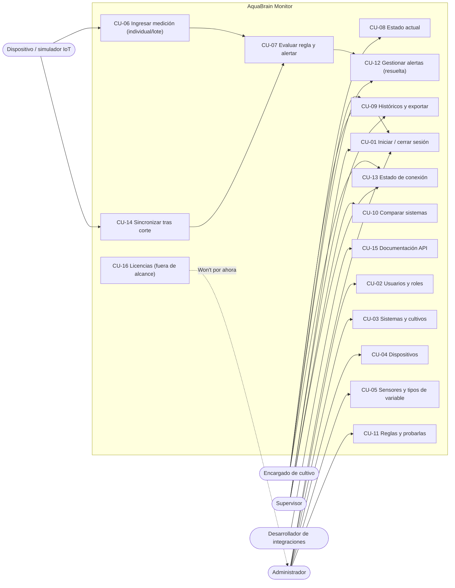

> **Nota (UML):** todos los casos protegidos **`<<include>>` autenticarse** (CU-01); **CU-07** es un
> **`<<extend>>` de CU-06**, que a su vez puede derivar en CU-12 (resolver alerta). CU-16 se incluye
> solo para mostrar que el licenciamiento quedó **fuera de alcance** (*Won't por ahora*).

### 3.3.3. Cómo los escenarios justifican las decisiones

- **E-1** exige separar la **persistencia** de la **evaluación de reglas** y del **guardado crudo**
  (RA-05): el endpoint de ingesta responde `201` apenas el dato está validado y persistido.
- **E-2 y E-3** exigen una **vista de lectura optimizada** para "última medición" y **agregación en
  base de datos** (RA-06, RNF03), en lugar de traer miles de filas al backend.
- **E-4** exige que la autorización sea **declarativa por permiso** (`@RequirePermission`), no dispersa
  en controladores.
- **E-5** exige **idempotencia** con `(dispositivo_id, id_externo)` único (RA-06) y validación de tiempo
  (RA-03).
- **E-7** exige tratar el **contrato OpenAPI como parte del diseño** (D-13), no como documentación
  tardía.

## 3.4. Vista lógica

### 3.4.1. Capas

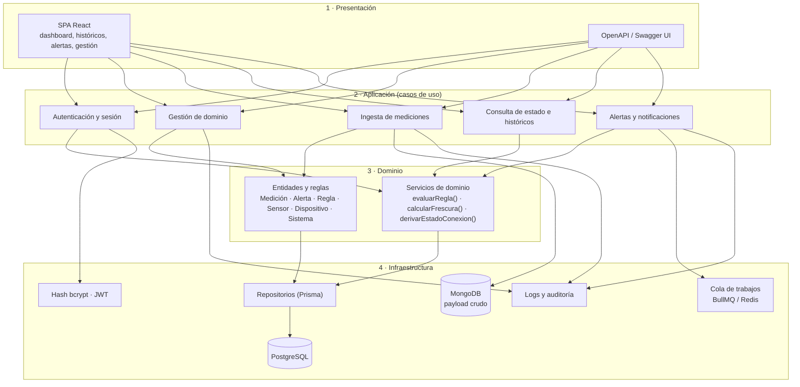

### 3.4.2. Módulos y responsabilidades

| Módulo | Capa | Responsabilidad | Requisitos | Depende de |
|---|---|---|---|---|
| `auth` | Aplicación | Login, refresco, logout, hash **bcrypt**, emisión de JWT | RF01, RNF01 | `usuarios`, `seguridad` |
| `rbac` | Aplicación | Guardias por rol/permiso y matriz de autorización | RF01, RF02, RNF01 | `auth` |
| `usuarios` | Dominio/Infra | CRUD de usuarios y roles, bloqueo por intentos fallidos | RF01, RF02, HU05 | — |
| `sistemas` | Dominio/Infra | CRUD de sistemas/instalaciones y cultivos/plantas | RF03, NEC-01 | — |
| `dispositivos` | Dominio/Infra | CRUD de dispositivos y sensores, API keys, estado y última comunicación | RF04, RF05, RF14 | `sistemas` |
| `mediciones` | Aplicación | Ingesta individual y por lote, validación de tiempo/formato, idempotencia, *landing zone* y tablas relacionales | RF06 | `dispositivos`, `alertas` |
| `alertas` | Aplicación/Dominio | Motor de reglas, CRUD de reglas, generación y gestión de alertas, *cooldown* | RF10, RF11, RF12 | `mediciones`, `notificaciones` |
| `consultas` | Aplicación | Estado actual, históricos agregados, comparación multi-sistema, exportación CSV | RF07, RF08, RF09 | `mediciones` |
| `notificaciones` | Infra | Cola de trabajos, aviso en interfaz (extensión a correo/webhook opcional) | RF11 | `alertas` |
| `auditoria` | Infra | Registro de accesos y cambios críticos | RNF11, RF10, RF12 | — |
| `api-docs` | Presentación | Publicación del contrato OpenAPI versionado | RF13, RNF08 | — |

> `licencias` (RF15/HU09/CU-16) **no se implementa**: queda como *Won't por ahora* y supuesto `SUP-09`.

### 3.4.3. Modelo de dominio (clases conceptuales)

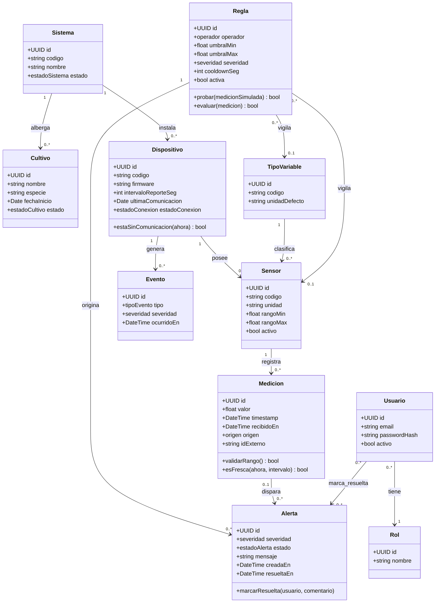

> **Nota de alcance (`SUP-05`):** ES1 define explícitamente `sistema → dispositivo → sensor`
> (RF03–RF05). Las entidades `Cultivo` y `Planta` **extienden NEC-01** para dar contexto agronómico,
> pero su cardinalidad real aún no está confirmada; se modelan de la forma más flexible.

## 3.5. Vista de procesos

### 3.5.1. Proceso 1 — Ingesta de medición y evaluación de alerta (E-1)

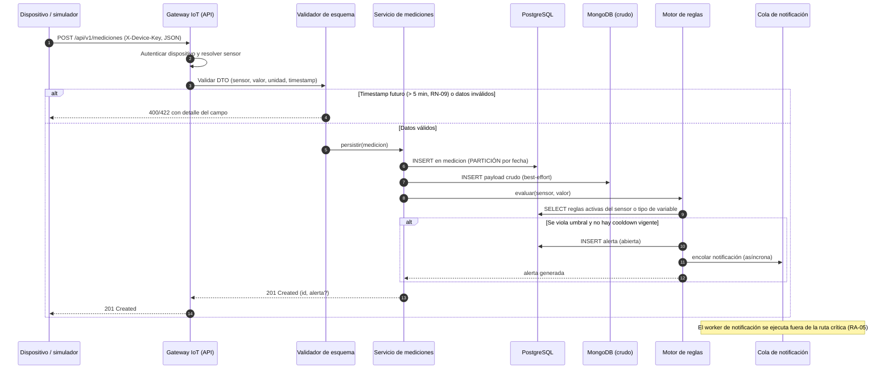

### 3.5.2. Proceso 2 — Dashboard de estado actual (E-2)

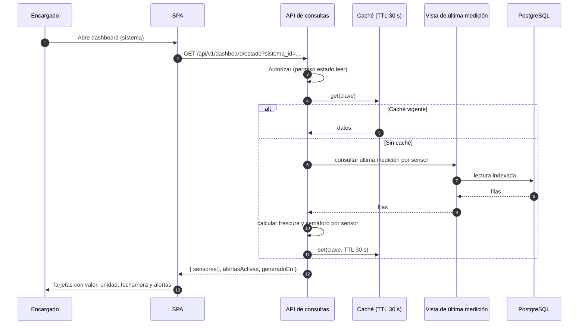

### 3.5.3. Proceso 3 — Histórico, exportación y comparación (E-3)

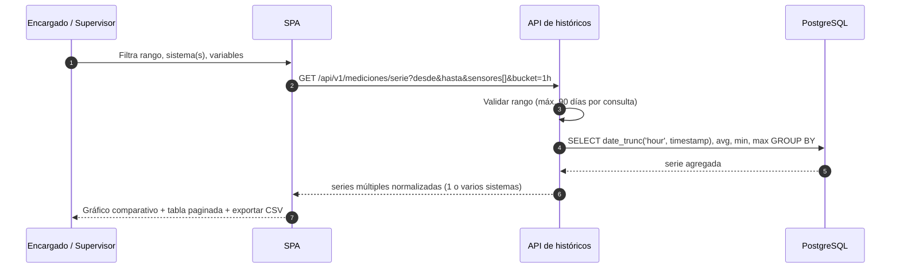

### 3.5.4. Proceso 4 — Autenticación y autorización (E-4)

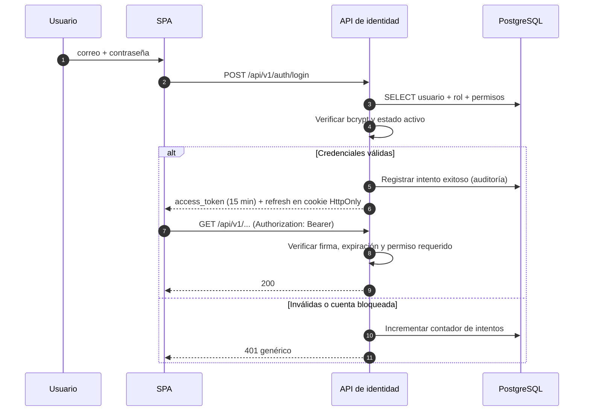

### 3.5.5. Proceso 5 — Sincronización tras pérdida de conectividad (E-5)

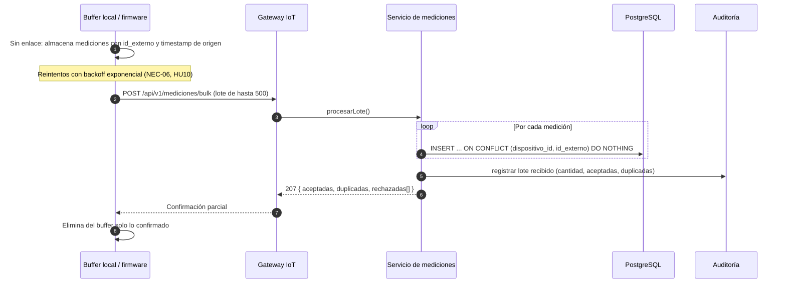

> La sincronización acepta **timestamps pasados** (RN-10) y conserva `origen = OFFLINE`, de modo que el
> histórico sigue siendo fiel a cuándo se midió, no a cuándo llegó.

### 3.5.6. Proceso 6 — Detección de dispositivo sin comunicación (E-6)

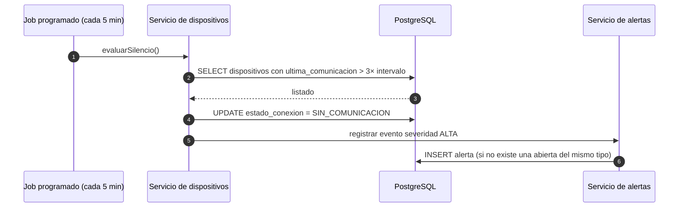

### 3.5.7. Proceso 7 — Publicación del contrato de API (E-7)

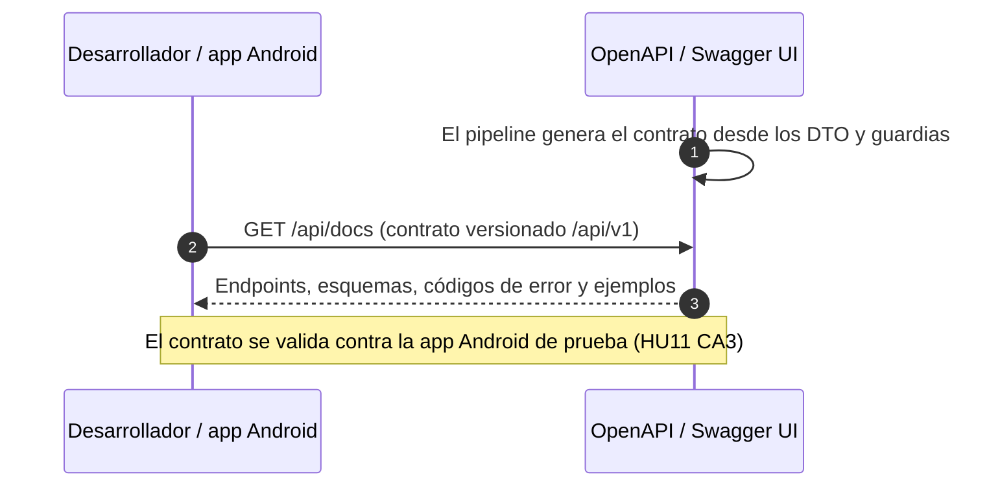

## 3.6. Vista de desarrollo

### 3.6.1. Organización del código (monorepo — D-03)

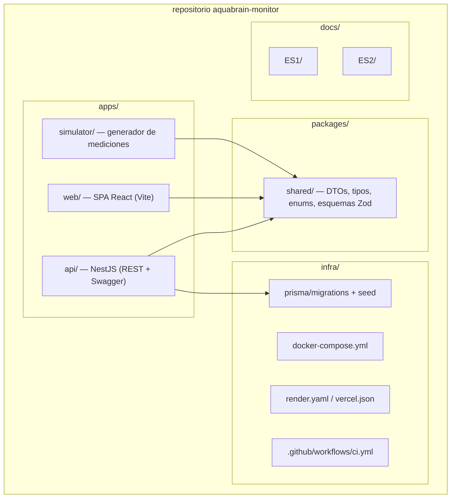

### 3.6.2. Convenciones de trabajo

| Aspecto | Definición |
|---|---|
| Estrategia de ramas | `main` (protegida, entregable) ← `develop` ← `feature/<id-hu>-<descripcion>` |
| Commits | Conventional Commits (`feat(mediciones): ingesta por lote`) referenciando `HU08` / `RF06` |
| Pull Request | Obligatorio, 1 aprobador distinto del autor, plantilla con checklist de seguridad y pruebas |
| Versionado | SemVer para la API (`/api/v1`) |
| Estilo | ESLint + Prettier + TypeScript `strict`; reglas compartidas en `packages/shared` |
| Documentación | ADR por decisión arquitectónica + README por app |

### 3.6.3. Cómo esta vista habilita el trabajo en equipo

- **Dos frentes paralelos** gracias a `packages/shared`: backend (API, motor de reglas, ingesta) y
  frontend (SPA contra tipos y DTOs acordados, con mocks) sin bloquearse.
- **CI única** que valida todo el monorepo en cada PR (lint, tests, build).
- **Módulos de dominio** con frontera clara permiten que cada integrante sea *owner* de un módulo.
- **Contrato OpenAPI primero**: el firmware y la app Android se integran contra un contrato estable.

### 3.6.4. Diagrama de componentes (vista de desarrollo — UML)

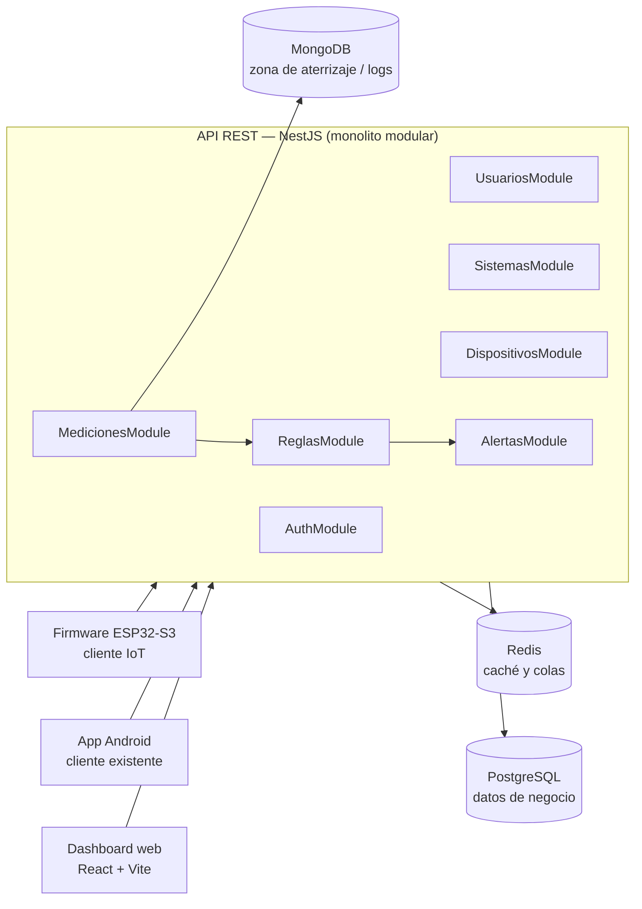

Los tres clientes consumen una **API REST única**: así el contrato `/api/v1` se mantiene estable para
web, Android y firmware (RA-02, D-13). Los módulos `MedicionesModule → ReglasModule → AlertasModule`
muestran la cadena de la decisión RA-05 (la evaluación de alertas no bloquea la respuesta de ingesta).

## 3.7. Vista física

### 3.7.1. Nodos y despliegue

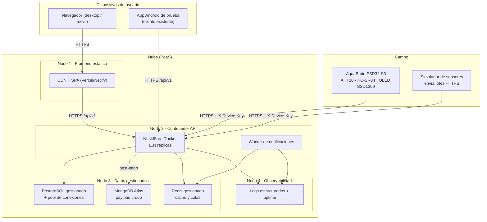

### 3.7.2. Entornos

| Entorno | Propósito | Infraestructura | Datos |
|---|---|---|---|
| **Local** | Desarrollo diario | `docker-compose` (API + PostgreSQL + Redis + MongoDB) | Semilla (`seed`) + simulador |
| **Desarrollo/Staging** | Demo interna, pruebas de integración y de carga | PaaS gratuito, una réplica | Semilla ampliada (100 dispositivos) |
| **Producción académica** | Evaluación ES3/ES4 | PaaS, HTTPS, BD gestionada | Datos simulados cargados y respaldados |

### 3.7.3. Atributos de calidad por nodo

| Nodo | Atributo | Cómo se consigue |
|---|---|---|
| Frontend | Disponibilidad y rapidez de carga | CDN, *build* estático, *code splitting* |
| API | Rendimiento (RNF03) | Contenedor sin estado, escalado horizontal, caché Redis, paginación y agregación en BD |
| PostgreSQL | Integridad y capacidad de histórico | Particionado por fecha, índice `(sensor_id, timestamp)`, respaldos (RNF02) |
| MongoDB | Flexibilidad de payload y desacople (RA-05) | Escritura *best-effort*: si falla, la medición ya está en PostgreSQL |
| Redis | Latencia de consultas repetidas y asincronía | TTL corto en dashboard; cola BullMQ fuera de la ruta crítica (RA-05) |
| Observabilidad | Auditabilidad | Logs estructurados con `correlation-id`, alertas de uptime |
| App Android | Interoperabilidad sin cambios (RNF08) | Contrato `/api/v1` estable y versionado (SUP-10) |

## 3.8. Trazabilidad de la arquitectura con los requisitos

| Vista | Requisitos que satisface |
|---|---|
| Escenarios | RF01, RF02, RF03, RF06, RF07, RF08, RF09, RF11, RF12, RF13, RF14 |
| Lógica | RF01…RF14, RNF06, RNF08 |
| Procesos | RNF01, RNF02, RNF03, RNF05, RN-04, RN-05, RN-09, RN-10, RN-12 |
| Desarrollo | RNF06, RNF07, RNF08 |
| Física | RNF02, RNF03, RNF07, RNF08 |

> La verificación cruzada completa (NEC → HU → RF/RNF → CU → diseño → implementación → prueba) está en
> el capítulo 09.
