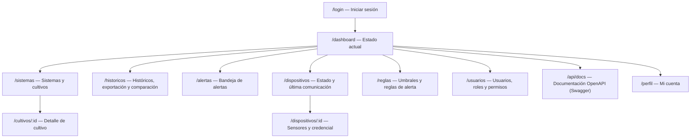
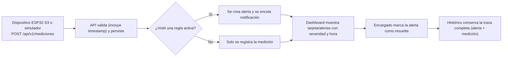

# 05 · Prototipos, wireframes y guía visual

Este capítulo deja definido **qué ve el usuario y cómo se comporta** antes de programar, asegurando
consistencia visual, adaptabilidad (*responsive*), accesibilidad básica y **coherencia con el display
OLED local** del AquaBrain (RNF05, RN-12). Las variables del prototipo reflejan el hardware real
(**AHT10** → temperatura/humedad; **HC-SR04** → distancia/nivel) más las variables simuladas declaradas
(pH, caudal).

## 5.1. Mapa de navegación y accesos por rol



| Menú | Encargado | Supervisor | Administrador | Desarrollador de integraciones |
|---|:--:|:--:|:--:|:--:|
| Dashboard / Estado actual | ✅ | ✅ | ✅ | ➖ |
| Históricos, exportación y comparación | ✅ | ✅ | ✅ | ➖ |
| Alertas (marcar resuelta) | ✅ | ✅ | ✅ | ➖ |
| Dispositivos (ver / conexión) | ✅ | ✅ | ✅ | ➖ |
| Sistemas y cultivos (editar) | ➖ | ➖ | ✅ | ➖ |
| Reglas de alerta (editar y probar) | ➖ | ➖ | ✅ | ➖ |
| Usuarios y permisos | ➖ | ➖ | ✅ | ➖ |
| Documentación API (OpenAPI) | ➖ | ➖ | ✅ | ✅ |

### 5.1.1. Inventario de pantallas, interacciones y estados

| # | Pantalla (ruta) | CU | Interacciones clave | Estados que debe resolver |
|---|---|---|---|---|
| 1 | Login (`/login`) | CU-01 | Credenciales, validar, redirigir según rol | Normal · error · cargando |
| 2 | Dashboard / estado actual (`/dashboard`) | CU-08 | Tarjetas por variable, refrescar, detalle de sensor, cambiar sistema | Normal · alerta · sin datos · dispositivo en silencio |
| 3 | Sistemas y cultivos (`/sistemas`) | CU-03 | CRUD de sistemas, abrir detalle de cultivo | Lista · vacío · crear/editar/eliminar |
| 4 | Detalle de cultivo (`/cultivos/:id`) | CU-03 | Ver cultivo, plantas y umbrales asociados | Con datos · vacío |
| 5 | Históricos (`/historicos`) | CU-09, CU-10 | Filtrar, paginar, exportar CSV, comparar | Vacío · cargando · con datos · 1 vs N sistemas |
| 6 | Alertas (`/alertas`) | CU-12 | Filtrar activas/resueltas, marcar resuelta, ver origen | Activa · resuelta · sin alertas |
| 7 | Dispositivos (`/dispositivos`) | CU-04, CU-13 | CRUD, última comunicación y estado | Online · offline · nunca conectado |
| 8 | Detalle de dispositivo (`/dispositivos/:id`) | CU-05 | Ver sensores, tipo y unidad; rotar credencial | Normal · credencial rotada |
| 9 | Reglas de alerta (`/reglas`) | CU-11 | CRUD, activar/desactivar, severidad, probar | Activa · inactiva · prueba OK/error |
| 10 | Usuarios y permisos (`/usuarios`) | CU-02 | CRUD, asignar rol, activar/desactivar | Normal · sin permiso (403) |
| 11 | Mi cuenta (`/perfil`) | CU-01 | Cambiar contraseña, cerrar sesiones | Normal · error de validación |

> La documentación OpenAPI (`/api/docs`, CU-15) es una pantalla generada por Swagger, no un CRUD de
> negocio, y por eso no se numera como pantalla de usuario.

**Flujo de interacción extremo a extremo:** (1) el usuario inicia sesión y, según rol, entra al
dashboard; (2) una tarjeta en rojo indica alerta y enlaza a `/alertas`; (3) marca la alerta como
resuelta; (4) en históricos filtra, ve gráfico y tabla, exporta CSV y compara sistemas; (5) un
administrador crea reglas con severidad, que se aplican a las **nuevas** mediciones.

## 5.2. Wireframes de los procesos principales

> Notación: `[ ]` botón · `( )` radio/check · `▾` selector · `▭` campo de texto · `≡` menú.

### 5.2.1. W-01 · Iniciar sesión (`/login`, CU-01)

```
┌──────────────────────────────────────────────────────────────────────┐
│            ┌──────────────────────────────────────┐                  │
│            │   🌱  AquaBrain Monitor              │                  │
│            │   Monitoreo de cultivos AquaPlants   │                  │
│            │   Correo                             │                  │
│            │   ▭▭▭▭▭▭▭▭▭▭▭▭▭▭▭▭▭▭▭▭▭▭▭▭▭▭▭▭       │                  │
│            │   Contraseña                    👁    │                  │
│            │   ▭▭▭▭▭▭▭▭▭▭▭▭▭▭▭▭▭▭▭▭▭▭▭▭▭▭▭▭       │                  │
│            │   [      Ingresar      ]             │                  │
│            │   ⚠ "Credenciales incorrectas"       │                  │
│            └──────────────────────────────────────┘                  │
└──────────────────────────────────────────────────────────────────────┘
```

Reglas: botón deshabilitado hasta que ambos campos tengan contenido; mensaje de error **genérico** (no
revela si el correo existe, RF01 · HU05); tras 5 fallos en 15 min, bloqueo temporal; cuenta desactivada
→ aviso específico; redirección a `/dashboard` o a la ruta solicitada.

### 5.2.2. W-02 · Dashboard de estado actual (`/dashboard`, CU-08)

Cumple **HU01**: última medición por sensor/sistema (CA①), refresco automático y manual (CA②),
distinción visual de valores fuera de rango (CA③) y **fecha y hora de la última medición (CA④)**.

```
┌───────────────────────────────────────────────────────────────────────────────────┐
│ ≡ AquaPlants  │ Dashboard  Históricos  Alertas  Dispositivos   [Sistema ▾]  👤    │
├───────────────────────────────────────────────────────────────────────────────────┤
│ Encargado de cultivo · Sistema: Invernadero Norte   🔔 3 alertas · ⟳ Refrescar     │
├───────────────────────────────────────────────────────────────────────────────────┤
│ ┌── Sensores (última medición) ────────────────────────────────────────────────┐  │
│ │ Temperatura 22,7 °C · 15/09 14:03 · ● en línea   │ Humedad 68 % · ● en línea    │  │
│ │ Nivel 14 cm · 15/09 14:02 · ● en línea           │ pH 6,1 ⚠ · ● ALERTA          │  │
│ │ Caudal 12,4 L/min · 15/09 14:01 · ● en línea     │ + Añadir                     │  │
│ └──────────────────────────────────────────────────────────────────────────────┘  │
│ ┌── Cultivos activos ────────────────┐ ┌── Alertas activas (3) ──────────────────┐│
│ │ Lechuga romana · desde 12/08 · 42 d │ │ ⛔ pH bajo   Sensor pH-01   hace 3 min ││
│ │ Albahaca · desde 03/09 · 21 d       │ │ ⚠ Sin comunicación Dev-02 hace 12 min ││
│ │ Rúcula · desde 22/09 · 8 d          │ │ ⚠ Nivel alto   Sensor DIST-01 hace 6 m││
│ └────────────────────────────────────┘ └────────────────────────────────────────┘ │
│ Última actualización: 15/09/2026 14:04:12 · Datos simulados con fines académicos  │
└───────────────────────────────────────────────────────────────────────────────────┘
```

Semántica visual (clave para que el dato sea *útil*, no solo correcto):

| Estado de tarjeta | Color | Borde/ícono | Significado |
|---|---|---|---|
| Normal | Verde | ● verde | Dentro de rango y fresco |
| Advertencia | Ámbar | ⚠ | Regla de severidad media violada |
| Crítico | Rojo | ⛔ | Regla de severidad alta violada |
| Desactualizado | Gris | ⏱ | Última medición más antigua que 3× el intervalo (RN-05) |
| Dispositivo caído | Gris oscuro | 📴 | Dispositivo sin comunicación (RF14) |

Cada tarjeta enlaza a `/historicos?sensor=<id>`; el encabezado muestra el conteo de alertas activas;
**cada tarjeta muestra fecha y hora** de la última medición (HU01 CA④); actualización por *polling* cada
30 s + botón manual. **Consistencia con el OLED (RN-12):** mismas variables y unidades que el display
local; el mismo valor con la misma unidad no puede verse distinto en la web y en el OLED.

### 5.2.3. W-03 · Históricos, exportación y comparación (`/historicos`, CU-09 y CU-10)

Cumple **HU02** (filtros CA①, gráfico + tabla CA②, exportar CA③) y **HU04** (multi-sistema CA①, líneas
superpuestas con leyenda CA②, rango de fechas CA③).

```
┌───────────────────────────────────────────────────────────────────────────────────┐
│ Filtros                                                                           │
│ Sistemas ▾ [x] Invernadero Norte  [x] Invernadero Sur   Cultivo ▾ Lechuga romana  │
│ Desde ▭ 01/09/2026   Hasta ▭ 15/09/2026   Agrupar ▾ 1 hora                         │
│ Variables:  (x) pH   (x) Temperatura   ( ) Humedad   ( ) Nivel   [+ Añadir]        │
│                                      [ Aplicar ]  [ Limpiar ]  [ ⭳ Exportar CSV ]  │
├───────────────────────────────────────────────────────────────────────────────────┤
│ Serie comparada (09/09/2026 – 15/09/2026) — 2 sistemas, variable pH               │
│   pH        Invernadero Norte (──)   Invernadero Sur (─ ─)                         │
│  8 ┤                                        ╭──╮          ┆                        │
│  7 ┤───╮╭───╯    ╰──╮────────────╭───╯  ╰───┈┈┈┈┈┈┈┈┈      ┆  ▓ rango normal        │
│  6 ┤   ╰╯           ╰────────────╯                        ┆                        │
│    └────┬────┬────┬────┬────┬────┬────┬────>              ┆                        │
│        09   10   11   12   13   14   15   (fecha)         ┆                        │
├───────────────────────────────────────────────────────────────────────────────────┤
│ Tabla de datos (paginada)                                     ▾ 25 · 50 · 100     │
│ Fecha/hora        Sensor        Valor     Unidad   Origen                          │
│ 15/09 14:00       pH-01         6,1       pH       online                          │
│ 15/09 12:00       pH-01         6,2       pH       offline (sincronizado 14:20)    │
└───────────────────────────────────────────────────────────────────────────────────┘
```

Reglas: rango máximo **90 días** por consulta (evita consultas destructivas, RNF03); la agregación
(`1 min/1 h/1 día`) se resuelve **en la base de datos**; los puntos provenientes de sincronización
offline se marcan (RF06 · HU10); **exportar CSV** descarga exactamente los datos filtrados (HU02 CA③);
comparación solo para una **variable común** (HU04 CA①); estados vacíos explícitos y reintento sin
perder filtros.

### 5.2.4. W-04 · Bandeja de alertas (`/alertas`, CU-12)

Cumple **HU03**: alerta generada al recibir una medición fuera de norma (CA①), con **severidad y
timestamp** (CA②), marcable como resuelta (CA③) y con registro histórico (CA④).

```
┌───────────────────────────────────────────────────────────────────────────────────┐
│ Estado: [ Activas 6 ][ Resueltas 62 ]        Severidad ▾ Todas                     │
│ Sistema ▾ Todas     Sensor ▾ Todos     Desde ▭ / Hasta ▭                           │
├───────────────────────────────────────────────────────────────────────────────────┤
│ ⛔ ALTA    pH bajo · pH-01 · valor 6,1 · umbral < 6,3 · Invernadero Norte          │
│            15/09/2026 14:02 (hace 3 min)      [ Marcar resuelta ]  [ Ver histórico ]│
│ ───────────────────────────────────────────────────────────────────────────────── │
│ ⚠ MEDIA    Sin comunicación · Dev-02 AquaBrain · última 15/09 13:50                │
│            15/09/2026 14:02                    [ Marcar resuelta ]  [ Ver dispositivo]│
│ ───────────────────────────────────────────────────────────────────────────────── │
│ ℹ BAJA     Nivel alto · DIST-01 · valor 14 cm · umbral > 12 cm                      │
│            15/09/2026 13:40                    [ Marcar resuelta ]  [ Detalle ]      │
├───────────────────────────────────────────────────────────────────────────────────┤
│ Marcar resuelta:  comentario (opcional)  [ Confirmar ]   ← registra usuario y hora  │
└───────────────────────────────────────────────────────────────────────────────────┘
```

### 5.2.5. W-05 · Dispositivos: estado y última comunicación (`/dispositivos`, CU-13)

Cumple **RF14**: registro y consulta del estado de conexión y \"última comunicación\" por dispositivo.

```
┌───────────────────────────────────────────────────────────────────────────────────┐
│ Sistema ▾ Invernadero Norte            Estado ▾ Todos            [ + Nuevo ]      │
├───────────────────────────────────────────────────────────────────────────────────┤
│ Código      Modelo      Estado              Última comunicación   Sensores  Acción│
│ DEV-01      AquaBrain   ● En línea          15/09 14:03 (1 min)   3         Ver    │
│ DEV-02      AquaBrain   📴 Sin comunicación 15/09 13:50 (13 min)  4         Ver    │
│ DEV-03      AquaBrain   ● En línea          15/09 14:02 (2 min)   2         Ver    │
├───────────────────────────────────────────────────────────────────────────────────┤
│ Detalle DEV-02                                                                    │
│   Intervalo de reporte: 5 min   ·  Umbral de silencio: 15 min (3×)                │
│   Último evento: "sin comunicación detectada" 14:02 · severidad ALTA              │
│   Sensores: TEMP-02, HUM-02, DIST-02, PH-02                                       │
│   Credencial de dispositivo: [ Regenerar API key ]  ⚠ se muestra una sola vez      │
└───────────────────────────────────────────────────────────────────────────────────┘
```

### 5.2.6. W-06 · Gestión (patrón CRUD) y reglas de alerta (`/reglas`, CU-11)

Cumple **HU07**: interfaz de configuración (CA①), activar/desactivar (CA②) y **probar la regla con una
medición simulada antes de guardar (CA③)**.

```
┌───────────────────────────────────────────────────────────────────────────────────┐
│ Reglas de alerta                                        [ + Nueva regla ]         │
├───────────────────────────────────────────────────────────────────────────────────┤
│ Ámbito             Variable       Condición           Severidad  Cooldown  Activa │
│ Sensor pH-01       pH             < 6,3  ó  > 7,5     Alta       15 min    (x)   │
│ Tipo: Temperatura  Temperatura    > 30 °C             Alta       10 min    (x)   │
│ Sensor DIST-01     Nivel (dist.)  > 12 cm             Media      30 min    ( )   │
├───────────────────────────────────────────────────────────────────────────────────┤
│ Nueva regla                                                                       │
│  Ámbito      ( ) Sensor  (•) Tipo de variable      Variable ▾ Temperatura          │
│  Condición   Operador ▾ mayor que       Umbral  ▭ 30   Unidad °C (auto)            │
│  Severidad   ▾ Alta         Cooldown  ▭ 10  minutos      (x) Activa                │
│  Vista previa: "Alertar cuando Temperatura > 30 °C (Alta), máx. 1 alerta cada 10 min"│
│  ── Probar regla (CA③) ──────────────────────────────────────────────────────────  │
│  Medición simulada: valor ▭ 31  [ Probar ]   ✔ Dispararía alerta (31 > 30)         │
│                                     [ Cancelar ]  [ Guardar regla ]               │
└───────────────────────────────────────────────────────────────────────────────────┘
```

Patrón reutilizable para **sistemas, cultivos, dispositivos, sensores y usuarios**: tabla + filtros +
botón Nuevo + panel lateral de formulario + confirmación de eliminación/desactivación. Los formularios
marcan en línea los campos inválidos y muestran el error del backend junto al campo (RNF01).

### 5.2.7. Flujo de extremo a extremo (demo ES3/ES4)



## 5.3. Prototipo interactivo

| Entregable | Herramienta | Alcance |
|---|---|---|
| Wireframes de baja fidelidad | Este capítulo (Markdown/ASCII) | Estructura de todas las pantallas |
| Prototipo navegable de alta fidelidad | Figma | Flujo clicable: Login → Dashboard → Alertas → Históricos → Administración |
| Mapa de navegación | Mermaid (§5.1) | Rutas y restricciones por rol |

**Enlace al prototipo navegable:** `‹URL-FIGMA›` (compartido como \"cualquiera con el enlace puede ver\",
solo lectura). *Reemplazar por la URL real antes de entregar.*

## 5.4. Iteraciones del prototipo (resumen; detalle en cap. 10)

| Iteración | Qué se hizo | Retroalimentación clave | Resultado |
|---|---|---|---|
| **v1 — wireframe** | Bocetos de baja fidelidad | \"Falta saber si el dato es viejo\" (FB-01) | Semáforo de frescura |
| **v2 — visual** | Alta fidelidad con tokens y estados | \"No distingo el estado solo por color\" (FB-10); \"no se ve en el celular\" (FB-11) | Ícono + texto; responsive de tablas |
| **v3 — navegable** | Flujo clicable con feedback aplicado | \"Quiero comparar sistemas\" (FB-09) | Comparación multi-sistema (RF09) |

## 5.5. Guía visual (design system)

### 5.5.1. Paleta y tokens

| Token | Valor | Uso |
|---|---|---|
| `--color-primary` | `#1F7A63` (verde AquaPlants) | Acciones principales, encabezado, foco |
| `--color-primary-dark` | `#155C4A` | Hover/active |
| `--color-accent` | `#3FA9C9` (agua) | Series de datos, enlaces secundarios |
| `--color-ok` | `#2E9E6B` | Estado normal |
| `--color-warn` | `#D98A17` | Advertencia (severidad media) |
| `--color-danger` | `#C0392B` | Crítico (severidad alta) |
| `--color-neutral-50…900` | escala de grises | Fondos, texto, bordes |
| `--color-surface` | `#FFFFFF` | Tarjetas |
| `--color-bg` | `#F5F8F7` | Fondo de aplicación |
| `--text-muted` | `#5B6B66` | Texto secundario (contraste ≥ 4.5:1 sobre superficie) |

Regla: **el color nunca es el único portador de significado** — siempre acompañado de ícono o texto
(accesibilidad, daltonismo).

### 5.5.2. Tipografía y espaciado

| Elemento | Especificación |
|---|---|
| Tipografía | Inter (o *system UI*) con fallback; una sola familia |
| Escala | 12 / 14 / 16 (base) / 20 / 24 / 32 px; interlineado 1,5 en cuerpo |
| Pesos | 400 cuerpo · 500 etiquetas · 600 encabezados · 700 cifras KPI |
| Cifras de datos | `font-variant-numeric: tabular-nums` |
| Espaciado | Escala 4/8/12/16/24/32 px; padding de tarjeta 16 px |
| Radios | 8 px tarjetas, 6 px controles, 999 px *badges* |
| Sombras | Sutil: `0 1px 2px rgba(0,0,0,.06)` |

### 5.5.3. Componentes base y sus estados

| Componente | Estados obligatorios |
|---|---|
| Botón | normal · hover · focus visible · activo · deshabilitado · cargando |
| Campo | vacío · con foco · válido · inválido (borde + mensaje) · deshabilitado |
| Tabla | cargando (*skeleton*) · vacía (mensaje + acción) · con datos · error (reintentar) · paginación |
| Tarjeta de sensor | normal · advertencia · crítico · desactualizado · dispositivo caído |
| Badge de severidad | Alta (rojo) · Media (ámbar) · Baja (azul) · Informativa (gris) |
| Notificación (*toast*) | éxito · error · advertencia; descartable y anunciada a lectores de pantalla |

## 5.6. Responsive y adaptabilidad (RNF05)

| Breakpoint | Ancho | Comportamiento |
|---|---|---|
| `xs` | 360–639 px | Una columna; menú en cajón lateral; tarjetas en *scroll* horizontal; tabla → lista de tarjetas |
| `sm` | 640–1023 px | Dos columnas; filtros colapsables |
| `md` | 1024–1439 px | Grid de 3 columnas; barra lateral fija |
| `lg` | ≥ 1440 px | Grid de 4 columnas; gráficos a ancho completo |

La gráfica histórica mantiene la misma información en móvil (*tooltip* táctil y leyenda plegable); la
tabla de datos se transforma en tarjetas etiquetadas.

## 5.7. Accesibilidad básica (WCAG 2.1 AA)

- [ ] Contraste de texto ≥ 4.5:1 y de componentes ≥ 3:1 (verificado sobre la paleta).
- [ ] Navegación completa por teclado con orden lógico y **foco visible**.
- [ ] Formularios con `<label>` asociado, errores vinculados (`aria-describedby`) y `aria-invalid`.
- [ ] Modales y paneles: foco atrapado, cierre con `Esc`, retorno de foco al disparador.
- [ ] Gráficos con alternativa textual (tabla subyacente) y no solo color.
- [ ] Estados del sistema (cargando/error/en línea) anunciados con `aria-live="polite"`.
- [ ] Textos alternativos en íconos con significado; `aria-hidden` en decorativos.
- [ ] Idiomas y unidades explícitos (\"°C\", \"%\", \"cm\", \"L/min\") junto al valor.

## 5.8. Trazabilidad de la interfaz con las historias de usuario

| Pantalla | HU | Criterios de aceptación cubiertos |
|---|---|---|
| W-01 Login | HU05 | RF01; base para el resto |
| W-02 Dashboard | HU01 | CA① último valor · CA② refresco · CA③ fuera de rango · CA④ fecha/hora |
| W-03 Históricos | HU02 | CA① filtros · CA② gráfico + tabla · CA③ exportar |
| W-03 Comparación | HU04 | CA① multi-sistema · CA② líneas con leyenda · CA③ rango de fechas |
| W-04 Alertas | HU03 | CA① generada al recibir · CA② severidad + timestamp · CA③ marcar resuelta · CA④ registro histórico |
| W-05 Dispositivos | RF14 / HU10 | Estado de conexión y última comunicación |
| W-06 Reglas | HU07 | CA① config · CA② activar/desactivar · CA③ **probar regla** |
| W-06 CRUD | HU06 | Crear/editar/eliminar sistemas, dispositivos y sensores |
