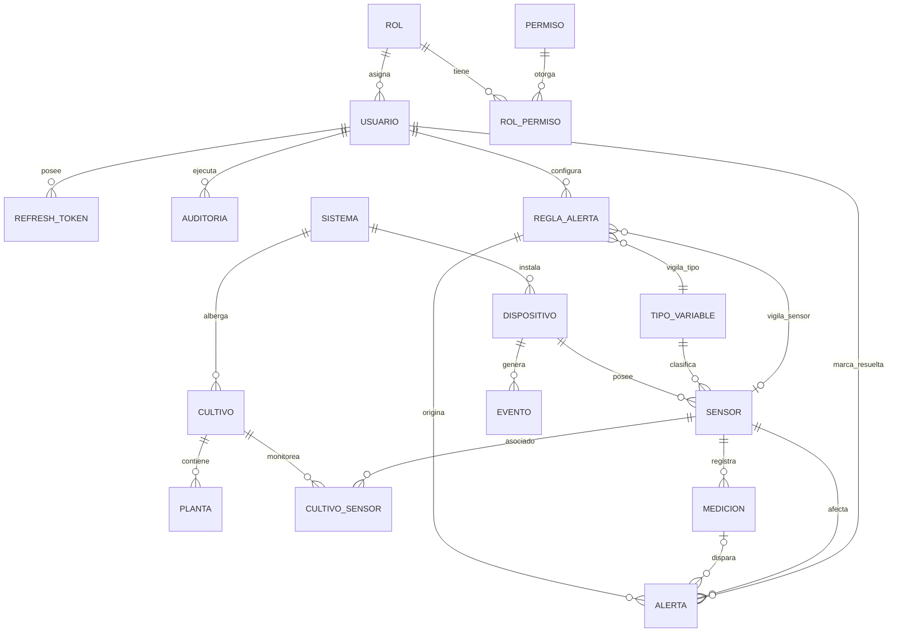

# 06 · Modelo de datos

Este capítulo presenta el **modelo conceptual** (DER), el **modelo lógico** con claves e integridad, el
**diccionario de datos**, la justificación de **normalización, índices y particionado**, y la decisión de
**qué datos van a una base estructurada y cuáles a almacenamiento no relacional**.

> **Convención de nombres:** la entidad principal se llama **`sistema`** (equivalente a \"instalación\"
> en el lenguaje del cliente). Los tres clientes de la API son el **firmware ESP32-S3**, la **app
> Android** y el **dashboard web**.

## 6.1. Criterios de modelado

> Identificadores `MC-01…MC-09` (*model criteria*). No confundir con las correcciones `C-01…C-08` de ES1.

| # | Criterio | Regla aplicada |
|---|---|---|
| MC-01 | Trazabilidad temporal | Toda medición tiene `timestamp` (origen) y `recibido_en` (recepción), ambos `timestamptz` en UTC (RN-08) |
| MC-02 | Histórico inmutable | `medicion` es *append-only*: sin `UPDATE` ni `DELETE` de negocio; la corrección se registra como medición nueva (RN-02, RN-03) |
| MC-03 | Integridad referencial | Todas las relaciones se declaran como FK con política `ON DELETE` explícita |
| MC-04 | Identificadores | PK `UUID v7` para entidades de dominio; `BIGSERIAL` para tablas de alto volumen (`medicion`, `auditoria`) |
| MC-05 | Enumeraciones | Los estados se modelan como `ENUM` nativo de PostgreSQL, no como texto libre |
| MC-06 | Magnitudes | Valores numéricos con `NUMERIC`, nunca `FLOAT` (evita errores de redondeo) |
| MC-07 | Volumen | `medicion` particionada por rango de `timestamp` (RNF04) |
| MC-08 | Idempotencia | `(dispositivo_id, id_externo)` único para reenvíos desde buffer offline (HU10) |
| MC-09 | Formato del firmware | El modelo admite el payload del ESP32-S3 (AHT10/HC-SR04) y el del simulador (RN-11) |

## 6.2. Modelo conceptual (DER)



**Entidades y atributos principales** (detalle en §6.3): `rol`, `permiso`, `rol_permiso`, `usuario`,
`refresh_token`, `auditoria`; `sistema`, `cultivo`, `planta`, `dispositivo`, `tipo_variable`, `sensor`,
`cultivo_sensor`; `medicion`, `regla_alerta`, `alerta`, `evento`.

> **Alcance:** `LICENCIA` (HU09/RF15) **no** forma parte del modelo vigente por ser *Won't por ahora*;
> su forma se documenta como supuesto en §6.10.

**Cardinalidades clave (con su origen):**

| Relación | Cardinalidad | Origen / regla |
|---|---|---|
| `sistema` → `cultivo` | 1 : N | NEC-01 (contexto agronómico) |
| `sistema` → `dispositivo` | 1 : N | RF04 |
| `dispositivo` → `sensor` | 1 : N | RF05 |
| `tipo_variable` → `sensor` | 1 : N | catálogo de variables |
| `sensor` → `medicion` | 1 : N | RF06 (append-only) |
| `cultivo` ↔ `sensor` | N : M (`cultivo_sensor`) | SUP-04 (lo más flexible) |
| `regla_alerta` → `alerta` | 1 : N | RN-04 (cooldown) |
| `medicion` → `alerta` | 0..1 : N | HU03 (evidencia del disparo) |
| `usuario` → `rol` | N : 1 | RBAC (RF01) |

## 6.3. Modelo lógico — diccionario de datos

Convenciones: `uuid` = UUID v7 · `timestamptz` en UTC · `snake_case` en base de datos, `camelCase` en
código.

### 6.3.1. Seguridad y usuarios

**`rol`**

| Columna | Tipo | Nulo | Clave/Regla | Descripción |
|---|---|---|---|---|
| `id` | uuid | no | PK | Identificador |
| `nombre` | varchar(30) | no | UNIQUE | `ADMINISTRADOR`, `SUPERVISOR`, `ENCARGADO` |
| `descripcion` | varchar(200) | sí | | Propósito del rol |

**`permiso`**: `id` (PK), `codigo` (UNIQUE, ej. `medicion:leer`), `descripcion`.
**`rol_permiso`**: PK compuesta (`rol_id`, `permiso_id`) con FK `ON DELETE CASCADE`.

**`usuario`**

| Columna | Tipo | Nulo | Clave/Regla | Descripción |
|---|---|---|---|---|
| `id` | uuid | no | PK | |
| `nombre` | varchar(120) | no | | Nombre completo |
| `email` | varchar(180) | no | UNIQUE (sin distinguir mayúsculas) | Identificador de acceso |
| `password_hash` | varchar(60) | no | | **bcrypt** (cost 12); nunca texto plano (RNF01, HU05 CA③) |
| `rol_id` | uuid | no | FK → `rol(id)` ON DELETE RESTRICT | |
| `activo` | boolean | no | DEFAULT true | Usuario desactivado no inicia sesión |
| `intentos_fallidos` | smallint | no | DEFAULT 0 CHECK ≥ 0 | Control de fuerza bruta |
| `bloqueado_hasta` | timestamptz | sí | | Bloqueo temporal |

Restricciones de negocio: **no puede existir cero administradores activos**; **un administrador no puede
eliminar su propia cuenta** (HU05 CA④, RN-06) → validación transaccional + pruebas TS-18, TS-19.

**`refresh_token`**: `id` (PK), `usuario_id` (FK CASCADE), `token_hash` (UNIQUE; solo se almacena el
hash), `expira_en` (7 días), `revocado_en` (rotación), `user_agent`, `ip`.

**`auditoria`**: `id` (bigserial PK), `usuario_id` (FK SET NULL), `accion` (`LOGIN_OK`, `LOGIN_FALLO`,
`CREAR`, `ACTUALIZAR`, `DESACTIVAR`, `MARCAR_RESUELTA`, `REGLA_CAMBIADA`), `entidad`, `entidad_id`,
`datos_antes`/`datos_despues` (jsonb, sin campos sensibles), `ip`, `ocurrido_en`.

### 6.3.2. Dominio de sistema y cultivo

**`sistema`**: `id` (PK), `codigo` (UNIQUE, `INV-NORTE-01`), `nombre`, `descripcion`, `ubicacion`,
`latitud`/`longitud` (CHECK de rango geográfico), `estado` (`ACTIVO`, `MANTENCION`, `INACTIVO`).

**`cultivo`** *(extiende NEC-01; cardinalidad por validar, SUP-05)*: `id` (PK), `sistema_id` (FK
RESTRICT), `nombre`, `especie`, `variedad`, `fecha_inicio`, `fecha_fin_estimada` (CHECK ≥ inicio),
`estado` (`ACTIVO`, `COSECHADO`, `CERRADO`), `fotoperiodo_horas` (CHECK 0–24).

**`planta`** *(extiende NEC-01; SUP-05)*: `id` (PK), `cultivo_id` (FK CASCADE), `codigo` (UNIQUE por
cultivo), `posicion`, `estado` (`SANA`, `EN_RIESGO`, `RETIRADA`).

> **Nota de alcance:** ES1 (RF03) exige el CRUD de **sistemas/instalaciones**; `cultivo` y `planta` se
> incluyen para dar contexto agronómico a NEC-01, pero su relación exacta con `sistema`, `dispositivo`
> y `sensor` es el supuesto `SUP-05` a validar con la contraparte (cap. 10).

### 6.3.3. Dispositivos y sensores

**`dispositivo`**: `id` (PK), `sistema_id` (FK RESTRICT), `codigo` (UNIQUE, `DEV-01`), `modelo`,
`firmware` (`AquaBrain` / `1.4.2`), `intervalo_reporte_seg` (DEFAULT 300, CHECK > 0), `api_key_hash`
(hash **bcrypt** de la API key, RNF01), `api_key_ultimos4`, `estado_conexion` (`EN_LINEA`,
`SIN_COMUNICACION`, `INACTIVO`, `DESCONOCIDO`), `ultima_comunicacion` (RF14), `activo`.

**`tipo_variable`**: `id` (PK), `codigo` (UNIQUE), `nombre`, `unidad_defecto`, `origen_dato` (`REAL` o
`SIMULADO`), `valor_min`/`valor_max`.

Catálogo inicial (alineado con el hardware real y las variables declaradas):

| `codigo` | `nombre` | `unidad_defecto` | `origen_dato` | Sensor / fuente |
|---|---|---|---|---|
| `TEMPERATURA` | Temperatura | `°C` | REAL | AHT10 (ESP32-S3) |
| `HUMEDAD` | Humedad relativa | `%` | REAL | AHT10 (ESP32-S3) |
| `DISTANCIA` | Nivel (distancia) | `cm` | REAL | HC-SR04 (ESP32-S3) |
| `PH` | pH | `pH` | SIMULADO | Simulador / sensor futuro |
| `CAUDAL` | Caudal | `L/min` | SIMULADO | Simulador / sensor futuro |

**`sensor`**: `id` (PK), `dispositivo_id` (FK CASCADE), `tipo_variable_id` (FK RESTRICT), `codigo`
(UNIQUE por dispositivo), `nombre`, `unidad`, `rango_min`/`rango_max` (CHECK min < max), `ubicacion_fisica`,
`activo`.

**`cultivo_sensor`** (N:M): PK (`cultivo_id`, `sensor_id`), ambas FK CASCADE.

### 6.3.4. Mediciones, reglas y alertas

**`medicion`** (particionada por rango de `timestamp`, *append-only*)

| Columna | Tipo | Nulo | Clave/Regla | Descripción |
|---|---|---|---|---|
| `id` | bigserial | no | PK (con `timestamp`) | Secuencia global |
| `sensor_id` | uuid | no | FK → `sensor(id)` RESTRICT | |
| `dispositivo_id` | uuid | no | FK → `dispositivo(id)` RESTRICT | Desnormalización deliberada (DN-01) |
| `valor` | numeric(12,4) | sí | CHECK (`valor` o `valor_texto`) | |
| `valor_texto` | varchar(120) | sí | | Variables de estado discreto |
| `unidad` | varchar(20) | no | | Copiada del sensor al medir (DN-02, histórico fiel) |
| `timestamp` | timestamptz | no | Parte de la PK de partición | Hora de origen (RN-08, RN-10) |
| `recibido_en` | timestamptz | no | DEFAULT now() | Hora de recepción |
| `origen` | enum | no | DEFAULT `ONLINE` | `ONLINE`, `OFFLINE`, `MANUAL` |
| `id_externo` | varchar(80) | sí | UNIQUE parcial (`dispositivo_id`,`id_externo`) | Idempotencia (HU10) |
| `calidad` | enum | no | DEFAULT `OK` | `OK`, `SOSPECHOSA`, `ANULADA` |
| `alerta_generada` | boolean | no | DEFAULT false | Acelera consultas de auditoría |
| `payload_crudo_id` | varchar(64) | sí | | Referencia al documento en MongoDB |

**Validación de tiempo en la ingesta:** se **rechaza** `timestamp` futuro (> 5 min de desfase, RN-09) y
se **acepta** `timestamp` pasado (RN-10).

**`regla_alerta`**: `id` (PK), `sensor_id` (FK CASCADE, opcional), `tipo_variable_id` (FK CASCADE,
opcional), `nombre`, `operador` (`MAYOR_QUE`, `MENOR_QUE`, `FUERA_DE_RANGO`, `DENTRO_DE_RANGO`,
`SIN_DATOS`), `umbral_min`/`umbral_max`, `severidad` (`ALTA`, `MEDIA`, `BAJA`, `INFO`), `cooldown_seg`
(DEFAULT 900, CHECK ≥ 60), `activa`, `creado_por` (FK usuario).
**Restricción XOR:** exactamente uno de `sensor_id` o `tipo_variable_id` (RN-07). **Precedencia:** si
existen reglas de sensor y de tipo, **gana la del sensor** (RN-07). **Prueba de regla (HU07 CA③):**
`Regla.probar()` evalúa una medición simulada **sin persistir** ni generar alertas.

**`alerta`**: `id` (PK), `regla_id` (FK SET NULL), `medicion_id` (nula para `SIN_DATOS`), `sensor_id`
(FK RESTRICT), `sistema_id` (desnormalización DN-03), `tipo` (`UMBRAL`, `SIN_COMUNICACION`,
`SINCRONIZACION`, `ERROR_DISPOSITIVO`), `severidad`, `estado` (`ACTIVA`, `RESUELTA`), `mensaje`,
`valor_detectado`/`umbral_aplicado` (evidencia del disparo, DN-04), `creada_en`, `resuelta_por`,
`resuelta_en`, `comentario_resolucion`.
**Regla de estado:** `ACTIVA → RESUELTA`; una alerta resuelta **conserva su registro histórico** (HU03
CA④). **Deduplicación:** no puede existir más de una alerta `ACTIVA` para la misma `regla_id` +
`sensor_id` (índice único parcial), lo que implementa el *cooldown* (RN-04).

**`evento`**: `id` (PK), `dispositivo_id` (FK SET NULL), `sistema_id` (FK), `tipo`
(`SIN_COMUNICACION`, `RECONEXION`, `REINTENTO_SINCRONIZACION`, `ERROR_SENSOR`, `CAMBIO_CONFIGURACION`,
`DESPLIEGUE`), `severidad`, `descripcion`, `datos` (jsonb), `ocurrido_en`.

## 6.4. Integridad, restricciones y reglas

| Tipo | Implementación | Regla de negocio |
|---|---|---|
| Integridad de entidad | PK en todas las tablas | — |
| Integridad referencial | FK con `ON DELETE` explícito (RESTRICT para maestros, CASCADE para dependientes) | RN-01 |
| Integridad de dominio | `ENUM`, `CHECK` (> 0, rangos, coherencia de fechas) | RNF01 |
| Integridad de usuario | UNIQUE de `email`, `codigo`, `(sensor_id, codigo)` | RF01…RF05 |
| Unicidad parcial | `UNIQUE (regla_id, sensor_id) WHERE estado='ACTIVA'` en `alerta`; idempotencia en tabla de apoyo `medicion_idempotencia` con PK `(dispositivo_id, id_externo)` | RN-04, HU10 |
| Integridad de tiempo | `CHECK` de desfase de `timestamp` en la ingesta; no se rechaza el pasado | RN-09, RN-10 |
| Integridad de proceso | Transición de estado de alerta validada en el servicio dentro de una transacción | RF12 |
| Inmutabilidad | Permisos `INSERT`/`SELECT` para el usuario de la API sobre `medicion`; sin `UPDATE`/`DELETE` | RN-02, RN-03 |
| Borrado lógico | `activo = false` para entidades con historial | RF02…RF05 |

## 6.5. Índices y su justificación

| # | Índice | Tabla | Consulta que optimiza | Justificación |
|---|---|---|---|---|
| I-01 | `(sensor_id, timestamp DESC)` | `medicion` | Serie histórica y \"última medición\" | Consulta dominante (RF07, RF08) |
| I-02 | `(dispositivo_id, timestamp DESC)` | `medicion` | Diagnóstico y detección de silencio | RF14 |
| I-03 | `(timestamp)` por partición | `medicion` | Depuración y `date_trunc` | Particionado por rango |
| I-04 | PRIMARY KEY `(dispositivo_id, id_externo)` | `medicion_idempotencia` | Reenvío idempotente | Evita duplicados (HU10) |
| I-05 | `(estado, severidad, creada_en DESC)` | `alerta` | Bandeja filtrada | RF12, HU03 |
| I-06 | UNIQUE parcial `(regla_id, sensor_id) WHERE estado='ACTIVA'` | `alerta` | Verificación de cooldown | RN-04 |
| I-07 | `(activa, sensor_id)` y `(activa, tipo_variable_id)` | `regla_alerta` | Búsqueda de reglas al ingerir | Motor de reglas (RF11) |
| I-08 | `(sistema_id, estado_conexion)` | `dispositivo` | Listado por sistema/estado | RF14 |
| I-09 | UNIQUE `(email)` | `usuario` | Login | RF01 |
| I-10 | `(ocurrido_en DESC)` | `auditoria`, `evento` | Revisión cronológica | RNF11 |
| I-11 | `(expira_en)` | `refresh_token` | Limpieza de tokens | Seguridad |
| I-12 | PRIMARY KEY `(sensor_id)` | `estado_sensor_actual` | Dashboard \"último valor por sensor\" | Estado actualizado en la misma transacción (DN-05, RNF03) |

**Anti-patrón evitado:** se decide **no** indexar `valor` ni crear índices sobre columnas de baja
cardinalidad de forma aislada; cada índice responde a una consulta concreta, porque cada índice
adicional encarece la escritura de ingesta (RNF03).

## 6.6. Particionado y capacidad

### 6.6.1. Estrategia (DDL simplificado)

```sql
CREATE SEQUENCE medicion_id_seq AS BIGINT;

CREATE TABLE medicion (
  id               BIGINT NOT NULL DEFAULT nextval('medicion_id_seq'),
  sensor_id        UUID        NOT NULL REFERENCES sensor(id)      ON DELETE RESTRICT,
  dispositivo_id   UUID        NOT NULL REFERENCES dispositivo(id) ON DELETE RESTRICT,
  valor            NUMERIC(12,4),
  valor_texto      VARCHAR(120),
  unidad           VARCHAR(20) NOT NULL,
  timestamp        TIMESTAMPTZ NOT NULL,
  recibido_en      TIMESTAMPTZ NOT NULL DEFAULT now(),
  origen           origen_medicion NOT NULL DEFAULT 'ONLINE',
  id_externo       VARCHAR(80),
  calidad          calidad_medicion NOT NULL DEFAULT 'OK',
  alerta_generada  BOOLEAN NOT NULL DEFAULT false,
  payload_crudo_id VARCHAR(64),
  PRIMARY KEY (id, timestamp),                -- la PK incluye la clave de partición
  CONSTRAINT medicion_valor_presente CHECK (valor IS NOT NULL OR valor_texto IS NOT NULL)
) PARTITION BY RANGE (timestamp);

CREATE TABLE medicion_2026_09 PARTITION OF medicion
  FOR VALUES FROM ('2026-09-01') TO ('2026-10-01');

CREATE INDEX idx_medicion_sensor_ts      ON medicion (sensor_id, timestamp DESC);
CREATE INDEX idx_medicion_dispositivo_ts ON medicion (dispositivo_id, timestamp DESC);

-- PostgreSQL exige la clave de partición en los índices únicos de una tabla particionada;
-- por eso la idempotencia (dispositivo_id, id_externo) vive en una tabla de apoyo.
CREATE TABLE medicion_idempotencia (
  dispositivo_id UUID NOT NULL REFERENCES dispositivo(id) ON DELETE CASCADE,
  id_externo     VARCHAR(80) NOT NULL,
  medicion_id    BIGINT NOT NULL,
  timestamp      TIMESTAMPTZ NOT NULL,
  recibido_en    TIMESTAMPTZ NOT NULL DEFAULT now(),
  PRIMARY KEY (dispositivo_id, id_externo)
);
```

| Aspecto | Decisión |
|---|---|
| Grano de partición | Mensual |
| Creación | Job programado crea la partición del mes siguiente y del mes en curso si falta |
| Retención | Datos crudos en PostgreSQL: 24 meses; agregados diarios indefinidos |
| Depuración | `DETACH` + `DROP` de particiones antiguas (O(1), sin `DELETE` masivo) |
| Partición por defecto | `medicion_default` para no rechazar datos con fecha anómala |

### 6.6.2. Estimación de capacidad (para dimensionar la prueba de carga de RNF03)

| Variable | Valor |
|---|---|
| Base de prueba de RNF03 | **50.000 registros en 1 mes** (umbral de ES1) |
| Dispositivos en prueba de volumen | 100 |
| Sensores por dispositivo | 3 (temperatura, humedad, distancia) |
| Intervalo de reporte | 5 min → 288 mediciones/sensor/día |
| Mediciones por día | 100 × 3 × 288 = **86 400** |
| Mediciones por mes | ≈ **2,6 millones** |
| Tamaño aproximado por fila | ≈ 120 bytes (con índice ≈ 200 bytes) |
| Crecimiento mensual | ≈ 0,52 GB |
| **Objetivo de prueba** | Históricos de **1 mes < 5 s** con **50.000 registros** (RNF03) |

## 6.7. Decisión: base estructurada vs. almacenamiento no relacional

| Dato | ¿Dónde vive? | Por qué |
|---|---|---|
| Usuarios, roles, permisos, auditoría | **PostgreSQL** | Requiere integridad referencial, unicidad y transacciones |
| Sistemas, cultivos, plantas | **PostgreSQL** | Entidades maestras, relaciones N:M y `JOIN` |
| Dispositivos y sensores | **PostgreSQL** | Unicidad de códigos, FK y estados controlados |
| Reglas y alertas | **PostgreSQL** | Estados con transiciones, unicidad parcial y reportes agregados |
| **Mediciones (curadas)** | **PostgreSQL particionada** | Es el dato consultado; se beneficia de índices, `GROUP BY`, `date_trunc` y particionado |
| **Payload crudo del dispositivo** | **MongoDB** (*landing zone*) | Esquema variable por versión de firmware/modelo; alto volumen *append*; no requiere relaciones; permite **reproceso** |
| Eventos crudos de conectividad | **MongoDB** (índice TTL 90 días) | Volumen alto y valor decreciente |
| Caché de dashboard y colas de trabajo | **Redis** | Latencia y asincronía (RA-05) |

**Por qué no todo NoSQL:** el dominio (usuarios, reglas, alertas con estados, permisos) exige
integridad referencial y transacciones; modelarlo en documentos obligaría a validar por aplicación y
perdería garantías que la rúbrica pide explícitamente (claves, cardinalidades, integridad).

**Por qué no todo SQL para el payload crudo:** un *payload* que cambia con la versión del firmware
provocaría una migración de esquema por cada versión; el modelo documental absorbe esa variabilidad y
permite **reprocesar** datos si cambia una regla de validación.

**Garantía de consistencia entre ambos:** la medición útil se escribe **primero** en PostgreSQL (fuente
de verdad, transaccional); la copia cruda en MongoDB es *best-effort* y asíncrona. Si MongoDB falla, no
se pierde el dato ni se degrada la operación (RA-05, RNF02). El campo `medicion.payload_crudo_id` enlaza
ambas representaciones cuando la escritura cruda tuvo éxito.

**Formato del documento crudo (ejemplo del firmware real ESP32-S3 con AHT10):**

```json
{
  "_id": "ObjectId('66f1...')",
  "dispositivo": { "codigo": "DEV-01", "firmware": "1.4.2" },
  "sensor": { "codigo": "TEMP-01", "tipo": "TEMPERATURA", "unidad": "°C" },
  "valor": 22.7,
  "timestamp": "2026-09-15T14:02:11Z",
  "recibido_en": "2026-09-15T14:02:13Z",
  "origen": "ONLINE",
  "id_externo": "DEV-01-1726408931",
  "headers": { "user-agent": "AquaBrain/1.4.2", "ip": "191.0.0.5" },
  "ttl": "2026-12-14T14:02:13Z"
}
```

### 6.7.1. Consultas SQL funcionales

```sql
-- Última medición por sensor (dashboard; apoya D-15)
SELECT DISTINCT ON (sensor_id) sensor_id, valor, unidad, timestamp
FROM medicion WHERE sensor_id = ANY($1)
ORDER BY sensor_id, timestamp DESC;

-- Histórico de un rango para un sensor (RNF03)
SELECT timestamp, valor, unidad
FROM medicion
WHERE sensor_id = $1 AND timestamp BETWEEN $2 AND $3
ORDER BY timestamp;

-- Serie agregada por hora (tendencias y comparación)
SELECT date_trunc('hour', timestamp) AS hora, avg(valor) AS promedio, max(valor) AS maximo
FROM medicion
WHERE sensor_id = $1 AND timestamp >= now() - interval '30 days'
GROUP BY 1 ORDER BY 1;
```

### 6.7.2. Operaciones no relacionales funcionales

```text
# Redis — caché del dashboard y control de tasa (D-15, RNF01)
SET  ultimas:sys:<sistema_id> <json> EX 30    # caché "última medición", TTL 30 s
INCR rate:<ip> EX 60                           # límite de tasa por IP
```

```json
{ "tipo": "login_fallido", "usuario": "encargado@aqua.cl", "ip": "10.0.0.5",
  "timestamp": "2026-09-15T10:00:00Z", "metadata": { "user_agent": "..." } }
```

**Criterio de migración a TimescaleDB:** cuando `medicion` supere ~10 M de filas o las consultas
históricas excedan 5 s (umbral de RNF03) pese al particionado, se convierte `medicion` en *hypertable*
de TimescaleDB (compatible con PostgreSQL) sin cambiar el modelo de la aplicación.

## 6.8. Normalización y optimización

### 6.8.1. Formas normales

| Forma | Cumplimiento | Detalle |
|---|---|---|
| **1FN** | ✅ | Atributos atómicos; los sensores de un cultivo se resuelven con `cultivo_sensor`, no con un arreglo |
| **2FN** | ✅ | En claves compuestas (`rol_permiso`, `cultivo_sensor`) todo atributo depende de la clave completa |
| **3FN** | ✅ | Sin dependencias transitivas; `unidad`/`rango` se copian a `sensor` solo porque un tipo puede parametrizarse distinto por sensor; `medicion.unidad` se copia como fotografía histórica |
| **BCNF** | ✅ | En tablas con más de una clave candidata los determinantes son claves candidatas |

### 6.8.2. Desnormalizaciones deliberadas y justificadas

| # | Desnormalización | Justificación | Riesgo controlado |
|---|---|---|---|
| DN-01 | `medicion.dispositivo_id` | Evita un `JOIN` en la consulta de mayor volumen | Consistencia garantizada por la ingesta |
| DN-02 | `medicion.unidad` copiada del sensor | El histórico debe seguir siendo fiel aunque cambie la unidad | Solo la ingesta escribe `medicion` |
| DN-03 | `alerta.sistema_id` | Filtrado del dashboard por sistema sin `JOIN` | Se asigna al crear la alerta |
| DN-04 | `alerta.valor_detectado` y `umbral_aplicado` | La alerta debe ser autoexplicativa aunque cambie la regla (HU03 CA②) | Snapshot inmutable |
| DN-05 | `estado_sensor_actual` (tabla de estado) | La consulta \"último valor por sensor\" es la más frecuente (RNF03) | Se actualiza en la misma transacción de ingesta |

### 6.8.3. Optimización

- **Agregación en base de datos** con `date_trunc`/`GROUP BY`; el backend nunca transporta miles de
  filas (RNF03).
- **Paginación por cursor** (`timestamp`, `id`) en lugar de `OFFSET` profundo.
- **Caché de lectura** en Redis con TTL 30 s para el dashboard, invalidada al generar una alerta.
- **`LIMIT` obligatorio** en listados; máximo 90 días por consulta de series.
- **VACUUM/ANALYZE** periódico y `autovacuum` ajustado en tablas de alto volumen.

## 6.9. Migraciones y datos de prueba

| Aspecto | Definición |
|---|---|
| Herramienta | Prisma Migrate; cada cambio se versiona en `infra/prisma/migrations` |
| Regla | Ninguna alteración se aplica a mano en producción; todo cambio pasa por migración revisada en PR |
| Semilla mínima (`seed`) | 3 roles, permisos base, 1 administrador, 1 supervisor, 1 encargado, 2 sistemas, 3 cultivos, 2 dispositivos, 10 sensores, 5 reglas, 30 días de mediciones sintéticas |
| Datos sensibles | La semilla nunca contiene credenciales reales; las claves de dispositivo se muestran una sola vez |
| Reproceso | El simulador (`apps/simulator`) regenera el histórico de forma determinista con semilla fija |

## 6.10. Alcance excluido: licenciamiento (HU09 / RF15)

Por decisión de ES1, el licenciamiento queda como **Won't (por ahora)** y supuesto `SUP-09`. Si la
contraparte lo confirma, la extensión mínima sería:

| Entidad propuesta | Atributos | Relación |
|---|---|---|
| `licencia` | `id`, `cliente`, `sistema_id` (opcional), `vigente_desde`, `vigente_hasta`, `estado`, `creado_en` | `1 sistema → N licencias` en el tiempo |
| `licencia_historial` | `id`, `licencia_id`, `cambio`, `usuario_id`, `ocurrido_en` | Trazabilidad de cambios |

**Impacto si se activa:** un filtro de vigencia en el guardia de autorización y una pantalla de
administración. No afecta el modelo de mediciones ni la ingesta.

> El **DDL de referencia completo y ejecutable** está en `docs/ES2/aquaplants_schema.sql` (PostgreSQL
> 15+), alineado con §6.3–§6.9. Reproduce los tipos `ENUM` (MC-05), las tablas, los índices I-01…I-12,
> el particionado de `medicion` y la semilla mínima.
