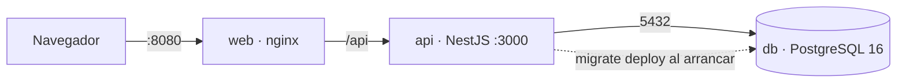

# 8. Despliegue y Reproducibilidad

## 8.1 Estrategia

La solución se empaqueta con **Docker Compose** en tres servicios que reproducen el entorno completo en cualquier máquina con Docker:

```text
infra/
├─ docker-compose.yml   Orquesta db + api + web
├─ api.Dockerfile       Imagen multi-etapa de la API (NestJS + Prisma)
├─ web.Dockerfile       Imagen multi-etapa del dashboard (Vite + nginx)
├─ nginx.conf           Sirve el SPA y proxea /api hacia la API
└─ .env.example         Plantilla de variables (los secretos no se versionan)
```



| Servicio | Imagen / build | Puerto host |
|---|---|---|
| `db` | `postgres:16-alpine` + volumen `dbdata` | 5432 |
| `api` | `infra/api.Dockerfile` (multi-etapa) | 3000 |
| `web` | `infra/web.Dockerfile` (multi-etapa) | 8080 |

## 8.2 Puesta en marcha

```powershell
Copy-Item infra/.env.example infra/.env    # y editar los secretos
docker compose --env-file infra/.env -f infra/docker-compose.yml up --build
# Dashboard:  http://localhost:8080
# API + OpenAPI: http://localhost:3000/api/docs
```

La API ejecuta **`prisma migrate deploy` antes de arrancar**, de modo que el esquema se aplica solo en el primer arranque (operación idempotente). El frontend se sirve como estático en nginx, que además **proxea `/api` hacia el servicio `api`**: el navegador ve un único origen, sin CORS.

## 8.3 Decisiones de empaquetado

- **Multi-etapa** en ambas imágenes: la etapa de compilación (con dependencias de desarrollo) se descarta y solo viaja el resultado a la imagen final.
- **Caché de capas**: se copian primero los `package.json` y luego el código, para que un cambio de código no invalide la instalación de dependencias.
- **Contexto en la raíz del monorepo**, porque la API consume `@aquabrain/shared`; se incluye un `.dockerignore` que excluye `node_modules`, `dist`, `coverage` y `.env`.
- **Secretos por entorno**: `docker-compose.yml` exige `JWT_ACCESS_SECRET`, `JWT_REFRESH_SECRET` y `DEVICE_KEY_PEPPER` (`:?`), y falla si no se definen.

## 8.4 Integración continua (GitHub Actions)

El flujo `.github/workflows/ci.yml` se dispara en cada *push* y *pull request* a `main` y consta de dos trabajos:

1. **`calidad`** — con un servicio PostgreSQL 16:
   - instala dependencias de los workspaces (`npm ci`),
   - compila `@aquabrain/shared`,
   - verifica tipos de la API (`tsc --noEmit`),
   - aplica migraciones y siembra datos mínimos,
   - ejecuta **pruebas unitarias + integración con cobertura combinada** (`npm run test:cov`, que aplica el umbral TS-44),
   - publica la cobertura como artefacto.
2. **`web`** — instala dependencias y compila el dashboard (`tsc --noEmit && vite build`).

La configuración de CI usa un coste de bcrypt bajo (`BCRYPT_COST=4`) para no penalizar el tiempo de las pruebas, manteniendo `12` en desarrollo y producción.

## 8.5 Evidencia de verificación

| Verificación | Resultado |
|---|---|
| Validación del archivo Compose | `docker compose config --quiet` → **exit 0** |
| Versión de Docker | Docker 29.8.2 · Compose v5.6.0 |
| Construcción de la imagen de la API | **`docker build` completado** (82,2 s) → imagen `aquabrain-api:dev` |
| Arranque de la imagen construida | `node dist/main.js` presente; `@aquabrain/shared` resuelve (`MAX_BULK_ITEMS=500`); Prisma Client 5.22.0 |
| Ejecución local completa | API en `localhost:3000` (health `ok`, base de datos `ok`), dashboard Vite en `localhost:5173`, PostgreSQL en `localhost:55432` |

**Evidencia de la imagen construida.**

```text
$ docker images aquabrain-api
REPOSITORY       TAG    SIZE
aquabrain-api    dev    162MB

$ docker image inspect aquabrain-api:dev --format "{{.Config.Cmd}} | {{.Config.WorkingDir}}"
[sh -c npx prisma migrate deploy && node dist/main.js] | /app/apps/api

$ docker run --rm aquabrain-api:dev node -e "console.log(process.version, require('@aquabrain/shared').MAX_BULK_ITEMS, require('@prisma/client/package.json').version)"
v20.20.2 500 5.22.0
```

La construcción tardó **82,2 s** e incluye la compilación del paquete compartido, la generación del cliente Prisma y el `nest build` de la API. Que el contenedor resuelva `@aquabrain/shared` confirma que el empaquetado del monorepo dentro de la imagen es correcto.

## 8.6 Limitaciones del despliegue

- **No** se desplegó en un proveedor de nube (el borrador mencionaba *Render*): el despliegue verificado es **local + Compose**.
- **No** hay servidor remoto ni *pull requests*; el control de versiones es local (sección 11).
- El TLS/HTTPS de extremo a extremo no se configuró en el prototipo (correspondería al proxy del entorno productivo).
