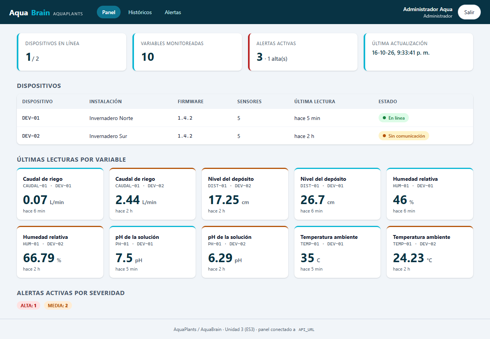
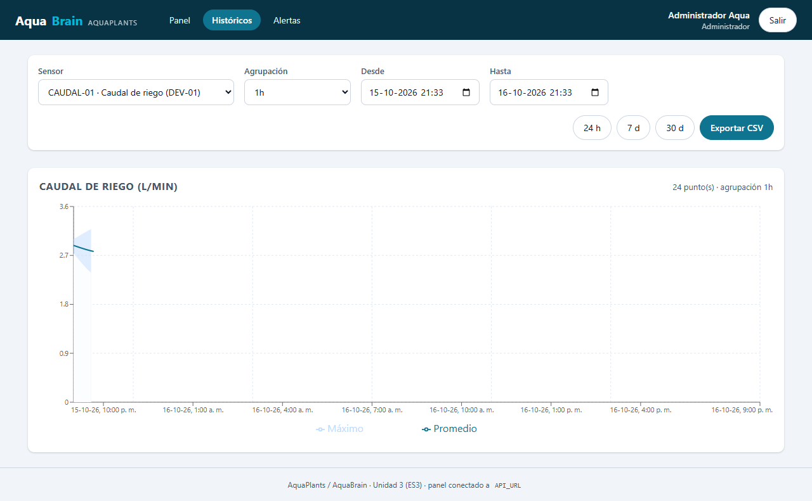
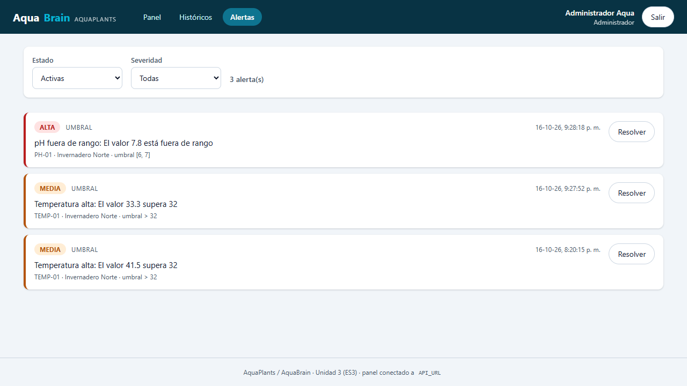

# 16. Anexos

## 16.1 Anexo A — Comandos de reproducción

Todos los comandos se ejecutan desde la raíz del proyecto (citando la ruta entre comillas por los espacios).

```powershell
# Dependencias y paquete compartido
npm install
npm run build --workspace @aquabrain/shared

# Base de datos (contenedor de desarrollo)
docker start aquabrain-pg
cd apps/api
npx prisma migrate deploy
npx prisma db seed

# API
npm run build
node dist/main.js            # http://localhost:3000/api/v1  y  /api/docs

# Dashboard
cd ../web
npm run dev                  # http://localhost:5173

# Simulador (ejemplo, modo offline)
cd ../simulator
npm run build
$env:API_URL='http://localhost:3000/api/v1'; $env:DEVICE_CODE='DEV-01'; $env:DEVICE_KEY='<clave>'
$env:MODO='offline'; node dist/simulador.js
```

## 16.2 Anexo B — Rendimiento (TS-43)

Salida cruda del script de medición (25 repeticiones por endpoint), sobre **52 230** mediciones:

```text
endpoint                      muestras min_ms p50_ms p95_ms max_ms bytes
--------                      -------- ------ ------ ------ ------ -----
GET /dashboard/estado               25   88,4  104,1  225,9  328,8  3642
GET /mediciones/serie (1 mes)       25  231,5  573,7  633,8  730,4 77231
GET /alertas?porPagina=20           25   59,2   64,8   86,2   91,8  2017
```

Escritura por lote (`POST /mediciones/bulk`), **antes y después** de la optimización R-01:

```text
# Antes (una transacción de escritura por lectura)
Cuerpo: 78,4 KB, items: 500
HTTP 207 · Tiempo total: 16410 ms

# Después (inserción masiva createManyAndReturn + reglas en un paso por lote)
Cuerpo: 78,5 KB, items: 500
HTTP 207 · Tiempo total: 1697 ms · 1403 ms · 1275 ms   (3 corridas; mediana 1403 ms)
{ "recibidas": 500, "aceptadas": 500, "duplicadas": 0, "rechazadas": 0, "alertasGeneradas": 0 }
```

## 16.3 Anexo C — Plan de consulta de la serie

```text
GroupAggregate  (cost=577.70..588.90 rows=277) (actual time=1.523..1.945 rows=49 loops=1)
  Group Key: date_bin('01:00:00'::interval, "timestamp", '2000-01-01'::timestamptz)
  Buffers: shared hit=17
  ->  Sort  (actual time=1.479..1.513 rows=295)
        Sort Method: quicksort  Memory: 41kB
        ->  Bitmap Heap Scan on medicion  (actual time=1.214..1.342 rows=295)
              Recheck Cond: (sensor_id = ... AND "timestamp" >= ... AND "timestamp" <= ...)
              ->  Bitmap Index Scan on idx_medicion_sensor_ts  (actual time=1.175..1.176)
Planning Time: 1.624 ms
Execution Time: 2.217 ms
```

## 16.4 Anexo D — Transcripciones del simulador

Se adjuntan como archivos:

- [`evidencia/sim-online.txt`](evidencia/sim-online.txt) — modo online (10 aceptadas, 1 alerta MEDIA).
- [`evidencia/sim-offline.txt`](evidencia/sim-offline.txt) — modo offline (8 almacenadas, sincronizadas, reenvío con 8 duplicadas).
- [`evidencia/sim-anomalia.txt`](evidencia/sim-anomalia.txt) — modo anomalía (2 fuera de rango, 1 alerta ALTA).

## 16.5 Anexo E — Capturas del dashboard

Panel en vivo (indicadores, dispositivos y las 10 variables):



Históricos con gráfico de líneas y banda de mínimo/máximo:



Bandeja de alertas con opción de resolución:



## 16.6 Anexo F — Empaquetado y dependencias

**Imagen Docker de la API** (contexto = raíz del monorepo):

```text
$ docker build -f infra/api.Dockerfile -t aquabrain-api:dev .
...
#24 DONE 82.2s

$ docker images aquabrain-api
REPOSITORY       TAG    SIZE
aquabrain-api    dev    162MB

$ docker run --rm aquabrain-api:dev node -e "console.log(process.version, require('@aquabrain/shared').MAX_BULK_ITEMS, require('@prisma/client/package.json').version)"
v20.20.2 500 5.22.0
```

**Auditoría de dependencias** (`npm audit`, resumen):

```text
61 vulnerabilidades (4 low, 15 moderate, 41 high, 1 critical)
```

> Las 61 alertas corresponden a **dependencias transitivas** del ecosistema NestJS 10 (no a código propio). Se documentan por transparencia; la recomendación es planificar la actualización mayor a NestJS 11 (que arrastra versiones parcheadas de las transitivas).

## 16.7 Anexo G — Inventario de endpoints (35 rutas)

```text
POST   /api/v1/auth/login                      POST   /api/v1/auth/refresh
POST   /api/v1/auth/logout                     GET    /api/v1/auth/me
GET    /api/v1/usuarios                        POST   /api/v1/usuarios
GET    /api/v1/usuarios/{id}                   PATCH  /api/v1/usuarios/{id}
DELETE /api/v1/usuarios/{id}                   GET    /api/v1/roles
GET    /api/v1/permisos                        GET    /api/v1/sistemas
POST   /api/v1/sistemas                        GET    /api/v1/sistemas/{id}
PATCH  /api/v1/sistemas/{id}                   DELETE /api/v1/sistemas/{id}
GET    /api/v1/cultivos                        POST   /api/v1/cultivos
GET    /api/v1/cultivos/{id}                   PATCH  /api/v1/cultivos/{id}
DELETE /api/v1/cultivos/{id}                   GET    /api/v1/dispositivos
POST   /api/v1/dispositivos                    GET    /api/v1/dispositivos/{id}
PATCH  /api/v1/dispositivos/{id}               DELETE /api/v1/dispositivos/{id}
GET    /api/v1/dispositivos/{id}/sensores      POST   /api/v1/dispositivos/{id}/sensores
PATCH  /api/v1/dispositivos/{id}/sensores/{sensorId}
POST   /api/v1/dispositivos/{id}/rotar-clave   GET    /api/v1/sensores
GET    /api/v1/sensores/{id}                   GET    /api/v1/tipos-variable
GET    /api/v1/reglas                          POST   /api/v1/reglas
GET    /api/v1/reglas/{id}                     PATCH  /api/v1/reglas/{id}
DELETE /api/v1/reglas/{id}                     POST   /api/v1/reglas/probar/simulacion
POST   /api/v1/mediciones                      POST   /api/v1/mediciones/bulk
GET    /api/v1/mediciones/serie                GET    /api/v1/mediciones/ultimas
GET    /api/v1/mediciones/exportar.csv         GET    /api/v1/alertas
GET    /api/v1/alertas/{id}                    GET    /api/v1/alertas/resumen
POST   /api/v1/alertas/{id}/resolver           GET    /api/v1/dashboard/estado
GET    /api/v1/auditoria                       GET    /health   (sin prefijo)
```

## 16.8 Anexo H — Variables de entorno

| Variable | Uso |
|---|---|
| `NODE_ENV`, `PORT`, `API_PREFIX`, `LOG_LEVEL` | Configuración general |
| `DATABASE_URL` | Conexión a PostgreSQL |
| `JWT_ACCESS_SECRET`, `JWT_REFRESH_SECRET`, `JWT_ACCESS_TTL`, `JWT_REFRESH_TTL` | Firma y vigencia de tokens |
| `BCRYPT_COST` | Factor de coste (12 en desarrollo/producción, 4 en CI) |
| `DEVICE_KEY_PEPPER` | Pepper de las claves de dispositivo |
| `ALERT_SILENCE_FACTOR` | Ventana de silencio de alertas |
| `MAX_TIMESTAMP_SKEW` | Tolerancia de `timestamp` (RN-09) |
| `BODY_LIMIT` | Límite del cuerpo de las peticiones |
| `CORS_ORIGINS` | Orígenes permitidos |
| `REDIS_URL` | **Reservado** (no consumido por el prototipo, ver §11 D-07) |
