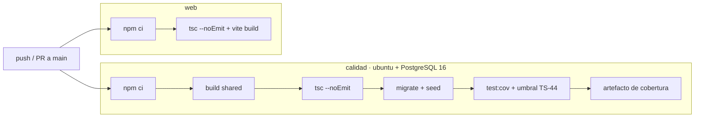

# 02 · Repositorio, colaboración en equipo y entorno de trabajo

> Indicadores cubiertos: **6** (control de versiones y estructura), **7** (colaboración en equipo) y **8**
> (configuración del entorno de trabajo).

## 2.1 Organización del repositorio (monorepo)

La solución se implementa como un **monorepo con npm workspaces**: todo el código vive en un único
repositorio, lo que permite **compartir contratos** entre aplicaciones y **automatizar la integración
continua** con una sola configuración.

```text
Proyecto AquaPlants  AquaBrain/
├─ apps/
│  ├─ api/          API NestJS + Prisma (backend)
│  ├─ web/          Dashboard React + Vite (frontend)
│  └─ simulator/    Simulador del gateway ESP32-S3
├─ packages/
│  └─ shared/       Esquemas Zod compartidos (fuente de verdad del contrato)
├─ infra/           docker-compose, Dockerfiles, configuración de nginx
├─ docs/
│  ├─ ES1/          Catálogo canónico corregido
│  ├─ ES2/          Diseño de la solución
│  └─ ES3/          Este informe (técnico + académico)
├─ .github/workflows/ci.yml   Integración continua
├─ package.json     Workspaces y scripts raíz
└─ README.md        Guía de instalación y operación
```

| Workspace | Paquete | Rol |
|---|---|---|
| `apps/api` | `@aquabrain/api` | Backend, ingesta de datos y lógica de negocio |
| `apps/web` | `@aquabrain/web` | Dashboard de monitoreo |
| `apps/simulator` | `@aquabrain/simulator` | Simulador del gateway (pruebas de extremo a extremo) |
| `packages/shared` | `@aquabrain/shared` | Esquemas Zod y constantes compartidas |

El script raíz `npm run build` compila el paquete compartido **primero** y luego la API y el dashboard, reflejando
la dependencia real entre workspaces.

## 2.2 Estado del control de versiones (evidencia real)

| Métrica del repositorio | Valor real |
|---|---|
| Commits en `main` | **15** |
| Ramas | **1** (`main`) |
| Archivos versionados (`git ls-files`) | **235** |
| Remoto configurado | **Ninguno** (repositorio local) |
| Autor único en el historial | `Equipo AquaBrain <equipo@aquabrain.local>` |
| Etiquetas (*tags*) | Ninguna |

**Historial de commits** (los incrementos reales del equipo):

| # | Commit | Mensaje |
|---:|---|---|
| 1 | `387cb28` | `chore: configuracion inicial del monorepo con npm workspaces` |
| 2 | `0fdd35e` | `feat(shared): esquemas Zod como fuente unica del contrato` |
| 3 | `81e3fed` | `feat(api): API NestJS con Prisma, autenticacion JWT y RBAC` |
| 4 | `ddd941a` | `test(api): suites unitarias y de integracion e2e` |
| 5 | `fa82478` | `feat(simulator): simulador IoT del gateway ESP32-S3` |
| 6 | `ba772c1` | `feat(web): dashboard React con panel, historicos y alertas` |
| 7 | `57efddf` | `ci(infra): pipeline de GitHub Actions y despliegue con Docker` |
| 8 | `c1152a2` | `docs(es1,es2): catalogo corregido y diseno de la solucion` |
| 9 | `0ef2a9c` | `docs(es3): informe de implementacion con evidencia real` |
| 10 | `b5600b8` | `perf(api): ingesta por lote masiva y reglas por lote (R-01)` |
| 11 | `a354940` | `test(api): idempotencia intra-lote y alertas del lote` |
| 12 | `780c8a9` | `docs(es3): informe actualizado con la optimizacion R-01` |
| 13 | `6a8ab7e` | `docs(es4): informe de cierre, demostracion y defensa del proyecto` |
| 14 | `5b18ce9` | `docs(es1): informe academico de diagnostico del problema informatico` |
| 15 | `5ddaca7` | `docs(es2): informe academico de diseno de la solucion de software` |

Los mensajes siguen la convención **Conventional Commits** (`feat`, `test`, `perf`, `ci`, `docs`, `chore`),
que hace legible el propósito de cada cambio.

## 2.3 Colaboración en equipo: qué se hizo y qué no

**Lo que sí demuestra el repositorio:**

- **Trabajo incremental y trazable:** cada commit agrupa un incremento coherente (paquete compartido → API →
  pruebas → simulador → dashboard → infraestructura). El orden del historial refleja el orden de dependencias.
- **Separación de responsabilidades por área:** los *scopes* (`shared`, `api`, `simulator`, `web`, `infra`,
  `docs`) permiten identificar qué parte del sistema cambió sin leer el *diff* completo.
- **Documentación viva:** los informes ES1–ES3 y el `README` evolucionan dentro del mismo repositorio que el
  código, no en un anexo aparte.

**Lo que el repositorio NO demuestra (declarado con transparencia):**

| Fragmento del borrador ES2 | Realidad en la entrega | Causa |
|---|---|---|
| «187 commits y 34 *pull requests*» | **15 commits agrupados**, **sin remoto** y **sin PR** | El historial se consolidó al final; el trabajo no pasó por revisión en remoto |
| Ramas por funcionalidad y *merge requests* | **Una sola rama** (`main`) | No se gestionó un repositorio remoto (GitHub) para el flujo de PR |
| Autoría diferenciada por integrante | **Autor único** en el historial | El trabajo se consolidó bajo una identidad de equipo |

> **Recomendación asociada (R-14).** Migrar el repositorio a un remoto con ramas por funcionalidad y
> *pull requests* para habilitar la revisión por pares y una trazabilidad de autoría más fina (capítulo 13).

La ausencia de PR y de autoría diferenciada **no impide** que el sistema esté implementado y probado: es una
**brecha de proceso de colaboración** que se declara honestamente y se prioriza como trabajo futuro.

## 2.4 Integración continua (GitHub Actions)

El flujo `.github/workflows/ci.yml` se dispara en cada *push* y *pull request* a `main` y cancela la ejecución
anterior de la misma rama. Consta de **dos trabajos**:

1. **`calidad`** — con un **servicio PostgreSQL 16** efímero:
   - instala dependencias de los workspaces (`npm ci`),
   - compila `@aquabrain/shared`,
   - verifica tipos de la API (`tsc --noEmit`),
   - aplica migraciones y siembra datos mínimos (`prisma migrate deploy` + `db seed`),
   - ejecuta **unitarias + integración con cobertura combinada** (`npm run test:cov`, que aplica el umbral
     TS-44 y **falla** si no se alcanza),
   - publica el artefacto de cobertura (`apps/api/coverage/combinado`).
2. **`web`** — instala dependencias, verifica tipos y compila el dashboard (`tsc --noEmit && vite build`).

La CI usa un coste de bcrypt bajo (`BCRYPT_COST=4`) para no penalizar el tiempo de las pruebas, manteniendo
`12` en desarrollo y producción.



## 2.5 Configuración del entorno de trabajo

### 2.5.1 Requisitos

| Componente | Versión usada | Nota |
|---|---|---|
| Node.js | **20** (imagen `node:20`) · host de desarrollo `v24.16.0` | `engines.node >= 20` en `package.json` |
| npm | **11.x** | Workspaces nativos |
| PostgreSQL | **16** (contenedor) | Versión del servidor: 16.15 |
| Docker + Compose | Docker **29.8.2** · Compose **v5.6.0** | Para el despliegue reproducible |

### 2.5.2 Servicios y variables de entorno

La configuración se resuelve **siempre** por variables de entorno (nunca en el código). Las variables se
documentan en `infra/.env.example`:

| Variable | Uso |
|---|---|
| `NODE_ENV`, `PORT`, `API_PREFIX`, `LOG_LEVEL` | Configuración general |
| `DATABASE_URL` | Conexión a PostgreSQL |
| `JWT_ACCESS_SECRET`, `JWT_REFRESH_SECRET`, `JWT_ACCESS_TTL`, `JWT_REFRESH_TTL` | Firma y vigencia de tokens |
| `BCRYPT_COST` | Factor de coste del hash (12 en desarrollo/producción, 4 en CI) |
| `DEVICE_KEY_PEPPER` | *Pepper* de las claves de dispositivo |
| `ALERT_SILENCE_FACTOR` | Ventana de silencio de alertas |
| `MAX_TIMESTAMP_SKEW` | Tolerancia de `timestamp` (RN-09) |
| `BODY_LIMIT` | Límite del cuerpo de las peticiones (1 MB) |
| `CORS_ORIGINS` | Orígenes permitidos (lista explícita, sin comodines) |
| `REDIS_URL` | **Reservado** (no consumido por el prototipo; ver capítulo 13) |

La API **valida las variables de entorno al arrancar** (`env.validation.ts`); un valor ausente o inválido
detiene el arranque en lugar de fallar en tiempo de ejecución.

### 2.5.3 Procedimiento de puesta en marcha (local)

```powershell
# 1) Dependencias y paquete compartido
npm install
npm run build --workspace @aquabrain/shared

# 2) Base de datos (contenedor de desarrollo)
docker start aquabrain-pg                 # contenedor PostgreSQL 16
cd apps/api
npx prisma migrate deploy                 # aplica migraciones
npx prisma db seed                        # siembra 30 días de datos

# 3) API
npm run build
node dist/main.js                         # http://localhost:3000/api/v1  y  /api/docs

# 4) Dashboard
cd ../web
npm run dev                               # http://localhost:5173
```

El detalle del **despliegue reproducible con Docker Compose** (y la evidencia de la imagen construida) se
presenta en el capítulo 09.

## 2.6 Síntesis del capítulo

- El **monorepo con workspaces** da una estructura mantenible, con contratos compartidos y build determinista.
- El control de versiones es **real y legible** (15 commits con Conventional Commits), aunque **no incluye
  remoto ni PR**: una brecha de proceso **declarada** y con recomendación.
- El **entorno de trabajo está configurado por variables de entorno**, con servicios PostgreSQL y una
  secuencia de arranque reproducible; la CI reconstruye ese entorno (incluida la base) en cada ejecución.
