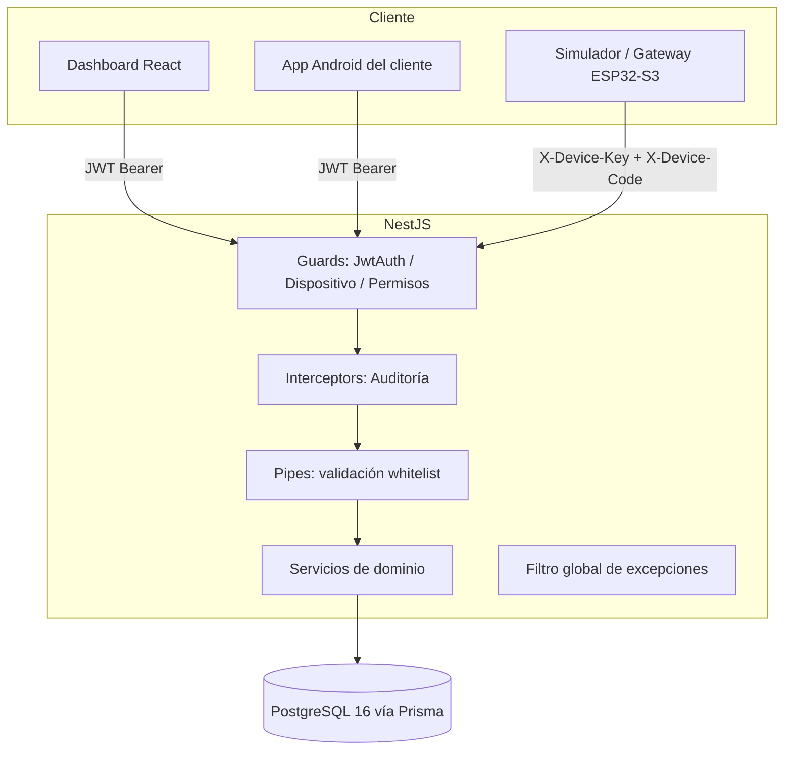
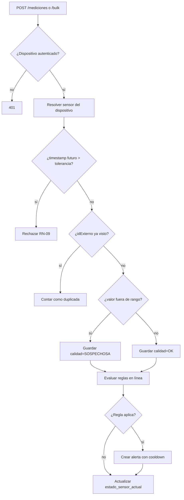
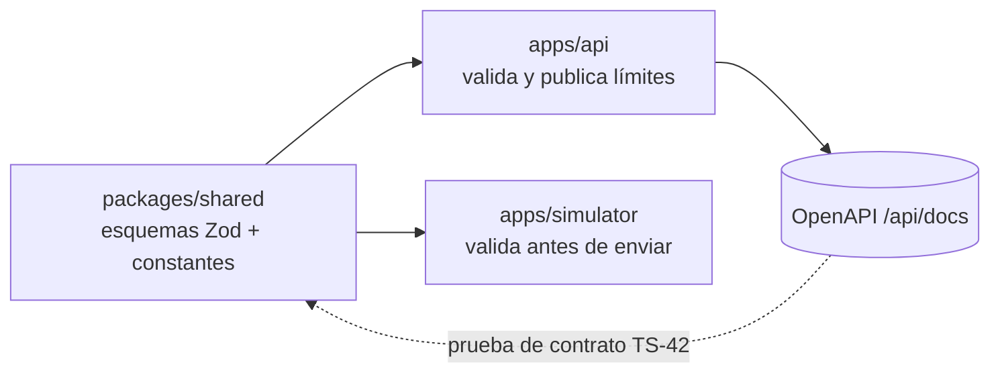

# 03 · Arquitectura e implementación del backend

> Indicadores cubiertos: **1** (funcionalidad que materializa las necesidades), **5** (seguridad, en su parte
> de plataforma) y **6** (estructura mantenible). La seguridad se detalla en el capítulo 07.

## 3.1 Tecnología y justificación

El backend se implementó con **NestJS 10 sobre Node.js 20** y **Prisma 5** como ORM sobre **PostgreSQL 16**.

> **Desviación respecto de ES2.** El borrador de ES2 planteaba **FastAPI (Python)**. El equipo implementó el
> backend en **NestJS (TypeScript)** para mantener **un solo lenguaje en todo el stack** (API, dashboard y
> simulador comparten tipos y esquemas), lo que habilita la **fuente de verdad compartida** descrita en §3.6.
> La arquitectura por capas y el contrato REST se conservan íntegros; el cambio es de tecnología, no de diseño
> (D-01, capítulo 13).

NestJS aporta de forma nativa **guards, interceptors, pipes y decoradores**, que se usan para materializar los
controles transversales (autenticación, autorización, auditoría y validación) **sin duplicar código** en cada
controlador. Esta es la razón técnica de la elección, más allá del lenguaje único.

## 3.2 Arquitectura en capas



Cada petición atraviesa, en orden: **guardas** (¿quién eres y qué puedes hacer?), **interceptor de auditoría**,
**pipe de validación** (rechaza campos no declarados), **servicio de dominio** y, ante cualquier error, el
**filtro global** que normaliza la respuesta. Los tres clientes (dashboard, gateway y app Android) se atienden
con el **mismo contrato**; la diferencia está en el mecanismo de autenticación: humano por **JWT** y máquina
por **cabeceras de dispositivo**.

## 3.3 Módulos implementados

| Módulo | Responsabilidad | Rutas |
|---|---|---|
| `auth` | Login, refresco, cierre de sesión y perfil | `POST /auth/login`, `POST /auth/refresh`, `POST /auth/logout`, `GET /auth/me` |
| `usuarios` | CRUD de usuarios, roles y permisos | `/usuarios`, `/roles`, `/permisos` |
| `sistemas` | CRUD de instalaciones (invernaderos) | `/sistemas` |
| `cultivos` | CRUD de cultivos y su ciclo de vida | `/cultivos` |
| `dispositivos` | CRUD de gateways, rotación de clave y sensores asociados | `/dispositivos`, `/dispositivos/{id}/sensores`, `/dispositivos/{id}/rotar-clave` |
| `sensores` | CRUD de sensores y catálogo de tipos de variable | `/sensores`, `/tipos-variable` |
| `reglas` | CRUD de reglas de alerta y simulación sin persistir | `/reglas`, `POST /reglas/probar/simulacion` |
| `mediciones` | Ingesta individual y por lote, series, últimas lecturas y CSV | `/mediciones`, `/mediciones/bulk`, `/mediciones/serie`, `/mediciones/ultimas`, `/mediciones/exportar.csv` |
| `alertas` | Listado, detalle, resumen y resolución | `/alertas`, `/alertas/{id}`, `/alertas/resumen`, `/alertas/{id}/resolver` |
| `dashboard` | Estado agregado de dispositivos, sensores y alertas | `/dashboard/estado` |
| `auditoria` | Bitácora de operaciones | `/auditoria` |
| `salud` | Sonda de salud | `/health` |

La API expone **35 rutas** publicadas en OpenAPI (§3.7). La organización por **módulo de dominio cohesivo**
—cada uno con su controlador, servicio y DTO— es lo que hace la estructura mantenible: un requisito nuevo se
implementa en un módulo identificable, y una ruta declara explícitamente su permiso.

## 3.4 Autenticación y autorización (resumen)

- **Usuario:** login con correo y contraseña; la respuesta incluye `accessToken` (**JWT**, 15 min) y un
  `refreshToken` (7 días) que viaja en una **cookie `HttpOnly`**. El token se verifica con `passport-jwt`
  (emisor `aquabrain`, audiencia `aquabrain-web`).
- **Contraseñas:** se almacenan con **bcrypt (coste 12)**; nunca en claro.
- **Autorización:** cada ruta declara su permiso con `@RequierePermiso('...')`. Hay **21 permisos** agrupados
  por recurso (`medicion:leer`, `medicion:escribir`, `alerta:resolver`, `dispositivo:rotar_clave`, …) y tres
  roles sembrados: **Administrador** (21 permisos), **Supervisor** y **Encargado** (subconjuntos).
- **Dispositivos:** la ingesta se autentica con dos cabeceras, `X-Device-Key` (clave `ak_live_<base64url>`) y
  `X-Device-Code` (el código del dispositivo).

El detalle de cada control y su prueba está en el **capítulo 07**.

## 3.5 Ingesta de mediciones (el corazón funcional)

La ingesta materializa **RF06 / HU08 / HU10**. El endpoint acepta una lectura (`POST /mediciones`) o un lote
(`POST /mediciones/bulk`) y comparte la siguiente lógica:

1. **Resolución del sensor** por `sensorId` o por `sensorCodigo` **dentro del dispositivo autenticado** (un
   dispositivo no puede escribir sobre el sensor de otro → TS-26).
2. **Validación temporal** contra el reloj del servidor: no se aceptan `timestamp` futuros más allá de la
   tolerancia (`MAX_TIMESTAMP_SKEW`, por defecto 5 min) → TS-10.
3. **Idempotencia:** si el lote trae `idExterno`, se comprueba en `medicion_idempotencia`; un reenvío no
   duplica datos → TS-41, base de HU10.
4. **Calidad:** si el valor está fuera del rango configurado del sensor, la medición **no se descarta**: se
   guarda con `calidad = SOSPECHOSA` y se conserva para análisis → TS-07.
5. **Evaluación de reglas en línea:** si una regla aplica, se crea la alerta (respetando el *cooldown*) → TS-03.
6. **Actualización de estado:** se refresca `estado_sensor_actual` con la última lectura.

El lote admite hasta **`MAX_BULK_ITEMS` = 500** elementos y responde **`207 Multi-Status`** con el desglose
`{recibidas, aceptadas, duplicadas, rechazadas, alertasGeneradas}`, de modo que un dispositivo con lecturas
heterogéneas entiende qué se aceptó y qué no.



## 3.6 Fuente de verdad compartida (`@aquabrain/shared`)

El paquete **`@aquabrain/shared`** define, con **Zod**, los esquemas de entrada (login, usuarios, sistemas,
sensores, reglas y mediciones) y constantes como `MAX_BULK_ITEMS`. Lo consumen el **simulador** (valida antes
de enviar) y la **API** (el tope del lote proviene de la constante compartida y el DTO publica ese límite en
OpenAPI).

Para que la afirmación «una sola fuente de verdad» sea **verificable y no una promesa**, se añadió una prueba
automática de **contrato** (`test/contrato.e2e-spec.ts`, TS-42) que compara el documento OpenAPI publicado con
los esquemas compartidos: confirma que el `minLength` de la contraseña del alta de usuario y el `maxItems` del lote **coinciden** con `usuarioCreateSchema` y `MAX_BULK_ITEMS`, que el esquema compartido rechaza contraseñas demasiado cortas en el alta, y que el login **no** publica la política de contraseñas (ni en OpenAPI ni en `loginSchema`), para no revelarla con respuestas distintas a «Credenciales inválidas».



## 3.7 Documentación OpenAPI

La API publica su contrato en **`/api/docs`** (interfaz) y **`/api/docs-json`** (documento OpenAPI 3). Se
generan **35 rutas**. La configuración reside en `src/config/openapi.ts` y la usan tanto el arranque real como
las pruebas, de forma que el **contrato verificado es el mismo** que consumirá la app Android. Esto responde
directamente a **RF13 / HU11 / RNF08**.

## 3.8 Manejo de errores

Un **filtro global de excepciones** (`AllExceptionsFilter`) normaliza toda salida de error a un único formato:

```json
{ "codigo": "SOLICITUD_INVALIDA", "mensaje": "...", "detalles": ["..."], "ruta": "/api/v1/...", "timestamp": "..." }
```

El **código se deriva del estado HTTP**, no de la forma del cuerpo, lo que evita clasificar mal un error. La
tabla de códigos incluye `NO_AUTORIZADO` (401), `PROHIBIDO` (403), `NO_ENCONTRADO` (404), `DUPLICADO` (409),
`CARGA_EXCESIVA` (413), `SOLICITUD_INVALIDA` (400/422), `DEMASIADAS_SOLICITUDES` (429), `REFERENCIA_INVALIDA`
(fallo de clave foránea) y `ERROR_INTERNO` (5xx). Este comportamiento está cubierto por pruebas unitarias del
filtro (TS-31), **incluido el caso antes defectuoso** de un `422` con cuerpo de texto (H-02, capítulo 13).

## 3.9 Decisiones de implementación destacadas

| Tema | Decisión | Motivo | Evidencia |
|---|---|---|---|
| Precedencia de reglas | Si existen reglas específicas del sensor, se ignoran las de tipo de variable | RN-07: evita alertas duplicadas | `motor-alertas.service.ts` + `reglas.engine.spec` (TS-05) |
| Particionado de `medicion` | Tabla normal con índices, **no** particionada | RNF04 es *Won't*; el volumen del prototipo no lo exige | Capítulo 06; D-05 |
| Motor de reglas | Evaluación **en línea** en la ingesta | Simplicidad para el volumen real; se documenta la alternativa asíncrona (D-06) | `mediciones.service.ts` |
| Exportación CSV | Separador `;` y **BOM UTF-8**, tope de 90 días y 50 000 filas | Apertura correcta en Excel en español | Suite `historicos` (TS-38) |
| Estado de dispositivo | Se deriva **en lectura** a partir de la última comunicación | Evita un proceso programado que mantenga estado duplicado (RN-05) | `frescura.ts` (TS-08/TS-09) |
| Ingesta por lote | **Inserción masiva** `createManyAndReturn` + reglas en un paso por lote | Resolver el cuello de botella del camino de escritura (R-01) | §11.5 y capítulo 13 |

## 3.10 Síntesis del capítulo

El backend es una **arquitectura por capas** con controles transversales reutilizables, un **contrato único**
verificado contra los esquemas compartidos y una **organización por módulos de dominio**. La lógica de negocio
de la ingesta —validación temporal, idempotencia, calidad e idempotencia de alertas— está implementada de
extremo a extremo y respaldada por pruebas (capítulos 10 y 11).
