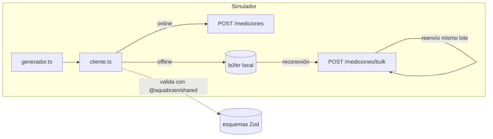

# 05 · Simulador del gateway (ESP32-S3)

> Indicador cubierto: **1** (funcionalidad que materializa la necesidad de ingesta tolerante a cortes) y el
> soporte de la evidencia de pruebas (capítulo 11).

## 5.1 Propósito

El gateway físico real es un **ESP32-S3** del cliente. Para poder ejercitar el backend de extremo a extremo
**sin depender del hardware** (y de forma reproducible) se implementó un **simulador** en `apps/simulator` que
**reproduce el protocolo de ingesta** de la API: mismos endpoints (`POST /mediciones`, `POST /mediciones/bulk`),
mismas cabeceras de dispositivo (`X-Device-Key`, `X-Device-Code`) y los **mismos esquemas de validación**
(importados de `@aquabrain/shared`).

> **Desviación respecto de ES2 (D-02).** El borrador describía un simulador en **Python**. Se implementó en
> **TypeScript (Node)** dentro del monorepo para reutilizar `@aquabrain/shared` como fuente de verdad de la
> validación, y porque `tsc` produce un ejecutable autónomo (`node dist/simulador.js`).

## 5.2 Estructura y componentes

| Archivo | Responsabilidad |
|---|---|
| `src/config.ts` | Lee la configuración por variables de entorno (URL de la API, dispositivo, modo, perfil, intervalo) |
| `src/generador.ts` | Modelo de valores por tipo de variable y perfiles (`normal`, `ola-de-calor`, `sequia`) |
| `src/cliente.ts` | Cliente de la API: valida con los esquemas Zod compartidos y trocea en lotes de `MAX_BULK_ITEMS` |
| `src/simulador.ts` | Orquesta los modos y resume el resultado |

**Modos de operación:**

- **`online`** — envía cada lectura con `POST /mediciones`.
- **`offline`** — acumula las lecturas en un **búfer local** y, al «reconectar», las sincroniza con
  `POST /mediciones/bulk` **conservando** el `timestamp` y el `idExterno` originales; después **reenvía el mismo
  lote** para demostrar la **idempotencia** (HU10).
- **`anomalia`** — inyecta valores fuera del rango del sensor para disparar alertas y marcar la calidad.

Los valores se generan con un modelo físico simple por tipo de variable y, opcionalmente, con un **perfil** que
sesga la temperatura o la humedad.



## 5.3 Evidencia de ejecución

Las tres corridas se realizaron contra la **API en vivo**, con el dispositivo **DEV-01**. Las transcripciones
completas están en `docs/ES3/evidencia/` y se reproducen en el capítulo 17.

### 5.3.1 Modo `online` (perfil ola de calor)

```text
[00:27:51] lectura 1
          TEMP-01      33.30 C
          HUM-01       52.00 %
          PH-01         6.27 pH
          DIST-01      27.40 cm
          CAUDAL-01     0.00 L/min
          → alerta MEDIA: Temperatura alta (valor 33.3)
── Resumen ──
  mediciones aceptadas : 10   alertas generadas : 1   errores : 0
```

La lectura de temperatura (`33,30 °C`) superó el umbral de la regla sembrada «Temperatura alta» (> 32) y generó
la alerta **MEDIA** esperada. Las **10 mediciones aceptadas** corresponden a **2 lecturas × 5 sensores**.

### 5.3.2 Modo `offline` (perfil sequía) — idempotencia

```text
[00:28:02] lectura 1 → almacenado en el búfer local (2 pendientes)
...
[00:28:05] lectura 4 → almacenado en el búfer local (8 pendientes)
[00:28:05] reconexión: sincronizando 8 lecturas en lote…
          → lote: recibidas=8 aceptadas=8 duplicadas=0 rechazadas=0 alertas=0
          → reenvío del mismo lote: duplicadas=8 (idempotencia verificada)
```

Ocho lecturas (4 × 2 sensores) se almacenaron sin conexión y se sincronizaron en un **único lote**; el
**reenvío** del mismo lote dio **8 duplicadas y 0 aceptadas**, lo que **confirma la idempotencia (HU10)** basada
en `idExterno`. En la base de datos se verificó que las 8 filas conservan **cuatro instantes de tiempo
distintos** (`timestamp` de origen preservados, RN-10/TS-41) y `origen = OFFLINE`.

### 5.3.3 Modo `anomalia` — calidad y alertas

```text
[00:28:17] lectura 4 (anomalía inyectada)
          TEMP-01      38.80 C      fuera de rango
          PH-01         7.80 pH     fuera de rango
          → alerta ALTA: pH fuera de rango (valor 7.8)
── Resumen ──
  mediciones aceptadas : 10   valores fuera de rango : 2   alertas generadas : 1   errores : 0
```

Los **dos valores fuera de rango no se descartaron**: se almacenaron con `calidad = SOSPECHOSA` y se creó la
alerta **ALTA** «pH fuera de rango». Se comprobó en la base de datos que las mediciones sospechosas quedaron
registradas.

## 5.4 Verificación cruzada en la base de datos

Tras las corridas se consultó **directamente PostgreSQL** para confirmar que lo que el simulador reportó como
aceptado está **efectivamente persistido**:

| Comprobación | Resultado |
|---|---|
| Mediciones con `origen = OFFLINE` | Presentes (lote sincronizado del modo offline) |
| Instantes distintos en el lote de 8 | **4** instantes distintos para 8 filas (timestamps de origen conservados) |
| Mediciones con `calidad = SOSPECHOSA` | **Las 2** lecturas fuera de rango del modo anomalía |
| Total de mediciones en la tabla | **> 50 000** filas (capítulos 06 y 11) |

Esta verificación cruzada es clave: no basta con que el simulador **diga** que aceptó las lecturas; hay que
**confirmar en la base** que quedaron guardadas con la calidad, el origen y el tiempo correctos.

## 5.5 Valor del simulador para la evaluación

- **Permite reproducir la operación sin hardware**: cualquier evaluador puede lanzar el simulador y ver el
  sistema funcionando.
- **Demuestra los comportamientos más difíciles de lograr**: tolerancia a cortes (búfer offline),
  **idempotencia** y manejo de **valores fuera de rango**.
- **Cierra la brecha del hardware no disponible**, declarada como limitación (RNF08/R-03): el simulador prueba
  el contrato de ingesta, aunque la validación con el **ESP32-S3 físico** y la **app Android real** queda como
  trabajo futuro.

## 5.6 Alcance no cubierto

- **No** se validó contra el **dispositivo físico** (ESP32-S3) ni la **app Android** del cliente (R-03).
- El modelo de valores es **simulado**, no una calibración real de sensores (los datos se rotulan con su
  origen para no confundirlos con mediciones reales).
