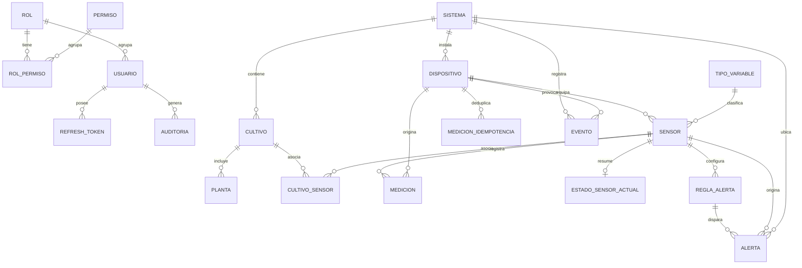

# 06 · Base de datos: estructura, normalización y optimización

> Indicadores cubiertos: **3** (estructura adecuada de la base de datos: relaciones, claves, índices y datos de
> prueba) y **4** (optimización y normalización, con justificación de índices).

## 6.1 Motor y migraciones

La base de datos es **PostgreSQL 16** (contenedor `postgres:16`, versión 16.15) y se gestiona con **Prisma
Migrate**. El esquema se aplicó mediante migraciones **versionadas**; hay una migración inicial registrada:

```text
migration_name          finished_at
20261016225855_init     2026-10-16 22:58:56 UTC
```

La API ejecuta **`prisma migrate deploy` antes de arrancar**, de modo que el esquema se aplica solo si hace
falta (operación idempotente). El esquema físico (modelos Prisma) consta de **19 modelos** y en la base hay
**20 tablas** (`pg_tables`): los 19 modelos más la tabla de control `_prisma_migrations`.

```text
Rol · Permiso · RolPermiso · Usuario · RefreshToken · Auditoria ·
Sistema · Cultivo · Planta · Dispositivo · TipoVariable · Sensor ·
CultivoSensor · Medicion · MedicionIdempotencia · EstadoSensorActual ·
ReglaAlerta · Alerta · Evento
```

## 6.2 Estructura relacional



Las entidades siguen la jerarquía del dominio real: un **sistema** (invernadero) contiene **cultivos** y
**dispositivos**; un dispositivo **equipa sensores** de distintos **tipos de variable**; cada sensor **registra
mediciones** en el tiempo; y las **reglas** sobre un sensor o un tipo generan **alertas** y **eventos**. Los
catálogos (**rol**, **permiso**, **tipo de variable**) están separados de los datos de operación.

## 6.3 Integridad

| Mecanismo | Implementación | Motivo |
|---|---|---|
| **Clave primaria** | UUID por defecto (`gen_random_uuid()`), salvo `medicion` con PK **compuesta `(id, timestamp)`** y `auditoria` (bigserial) | El PK compuesto de `medicion` habilita particionado futuro por fecha |
| **Claves foráneas** | Explícitas en todos los modelos | No hay referencias huérfanas |
| **Integridad histórica** | `ON DELETE RESTRICT` en `medicion → sensor` y `medicion → dispositivo` | **No se pierde historia** de sensores/dispositivos |
| **Borrado en cascada** | `ON DELETE CASCADE` en dependencias de composición (`rol_permiso`, `sensor`, `refresh_token`) | Se elimina solo lo que no tiene valor propio |
| **Unicidad** | `usuario.email`, `sistema.codigo`, `dispositivo.codigo`, `tipo_variable.codigo`, `(dispositivo, sensor.codigo)`, `(dispositivo, idExterno)` | Evita duplicados en identificadores de negocio |
| **Idempotencia** | PK compuesta `(dispositivo_id, id_externo)` en `medicion_idempotencia` | Base de HU10 (no duplicar historia offline) |

## 6.4 Normalización

El esquema está en **tercera forma normal (3NF)**. La evidencia de cada paso:

| Forma normal | Evidencia en el esquema |
|---|---|
| **1FN** — valores atómicos, sin grupos repetidos | Cada lectura es **una fila** en `medicion` (no una columna por sensor). No hay listas embebidas; las relaciones 1:N se resuelven con filas. |
| **2FN** — sin dependencias parciales | Las tablas puente `rol_permiso (rol_id, permiso_id)` y `cultivo_sensor (cultivo_id, sensor_id)` tienen **clave primaria compuesta** y **ningún atributo que dependa solo de una parte**. En `medicion`, todos los atributos dependen del par `(id, timestamp)`. |
| **3FN** — sin dependencias transitivas | El **tipo de variable** se separa de `sensor` (`sensor.tipo_variable_id`): el nombre y la unidad por defecto de una variable no se repiten en cada sensor. El **estado** y la **ubicación** viven en su entidad, no derivados a través de otra. |

**Desnormalizaciones controladas y justificadas** (no son descuidos, son decisiones documentadas):

| Estructura | Naturaleza | Justificación |
|---|---|---|
| `estado_sensor_actual` | **Materialización** de la última lectura por sensor | Evita un `ORDER BY … LIMIT 1` sobre 52 000+ filas en **la consulta más frecuente** (el panel). Se mantiene coherente al ingerir. |
| `medicion_idempotencia` | Registro de deduplicación | Persistir las claves externas vistas permite **idempotencia O(1)** sin escanear la tabla de mediciones. |
| `alerta.sistema_id` | Redundancia respecto de `sensor → dispositivo → sistema` | Permite **filtrar alertas por instalación** con un solo índice, sin *joins* en la consulta más usada de la bandeja. |
| `medicion.alerta_generada` | Bandera derivable | Evita recomputar, para cada lectura, si ya generó alerta durante la ingesta por lote. |

Cada una de estas decisiones sacrifica una mínima redundancia a cambio de un **beneficio medible de lectura**
y se acompaña de la lógica que la mantiene consistente.

## 6.5 Índices y su justificación

La tabla `medicion` tiene clave primaria compuesta y **tres índices secundarios**; el resto del modelo tiene
índices sobre los patrones de acceso reales. Los identificadores `I-0x` trazan al catálogo de diseño de ES2:

| Índice | Definición | Consulta que optimiza |
|---|---|---|
| `medicion_pkey` | `UNIQUE btree (id, timestamp)` | Identificación y soporte de particionado futuro |
| `idx_medicion_sensor_ts` (**I-01**) | `btree (sensor_id, timestamp DESC)` | **Series históricas** por sensor (HU02) |
| `idx_medicion_dispositivo_ts` (**I-02**) | `btree (dispositivo_id, timestamp DESC)` | Últimas lecturas por dispositivo |
| `idx_medicion_timestamp` (**I-03**) | `btree (timestamp)` | Rangos globales y mantenimiento |
| `medicion_idempotencia` (**I-04**) | PK `(dispositivo_id, id_externo)` | Detección de duplicados en la ingesta |
| `idx_alerta_estado` (**I-05**) | `btree (estado, severidad, creada_en DESC)` | Bandeja de alertas (HU03) |
| `idx_regla_activa_sensor` / `_tipo` (**I-07**) | `btree (activa, sensor_id)` / `(activa, tipo_variable_id)` | Selección de reglas aplicables en la ingesta |
| `idx_dispositivo_sistema_estado` (**I-08**) | `btree (sistema_id, estado_conexion)` | Estado de dispositivos por sistema (RF14) |
| `idx_auditoria_ocurrido` (**I-10**) | `btree (ocurrido_en DESC)` | Consulta de auditoría por fecha |
| `idx_refresh_token_expira` (**I-11**) | `btree (expira_en)` | Purga de tokens vencidos |
| `estado_sensor_actual` (**I-12**) | PK `(sensor_id)` | Última lectura por sensor (dashboard) |

> El criterio es **índices dirigidos por el patrón de acceso**: cada índice responde a una consulta que el
> sistema realmente ejecuta (panel, serie, bandeja de alertas, ingesta), no a una colección arbitraria de
> columnas.

## 6.6 Optimización medida (evidencia real)

El índice `idx_medicion_sensor_ts` sostiene la consulta de series (HU02/HU04). Su efecto se midió con
**`EXPLAIN (ANALYZE, BUFFERS)`** sobre la consulta real de agregación por *bucket* (`date_bin`):

```text
GroupAggregate  (actual time=1.523..1.945 rows=49 loops=1)
  ->  Sort  (actual time=1.479..1.513 rows=295 loops=1)
        ->  Bitmap Heap Scan on medicion  (actual time=1.214..1.342 rows=295 loops=1)
              Recheck Cond: (sensor_id = ... AND "timestamp" >= ... AND "timestamp" <= ...)
              ->  Bitmap Index Scan on idx_medicion_sensor_ts  (actual time=1.175..1.176)
Planning Time: 1.624 ms
Execution Time: 2.217 ms
```

La agregación de **dos días por hora** se resuelve en **≈ 2,2 ms** usando el índice, sobre una tabla de más de
50 000 filas. El plan confirma un **Bitmap Index Scan** sobre `idx_medicion_sensor_ts`, es decir, el índice se
está usando (no un *seq scan*).

Además, el camino de **escritura** se optimizó dentro de ES3 (recomendación **R-01**): la ingesta por lote pasó
de **una transacción por lectura** a una **inserción masiva** (`createManyAndReturn`) con evaluación de reglas
en **un paso por lote**, bajando un lote de 500 lecturas de **16 410 ms a ~1 403 ms** (≈ 12×). El detalle y la
evidencia están en el capítulo 11.

## 6.7 Volumetría real y datos de prueba

Conteos tomados **directamente de PostgreSQL** tras ejecutar todas las pruebas y corridas del simulador:

| Tabla | Filas | Nota |
|---|---:|---|
| `medicion` | **52 230** | Ver composición abajo |
| `auditoria` | 877 | Generadas por las pruebas y el uso |
| `medicion_idempotencia` | 2 030 | Claves de idempotencia registradas |
| `refresh_token` | 110 | Sesiones emitidas/revocadas |
| `rol_permiso` | 39 | Asignaciones permiso↔rol |
| `permiso` | 21 | Catálogo de permisos |
| `sensor` | 10 | 5 por dispositivo |
| `dispositivo` | 2 | `DEV-01`, `DEV-02` |
| `tipo_variable` | 5 | TEMPERATURA, HUMEDAD, PH, DISTANCIA, CAUDAL |
| `regla_alerta` | 4 | Reglas sembradas |
| `usuario` | 3 | Administrador, Supervisor, Encargado |
| `sistema` | 2 | Invernadero Norte y Sur |
| `cultivo` | 3 | Cultivos sembrados |
| `alerta` | 3 | 2 activas y 1 resuelta (tras la prueba de resolución) |

**Composición de la tabla de mediciones (52 230):**

| Origen de las filas | Cantidad |
|---|---:|
| Semilla determinista (30 días × 10 min × 10 sensores) | 43 200 |
| Carga sintética para la prueba de volumen TS-43 | 7 000 |
| Lotes de rendimiento de escritura (4 × 500 lecturas por la API) | 2 000 |
| Ingesta del simulador (modos online/offline/anomalía) | 30 |
| **Total** | **52 230** |

**Calidad y origen registrados correctamente:**

| `origen` | `calidad` | Filas |
|---|---|---:|
| ONLINE | OK | 50 220 |
| ONLINE | SOSPECHOSA | 2 |
| OFFLINE | OK | 2 008 |

Las **2** mediciones `SOSPECHOSA` son exactamente los valores fuera de rango inyectados por el simulador
(TS-07), lo que confirma que **no se descartan**. Las **2 008** `OFFLINE` provienen del lote sincronizado del
simulador (8) y de los lotes de rendimiento (2 000).

> **Datos de prueba deterministas.** La semilla (`prisma/seed.ts`) es reproducible con semilla fija; los
> *tenants* temporales que crean las pruebas de integración se eliminan al terminar cada suite (RP-03), por lo
> que **no dejan residuos**. Los datos no son personales.

## 6.8 Síntesis del capítulo

La base de datos es **operativa y coherente con el dominio**: 19 modelos relacionados por claves foráneas con
integridad histórica, **normalizados a 3FN** con desnormalizaciones **explícitas y justificadas**, e **indexados
según el patrón de acceso real**, con efecto **medido** (`EXPLAIN ANALYZE` ≈ 2,2 ms). La tabla de mediciones
supera las **52 000 filas** con datos de prueba **deterministas y trazables** a cada prueba que los generó.
