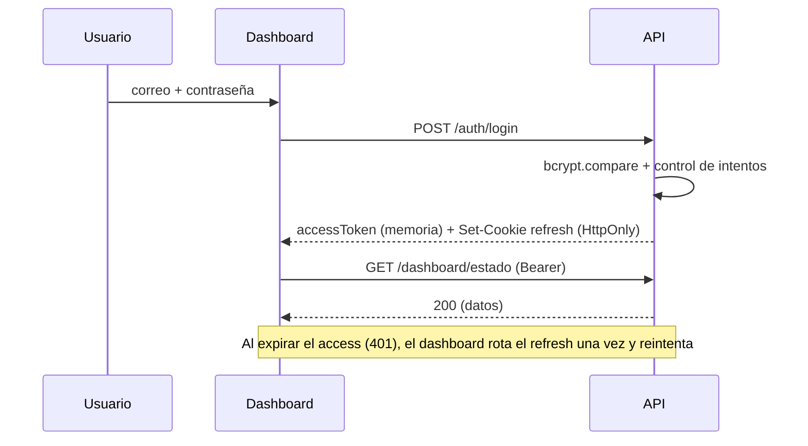

# 07 · Seguridad implementada

> Indicador cubierto: **5** (implementación de patrones de seguridad: autenticación/autorización, validación,
> protección de credenciales y controles implementados).

Esta sección documenta los controles **efectivamente implementados y probados**, no solo los diseñados. Cada
control va acompañado de la **prueba que lo respalda** (los casos `TS-xx` se detallan en el capítulo 11).

## 7.1 Autenticación de usuarios

| Control | Implementación | Prueba |
|---|---|---|
| Contraseñas con hash | **bcrypt con coste 12**; nunca en claro | `auth`/`gestion` verifican que el usuario creado no expone la contraseña y que el hash es bcrypt (TS-12) |
| Token de acceso | **JWT** firmado, `iss=aquabrain`, `aud=aquabrain-web`, TTL 15 min | `auth`: token válido, expirado y manipulado (TS-14) |
| Token de refresco | TTL 7 días, en **cookie `HttpOnly`**; se **rota** y se **revoca** en el cierre de sesión | `auth`: refresco válido, revocado y reutilizado (TS-15) |
| Bloqueo por intentos | Cinco intentos fallidos bloquean la cuenta (15 min); se registra el evento | `auth` (TS-13) |
| Coste constante en credenciales inexistentes | Se compara contra un hash ficticio para no filtrar por tiempo | `auth.service.ts` + `auth` (TS-13) |
| Control de tasa en el login | `@nestjs/throttler` sobre el login | `limites`: `429 DEMASIADAS_SOLICITUDES` (TS-13) |

Los tokens de refresco se persisten en la tabla `refresh_token` (con estado de revocación), lo que permite
**invalidar sesiones** y **auditar su ciclo de vida**. La **rotación** del refresco, además, cierra el vector de
**reutilización de tokens**: reutilizar uno ya rotado **revoca toda la cadena de sesión** (TS-15).

## 7.2 Autorización por roles (RBAC)

La API define **21 permisos** agrupados por recurso (`medicion:leer`, `medicion:escribir`, `alerta:resolver`,
`dispositivo:rotar_clave`, `rol:asignar`, `auditoria:leer`, etc.) y tres roles sembrados: **Administrador**
(21 permisos), **Supervisor** y **Encargado** (subconjuntos). El patrón es **basado en permisos, no en roles**:
cada ruta declara el **permiso** que exige, y el rol es solo un conjunto de permisos, lo que permite ajustar la
matriz sin tocar el código.

- Cada ruta declara su permiso con `@RequierePermiso(...)`.
- Una petición **sin sesión** recibe **401**; una sesión **sin el permiso** recibe **403**.
- La denegación, además de responder `403`, **se registra en la auditoría**.

**Pruebas ejecutadas** (suite `rbac`, 11 casos, TS-16…TS-19, TS-26): cada rol accede solo a lo que le
corresponde y los intentos fuera de alcance devuelven `403`. Casos destacados:

- Un usuario **no puede desactivar su propia cuenta** (evita el auto-bloqueo, `403`).
- Un usuario **no puede asignarse un rol a sí mismo** infringiendo RN-06 (`403` + auditoría).
- Un dispositivo no puede reportar con el **sensor de otro dispositivo** (`403`, nada se persiste).

## 7.3 Autenticación de dispositivos (máquina a máquina)

La ingesta se autentica con **dos cabeceras**: `X-Device-Key` (clave `ak_live_<base64url>`) y `X-Device-Code`
(código del dispositivo). El patrón de seguridad aplicado:

- La clave se almacena **hasheada con bcrypt + pepper** (`DEVICE_KEY_PEPPER`); **no es recuperable**.
- Como el hash no permite localizar el dispositivo, el **código es obligatorio** junto con la clave (esto evita
  que un hash robado sea útil para identificar a quién pertenece).
- Existe **rotación de clave** (`POST /dispositivos/{id}/rotar-clave`), protegida por el permiso
  `dispositivo:rotar_clave`; al rotar, la clave anterior **deja de funcionar de inmediato** (TS-28).
- Un dispositivo inactivo o una clave/código mal emparejada recibe **401**.

Las claves reales solo existen en el entorno local (`.env`); la semilla las **imprime una única vez** y **no se
versionan**. Se conservan los últimos cuatro caracteres (`apiKeyUltimos4`) para poder **identificarlas sin
exponerlas**.

## 7.4 Validación de entrada

El pipe global de validación usa **`whitelist`** y **`forbidNonWhitelisted`**, lo que convierte la validación en
un control de seguridad, no solo de calidad de datos:

- **422** si el cuerpo trae **campos no declarados** (TS-21).
- **400** si un campo declarado tiene un **valor inválido** (TS-22).
- **UUID inválido** en parámetros → **400** (`ParseUUIDPipe`).
- Límites de tamaño del lote (`ArrayMinSize`, `ArrayMaxSize`, `Min`, `Max`) → TS-30.

Esto **bloquea de raíz los ataques de *mass assignment*** (por ejemplo, enviar `rol` o `activo` donde no
corresponde) y se verificó en las suites `mediciones` y `gestion`.

## 7.5 Endurecimiento HTTP

| Control | Configuración | Prueba |
|---|---|---|
| Cabeceras de seguridad | **helmet** (`aplicarEndurecimiento`) | `salud` (TS-23) |
| CORS | Lista explícita de orígenes (`CORS_ORIGINS`), **sin comodines** | `salud` (TS-23) |
| Límite de cuerpo | `BODY_LIMIT` = 1 MB → **413 `CARGA_EXCESIVA`** | filtro (TS-30) |
| Control de tasa | `@nestjs/throttler` sobre el login → **429 `DEMASIADAS_SOLICITUDES`** | `limites` (TS-13) |
| Validación de parámetros | `ParseUUIDPipe` y DTO con transformación y rango | `mediciones`/`gestion` |
| No exponer servidor/versión | helmet elimina `X-Powered-By` | `salud` (TS-23) |

La configuración de endurecimiento se aplica **tanto en `main.ts` como en las pruebas** (`aplicarEndurecimiento`),
de modo que **lo probado es lo desplegado**.

## 7.6 Auditoría

Toda **operación de escritura** y toda **denegación de permiso** pasa por el `AuditoriaInterceptor`, que registra
en la tabla `auditoria` el usuario (o dispositivo), la acción, la entidad afectada, la ruta y el resultado. La
bitácora se consulta por `GET /auditoria` (permiso `auditoria:leer`). Se verificó que la creación de una regla y
la resolución de una alerta quedan auditadas (TS-27) y que las denegaciones RBAC también (TS-18). En la base de
desarrollo hay **centenares de registros** generados por las pruebas.

> **Hallazgo real detectado durante las pruebas.** La consulta `GET /auditoria` fallaba con `500` por un error
> de serialización de `BigInt`; se corrigió serializando el identificador a cadena en el controlador. Es un
> ejemplo de **defecto de seguridad/robustez encontrado y resuelto** gracias a las pruebas de integración.

## 7.7 Gestión de secretos

Todos los secretos (JWT, *pepper* de dispositivo, credenciales de base de datos) se leen de **variables de
entorno**. `.gitignore` excluye `.env`, `.env.*` (salvo `.env.example`) e `infra/.env`. Antes del primer commit
se verificó que **no se versiona ninguna clave real**. `docker-compose.yml` exige `JWT_ACCESS_SECRET`,
`JWT_REFRESH_SECRET` y `DEVICE_KEY_PEPPER` con la sintaxis `:?`, de modo que el despliegue **falla** si no se
definen, en lugar de arrancar con valores por defecto inseguros.

## 7.8 Mapeo a patrones de seguridad (OWASP Top 10 · 2021)

| Riesgo OWASP | Control implementado | Evidencia |
|---|---|---|
| **A01** Control de acceso quebrado | RBAC por permiso en cada ruta (`@RequierePermiso`), 401/403 correctos, auditoría de denegación | `rbac` (11), `permisos.guard.spec` |
| **A02** Fallas criptográficas | bcrypt coste 12; claves de dispositivo con pepper; JWT firmados; secretos fuera del repositorio | `auth`, `gestion`; §7.7 |
| **A03** Inyección | ORM parametrizado (Prisma) y validación estricta; sin SQL concatenado | `mediciones` (TS-20) |
| **A04** Diseño inseguro | Rotación de refresco, bloqueo por intentos, idempotencia, principio de mínimo privilegio | `auth` (TS-13/14/15) |
| **A05** Configuración insegura | helmet, CORS por lista, límite de cuerpo, *throttler*, validación de entorno al arranque | `salud` (TS-23), `limites` |
| **A06** Componentes vulnerables | `npm audit` ejecutado; hallazgos en dependencias **transitivas** con plan de actualización | §11.6 y capítulo 13 |
| **A07** Fallas de identificación/autenticación | Bloqueo de cuenta, respuesta genérica, coste de tiempo constante, rotación de sesión | `auth` (TS-13/14/15) |
| **A08** Integridad de datos/software | Validación *whitelist*, verificación de tipos, migraciones versionadas, CI que bloquea el *merge* | `validation.pipe.spec`, CI |
| **A09** Registro y monitoreo insuficientes | `AuditoriaInterceptor`, `GET /auditoria`, eventos de dispositivo | `alertas` (TS-27) |
| **A10** SSRF | N/A en el alcance (la API no consume URLs provistas por el usuario) | — |

## 7.9 Alcance no cubierto (declarado)

- **No** se ejecutó un análisis con **OWASP ZAP** ni una **prueba de penetración** formal (D-11): el
  endurecimiento se verificó con **pruebas automatizadas propias**.
- **No** se implementó el control de tasa **distribuido** (Redis); el *throttler* es **en memoria por
  instancia**, por lo que el límite no se comparte entre réplicas (D-07).
- **No** se configuró **HTTPS/TLS** de extremo a extremo en el entorno local (queda a cargo del proxy en el
  despliegue productivo).
- El **análisis de dependencias** encontró **61 vulnerabilidades transitivas** (41 altas, 1 crítica) del
  ecosistema NestJS 10; **no hay código propio afectado** y se planifica la actualización mayor (§11.6, R-16).

## 7.10 Síntesis del capítulo

Los **patrones de seguridad** están implementados y **probados**, no solo declarados: autenticación con
**rotación y revocación de sesión**, **autorización por permiso** en cada ruta, autenticación **máquina a
máquina** con clave hasheada, **validación estricta** de entrada que corta el *mass assignment*, **endurecimiento
HTTP** (helmet/CORS/límite/tasa) y **auditoría** de escrituras y denegaciones. El mapeo a **OWASP Top 10**
enlaza cada patrón con la prueba que lo respalda, y las brechas (ZAP, tasa distribuida, TLS) quedan declaradas.
