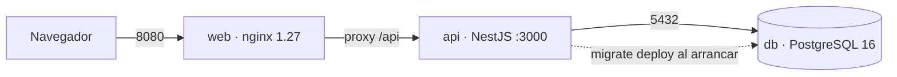

# 09 · Despliegue reproducible y documentación

> Indicadores cubiertos: **8** (configuración del entorno de trabajo y despliegue reproducible) y **9**
> (documentación de la implementación).

## 9.1 Estrategia de empaquetado

La solución se empaqueta con **Docker Compose** en **tres servicios** que reproducen el entorno completo en
cualquier máquina con Docker:

```text
infra/
├─ docker-compose.yml   Orquesta db + api + web
├─ api.Dockerfile       Imagen multi-etapa de la API (NestJS + Prisma)
├─ web.Dockerfile       Imagen multi-etapa del dashboard (Vite + nginx)
├─ nginx.conf           Sirve el SPA y proxea /api hacia la API
└─ .env.example         Plantilla de variables (los secretos no se versionan)
```



| Servicio | Imagen / build | Puerto host |
|---|---|---|
| `db` | `postgres:16-alpine` + volumen `dbdata` | **5432** |
| `api` | `infra/api.Dockerfile` (multi-etapa) | **3000** |
| `web` | `infra/web.Dockerfile` (multi-etapa) | **8080** |

## 9.2 Puesta en marcha

```powershell
# 1) Preparar variables de entorno (y editar los secretos)
Copy-Item infra/.env.example infra/.env

# 2) Construir y levantar la pila completa
docker compose --env-file infra/.env -f infra/docker-compose.yml up --build

# 3) Abrir el dashboard
#    http://localhost:8080     (el navegador solo habla con nginx)
```

Las variables se documentan en `infra/.env.example` (POSTGRES_*, API_PORT, WEB_PORT, LOG_LEVEL,
JWT_ACCESS_SECRET, JWT_REFRESH_SECRET, JWT_*_TTL, BCRYPT_COST, DEVICE_KEY_PEPPER, ALERT_SILENCE_FACTOR,
MAX_TIMESTAMP_SKEW, BODY_LIMIT, CORS_ORIGINS). La plantilla indica **generar secretos propios** con
`node -e "console.log(require('crypto').randomBytes(48).toString('base64url'))"`.

## 9.3 Decisiones de empaquetado

| Decisión | Motivo |
|---|---|
| **Multi-etapa** en ambas imágenes | La etapa de compilación (con devDependencies y `tsc`) **no viaja** a la imagen final |
| **Contexto de build = raíz del monorepo** | La API compila `@aquabrain/shared`, que es un *workspace* |
| **`npm ci` sobre manifiestos copiados primero** | Aprovecha la **caché de capas** de Docker |
| **`prisma migrate deploy` al arrancar** | El esquema se aplica solo si hace falta (idempotente) |
| **nginx como proxy inverso de `/api`** | El navegador ve **un único origen**: sin CORS y con la cookie de refresco como *same-origin* |
| **Secretos por `:?` en Compose** | Si faltan `JWT_ACCESS_SECRET`, `JWT_REFRESH_SECRET` o `DEVICE_KEY_PEPPER`, el despliegue **falla** en vez de arrancar inseguro |
| **Volumen `dbdata`** | Los datos persisten entre reinicios del contenedor |

## 9.4 Evidencia de verificación del despliegue

La reproducibilidad no se afirma: se **verificó**. Comandos reales ejecutados desde la raíz del proyecto:

| Verificación | Comando | Resultado real observado |
|---|---|---|
| Sintaxis y render de la pila | `docker compose --env-file infra/.env -f infra/docker-compose.yml config` | Terminó con **código 0** (pila válida) |
| Construcción de la imagen de la API | `docker build -f infra/api.Dockerfile -t aquabrain-api:dev .` | Construcción **completa en 82,2 s**; imagen final **162 MB** |
| Arranque de la imagen y auto-verificación | `docker run --rm aquabrain-api:dev node -e "…"` | `node v20.20.2` · `MAX_BULK_ITEMS = 500` · `prisma 5.22.0` |
| API local contra la base real | `node dist/main.js` | `GET /api/v1/health` → `{estado:ok, baseDeDatos:ok}` |
| Dashboard local | `npm run dev` (Vite) | Sirve en `http://localhost:5173` y consume la API |
| PostgreSQL de desarrollo | contenedor `aquabrain-pg` | Escucha en `host:55432` (mapeo local) |

La imagen expone el precio de la reproducibilidad (≈ 162 MB, 82 s de build) y confirma que **lo que se probó es
lo que se empaqueta**: la misma constante `MAX_BULK_ITEMS = 500` compartida por API y simulador aparece dentro
del contenedor.

## 9.5 Documentación de la implementación

La documentación es **parte del producto**, no un anexo. Se compone de:

| Documento | Contenido | Ubicación |
|---|---|---|
| **README** | Índice de la documentación y **guía de instalación/operación** con comandos | `README.md` |
| **Catálogo canónico** | Necesidades, HU, RF/RNF, CU y reglas de negocio (fuente de la trazabilidad) | `docs/ES1/` |
| **Diseño de la solución** | Arquitectura 4+1, DER y diccionario, seguridad, plan de pruebas TS-01…TS-44 | `docs/ES2/` |
| **Implementación (técnica)** | 17 capítulos con la evidencia de ejecución real | `docs/ES3/00-…-16-…` |
| **Implementación (académica)** | Este informe | `docs/ES3/informe/` |
| **Contrato de la API** | OpenAPI 3 servido y navegable | `GET /api/docs` · `/api/docs-json` |
| **Configuración** | Plantilla de variables de entorno | `infra/.env.example`, `apps/api/.env.example` |
| **Contratos compartidos** | Esquemas Zod con JSDoc | `packages/shared/src/` |
| **Documentación en el código** | Comentarios que citan el requisito/regla implementados | `apps/api/src/**` |

El **README** incluye el **índice maestro** que enlaza cada entrega, la **propuesta de valor**, el **alcance
MoSCoW**, los **candidatos de hardware** y el **procedimiento de puesta en marcha**, de modo que una persona
nueva puede **entender e instalar** el sistema sin ayuda externa.

## 9.6 Limitaciones del despliegue (declaradas)

| Limitación | Consecuencia | Recomendación |
|---|---|---|
| **No hay despliegue en la nube** | El sistema corre en local; no hay URL pública | R-02 |
| **Sin TLS/HTTPS** en el entorno local | El tráfico no va cifrado en la red local | R-02 |
| **Repositorio sin remoto** | No hay entrega continua (CD) real | R-14 |
| **Una sola instancia** | El *throttler* y la caché no se comparten entre réplicas | R-05 |

El despliegue en un entorno real (contenedor gestionado o PaaS, con HTTPS y secretos por gestor de secretos)
es la recomendación **R-02**, prioridad alta en el capítulo 13.

## 9.7 Síntesis del capítulo

El entorno de trabajo es **reproducible por construcción**: imágenes **multi-etapa**, orquestación con
**Compose**, configuración **por variables de entorno**, aplicación de **migraciones al arrancar** y
**verificación real** del build (162 MB, 82,2 s) y del arranque (health `ok`). La documentación —README, catálogo
ES1, diseño ES2, informes de implementación, OpenAPI y comentarios trazables en el código— cubre **instalación,
arquitectura y operación**, cumpliendo el indicador de documentación y dejando explícitas sus limitaciones.
