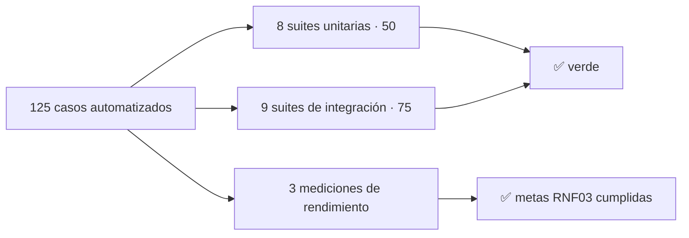

# 11 · Ejecución del protocolo de pruebas

> Indicador cubierto: **11** (ejecución del protocolo de pruebas: registro con esperado, obtenido, estado,
> evidencia y observación).

## 11.1 Entorno de ejecución

| Elemento | Valor |
|---|---|
| Ejecutor | Equipo AquaBrain |
| Fecha | 2026-10-16 / 2026-10-17 |
| Backend | NestJS 10 · Prisma 5.22 · Node.js (build Docker `v20.20.2`) |
| Base de datos | PostgreSQL 16.15 (contenedor `aquabrain-pg`) |
| Frontend | React 18 · Vite 5 |
| Herramientas | **Jest + Supertest** (automatizadas) · **script HTTP propio** (rendimiento) · **navegador automatizado** (interfaz) |
| Volumen | **52 230** mediciones · **877** registros de auditoría |

## 11.2 Resumen de la ejecución

| Tipo | Suites | Casos | Resultado | Herramienta |
|---|---:|---:|---|---|
| Unitarias | 8 | **50** | ✅ 50 en verde | Jest |
| Integración (e2e) | 9 | **75** | ✅ 75 en verde | Jest + Supertest |
| **Total automatizado** | **17** | **125** | **✅ 125 en verde** | — |
| Rendimiento | — | 3 endpoints + 1 escritura | ✅ metas cumplidas | Script HTTP propio |
| Interfaz | — | 4 pantallas + 2 acciones | ✅ verificado en navegador | Navegador automatizado |

La cobertura se mide sobre la **suite completa** (unitarias + integración), que es la que ejercita el código de
producción de extremo a extremo.

## 11.3 Suites unitarias (8 suites / 50 casos)

| Suite | Casos | Qué verifica |
|---|---:|---|
| `all-exceptions.filter.spec.ts` | 10 | Normalización de errores y derivación de códigos por estado (401/403/404/409/413/422/429/5xx) |
| `reglas.engine.spec.ts` | 11 | Operadores del motor de reglas (`MAYOR_QUE`, `MENOR_QUE`, `FUERA_DE_RANGO`, …) y evaluación por alcance |
| `permisos.guard.spec.ts` | 7 | Autorización y auditoría de la denegación |
| `frescura.spec.ts` | 6 | Derivación de frescura y de estado de conexión |
| `validation.pipe.spec.ts` | 5 | Validación *whitelist* y rechazo de campos/valores inválidos |
| `env.validation.spec.ts` | 5 | Robustez de la configuración (variables de entorno inválidas) |
| `auditoria.interceptor.spec.ts` | 3 | Registro de auditoría de operaciones |
| `tiempo.spec.ts` | 3 | Validación temporal (timestamp futuro/pasado, RN-09/RN-10) |

## 11.4 Suites de integración (9 suites / 75 casos)

| Suite | Casos | Qué verifica |
|---|---:|---|
| `gestion.e2e-spec.ts` | 16 | CRUD de usuarios, sistemas, cultivos, dispositivos, sensores y reglas |
| `mediciones.e2e-spec.ts` | 12 | Ingesta, validación, idempotencia, límites y timestamp |
| `rbac.e2e-spec.ts` | 11 | Permisos por rol, IDOR, auto-asignación y aislamiento por dispositivo |
| `alertas.e2e-spec.ts` | 9 | Reglas, cooldown, resolución, auditoría y dispositivo sin comunicación |
| `auth.e2e-spec.ts` | 8 | Login, bloqueo por intentos, tokens y refresco |
| `salud.e2e-spec.ts` | 7 | Sonda de salud, cabeceras de seguridad, CORS y contrato |
| `historicos.e2e-spec.ts` | 6 | Series, agregación, exportación CSV, comparación y rotación de clave |
| `contrato.e2e-spec.ts` | 5 | Coherencia OpenAPI ↔ esquemas compartidos (TS-42) |
| `limites.e2e-spec.ts` | 1 | Control de tasa en el login (TS-13) |

## 11.5 Registro de ejecución del catálogo (TS-01…TS-44)

**Estados:** ✅ Aprobado · ⚠️ Con hallazgo · 🟡 Parcial · ⬜ No aplica.

| ID | Requisito | Esperado (resumen) | Obtenido | Estado | Evidencia |
|---|---|---|---|---|---|
| TS-01 | RF11, RN-04 | Alerta con la severidad configurada | Alerta creada (`MAYOR_QUE`) | ✅ | `reglas.engine.spec.ts` |
| TS-02 | RF11 | Alerta indicando el umbral aplicado | Alerta de rango generada | ✅ | `reglas.engine.spec.ts` |
| TS-03 | RF11, RN-04 | Una sola alerta activa dentro del cooldown | Una sola alerta; valor = umbral no dispara | ✅ | `alertas.e2e-spec.ts` |
| TS-04 | RF10, RF11 | Regla inactiva no genera alerta | Sin alertas | ✅ | `reglas.engine.spec` + `alertas.e2e` |
| TS-05 | RN-07 | Prevalece la regla del sensor | Sensor precede a tipo de variable | ✅ | `alertas.e2e-spec.ts` |
| TS-06 | RF10, HU07 | Simular regla sin persistir | Indica sin crear alerta ni persistir | ✅ | `gestion.e2e-spec.ts` |
| TS-07 | RF06, RNF01 | `SOSPECHOSA` o rechazo configurable | Se guarda `SOSPECHOSA` (no se descarta) | ✅ | `frescura.spec` + simulador + BD (2 `SOSPECHOSA`) |
| TS-08 | RF07, RN-05 | Fresco, fresco y desactualizado | Derivación correcta (1/4/20 min) | ✅ | `frescura.spec.ts` |
| TS-09 | RF14, RN-05 | `EN_LINEA`/`SIN_COMUNICACION`/`INACTIVO` | Estados correctos | ✅ | `frescura.spec.ts` |
| TS-10 | RN-09, HU08 | `timestamp` futuro rechazado | Rechazado; no se persiste | ✅ | `mediciones.e2e-spec.ts` |
| TS-11 | RN-10, HU10 | `timestamp` pasado aceptado | Aceptado con su hora de origen | ✅ | `mediciones.e2e-spec.ts` |
| TS-12 | RNF01, HU05 | bcrypt; < 10 caracteres rechazada | Hash bcrypt verificable; corta → `400` | ✅ | `auth.e2e` + `gestion.e2e` |
| TS-13 | RF01, RNF01 | Bloqueo tras 5 intentos; respuesta genérica; auditoría | Bloqueo 15 min; `429` en login | ✅ | `auth.e2e` + `limites.e2e` |
| TS-14 | RF01, RNF01 | `401`; el refresco renueva | `401`; refresco OK; token manipulado `401` | ✅ | `auth.e2e-spec.ts` |
| TS-15 | RNF01 | Reutilizar refresco revoca la cadena | Cadena revocada; exige login nuevo | ✅ | `auth.e2e-spec.ts` |
| TS-16 | RF01, RNF01 | `403` sin permiso | `403` sin filtrar información | ✅ | `rbac.e2e` + `permisos.guard.spec` |
| TS-17 | RNF01 | IDOR → `403`/`404` | `403`; la operación no se ejecuta | ✅ | `rbac.e2e-spec.ts` |
| TS-18 | RN-06, RF02 | No auto-asignarse administrador | `403`; rol sin cambios + auditoría | ✅ | `rbac.e2e` + `permisos.guard.spec` |
| TS-19 | HU05, RN-06 | No eliminar la propia cuenta | `403`; cuenta permanece activa | ✅ | `rbac.e2e` + `gestion.e2e` |
| TS-20 | RNF01 | Inyección no ejecuta SQL | Sin inyección; respuesta vacía/`422` | ✅ | `mediciones.e2e-spec.ts` |
| TS-21 | RNF01 | Campo desconocido → `422` | `422` con detalle; no persiste | ✅ | `gestion.e2e` + `validation.pipe.spec` |
| TS-22 | HU08, RF06 | `201`/`400`/`401` correctos | Correctos | ✅ | `mediciones.e2e` + `gestion.e2e` + `validation.pipe.spec` |
| TS-23 | RNF01 | Cabeceras de seguridad y CORS | helmet presente; origen no permitido rechazado | ✅ | `salud.e2e-spec.ts` |
| TS-24 | RNF06 | Sin vulnerabilidades altas/críticas sin mitigar | **61 vulnerabilidades transitivas** (41 altas, 1 crítica); sin código propio afectado | ⚠️ Con hallazgo | `npm audit` (anexo F) |
| TS-25 | RN-02, RF06 | Sin endpoint de modificar/eliminar medición | No existe el endpoint; `403`/`404` | ✅ | `mediciones.e2e-spec.ts` |
| TS-26 | RF06, RNF01 | Sensor de otro dispositivo → `403` | `403`; no se persiste | ✅ | `rbac.e2e-spec.ts` |
| TS-27 | RNF11, RF10, RF12 | Auditoría de regla y de resolución | Registro con usuario, acción, entidad y hora | ✅ | `alertas.e2e-spec.ts` |
| TS-28 | RF14, RF04 | Rotar clave; la anterior deja de funcionar | Rotación OK; clave anterior inválida | ✅ | `historicos.e2e-spec.ts` |
| TS-29 | RNF01 | Sin secretos en el repositorio | Verificación manual: `.env` ignorado, sin secretos versionados | 🟡 Parcial | `.gitignore` + revisión (sin `gitleaks`, R-18) |
| TS-30 | RNF01 | Lote de 501 / cuerpo grande → `413`/`422`, sin persistencia parcial | `422`/`413` correcto | ✅ | `mediciones.e2e` + `all-exceptions.filter.spec` |
| TS-31 | RNF01 | `500` genérico sin *stack trace* | `500` genérico | ✅ | `all-exceptions.filter.spec` |
| TS-32 | RNF02 | Operativo en modo degradado con NoSQL caído | **No aplica**: el almacén NoSQL no se implementó | ⬜ No aplica | D-04 |
| TS-33 | RNF01 | XSS escapado | Contenido escapado; no se ejecuta script | ✅ | `alertas.e2e-spec.ts` |
| TS-34 | RA-05, RNF02 | Falla de Mongo: persiste en PostgreSQL y responde `201` | **No aplica**: el almacén NoSQL no se implementó | ⬜ No aplica | D-04 |
| TS-35 | RF01…RF12 | Flujo completo: login → alta → ingesta → alerta → resolver | Cada paso con el estado y los registros esperados | ✅ | `alertas.e2e-spec.ts` |
| TS-36 | RF06 | `207` con `aceptadas=490, duplicadas=10, rechazadas=0` | `207` con el desglose correcto | ✅ | `mediciones.e2e-spec.ts` |
| TS-37 | RF07, HU01 | Última medición + fecha/hora + frescura + alertas | Correcto | ✅ | `alertas.e2e` + navegador real |
| TS-38 | RF08, HU02 | Serie agregada + CSV; rango > 90 días → `422` | Serie y CSV correctos; tope aplicado | ✅ | `historicos.e2e-spec.ts` |
| TS-39 | RF09, HU04 | Series superpuestas con leyenda y filtro | API entrega varias series; **la UI no superpone** | 🟡 Parcial | `historicos.e2e` (RF09 *Could*) |
| TS-40 | RF14, RN-05 | Dispositivo pasa a `SIN_COMUNICACION` (marca de frescura calculada en vivo) | Correcto (la creación de evento/alerta no se verifica; brecha D-15) | ✅ | `alertas.e2e-spec.ts` |
| TS-41 | RF06, RF14, RN-10 | Conserva `timestamp` y `origen = OFFLINE` | Correcto (4 instantes para 8 filas) | ✅ | `mediciones.e2e` + simulador offline |
| TS-42 | RF13, HU11, RNF08 | OpenAPI con endpoints, esquemas y errores | **35 rutas**; coincide con `@aquabrain/shared` | ✅ | `contrato.e2e` + `salud.e2e` |
| TS-43 | RNF03 | Dashboard < 2 s; serie 1 mes < 5 s (50 000) | p50 **104,1 ms** / **573,7 ms** | ✅ | `perf-ts43.txt` |
| TS-44 | RNF02, RNF10 | Uptime ≥ 99 %; cobertura ≥ 70 % | Cobertura **92,26 %**; *uptime* **no medido** | 🟡 Parcial | `coverage-summary.json` |

**Balance:** **38 aprobados**, **1 con hallazgo** (TS-24), **3 parciales** (TS-29, TS-39, TS-44) y
**2 no aplica** (TS-32, TS-34) = **44 casos**.

## 11.6 Rendimiento (TS-43)

Script HTTP propio, **25 repeticiones por endpoint**, sobre una base de **52 230 mediciones** (evidencia
`perf-ts43.txt`):

| Endpoint | Muestras | mín (ms) | **p50 (ms)** | p95 (ms) | máx (ms) | Bytes |
|---|---:|---:|---:|---:|---:|---:|
| `GET /dashboard/estado` | 25 | 88,4 | **104,1** | 225,9 | 328,8 | 3 642 |
| `GET /mediciones/serie` (1 mes) | 25 | 231,5 | **573,7** | 633,8 | 730,4 | 77 231 |
| `GET /alertas?porPagina=20` | 25 | 59,2 | **64,8** | 86,2 | 91,8 | 2 017 |

- **RNF03 — dashboard < 2 s:** p50 **104,1 ms** (≈ 19× por debajo del umbral).
- **RNF03 — históricos 1 mes < 5 s sobre 50 000 registros:** p50 **573,7 ms** (≈ 8,7× por debajo del umbral),
  sobre **52 230** mediciones.

### 11.6.1 Optimización de la escritura por lote (R-01)

Durante la ejecución se detectó que la **ingesta por lote** era el cuello de botella: cada lectura abría su
propia transacción. Se optimizó con **inserción masiva** (`createManyAndReturn`) y evaluación de reglas en **un
paso por lote**. Evidencia (`perf-bulk.txt`, lote de 500 lecturas, cuerpo de 78,5 KB, `HTTP 207`):

| Escenario | Tiempo total |
|---|---:|
| **Antes** de R-01 | **16 410 ms** |
| Después (corrida 1) | 1 697 ms |
| Después (corrida 2) | 1 403 ms |
| Después (corrida 3) | 1 275 ms |
| **Mediana** | **1 403 ms** (≈ **12×** más rápido) |

La respuesta `207` confirmó `recibidas=500, aceptadas=500, duplicadas=0, rechazadas=0`.

## 11.7 Cobertura (TS-44)

| Métrica | Valor | Umbral | Resultado |
|---|---:|---:|---|
| Líneas | **92,26 %** | 70 % | ✅ |
| Sentencias | **91,09 %** | 70 % | ✅ |
| Funciones | **89,49 %** | 60 % | ✅ |
| Ramas | **69,01 %** | 60 % | ✅ |

El umbral se verifica **en la CI**: `scripts/coverage-combinado.js` termina con error si no se alcanza, de modo
que una regresión de cobertura **rompe el pipeline**. La parte de **uptime ≥ 99 %** de TS-44 no se midió
(declarado).

## 11.8 Interpretación de la ejecución

- **Todo lo que se ejecutó pasó:** 125/125 casos automatizados en verde y las 3 metas de rendimiento cumplidas.
- **Una sola prueba quedó no conforme:** TS-24 (dependencias transitivas), un hallazgo **real** y acotado (sin
  código propio afectado), con plan de actualización.
- **Tres pruebas quedaron parciales** por alcance (secretos sin escáner, comparación sin UI, uptime no medido),
  no por fallo del software.
- **Dos no aplican** porque el almacén NoSQL no se implementó (decisión D-04).
- **Las pruebas de integración encontraron defectos reales** (capítulo 13), lo que demuestra su valor: el
  protocolo no fue un trámite, sino un instrumento que mejoró el software.
