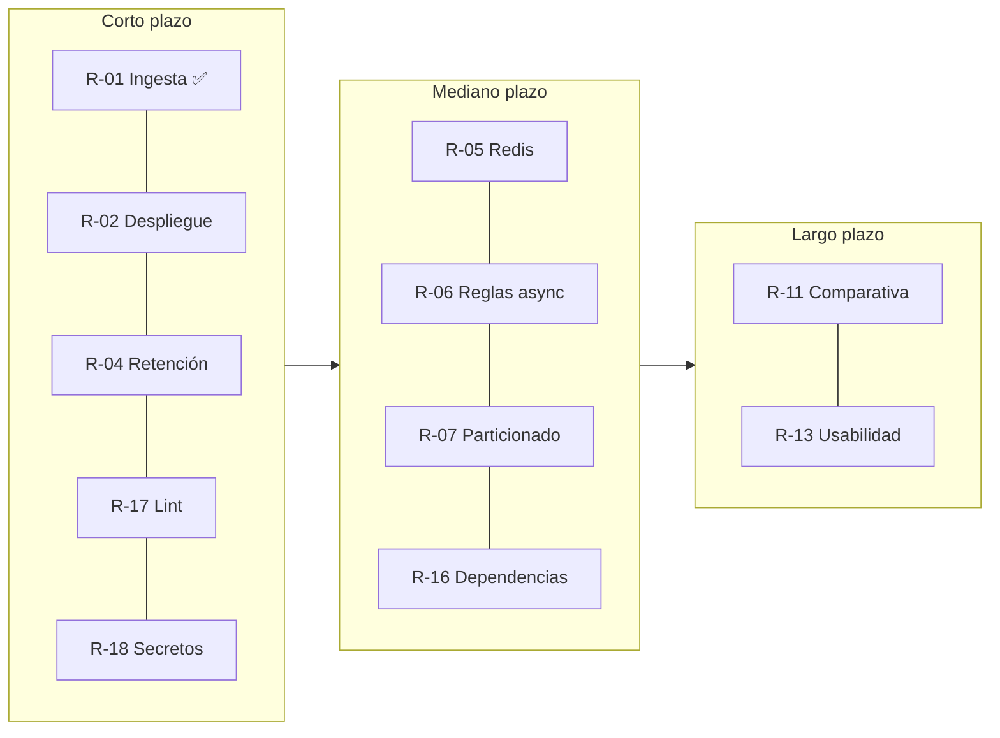

# 13 · Discrepancias, causa probable y recomendaciones priorizadas

> Indicadores cubiertos: **13** (precisión en la comparación: discrepancia, causa probable y criticidad) y
> **14** (recomendaciones derivadas de los resultados de las pruebas).

Esta sección confronta el **diseño de ES2** y el **borrador** con lo que efectivamente se construyó. La regla es
**declarar la brecha y su causa, nunca ocultarla**.

## 13.1 Discrepancias de tecnología

| # | Esperado (ES2 / borrador) | Implementado | Causa | Impacto | Criticidad |
|---|---|---|---|---|---|
| **D-01** | Backend en **FastAPI (Python)** | **NestJS (TypeScript)** | Unificar el lenguaje del stack y compartir esquemas con el simulador | Nulo en diseño: se conservan capas y contrato REST | Baja |
| **D-02** | Simulador en Python | **TypeScript** en el monorepo | Reutilizar `@aquabrain/shared` como fuente de verdad | Nulo | Baja |
| **D-03** | Frontend con **Tailwind + Zustand + Axios** | **CSS propio + estado local/TanStack Query + fetch** | Reducir dependencias sin alterar la interfaz | Nulo funcional | Baja |
| **D-04** | Almacenamiento **PostgreSQL + MongoDB** | **Solo PostgreSQL** | El modelo relacional cubre todos los casos; un NoSQL añadía operación sin beneficio | **TS-32 y TS-34 no aplican** | Media |

## 13.2 Discrepancias de arquitectura

| # | Esperado (ES2) | Implementado | Causa | Impacto | Criticidad |
|---|---|---|---|---|---|
| **D-05** | Tabla `medicion` **particionada** por fecha | Tabla **normal** con índices | RNF04 quedó *Won't* en el MoSCoW | Ninguno con el volumen actual; a gran escala, sí | Baja |
| **D-06** | Motor de reglas **asíncrono** (cola) | Evaluación **en línea** | Simplicidad para el volumen del prototipo | La ingesta carga la evaluación | Media |
| **D-07** | Redis para caché y tasa distribuida | **No se usa** (`throttler` en memoria) | No era necesario para una sola instancia | El límite no se comparte entre réplicas | Baja |
| **D-15** | Registro y consulta de **eventos** de conectividad (`SIN_COMUNICACION`, `RECONEXION`…) | Tabla `evento` **creada en la migración**, pero **sin escrituras ni endpoint** (`prisma.evento` no se usa) | Se priorizó el camino *Must*; la detección de silencio quedó como **marca en vivo** en el panel | Bajo: el dominio lo cubren alertas, auditoría y la marca de frescura | Baja |

## 13.3 Discrepancias de proceso y evidencia

| # | Esperado (borrador) | Realidad medida | Causa | Criticidad |
|---|---|---|---|---|
| **D-08** | 187 *commits* y 34 *pull requests* | **15 commits agrupados**, sin remoto ni PR | El historial se consolidó al final; no pasó por revisión en remoto | Media |
| **D-09** | Despliegue en **Render** | **Local + Docker Compose** validado; imagen de la API construida (162 MB, 82,2 s) | No se gestionó cuenta de nube | Media |
| **D-10** | Pruebas de carga con **k6** | Script HTTP propio (25 repeticiones por endpoint) | k6 no disponible en el entorno | Baja |
| **D-11** | Análisis de seguridad con **OWASP ZAP** | Pruebas automatizadas propias | Sin herramienta/alcance para un escaneo formal | Media |
| **D-12** | **Lighthouse = 94** | **No ejecutado** | Se priorizó la verificación funcional en navegador | Baja |
| **D-13** | 52 340 registros | **52 230** mediciones reales | Es el conteo efectivo tras las pruebas | Nula (cifra) |
| **D-14** | Validación contra la **app Android** real | Contrato verificado por prueba automatizada (TS-42) | La app de prueba no estuvo disponible | Media |

> **Sobre las cifras del borrador.** Valores como «187 commits», «34 PR», «Lighthouse 94», «52 340» o las
> corridas de ZAP/k6 eran **marcadores de posición**. Este informe los reemplaza por **mediciones reales** o los
> marca como **no ejecutados** (D-08…D-14). No se conserva ninguna cifra sin respaldo.

## 13.4 Hallazgos técnicos durante la implementación

Defectos o comportamientos **descubiertos al probar** (no supuestos), con su resolución:

| # | Hallazgo | Resolución | Criticidad original |
|---|---|---|---|
| **H-01** | `GET /auditoria` devolvía **500** al serializar `BigInt` | Se serializa el `id` a cadena en el controlador | Alta |
| **H-02** | Un `422` con cuerpo de texto se etiquetaba como `ERROR_INTERNO` | El código de error ahora **se deriva del estado HTTP** | Media |
| **H-03** | Precedencia de reglas ambigua (sensor vs. tipo de variable) | Se fija: si hay reglas del sensor, se ignoran las de tipo (RN-07) | Media |
| **H-04** | **Ingesta por lote lenta:** 500 mediciones en **16,4 s** (~30/s) | **Resuelto (R-01):** inserción masiva + reglas por lote → **1 403 ms** (≈12×) | Alta |
| **H-05** | Cobertura de **ramas** baja (69,01 %) frente a líneas (92,26 %) | Cumple el umbral (60 %), pero revela rutas de error poco ejercitadas | Baja |

> **Nota de precisión.** El registro de casos del capítulo 11 se construyó a partir de las **etiquetas `TS-xx`
> presentes en el propio código de prueba** (no de una agrupación nominal). Por eso casos como **TS-08, TS-09 y
> TS-31** figuran como **aprobados** (los cubren `frescura.spec` y `all-exceptions.filter.spec`) y **TS-24**
> figura como **con hallazgo** (lo cubre `npm audit`), en lugar de agruparse como «no ejecutados». Esta es una
> **corrección de precisión** respecto de una lectura gruesa del plan.

## 13.5 Estado del sistema tras las pruebas

Las pruebas **modifican el estado**, y eso se documenta para que toda cifra sea reproducible: la resolución en
la interfaz dejó una alerta resuelta (la bandeja pasó de **3 a 2** activas); la tabla `medicion` incluye
**7 000 filas sintéticas** de la prueba de volumen TS-43 y **2 000 filas** de los lotes de rendimiento.

## 13.6 Recomendaciones priorizadas

Ordenadas por **prioridad** (P1 alta → P3 baja), **derivadas directamente de los resultados**: cada una indica
lo que atiende, el esfuerzo y el beneficio.

### 13.6.1 Prioridad alta (P1)

| # | Recomendación | Atiende | Esfuerzo | Beneficio |
|---|---|---|---|---|
| **R-01** | ✅ **Implementada** — Optimizar la ingesta por lote (inserción masiva + reglas por lote) | H-04 (16,4 s → 1,4 s / 500) | Medio | **≈12×** menos tiempo en el vaciado de búferes offline |
| **R-02** | **Desplegar en un entorno real** (contenedor gestionado o PaaS) con HTTPS y variables de entorno | D-09, RNF07 | Medio | Cumple RNF07 y habilita la integración con hardware |
| **R-03** | **Validar el contrato con la app Android** del cliente | D-14, RNF08 | Medio | Cierra el riesgo de interoperabilidad real |
| **R-04** | **Política de retención y anonimización** de datos (Ley 19.628 / 21.719) | RNF11 | Bajo–Medio | Cumplimiento ético-legal |

### 13.6.2 Prioridad media (P2)

| # | Recomendación | Atiende | Esfuerzo | Beneficio |
|---|---|---|---|---|
| **R-05** | **Control de tasa y caché distribuidos** con Redis | D-07 | Medio | Escala horizontal sin *bypass* del límite |
| **R-06** | **Motor de reglas asíncrono** (cola/broker) | D-06 | Medio–Alto | Desacopla la ingesta de la evaluación |
| **R-07** | **Particionado de `medicion`** por rango de fecha | D-05, RNF04 | Medio | Mantiene el rendimiento a escala de cientos de sistemas |
| **R-08** | **Ampliar la cobertura de ramas** (rutas de error) hacia ≥ 80 % | H-05 | Bajo | Más confianza ante fallos |
| **R-09** | **Pruebas de interfaz automatizadas** (componentes / e2e de UI) | Interfaz sin suite | Medio | Evita regresiones visuales y de flujo |
| **R-10** | **Monitoreo de disponibilidad** con la sonda `/health` y registro de *uptime* | RNF02, TS-44 | Bajo | Verifica el 99 % del horario de operación |

### 13.6.3 Prioridad baja (P3)

| # | Recomendación | Atiende | Esfuerzo | Beneficio |
|---|---|---|---|---|
| **R-11** | **Comparativa multi-sistema** en la interfaz (superposición de líneas) | RF09, TS-39 | Bajo–Medio | Completa un requisito *Could* |
| **R-12** | **Pruebas de carga formales** (k6/Artillery) y **escaneo ZAP** | D-10, D-11 | Medio | Evidencia de rendimiento y seguridad de terceros |
| **R-13** | **Auditoría de usabilidad y accesibilidad** (WCAG) con usuarios | RNF05 | Medio | Mejora la adopción por encargados no técnicos |
| **R-14** | **Repositorio remoto con PR y CI** para el flujo colaborativo | D-08, RNF06 | Bajo | Trazabilidad del trabajo y revisión por pares |
| **R-15** | **Consistencia de la interfaz con el display OLED** | RNF05 | Bajo | Alinea el dashboard con la lectura local del gateway |

### 13.6.4 Recomendaciones nuevas surgidas de los resultados

Dos hallazgos que el diseño de ES2 no anticipó y que las pruebas **sí** destaparon:

| # | Recomendación | Atiende | Esfuerzo | Beneficio |
|---|---|---|---|---|
| **R-16** | **Actualizar las dependencias** del ecosistema NestJS 10 (resolver las vulnerabilidades **transitivas**) | TS-24 (§7.9) | Medio–Alto | Elimina deuda de seguridad en componentes de terceros |
| **R-17** | **Formalizar ESLint/Prettier**: configurar el archivo de configuración y ejecutar el *lint* en la CI | Convenciones de código (§8.2) | Bajo | Convierte en automático un estándar hoy solo declarado |
| **R-18** | **Escaneo automático de secretos** (gitleaks) en la CI | TS-29 (§7.7) | Bajo | Evita la fuga de credenciales de forma continua |

> **Por qué existen R-16…R-18 y no estaban en el borrador.** Son consecuencias **directas de la ejecución**: el
> análisis de dependencias (TS-24) arrojó hallazgos, y la revisión de estándares reveló que el *linter* y el
> escaneo de secretos **no estaban cableados**. Recomendar es responder a lo medido, no a lo supuesto.

## 13.7 Hoja de ruta sugerida

**R-01 ya está implementada** (resolvió el único hallazgo de rendimiento). Entre las pendientes, **R-02** es la
de mayor retorno: habilita el uso real del sistema con el hardware del cliente.

## 13.8 Balance

Las discrepancias se concentran en **tecnología** (justificadas) y en **evidencias de proceso no ejecutadas**
(nube, k6, ZAP, Lighthouse, app Android). **No hay requisitos *Must* funcionales sin implementar**: todas las
brechas funcionales son *Should/Could* o *Won't*. El único hallazgo de rendimiento relevante (**H-04**) quedó
**resuelto con R-01**; el camino de lectura siempre estuvo holgadamente dentro de las metas.
