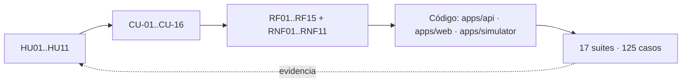

# 14 · Matriz de trazabilidad

> Criterio de calidad transversal de la rúbrica: **la evidencia debe ser trazable y coherente**. Esta matriz
> conecta cada **historia de usuario (HU)** con su **caso de uso (CU)**, sus **requisitos (RF/RNF)**, el **código
> que los implementa** y la **prueba que los verifica**. Es la cadena que permite afirmar que un requisito está
> cubierto y **localizar dónde**.

## 14.1 Cadena completa: HU → CU → RF → implementación → prueba

| HU | CU | RF | Implementación (ruta real de código) | Prueba que lo verifica | Estado |
|---|---|---|---|---|---|
| **HU01** — Dashboard con estado actual | CU-08 | RF07 | `apps/api/src/modules/dashboard/` · `GET /dashboard/estado` · `apps/web/src/paginas/Panel.tsx` | Verificación en navegador; `salud` (dominio) | ✅ |
| **HU02** — Histórico por rango de fechas | CU-09 | RF08 | `mediciones.service.ts` (`serie`) · `GET /mediciones/serie` · `GET /mediciones/exportar.csv` · `Historicos.tsx` | `historicos` (6); TS-37/TS-38; UI verificada | ✅ |
| **HU03** — Alertas automáticas y resolución | CU-07, CU-12 | RF11, RF12 | `reglas/reglas.engine.ts` · `alertas/` · `POST /alertas/{id}/resolver` · `Alertas.tsx` | `alertas` (9) y `reglas.engine.spec` (11); resolución en UI (3→2) | ✅ |
| **HU04** — Comparar varios sistemas | CU-10 | RF09 | `GET /mediciones/serie` (acepta varios sensores) | `historicos` (consulta múltiple) | 🟡 UI sin superposición |
| **HU05** — Gestionar usuarios y roles | CU-01, CU-02 | RF01, RF02 | `auth/`, `usuarios/`, `PermisosGuard`, `@RequierePermiso` | `auth` (8), `rbac` (11), `gestion` (16) | ✅ |
| **HU06** — Registrar sistemas, dispositivos y sensores | CU-03, CU-04, CU-05 | RF03, RF04, RF05 | `sistemas/`, `dispositivos/`, `sensores/`, catálogos | `gestion` (16) | ✅ |
| **HU07** — Reglas y umbrales configurables | CU-11 | RF10 | `reglas/` · `POST /reglas/probar/simulacion` | `gestion`; `reglas.engine.spec`; TS-06 | ✅ |
| **HU08** — Enviar mediciones por API | CU-06 | RF06 | `mediciones/` · `POST /mediciones` · `POST /mediciones/bulk` · `apps/simulator/` | `mediciones` (12); simulador (§5) | ✅ |
| **HU09** — Suscripciones y licencias | CU-16 | RF15 | — | — | ⬜ *Won't* |
| **HU10** — Almacenar offline y reintentar | CU-13, CU-14 | RF06, RF14 | `apps/simulator` (búfer e idempotencia) · `medicion_idempotencia` · frescura derivada | Simulador `offline` (8 duplicadas); TS-41; `mediciones` | ✅ |
| **HU11** — Documentación OpenAPI versionada | CU-15 | RF13 | `src/config/openapi.ts` · `/api/docs`, `/api/docs-json` | `contrato` (5), TS-42 | ✅ |

## 14.2 Trazabilidad de requisitos no funcionales

| RNF | Implementación | Prueba / evidencia | Estado |
|---|---|---|---|
| RNF01 Seguridad | `auth/`, `PermisosGuard`, `validation.pipe`, `config/http.ts`, Prisma | `auth`, `rbac`, `limites`; capítulo 07 | ✅ |
| RNF02 Disponibilidad | `health/` · `GET /health` | Sonda funcional; **sin** monitoreo de ventana | 🟡 |
| RNF03 Rendimiento | `date_bin` + índices; panel con `refetchInterval` | Script TS-43 (p50 104,1 / 573,7 ms) | ✅ |
| RNF04 Escalabilidad | Índices `idx_medicion_*`; normalización | `EXPLAIN ANALYZE` (capítulo 06); **sin** particionado | ⬜ *Won't* |
| RNF05 Usabilidad | `estilos.css`, mensajes del filtro | Revisión visual; **sin** pruebas con usuarios | 🟡 |
| RNF06 Mantenibilidad | Monorepo, TS estricto, Git, README y docs | Inspección; historial de commits | ✅ |
| RNF07 Portabilidad | `infra/docker-compose.yml`, Dockerfiles, `.env` | `docker compose config` (exit 0); ejecución local | 🟡 |
| RNF08 Interoperabilidad | OpenAPI + `@aquabrain/shared` | `contrato` (TS-42); **sin** app Android real | 🟡 |
| RNF09 Autonomía local | — (firmware) | — | ⬜ *Won't* |
| RNF10 Cobertura ≥ 70 % | Suite completa del proyecto | `test:cov` → 92,26 % líneas (TS-44) | ✅ |
| RNF11 Privacidad/ética | `auditoria/`; secretos fuera del repo | §7.6–7.7; **sin** retención automatizada | 🟡 |

## 14.3 Trazabilidad de casos de prueba a módulos

| Suite | Módulo(s) ejercitado(s) | Casos |
|---|---|---:|
| `gestion` | sistemas, cultivos, usuarios, reglas, catálogos | 16 |
| `rbac` | auth, permisos (transversal) | 11 |
| `mediciones` | mediciones (ingesta, idempotencia, calidad) | 12 |
| `alertas` | alertas, reglas | 9 |
| `auth` | auth | 8 |
| `salud` | salud, arranque | 7 |
| `historicos` | mediciones (serie, CSV) | 6 |
| `contrato` | openapi ↔ shared | 5 |
| `limites` | control de tasa (transversal) | 1 |

## 14.4 Cobertura del catálogo (cierre de la cadena)

- **HU cubiertas (10/11):** HU01–HU08, HU10, HU11. Falta **HU09** (RF15, *Won't*).
- **CU cubiertos (15/16):** CU-01…CU-15. Falta **CU-16** (licencias, *Won't*).
- **RF cubiertos (14/15):** RF01–RF14. Falta RF15 (*Won't*); RF09 parcial.
- **RNF con evidencia completa (5/11):** RNF01, RNF03, RNF06, RNF10; el resto parciales o *Won't*.

La cadena **HU → CU → RF → código → prueba** queda **cerrada para todos los requisitos *Must***; las brechas
restantes (HU09/CU-16/RF15, RF09 y los RNF parciales) **coinciden exactamente** con lo declarado en los
capítulos 10, 12 y 13. Esto es lo que hace que la trazabilidad sea **coherente**: no hay requisito sin prueba ni
prueba sin requisito, y toda brecha está declarada en un único lugar de referencia.

## 14.5 Nota sobre la nomenclatura

Este informe **respeta el catálogo canónico corregido** de ES1 (`docs/ES1/00-backlog-base.md`): **NEC-01…NEC-09,
HU01…HU11, RF01…RF15, RNF01…RNF11, CU-01…CU-16, RN-01…RN-12**, más los identificadores de diseño de ES2
(D-01…D-15, TS-01…TS-44, RA-05, MC-08, RP-01…RP-06). No se renumeran ni se reinterpretan: se **implementan** y se
**verifican**.
