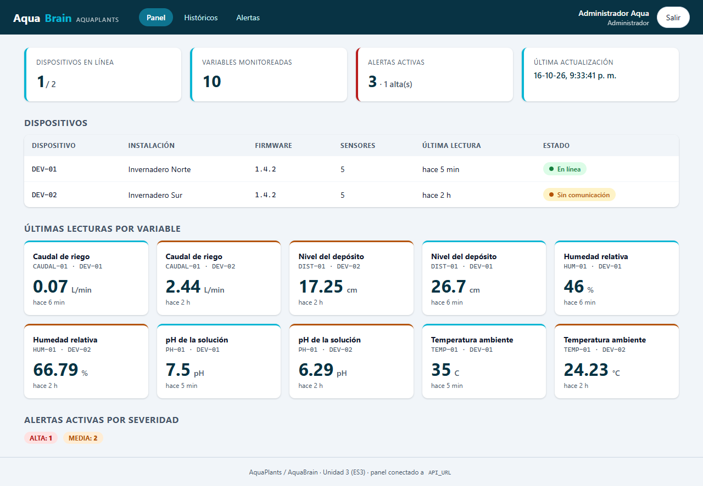
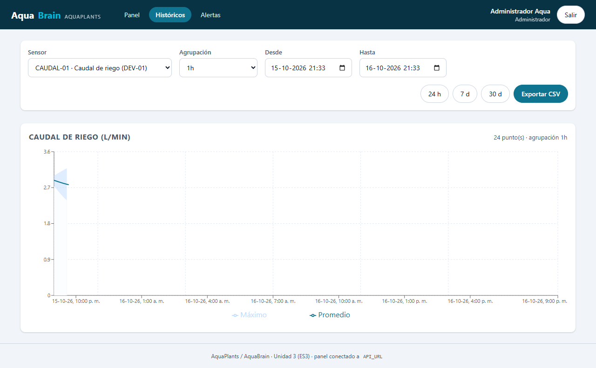
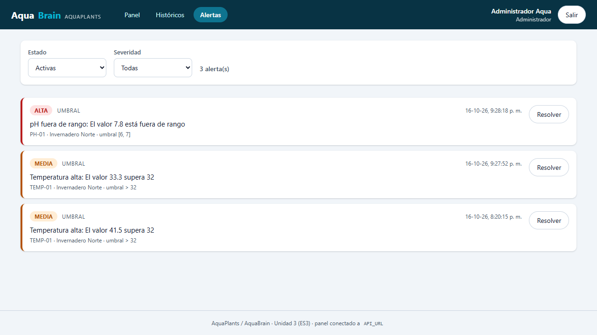

# 17 · Anexos y preparación de la defensa

> Indicador cubierto: **15** (defensa: banco de preguntas y respuestas sustentadas en la evidencia).
> Este capítulo reúne los **anexos** que respaldan las cifras del informe y un **banco de preguntas** para la
> defensa oral.

## 17.1 Anexo A — Comandos de reproducción

Todos los comandos se ejecutan desde la raíz del proyecto (con la ruta entre comillas por los espacios).

```powershell
# Dependencias y paquete compartido
npm install
npm run build --workspace @aquabrain/shared

# Base de datos (contenedor de desarrollo)
docker start aquabrain-pg
cd apps/api
npx prisma migrate deploy
npx prisma db seed

# API
npm run build
node dist/main.js            # http://localhost:3000/api/v1  y  /api/docs

# Pruebas (todas verdes)
npm test                     # 50 unitarias
npm run test:e2e             # 75 de integración
npm run test:cov             # cobertura combinada + umbral

# Dashboard
cd ../web
npm run dev                  # http://localhost:5173

# Simulador (ejemplo, modo offline)
cd ../simulator
npm run build
$env:API_URL='http://localhost:3000/api/v1'; $env:DEVICE_CODE='DEV-01'; $env:DEVICE_KEY='<clave>'
$env:MODO='offline'; node dist/simulador.js

# Despliegue completo
docker compose --env-file infra/.env -f infra/docker-compose.yml up --build
```

## 17.2 Anexo B — Rendimiento (TS-43)

Salida cruda del script de medición (25 repeticiones por endpoint), sobre **52 230** mediciones:

```text
endpoint                      muestras min_ms p50_ms p95_ms max_ms bytes
--------                      -------- ------ ------ ------ ------ -----
GET /dashboard/estado               25   88,4  104,1  225,9  328,8  3642
GET /mediciones/serie (1 mes)       25  231,5  573,7  633,8  730,4 77231
GET /alertas?porPagina=20           25   59,2   64,8   86,2   91,8  2017
```

Escritura por lote (`POST /mediciones/bulk`), **antes y después** de la optimización R-01:

```text
# Antes (una transacción de escritura por lectura)
Cuerpo: 78,4 KB, items: 500
HTTP 207 · Tiempo total: 16410 ms

# Después (createManyAndReturn + reglas en un paso por lote)
Cuerpo: 78,5 KB, items: 500
HTTP 207 · Tiempo total: 1697 ms · 1403 ms · 1275 ms   (3 corridas; mediana 1403 ms)
{ "recibidas": 500, "aceptadas": 500, "duplicadas": 0, "rechazadas": 0, "alertasGeneradas": 0 }
```

## 17.3 Anexo C — Plan de consulta de la serie (`EXPLAIN ANALYZE`)

```text
GroupAggregate  (cost=577.70..588.90 rows=277) (actual time=1.523..1.945 rows=49 loops=1)
  Group Key: date_bin('01:00:00'::interval, "timestamp", '2000-01-01'::timestamptz)
  Buffers: shared hit=17
  ->  Sort  (actual time=1.479..1.513 rows=295)
        Sort Method: quicksort  Memory: 41kB
        ->  Bitmap Heap Scan on medicion  (actual time=1.214..1.342 rows=295)
              Recheck Cond: (sensor_id = ... AND "timestamp" >= ... AND "timestamp" <= ...)
              ->  Bitmap Index Scan on idx_medicion_sensor_ts  (actual time=1.175..1.176)
Planning Time: 1.624 ms
Execution Time: 2.217 ms
```

## 17.4 Anexo D — Transcripciones del simulador

Se adjuntan como archivos:

- [`evidencia/sim-online.txt`](../evidencia/sim-online.txt) — modo online (10 aceptadas, 1 alerta MEDIA).
- [`evidencia/sim-offline.txt`](../evidencia/sim-offline.txt) — modo offline (8 almacenadas, sincronizadas;
  reenvío con **8 duplicadas**).
- [`evidencia/sim-anomalia.txt`](../evidencia/sim-anomalia.txt) — modo anomalía (2 fuera de rango, 1 alerta
  ALTA).

## 17.5 Anexo E — Capturas del dashboard

Panel en vivo (indicadores, dispositivos y las 10 variables):



Históricos con gráfico de líneas y banda de mínimo/máximo:



Bandeja de alertas con opción de resolución:



## 17.6 Anexo F — Empaquetado y dependencias

**Imagen Docker de la API** (contexto = raíz del monorepo):

```text
$ docker build -f infra/api.Dockerfile -t aquabrain-api:dev .
...
#24 DONE 82.2s

$ docker images aquabrain-api
REPOSITORY       TAG    SIZE
aquabrain-api    dev    162MB

$ docker run --rm aquabrain-api:dev node -e "console.log(process.version, require('@aquabrain/shared').MAX_BULK_ITEMS, require('@prisma/client/package.json').version)"
v20.20.2 500 5.22.0
```

**Auditoría de dependencias** (`npm audit`, resumen):

```text
61 vulnerabilidades (4 low, 15 moderate, 41 high, 1 critical)
```

> Las 61 alertas corresponden a **dependencias transitivas** del ecosistema NestJS 10 (no a código propio). Se
> documentan por transparencia; la recomendación es planificar la actualización mayor a NestJS 11 (**R-16**).

## 17.7 Anexo G — Inventario de endpoints (35 rutas)

```text
POST   /api/v1/auth/login                      POST   /api/v1/auth/refresh
POST   /api/v1/auth/logout                     GET    /api/v1/auth/me
GET    /api/v1/usuarios                        POST   /api/v1/usuarios
GET    /api/v1/usuarios/{id}                   PATCH  /api/v1/usuarios/{id}
DELETE /api/v1/usuarios/{id}                   GET    /api/v1/roles
GET    /api/v1/permisos                        GET    /api/v1/sistemas
POST   /api/v1/sistemas                        GET    /api/v1/sistemas/{id}
PATCH  /api/v1/sistemas/{id}                   DELETE /api/v1/sistemas/{id}
GET    /api/v1/cultivos                        POST   /api/v1/cultivos
GET    /api/v1/cultivos/{id}                   PATCH  /api/v1/cultivos/{id}
DELETE /api/v1/cultivos/{id}                   GET    /api/v1/dispositivos
POST   /api/v1/dispositivos                    GET    /api/v1/dispositivos/{id}
PATCH  /api/v1/dispositivos/{id}               DELETE /api/v1/dispositivos/{id}
GET    /api/v1/dispositivos/{id}/sensores      POST   /api/v1/dispositivos/{id}/sensores
PATCH  /api/v1/dispositivos/{id}/sensores/{sensorId}
POST   /api/v1/dispositivos/{id}/rotar-clave   GET    /api/v1/sensores
GET    /api/v1/sensores/{id}                   GET    /api/v1/tipos-variable
GET    /api/v1/reglas                          POST   /api/v1/reglas
GET    /api/v1/reglas/{id}                     PATCH  /api/v1/reglas/{id}
DELETE /api/v1/reglas/{id}                     POST   /api/v1/reglas/probar/simulacion
POST   /api/v1/mediciones                      POST   /api/v1/mediciones/bulk
GET    /api/v1/mediciones/serie                GET    /api/v1/mediciones/ultimas
GET    /api/v1/mediciones/exportar.csv         GET    /api/v1/alertas
GET    /api/v1/alertas/{id}                    GET    /api/v1/alertas/resumen
POST   /api/v1/alertas/{id}/resolver           GET    /api/v1/dashboard/estado
GET    /api/v1/auditoria                       GET    /health   (sin prefijo)
```

## 17.8 Anexo H — Variables de entorno

| Variable | Uso |
|---|---|
| `NODE_ENV`, `PORT`, `API_PREFIX`, `LOG_LEVEL` | Configuración general |
| `DATABASE_URL` | Conexión a PostgreSQL |
| `JWT_ACCESS_SECRET`, `JWT_REFRESH_SECRET`, `JWT_ACCESS_TTL`, `JWT_REFRESH_TTL` | Firma y vigencia de tokens |
| `BCRYPT_COST` | Factor de coste (12 en desarrollo/producción, 4 en CI) |
| `DEVICE_KEY_PEPPER` | *Pepper* de las claves de dispositivo |
| `ALERT_SILENCE_FACTOR` | Ventana de silencio de alertas |
| `MAX_TIMESTAMP_SKEW` | Tolerancia de `timestamp` (RN-09) |
| `BODY_LIMIT` | Límite del cuerpo de las peticiones |
| `CORS_ORIGINS` | Orígenes permitidos |
| `REDIS_URL` | **Reservado** (no consumido por el prototipo, ver D-07) |

## 17.9 Anexo I — Volumetría de la base de datos

| Tabla | Filas | Origen |
|---|---:|---|
| `medicion` | **52 230** | 43 200 seed + 7 000 TS-43 + 2 000 rendimiento + 30 simulador |
| `medicion_idempotencia` | **2 030** | Claves de deduplicación de los lotes |
| `auditoria` | **877** | Operaciones y denegaciones registradas |
| `dispositivo` | 2 | Semilla (`DEV-01`, `DEV-02`) |
| `sensor` | 10 | 5 tipos de variable |
| `regla` | 4 | Semilla |

## 17.10 Banco de preguntas para la defensa

Las respuestas son breves, **citan la evidencia** del informe y usan los identificadores canónicos
(HU/RF/RNF/CU/RN/TS/D/R) para que toda afirmación sea **verificable**. Ensayo sugerido: 30–60 segundos por
respuesta.

### 17.10.1 Arquitectura y decisiones

**¿Por qué NestJS si el diseño de ES2 decía FastAPI?**
Porque unifica el lenguaje del monorepo y permite **compartir los esquemas Zod** (`@aquabrain/shared`) con el
simulador, eliminando la duplicación de contratos. Es la discrepancia **D-01**, con impacto **nulo** en el
diseño: se conservan las capas y el contrato REST. *(§3.1, §13.1.)*

**¿Cómo garantizan que la API y el simulador no se desincronicen?**
Con el paquete compartido `@aquabrain/shared` como única fuente de verdad, verificado por una **prueba de
contrato** (`contrato.e2e`, TS-42) que compara el OpenAPI con los esquemas compartidos. *(§3.4, §8.)*

**¿Qué pasa si se cae la red entre el gateway y la API?**
El simulador (que reproduce el gateway) **almacena las lecturas** y las reenvía; la API las **deduplica** con
`id_externo` (tabla `medicion_idempotencia`). En la prueba offline: 8 almacenadas, 8 aceptadas y, al reenviar,
**8 duplicadas**. *(§5, §13.1, Anexo D.)*

### 17.10.2 Base de datos

**¿Por qué PostgreSQL y no también MongoDB?**
Porque el modelo relacional **cubre todos los casos** de consulta (series, agregación, integridad histórica) y
un NoSQL añadía operación sin beneficio. Es la discrepancia **D-04**; por eso **TS-32 y TS-34 no aplican**.
*(§6, §13.1.)*

**¿Cómo logran el rendimiento de la serie sin particionar?**
Con **índices guiados por el patrón de consulta** (`idx_medicion_sensor_ts`) y `date_bin` para la agregación:
el plan usa *Bitmap Index Scan* y ejecuta en **2,217 ms** (Anexo C). El particionado se declaró *Won't* (RNF04).
*(§6, §13.2.)*

**¿Es normalizada la base?**
Sí, **3FN**, con integridad referencial e histórica (no se borran mediciones). La normalización de la
volumetría se documenta en el capítulo 06.

### 17.10.3 Seguridad

**¿Cómo protegen las contraseñas?**
Con **bcrypt, factor de coste 12** (4 solo en CI). La prueba TS-12 verifica que el hash **≠** la contraseña.
*(§7, TS-12.)*

**¿Qué impide que un usuario vea datos de otro sistema?**
El **RBAC de 21 permisos** con `PermisosGuard` y verificación de **alcance por dispositivo**; IDOR devuelve
`403` sin filtrar información (TS-16, TS-17, TS-26). *(§7, §11.5.)*

**¿Cómo manejan los tokens?**
JWT de acceso corto + **refresco rotado y revocado** en cookie `HttpOnly`; reutilizar un refresco **revoca la
cadena** (TS-14, TS-15). *(§7.)*

**¿Encontraron vulnerabilidades?**
Sí: **61 en dependencias transitivas** (TS-24, 41 altas y 1 crítica), **sin código propio afectado**; el plan de
actualización es **R-16**. No se ejecutó ZAP (D-11). *(§7.9, §13.4.)*

### 17.10.4 Pruebas y calidad

**¿Cuántas pruebas tienen y en qué estado?**
**125 en verde** (50 unitarias + 75 de integración, 17 suites), **92,26 % de líneas** de cobertura (umbral 70 %).
*(§10, §11.)*

**¿Cómo sé que la cobertura es real y no inflada?**
Porque se calcula **fusionando** los mapas de las pruebas unitarias y de integración
(`coverage-combinado.js`) y **bloquea la CI** si baja del umbral. *(§10.5, §11.7.)*

**¿Qué encontraron las pruebas que enriqueció el producto?**
Defectos reales: el `500` de auditoría por `BigInt` (H-01), la mala clasificación de un `422` (H-02), la
precedencia ambiguua de reglas (H-03) y el **cuello de botella de escritura por lote** (H-04, 16,4 s → 1,4 s).
*(§11, §13.4.)*

**¿Por qué TS-32 y TS-34 no están aprobados?**
Porque prueban **caída de MongoDB/Redis**, y esos almacenes **no se implementaron** (D-04, D-07). Se declaran
**no aplica** en vez de marcarlos como fallidos. *(§11.5, §13.1–13.2.)*

### 17.10.5 Rendimiento

**¿El dashboard cumple el límite de 2 segundos?**
Sí, con holgura: **p50 104,1 ms** sobre 52 230 mediciones (RNF03, TS-43). *(§11.6, Anexo B.)*

**¿Y la consulta de un mes sobre 50 000 registros?**
**p50 573,7 ms**, bajo la meta de 5 s. *(§11.6, Anexo B.)*

**¿Qué optimizaron durante la implementación?**
La **ingesta por lote**: `createManyAndReturn` + reglas por lote redujo 500 lecturas de **16 410 ms a 1 403 ms**
(≈ 12×, recomendación R-01 ya implementada). *(§11.6.1, §13.6.1.)*

### 17.10.6 Despliegue y documentación

**¿Es reproducible el entorno?**
Sí: **Docker Compose** con tres servicios, imágenes **multi-etapa**, migraciones al arrancar y `config` con
código **0**. La imagen de la API se construyó en **82,2 s** y pesa **162 MB**. *(§9, Anexo F.)*

**¿Dónde está documentado el sistema?**
README con instalación, catálogo ES1, diseño ES2, informe técnico ES3, **OpenAPI** en `/api/docs` y comentarios
trazables en el código. *(§9.5.)*

**¿Qué NO está hecho y lo declaran?**
Despliegue en nube/HTTPS (R-02), k6 y ZAP formales (D-10, D-11), Lighthouse (D-12), validación con la app
Android real (D-14), particionado (RNF04), linter cableado (R-17) y escaneo de secretos (R-18). Todas con su
causa y recomendación en el capítulo 13.

### 17.10.7 Cierre

**Si tuvieran una semana más, ¿qué harían primero?**
**R-02**: desplegar en un entorno real con HTTPS, porque habilita el uso con el hardware del cliente y cierra
RNF07, la brecha de mayor impacto.

**¿Qué demuestra que el software funciona?**
La combinación de **125 pruebas en verde**, **92,26 % de cobertura**, métricas de rendimiento **medidas sobre
datos reales** y una **trazabilidad completa** de HU a prueba (capítulo 14). Y lo que no funciona está
**declarado**.
