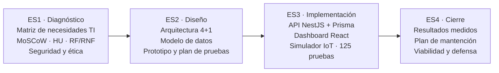

# 1. Introducción y Propuesta de Valor

## 1.1 Propósito del informe

Este documento corresponde a la **cuarta y última entrega (ES4)** del Proyecto Integrado y cumple el rol de **cierre del proyecto**. Mientras que ES1 diagnosticó el problema, ES2 diseñó la solución y ES3 la implementó y probó, ES4 **consolida y comunica** el resultado: reúne las funcionalidades construidas, las **mide**, las compara con el diagnóstico inicial, propone el **plan de mantención**, evalúa la **viabilidad**, y prepara la **presentación y la defensa** del equipo.

No describe un sistema hipotético: describe el **sistema que ya está en el repositorio y corriendo**. Cada afirmación se respalda con evidencia de ejecución (pruebas, mediciones, consultas a la base de datos, capturas).

## 1.2 Propuesta de valor

AquaPlants/AquaBrain es un sistema de control y monitoreo para cultivos hidropónicos y aeropónicos que integra el **hardware IoT del cliente** (ESP32-S3 con sensores AHT10 y HC-SR04, display OLED SSD1309 y joystick) con una **plataforma web centralizada**. La propuesta de valor se resume en tres pilares:

1. **Centralización de datos.** Una única fuente de verdad para las mediciones, que hoy están dispersas entre el display local, la app Android y el firmware. La plataforma las recibe, valida y persiste en PostgreSQL.
2. **Decisiones oportunas.** Un **dashboard** con la última lectura de cada sensor y un **motor de reglas** que genera alertas automáticas al salir de rango, para que el encargado actúe antes de que el cultivo sufra daño.
3. **Escalabilidad e interoperabilidad.** Una arquitectura **API-first** documentada con OpenAPI, que permite integrar la app Android existente, el firmware ESP32-S3 y futuros clientes **sin duplicar lógica de negocio**.

## 1.3 Problema que resuelve

El diagnóstico de ES1 identificó un sistema operativo con datos aislados y sin aviso automático. La solución implementada (ES2 + ES3) responde punto por punto:

| Problema (ES1) | Solución implementada y probada |
|---|---|
| Datos de instalaciones, cultivos, dispositivos y sensores dispersos | Plataforma web centralizada sobre **PostgreSQL 16** (19 modelos) |
| El encargado no conoce el estado sin inspección física | **Dashboard** con la última medición por sensor y estado de frescura |
| Sin aviso automático de variables fuera de rango | **Motor de reglas y alertas** (4 reglas activas, severidad y resolución) |
| El firmware solo muestra datos localmente | **API de ingesta** (`POST /mediciones` y `/mediciones/bulk`) que valida y persiste |
| App Android aislada | **API-first documentada** (OpenAPI 3, 35 rutas) |
| Acceso no controlado a la información | **JWT + RBAC** (3 roles, 21 permisos) + auditoría |
| Sin históricos comparables | **Módulo de históricos** con gráficos, exportación CSV y consulta multi-sensor |
| Sin autonomía ante caídas de red | **Búfer offline + reintento** con idempotencia y marcas de tiempo pasadas |

## 1.4 Recorrido del proyecto

La continuidad entre etapas no es declarativa: la **trazabilidad HU → RF → código → prueba** se verificó en ES3 (§13 de ese informe) y se resume aquí en el capítulo 4. El catálogo canónico de ES1 (`docs/ES1/00-backlog-base.md`) fija 11 historias de usuario, 15 requisitos funcionales (RF01–RF15) y 11 no funcionales (RNF01–RNF11), que son la referencia de este informe.

## 1.5 Alcance de esta entrega

| Dimensión | Contenido de ES4 |
|---|---|
| Funcionalidades | Matriz de las funcionalidades construidas y su trazabilidad (§4) |
| Demostración | Guion de demo en vivo reproducible (§5) |
| Estándares | Normativas y buenas prácticas efectivamente aplicadas, y las no aplicadas (§6) |
| Resultados | Métricas **medidas** de implementación, calidad, rendimiento y colaboración (§7) |
| Comparativa | Diagnóstico inicial vs. resultado final (§8) |
| Continuidad | Plan de mantención (§9), viabilidad y proyección (§10) |
| Comunicación | Guion de la presentación (§11) y preparación de la defensa (§12) |

> **Nota sobre el borrador.** El borrador de ES4 describía el proyecto sobre un stack *FastAPI + Python + Redis* y con cifras de ejemplo (por ejemplo «187 commits», «78 % de cobertura», «despliegue en Render»). Ninguna de esas cifras se replica aquí sin verificarla: donde no hubo medición, se declara **no ejecutado** (§6 y §12).
