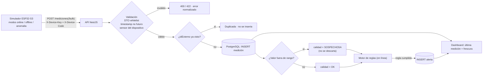

# 4. Funcionalidades Implementadas

## 4.1 Matriz de funcionalidades

Cada funcionalidad construida se traza a su **historia de usuario (HU)**, su **requisito funcional (RF)** y la **prueba o evidencia** que la respalda. El estado usa la misma convención que ES3: ✅ cumplido con evidencia, 🟡 parcial, ⬜ fuera de alcance.

| # | Funcionalidad | HU | RF | Estado | Evidencia |
|---|---|---|---|:--:|---|
| 1 | Autenticación con JWT + refresh token (cookie `HttpOnly`) | HU05 | RF01 | ✅ | Suites `auth` (8) y `rbac` (11) |
| 2 | CRUD de usuarios con roles, restringido a administradores | HU05 | RF02 | ✅ | Suite `gestion` (16); un encargado recibe `403` |
| 3 | CRUD de sistemas/instalaciones | HU06 | RF03 | ✅ | Suite `gestion` |
| 4 | Gestión de dispositivos por sistema | HU06 | RF04 | ✅ | Suite `gestion`; 2 dispositivos sembrados |
| 5 | Gestión de sensores con tipo de variable y unidad | HU06 | RF05 | ✅ | 10 sensores; 5 tipos de variable |
| 6 | Ingesta de mediciones vía API (individual y por lote) | HU08 | RF06 | ✅ | Suite `mediciones` (12); simulador (§4.2) |
| 7 | Dashboard con la última medición por sensor | HU01 | RF07 | ✅ | Panel verificado en navegador (10 variables) |
| 8 | Históricos con filtros, gráfico y exportación CSV | HU02 | RF08 | ✅ | Suite `historicos` (6); CSV con BOM UTF-8 |
| 9 | Comparativa multi-sistema | HU04 | RF09 | 🟡 | La **API** acepta varios sensores; la **UI no** superpone sistemas |
| 10 | CRUD de reglas de alerta (variable, operador, umbral, severidad) | HU07 | RF10 | ✅ | Suite `gestion`; 4 reglas sembradas |
| 11 | Motor de evaluación de alertas | HU03 | RF11 | ✅ | `reglas.engine.spec` (11) + `alertas` (9) |
| 12 | Lista de alertas con filtros y resolución | HU03 | RF12 | ✅ | Suite `alertas` (9); resolución verificada en UI (3 → 2) |
| 13 | Documentación OpenAPI versionada | HU11 | RF13 | ✅ | 35 rutas en `/api/docs`; contrato verificado (TS-42) |
| 14 | Estado de conexión / última comunicación del dispositivo | HU10 | RF14 | ✅ | Frescura derivada (`frescura.spec`, 6); panel «Sin comunicación» |
| — | Suscripción y licenciamiento | HU09 | RF15 | ⬜ | *Won't* (supuesto no respaldado por el desafío) |

**Resultado:** 13 funcionalidades cumplidas con evidencia automatizada o verificada, 1 parcial (comparativa en UI) y 1 fuera de alcance. **Todos los RF *Must* están implementados y probados.**

## 4.2 Flujo completo demostrable

El flujo de extremo a extremo —desde la lectura del sensor hasta la alerta y el panel— es el que se muestra en la demo en vivo (capítulo 5):

Puntos clave del flujo que se destacan en la demo:

- **Autenticación de dispositivo** por dos cabeceras (`X-Device-Key`, `X-Device-Code`), no por usuario.
- **Idempotencia**: un reenvío del mismo lote no duplica historia (`medicion_idempotencia`).
- **Calidad, no descarte**: un valor fuera de rango se guarda como `SOSPECHOSA` y dispara alerta.
- **Evaluación en línea**: el motor de reglas corre dentro de la ingesta (alternativa asíncrona documentada en §9).

## 4.3 Módulos del backend

La API expone **35 rutas** agrupadas en 12 módulos:

| Módulo | Responsabilidad | Rutas representativas |
|---|---|---|
| `auth` | Login, refresco, cierre de sesión y perfil | `POST /auth/login`, `POST /auth/refresh`, `GET /auth/me` |
| `usuarios` | CRUD de usuarios, roles y permisos | `/usuarios`, `/roles`, `/permisos` |
| `sistemas` | CRUD de instalaciones (invernaderos) | `/sistemas` |
| `cultivos` | CRUD de cultivos y su ciclo de vida | `/cultivos` |
| `dispositivos` | CRUD de gateways, rotación de clave y sensores | `/dispositivos`, `/dispositivos/{id}/rotar-clave` |
| `sensores` | CRUD de sensores y catálogo de tipos de variable | `/sensores`, `/tipos-variable` |
| `reglas` | CRUD de reglas y simulación sin persistir | `/reglas`, `POST /reglas/probar/simulacion` |
| `mediciones` | Ingesta, series, últimas lecturas y CSV | `/mediciones`, `/mediciones/bulk`, `/mediciones/serie`, `/mediciones/exportar.csv` |
| `alertas` | Listado, detalle, resumen y resolución | `/alertas`, `/alertas/resumen`, `/alertas/{id}/resolver` |
| `dashboard` | Estado agregado de dispositivos, sensores y alertas | `/dashboard/estado` |
| `auditoria` | Bitácora de operaciones | `/auditoria` |
| `salud` | Sonda de salud | `/health` (sin prefijo) |

El inventario completo de las 35 rutas está en el anexo (§15).

## 4.4 Pantallas del dashboard

Cuatro pantallas funcionales (evidencia en el capítulo 15):

| # | Pantalla | HU | RF | Qué muestra |
|---|---|---|---|---|
| 1 | **Acceso** | HU05 | RF01 | Formulario de correo y contraseña con manejo de error |
| 2 | **Panel** | HU01 | RF07 | Indicadores, dispositivos con estado de frescura y 10 tarjetas de última lectura (refresco cada 15 s) |
| 3 | **Históricos** | HU02 | RF08 | Selector de sensor y agrupación, rango de fechas, gráfico con banda mín/máx y exportación CSV |
| 4 | **Alertas** | HU03 | RF12 | Bandeja con filtros por estado y severidad, paginación y resolución con comentario |

> **Nota de honestidad.** El borrador de ES4 afirmaba **9 pantallas**. La implementación tiene **4 pantallas** que cubren los mismos casos de uso (acceso, estado, históricos y alertas) más los CRUD accesibles por API. No se inventan pantallas que no existen; la administración de usuarios/sistemas/reglas se ejerce hoy por API y está en el roadmap de interfaz (§10).
