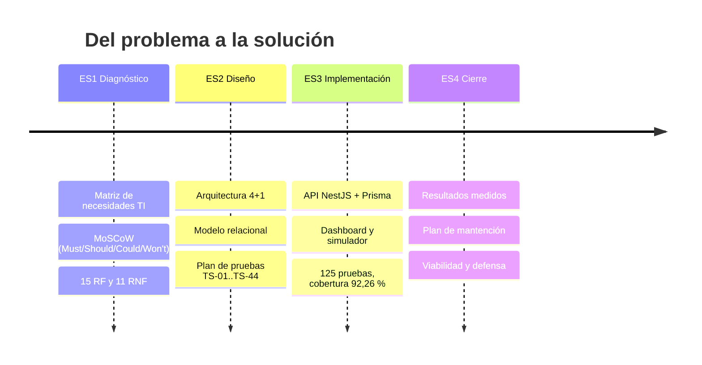

# 8. Comparativa Diagnóstico → Resultado

## 8.1 Cómo leer esta comparativa

El diagnóstico de ES1 describía una operación con **datos aislados y sin aviso automático**, pero **no medía** esos problemas con cifras (no existía un sistema previo del cual tomarlas). Por eso esta comparativa es honesta en dos partes:

- **Antes (diagnóstico):** se describe **cualitativamente** la situación detectada en ES1.
- **Después (resultado):** se muestran **cifras reales** medidas sobre la solución construida.

No se inventan «antes» cuantitativos: donde el borrador ponía «45 min → 2 min», aquí se explica la **transformación** sin fabricar una medición que nunca se hizo.

## 8.2 Matriz de transformación

| Dimensión | Antes (diagnóstico ES1) | Después (resultado ES4) | Evidencia |
|---|---|---|---|
| **Centralización** | Lecturas repartidas entre display local, app y firmware | **52 230** mediciones en **una** base PostgreSQL (19 modelos) | §7.1, §15 |
| **Visibilidad del estado** | Requería inspección física del cultivo | **Dashboard** con la última lectura por sensor y semáforo de frescura | `img/web-panel.png` |
| **Detección de anomalías** | Dependía de la observación humana | **Motor de reglas** con 4 reglas; alerta generada **en la ingesta** | Suites `alertas`, `reglas` |
| **Reacción a una alerta** | Sin registro ni seguimiento | **Resolución** con comentario y trazabilidad (3 → 2 activas) | `img/web-alertas.png` |
| **Control de acceso** | Sin control central | **JWT + RBAC**: 3 roles, 21 permisos, auditoría | Suites `auth` (8), `rbac` (11) |
| **Interoperabilidad** | Formatos ad-hoc por cliente | **API OpenAPI 3** con 35 rutas y contrato Zod | `/api/docs` |
| **Análisis histórico** | Sin series consultables | **Históricos** con filtro, gráfico y exportación CSV | `img/web-historicos.png` |
| **Pérdida de conectividad** | Implicaba pérdida de datos | **Búfer offline + idempotencia**: reenvío sin duplicados | `evidencia/sim-offline.txt` |
| **Trazabilidad operativa** | No existía | **Bitácora de auditoría** (1 052 registros al cierre) | Suite `auditoria` |
| **Reproducibilidad** | Dependía de la máquina | **Docker Compose** + migraciones versionadas | `docker compose config` → *exit 0* |

## 8.3 Indicadores clave del resultado

Solo la columna «resultado» contiene cifras, y todas son medidas:

| Indicador | Resultado medido | Referencia |
|---|---:|---|
| Mediciones en base | **52 230** | §7.1 |
| Rutas de API | **35** | §7.1 |
| Modelos de datos | **19** | §7.1 |
| Sensores / dispositivos / reglas | **10 / 2 / 4** | §7.1 |
| Pruebas en verde | **125** | §7.2 |
| Cobertura de líneas | **92,26 %** | §7.2 |
| Panel (p50) | **104,1 ms** | §7.3 |
| Serie de 1 mes (p50) | **573,7 ms** | §7.3 |
| Lote de 500 (mediana) | **1 403 ms** (antes 16 410 ms) | §7.3 |
| Cumplimiento del catálogo | **17 ✅ + 6 🟡 + 3 ⬜** sobre 26 | §7.6 |

## 8.4 Evolución del proyecto

## 8.5 Lectura de negocio del resultado

- **Trazabilidad de punta a punta.** Un dato del sensor se puede seguir desde su ingesta hasta la alerta y el panel; la auditoría registra quién hizo qué. Esto habilita mejorar el cultivo con base en evidencia, no en memoria.
- **Costo de operación menor que el de no tener sistema.** El sistema no reemplaza al encargado: le quita la tarea de vigilar y le deja la de decidir.
- **Base para crecer.** Al ser API-first, integrar la app Android o un segundo invernadero no exige reescribir la lógica, sino reutilizar el contrato.
- **Límites reconocidos.** Sin despliegue productivo, sin app Android validada y sin auditoría de accesibilidad; son el punto de partida de la mantención (§9 y §10), no un resultado que se pueda afirmar como logrado.
