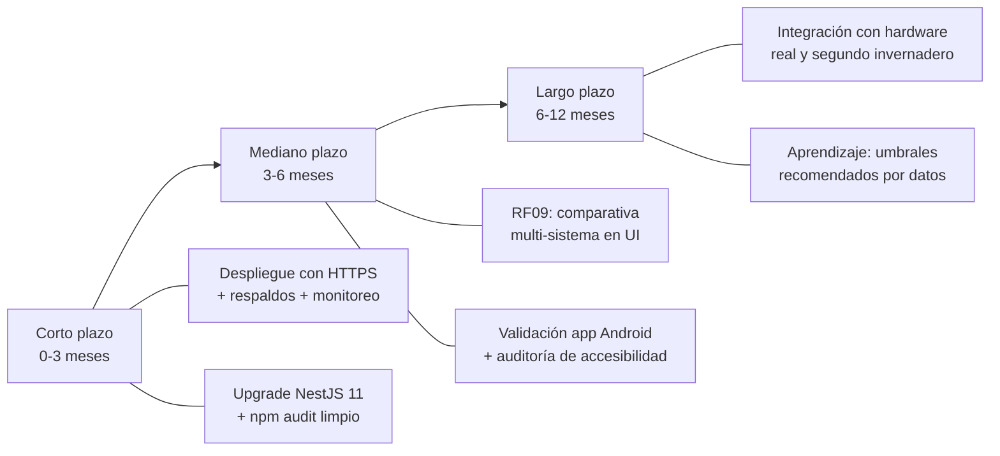

# 10. Viabilidad y Proyección

> **Advertencia de método.** La viabilidad **técnica** se apoya en hechos medidos (§7). La viabilidad **económica** usa **estimaciones de mercado**, no mediciones del proyecto: se etiquetan como tales para no confundirlas con resultados. La viabilidad **operativa y legal** se argumenta a partir de lo que el sistema realmente hace.

## 10.1 Viabilidad técnica

El sistema es técnicamente viable porque **ya funciona de extremo a extremo** y se apoya en tecnologías maduras y con soporte:

| Criterio | Evaluación | Respaldo |
|---|---|---|
| Stack consolidado | **Alta** | NestJS, Prisma, PostgreSQL, React: todas con LTS/versiones activas |
| Contrato estable | **Alta** | OpenAPI 3 con 35 rutas + prueba de contrato (TS-42) |
| Calidad verificable | **Alta** | 125 pruebas y cobertura de líneas 92,26 % (§7.2) |
| Rendimiento suficiente | **Alta** | p50 panel 104,1 ms; serie de 1 mes 573,7 ms (§7.3) |
| Reproducibilidad | **Alta** | Docker Compose + migraciones versionadas |
| Portabilidad de datos | **Media-alta** | PostgreSQL estándar; `pg_dump`/`restore` |
| Listo para producción | **Media** | Falta despliegue con HTTPS, monitoreo y respaldos (§9) |
| Escalabilidad a gran volumen | **Media** | Estrategia por umbrales (§9.7); sin particionado hoy |

**Conclusión técnica:** viable para un invernadero piloto y para crecer por etapas; los pendientes son de **operación** (despliegue, monitoreo), no de arquitectura.

## 10.2 Viabilidad económica *(estimaciones)*

No hubo gasto real: el desarrollo corrió en el equipo del proyecto y en un contenedor local. Las siguientes cifras son **estimaciones de mercado** para llevar el sistema a producción, con dos escenarios:

| Ítem | Escenario mínimo *(estimado)* | Escenario gestionado *(estimado)* |
|---|---:|---:|
| Cómputo (VPS 2 vCPU / 4 GB) | 12–24 USD/mes | 24–48 USD/mes |
| Base de datos | incluida en el VPS | 15–30 USD/mes (gestionada) |
| Dominio | ~1 USD/mes (12 USD/año) | ~1 USD/mes |
| Certificado TLS | 0 (Let's Encrypt) | 0 |
| Respaldos (almacenamiento) | 1–5 USD/mes | 1–5 USD/mes |
| **Total infraestructura** | **≈ 15–30 USD/mes** | **≈ 40–85 USD/mes** |
| Mantención (horas/mes) | 4–8 h/mes | 8–16 h/mes |

**Beneficio esperado (cualitativo, no cuantificado):** menos pérdidas de cultivo por detección tardía, menos tiempo de inspección manual y mejor uso de insumos. El proyecto **no** midió el ahorro, por lo que no se afirma una cifra de retorno.

## 10.3 Viabilidad operativa

- **Barrera de uso baja:** el encargado solo necesita un navegador; dos roles ya están separados (consulta vs. administración).
- **Autonomía del hardware:** el ESP32-S3 sigue operando localmente y el búfer offline evita perder datos durante cortes.
- **Capacitación:** el uso diario (panel, históricos, alertas) se cubre en una sesión breve; la administración (usuarios, reglas) en una segunda sesión.
- **Dependencia de una persona:** mitigada por documentación (informes ES1–ES4, README, OpenAPI) y por pruebas automatizadas que describen el comportamiento esperado.

## 10.4 Viabilidad legal y ética

| Aspecto | Situación | Acción propuesta |
|---|---|---|
| Datos personales (Ley 19.628 / 21.719) | Se almacenan correo y nombre de usuario con **minimización** y contraseñas con **bcrypt** | Definir **política de retención** y procedimiento de acceso/eliminación |
| Seguridad | RBAC, JWT, auditoría y validación de entrada | Auditoría formal (ZAP) y revisión de accesibilidad |
| Transparencia | El informe declara brechas y datos no medidos | Mantener la práctica en la mantención |
| Licenciamiento de software | Dependencias de código abierto (MIT/Apache) | Revisar licencias antes de una venta |

## 10.5 Proyección y roadmap

| Horizonte | Entregable | Atiende |
|---|---|---|
| **Corto (0–3 meses)** | Despliegue con HTTPS, respaldos y monitoreo | RNF07, R-02 |
| **Corto** | Upgrade a NestJS 11 y cierre de vulnerabilidades | §6.4 |
| **Mediano (3–6 meses)** | Superposición multi-sistema en la interfaz | RF09 / NEC-08 |
| **Mediano** | Validación del contrato con la app Android y auditoría de accesibilidad | RNF08, WCAG |
| **Largo (6–12 meses)** | Integración con el hardware real y un segundo invernadero | Escalabilidad |
| **Largo** | Recomendación de umbrales a partir de los datos históricos | Valor del dato |

## 10.6 Riesgos y mitigación

| # | Riesgo | Prob. | Impacto | Mitigación |
|---|---|:--:|:--:|---|
| R-1 | El firmware real difiere del contrato simulado | Media | Alto | Probar un lote contra el contrato OpenAPI antes de integrar |
| R-2 | Crecimiento de datos degrada las series | Baja | Medio | Umbrales de escalabilidad (§9.7) |
| R-3 | Un solo entorno (sin alta disponibilidad) | Media | Alto | Desplegar con respaldos + monitoreo; luego HA |
| R-4 | Dependencias de terceros con vulnerabilidades | Alta | Medio | Actualizar a NestJS 11 y automatizar el escaneo |
| R-5 | Pérdida de conocimiento del equipo | Baja | Alto | Documentación (ES1–ES4) y pruebas |
| R-6 | Uso indebido por roles mal asignados | Baja | Medio | Revisar permisos y auditoría periódicamente |
