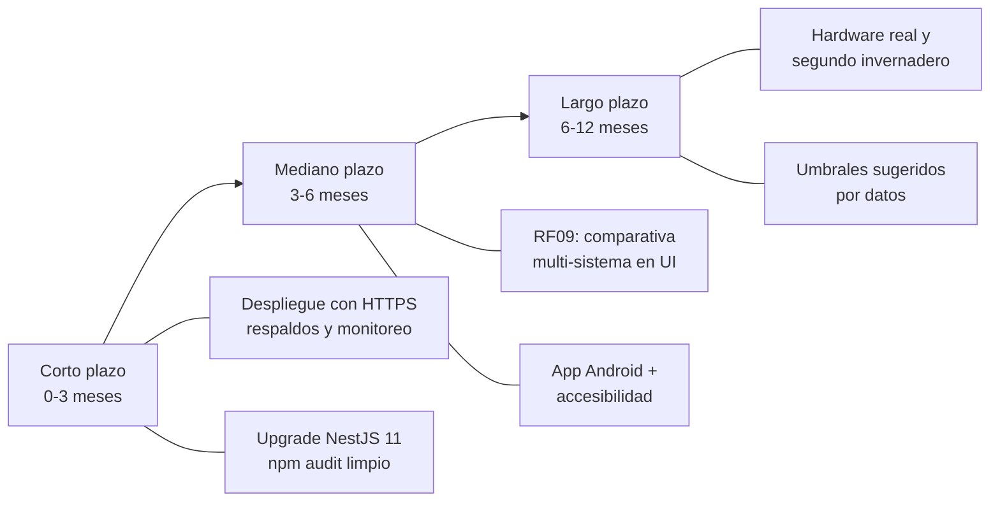

# 2. Documentación Final del Proyecto

Este capítulo consolida, en un solo lugar, la **documentación final** del proyecto: qué valor entrega, qué necesidades del cliente aborda, hasta dónde llega su alcance y por qué es viable. Es la síntesis de ES1 (diagnóstico), ES2 (diseño) y ES3 (implementación).

## 2.1 Propuesta de valor

AquaPlants / AquaBrain es un sistema de **control y monitoreo** para cultivos hidropónicos y aeropónicos que integra el *hardware* IoT del cliente (gateway **ESP32-S3** con sensores AHT10 y HC-SR04, display OLED SSD1309 y joystick) con una **plataforma web centralizada**. La propuesta de valor se apoya en tres pilares:

1. **Centralizar los datos.** Hoy las lecturas viven repartidas entre el display local, la app y el firmware. La solución las reúne en **una** base PostgreSQL (**19 modelos**) accesible por API y dashboard.
2. **Decidir a tiempo.** Un **motor de reglas** evalúa cada medición dentro de la ingesta y genera **alertas** con severidad; el panel muestra la última lectura y un semáforo de **frescura** por dispositivo.
3. **Crecer por etapas.** La arquitectura *API-first* (OpenAPI 3, **35 rutas**) y una estrategia de escalabilidad **por umbrales medibles** permiten incorporar más sensores, invernaderos y clientes sin rediseñar.

> **Diferenciador honesto.** El valor no está en una funcionalidad exótica, sino en un sistema **funcional, medido y transparente sobre sus límites**: 125 pruebas en verde, cobertura de líneas del 92,26 % y una declaración explícita de lo que falta.

## 2.2 Necesidades abordadas (NEC-01 … NEC-09)

El diagnóstico de ES1 definió **nueve necesidades** con prioridad MoSCoW. El estado que se declara es el **verificado** en la implementación (ES3), no el previsto:

| # | Necesidad TI (ES1) | MoSCoW | Estado real | Evidencia |
|---|---|:--:|:--:|---|
| NEC-01 | Centralizar la información en una plataforma web única con BD consistente | **Must** | ✅ | 19 modelos; CRUD de sistemas, cultivos, dispositivos y sensores (RF03–RF05) |
| NEC-02 | Dashboard con el estado actual (última medición) por sensor y sistema | **Must** | ✅ | `GET /dashboard/estado`; panel verificado en navegador (RF07) |
| NEC-03 | Motor de reglas/umbrales que genere alertas al salir de rango | **Should** | ✅ | 4 reglas activas; motor en línea y bandeja de alertas (RF10–RF12) |
| NEC-04 | API de ingesta que reciba el formato del firmware real, además del simulador | **Must** | ✅ | `POST /mediciones` + `/mediciones/bulk`; autenticación por dispositivo (RF06) |
| NEC-05 | API-first documentada y versionada para integrar app Android y futuros clientes | **Should** | ✅ | OpenAPI 3 con 35 rutas; contrato verificado contra `@aquabrain/shared` (RF13) |
| NEC-06 | Tolerar pérdidas temporales de conectividad con reintentos y sincronización | **Could** | ✅ | Modo `offline` del simulador; idempotencia (`medicion_idempotencia`) (RF06, RF14) |
| NEC-07 | Autenticación robusta (JWT) y control de acceso por roles (RBAC) | **Must** | ✅ | JWT + refresh rotado; 3 roles, 21 permisos; auditoría (RF01, RF02) |
| NEC-08 | Históricos con gráficos y comparación entre múltiples sistemas | **Could** | 🟡 | Históricos ✅ (gráfico + CSV); la **UI no superpone** varios sistemas (RF08 ✅ / RF09 🟡) |
| NEC-09 | Diseño escalable (índices, normalización, estrategia de particionamiento) | **Won't** | ⬜ | Índices y normalización sí; **particionado no** (RNF04 *Won't*), reemplazado por umbrales (§7.8) |

**Lectura del resultado.** Las necesidades **Must** y **Should** quedan cubiertas. La única brecha funcional (*Could*) es la **superposición multi-sistema** en la interfaz (RF09), cuya API ya soporta la consulta. La necesidad **Won't** se resuelve no implementando particionado —que el volumen aún no exige— sino documentando una **estrategia por umbrales** (§7.8).

## 2.3 Alcance del MVP

**Incluido y verificado:**

- **15 Requerimientos Funcionales** (RF01–RF15): **13 cumplidos** con evidencia, **RF09 parcial** (API sí, UI de superposición no) y **RF15** fuera de alcance (*Won't*).
- **11 Requerimientos No Funcionales** (RNF01–RNF11): **4 cumplidos** (RNF01, RNF03, RNF06, RNF10), **5 parciales** con el faltante acotado (RNF02, RNF05, RNF07, RNF08, RNF11) y **2 *Won't*** (RNF04 particionado, RNF09 autonomía del firmware).
- **11 Historias de Usuario** trazadas (HU01–HU11); **HU09 fuera de alcance**.
- **3 roles** operativos (Encargado, Supervisor, Administrador) con **21 permisos**.
- **2 dispositivos** (`DEV-01`, `DEV-02`), **10 sensores** y **5 tipos de variable** (TEMPERATURA, HUMEDAD, PH, DISTANCIA, CAUDAL).
- **4 reglas de alerta** activas: «Temperatura alta», «Humedad baja», «pH fuera de rango» y «Nivel bajo del depósito».
- **4 pantallas** funcionales: Acceso, Panel, Históricos y Alertas.

**Excluido (declarado, no oculto):**

| Excluido | Motivo |
|---|---|
| Licenciamiento y suscripciones (HU09 / RF15) | Supuesto no respaldado por el desafío; *Won't* en el MoSCoW |
| Particionado de la tabla `medicion` (RNF04) | El volumen del prototipo no lo exige; estrategia de umbrales documentada |
| Autonomía local del firmware (RNF09) | Depende del hardware (OLED + joystick), no del software de plataforma |
| Despliegue en nube / HTTPS de producción | No se gestionó cuenta de proveedor; ver §2.4 y capítulo 7 |
| App Android real integrada | No se dispone del contrato que consume hoy; el contrato OpenAPI sí está listo |

**Actores del desafío y su cobertura:**

| Actor (ES1) | Necesidad | Cobertura real |
|---|---|---|
| **Encargado de cultivo** | Ver estado, históricos y alertas | HU01–HU03 → Panel, Históricos y Alertas ✅ |
| **Supervisor** | Comparar sistemas y analizar tendencias | HU04 → históricos multi-sensor ✅; superposición en UI 🟡 |
| **Administrador** | Gestionar usuarios, sistemas, dispositivos y reglas | HU05–HU07 → CRUD y reglas ✅ |
| **Dispositivo / AquaBrain (ESP32-S3)** | Enviar mediciones y operar sin conectividad | HU08, HU10 → API de ingesta + simulador ✅ |
| **Simulador IoT** | Generar mediciones sin hardware | Modos `online`, `offline` y `anomalia` ✅ |
| **Desarrollador de Integraciones** | Consumir la API documentada | HU11 → OpenAPI 3 con 35 rutas ✅ |

## 2.4 Viabilidad del proyecto

**Viabilidad técnica.** El sistema es técnicamente viable porque **ya funciona de extremo a extremo** y se apoya en tecnologías maduras con soporte:

| Criterio | Evaluación | Respaldo |
|---|:--:|---|
| Stack consolidado | **Alta** | NestJS, Prisma, PostgreSQL y React en versiones activas |
| Contrato estable | **Alta** | OpenAPI 3 con 35 rutas + prueba de contrato (TS-42) |
| Calidad verificable | **Alta** | 125 pruebas y cobertura de líneas 92,26 % |
| Rendimiento suficiente | **Alta** | p50 del panel 104,1 ms; serie de 1 mes 573,7 ms |
| Reproducibilidad | **Alta** | Docker Compose + migraciones versionadas |
| Portabilidad de datos | **Media-alta** | PostgreSQL estándar; `pg_dump` / `restore` |
| Listo para producción | **Media** | Falta despliegue con HTTPS, monitoreo y respaldos (capítulo 7) |
| Escalabilidad a gran volumen | **Media** | Estrategia por umbrales; sin particionado hoy |

*Conclusión:* viable para un **invernadero piloto** y para crecer por etapas; los pendientes son de **operación** (despliegue, monitoreo), no de arquitectura.

**Viabilidad económica *(estimaciones de mercado, no medidas)*.** No hubo gasto real: el desarrollo corrió en el equipo del proyecto y en un contenedor local. Los siguientes valores son **estimaciones** para llevar el sistema a producción:

| Ítem | Escenario mínimo *(estimado)* | Escenario gestionado *(estimado)* |
|---|---:|---:|
| Cómputo (VPS 2 vCPU / 4 GB) | 12–24 USD/mes | 24–48 USD/mes |
| Base de datos | incluida en el VPS | 15–30 USD/mes (gestionada) |
| Dominio | ~1 USD/mes | ~1 USD/mes |
| Certificado TLS (Let's Encrypt) | 0 | 0 |
| Respaldos (almacenamiento) | 1–5 USD/mes | 1–5 USD/mes |
| **Total infraestructura** | **≈ 15–30 USD/mes** | **≈ 40–85 USD/mes** |
| Mantención (horas/mes) | 4–8 h/mes | 8–16 h/mes |

**Beneficio esperado (cualitativo, no cuantificado):** menos pérdidas de cultivo por detección tardía, menos tiempo de inspección manual y mejor uso de insumos. El proyecto **no** midió el ahorro, por lo que **no** se afirma una cifra de retorno.

**Viabilidad operativa.**

- **Barrera de uso baja:** el encargado solo necesita un navegador; dos roles ya están separados (consulta vs. administración).
- **Autonomía del hardware:** el ESP32-S3 sigue operando localmente y el búfer *offline* evita perder datos durante cortes.
- **Capacitación:** el uso diario (panel, históricos, alertas) se cubre en una sesión breve; la administración (usuarios, reglas) en una segunda.
- **Dependencia de una persona:** mitigada por documentación (informes ES1–ES4, README, OpenAPI) y por pruebas automatizadas que describen el comportamiento esperado.

**Viabilidad legal y ética.**

| Aspecto | Situación | Acción propuesta |
|---|---|---|
| Datos personales (Ley 19.628 / 21.719) | Se almacenan correo y nombre de usuario con **minimización**; contraseñas con **bcrypt** (coste 12) | Definir **política de retención** y procedimiento de acceso/eliminación |
| Seguridad | RBAC, JWT, auditoría y validación de entrada | Auditoría formal (ZAP) y revisión de accesibilidad |
| Transparencia | El informe declara brechas y datos no medidos | Mantener la práctica durante la mantención |
| Licenciamiento de software | Dependencias de código abierto (MIT/Apache) | Revisar licencias antes de una venta |

## 2.5 Proyección y riesgos

| Horizonte | Entregable | Atiende |
|---|---|---|
| **Corto (0–3 meses)** | Despliegue con HTTPS, respaldos y monitoreo | RNF07, R-02 |
| **Corto** | Upgrade a NestJS 11 y cierre de vulnerabilidades | R-16 |
| **Mediano (3–6 meses)** | Superposición multi-sistema en la interfaz | RF09 / NEC-08 |
| **Mediano** | Validación del contrato con la app Android y auditoría de accesibilidad | RNF08, WCAG |
| **Largo (6–12 meses)** | Integración con el hardware real y un segundo invernadero | Escalabilidad |
| **Largo** | Recomendación de umbrales a partir de los datos históricos | Valor del dato |

| # | Riesgo | Prob. | Impacto | Mitigación |
|---|---|:--:|:--:|---|
| R-1 | El firmware real difiere del contrato simulado | Media | Alto | Probar un lote contra el contrato OpenAPI antes de integrar |
| R-2 | Crecimiento de datos degrada las series | Baja | Medio | Umbrales de escalabilidad (§7.8) |
| R-3 | Un solo entorno (sin alta disponibilidad) | Media | Alto | Desplegar con respaldos + monitoreo; luego HA |
| R-4 | Dependencias de terceros con vulnerabilidades | Alta | Medio | Actualizar a NestJS 11 y automatizar el escaneo (R-16, R-18) |
| R-5 | Pérdida de conocimiento del equipo | Baja | Alto | Documentación (ES1–ES4) y pruebas |
| R-6 | Uso indebido por roles mal asignados | Baja | Medio | Revisar permisos y auditoría periódicamente |

## 2.6 Síntesis

La documentación final muestra un proyecto **coherente con su propuesta de valor**: centraliza datos, genera alertas a tiempo y está preparado para crecer. Su alcance está **cerrado y declarado** —con dos brechas funcionales acotadas (RF09 y RNF09)— y su viabilidad es **alta** desde el punto de vista técnico y **media** desde el operativo, con una ruta de puesta en producción explícita en el plan de mantención (capítulo 7).
