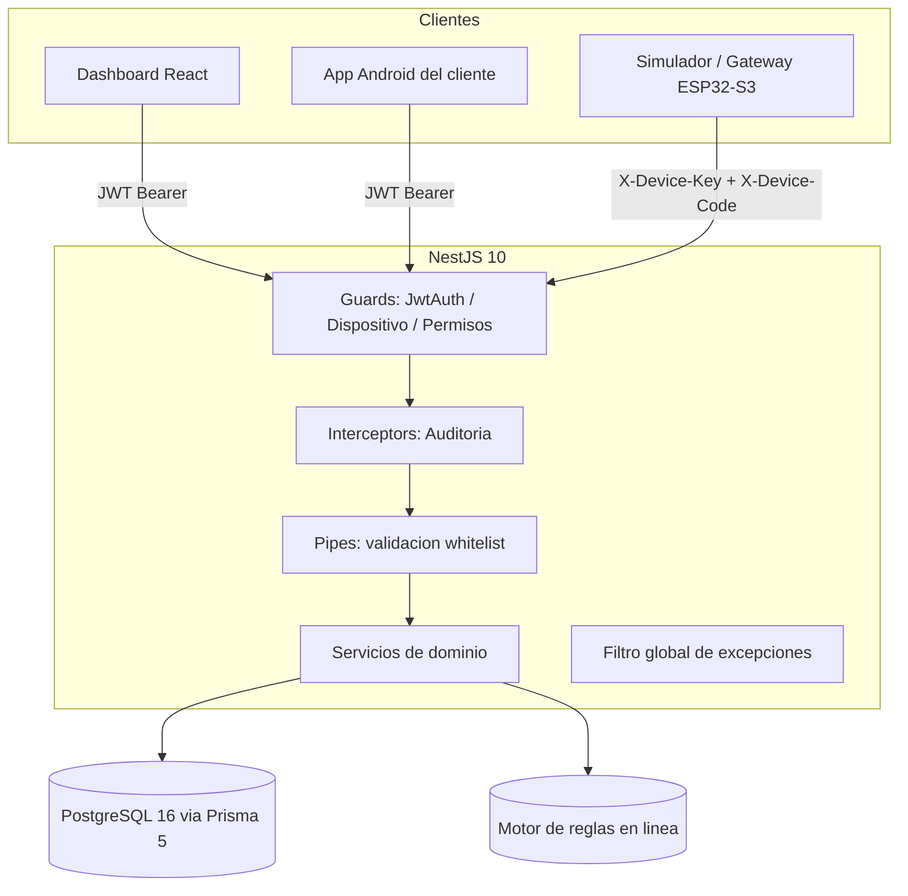
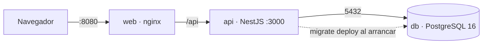

# 3. Arquitectura, Tecnologías y Entorno Reproducible

Este capítulo aporta el respaldo técnico del aspecto 1: **cómo está construida** la solución y **cómo se reproduce**.

## 3.1 Arquitectura 4+1

El diseño de ES2 se materializó respetando las cinco vistas del modelo 4+1, con evidencia verificable en el repositorio:

| Vista | Descripción | Evidencia en el proyecto |
|---|---|---|
| **Lógica** | Cuatro capas: presentación, aplicación (controladores), dominio (servicios) y datos (Prisma/PostgreSQL) | Módulos por dominio en `apps/api/src/modules/`; capas separadas |
| **Desarrollo** | Monorepo con *npm workspaces*: `apps/api`, `apps/web`, `apps/simulator`, `packages/shared` | Estructura del repositorio (§3.3) |
| **Procesos** | Flujo ingesta → validación → persistencia → motor de alertas → dashboard | `mediciones.service.ts`, `motor-alertas.service.ts`; diagrama en §4.2 |
| **Física** | Contenedores (Docker), gateways ESP32-S3, clientes web y móvil | `infra/docker-compose.yml`; imagen de API construida (162 MB) |
| **Escenarios** | Seis escenarios clave: dashboard, alerta, comparativa, offline, administración y reglas | Suites de prueba y guion de demo (capítulo 5) |

Cada petición atraviesa la API en este orden: **guardas** (¿quién eres y qué puedes hacer?), **interceptor de auditoría**, **pipe de validación** (rechaza campos no declarados), **servicio de dominio** y, ante cualquier error, un **filtro global** que normaliza la respuesta.



> **Desviación respecto de ES2 / borrador (D-01 y D-07).** El borrador planteaba **FastAPI (Python)** y **Redis**. La implementación usa **NestJS (TypeScript)** para mantener un solo lenguaje en todo el stack —lo que habilita la fuente de verdad compartida `@aquabrain/shared`— y **no usa Redis**: con una sola instancia no aportaba valor; `REDIS_URL` queda como variable **reservada**.

## 3.2 Stack tecnológico consolidado

Versiones **medidas** en el entorno de desarrollo:

| Capa | Tecnología | Versión | Rol y justificación |
|---|---|---|---|
| Frontend | **React** | 18.3.1 | Componentes reutilizables; coincide con ES2 |
| *Bundler* | **Vite** | 5.4.8 | Arranque y recarga en caliente |
| Lenguaje | **TypeScript** | 5.6.3 | Tipado estricto del contrato (modo `strict`) |
| Estado del servidor | **TanStack Query** | 5.59.0 | Caché, reintentos y refresco periódico del panel |
| Gráficos | **Recharts** | 2.12.7 | Series con bandas de mínimo/máximo |
| Backend | **NestJS** | 10.4.4 | *Guards*, *interceptors*, *pipes* y decoradores nativos |
| ORM | **Prisma** | 5.22.0 | Migraciones versionadas y tipado del esquema |
| Base de datos | **PostgreSQL** | 16.15 (`postgres:16`) | Integridad, índices compuestos y series temporales |
| Validación | **Zod** | 3.23.8 | Esquemas compartidos (`@aquabrain/shared`) |
| Autenticación | **JWT + bcrypt** | bcrypt 5.1.1 | Estándar multi-cliente; contraseñas con coste 12 |
| Contenedores | **Docker + Compose** | Docker 29.8.2 · Compose v5.6.0 | Portabilidad y reproducibilidad |
| CI/CD | **GitHub Actions** | — | Verificación de tipos, migraciones, pruebas y cobertura |
| Pruebas | **Jest + Supertest** | — | 125 pruebas unitarias y de integración |
| Documentación | **OpenAPI 3 + Swagger UI** | — | Contrato estable versionado (35 rutas) |

> **Desviación respecto de ES2 / borrador (D-03).** El borrador proponía **Tailwind CSS + Zustand + Axios**. La implementación usa **CSS propio**, el **estado local de React + TanStack Query** y **`fetch` nativo**, para reducir dependencias sin alterar la interfaz diseñada.

**Otras decisiones de arquitectura relevantes:**

- **Un solo lenguaje (TypeScript)** en API, web, simulador y paquete compartido. El contrato de datos (esquemas Zod) es **una sola fuente de verdad** que consumen los tres clientes.
- **PostgreSQL como única base de datos.** El borrador contemplaba además **MongoDB** para datos no estructurados; se descartó porque el dominio es tabular y relacional (sensores, mediciones, alertas) y una segunda base habría duplicado la operación sin beneficio (**discrepancia D-02**).
- **Motor de reglas en línea** (dentro de la ingesta), con la variante asíncrona (cola + *workers*) prevista como camino de escalabilidad.

## 3.3 Estructura del repositorio (monorepo)

```text
Proyecto AquaPlants  AquaBrain/
├─ apps/
│  ├─ api/          API NestJS + Prisma (backend)
│  ├─ web/          Dashboard React + Vite (frontend)
│  └─ simulator/    Simulador del gateway ESP32-S3
├─ packages/
│  └─ shared/       Esquemas Zod compartidos (fuente de verdad del contrato)
├─ infra/           docker-compose, Dockerfiles, configuración de nginx
├─ docs/
│  ├─ ES1/          Catálogo canónico (necesidades, HU, RF/RNF)
│  ├─ ES2/          Diseño de la solución
│  ├─ ES3/          Informe de implementación
│  └─ ES4/          Informe de cierre (este documento)
├─ .github/workflows/ci.yml   Integración continua
├─ package.json     Workspaces y scripts raíz
└─ README.md
```

| Workspace | Paquete | Rol |
|---|---|---|
| `apps/api` | `@aquabrain/api` | Backend, ingesta de datos y lógica de negocio |
| `apps/web` | `@aquabrain/web` | Dashboard de monitoreo |
| `apps/simulator` | `@aquabrain/simulator` | Cliente del protocolo de ingesta (gateway simulado) |
| `packages/shared` | `@aquabrain/shared` | Esquemas de validación compartidos |

## 3.4 Vista de despliegue y entorno reproducible



La solución se empaqueta con **Docker Compose** en tres servicios (`db`, `api`, `web`). La API ejecuta `prisma migrate deploy` antes de arrancar y el *frontend* se sirve como estático en **nginx**, que además **proxea `/api` hacia la API**: el navegador ve un único origen, sin CORS.

**Reproducibilidad.** El entorno completo se levanta con un solo comando (`docker compose up`) y las migraciones están versionadas. Además, la **integración continua** (`.github/workflows/ci.yml`) instala dependencias, compila el paquete compartido, aplica migraciones, ejecuta las 125 pruebas con cobertura y verifica el contrato. La sección de comandos exactos está en el anexo (capítulo 14).

La construcción de la imagen de API quedó **medida**: `docker build` completó en **82,2 s** y la imagen resultante pesa **162 MB** (Anexo H).
