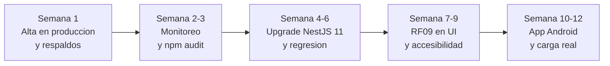

# 7. Plan de Mantención

Este capítulo responde al aspecto 4 con la profundidad que exige: **actualizaciones, optimizaciones, corrección de errores, respaldos, escalabilidad, responsables, frecuencias y herramientas**.

> **Naturaleza de esta sección.** El proyecto se entregó en **entorno de desarrollo**; el plan que sigue es una **propuesta** de mantención para su puesta en producción, no la descripción de algo ya ejecutado. Se apoya en las cifras medidas (capítulo 9) y en las brechas declaradas (capítulo 6).

## 7.1 Objetivo y enfoque

El plan busca que el sistema **siga funcionando y aportando valor** después de la entrega. Se organiza según las cuatro categorías de la norma **ISO/IEC 14764**, con responsables, frecuencia y herramientas concretas.

| Categoría | Definición | Ejemplo en AquaBrain |
|---|---|---|
| **Correctiva** | Corregir defectos | Un error de cálculo en la agrupación de series |
| **Adaptativa** | Ajustar a cambios del entorno | Actualizar NestJS 10 → 11; nuevo formato del firmware |
| **Perfectiva** | Mejorar sin corregir ni adaptar | Añadir superposición multi-sistema (RF09) en la UI |
| **Preventiva** | Reducir riesgo futuro | Respaldos, monitoreo, revisión de dependencias |

## 7.2 Actividades, frecuencia y responsable

| # | Actividad | Categoría | Frecuencia | Responsable | Herramienta |
|---|---|---|---|---|---|
| M-01 | Revisión de errores en bitácora de auditoría y *logs* | Correctiva | Semanal | Backend | `GET /auditoria`, *logs* |
| M-02 | Resolución de incidencias reportadas | Correctiva | Según evento | Equipo | GitHub Issues |
| M-03 | Revisión de dependencias y parches de seguridad | Preventiva | Mensual | DevOps | `npm audit`, Dependabot |
| M-04 | Actualización de versión mayor (NestJS 11) | Adaptativa | Trimestral | Backend | `npm outdated` |
| M-05 | Actualización de PostgreSQL (parches 16.x) | Adaptativa | Según *release* | DevOps | Docker |
| M-06 | Verificación de respaldos y prueba de restauración | Preventiva | Mensual | DevOps | `pg_dump`, *script* de *restore* |
| M-07 | Revisión de cobertura y pruebas | Perfectiva | Por *release* | QA | `npm run test:cov` |
| M-08 | Revisión de rendimiento de *endpoints* clave | Preventiva | Mensual | Backend | *script* de medición (TS-43) |
| M-09 | Ampliación de funcionalidades del *roadmap* | Perfectiva | Por hito | Equipo | — |
| M-10 | Auditoría de accesibilidad y de privacidad | Preventiva | Semestral | Frontend | axe / Lighthouse / revisión manual |

## 7.3 Actualizaciones

- **Dependencias:** política de **actualización mensual de parches** y **trimestral de versiones mayores**. La prioridad inmediata es migrar a **NestJS 11**, que arrastra versiones parcheadas de las **66 dependencias transitivas** con alerta de `npm audit` (§6.4, **R-16**).
- **Base de datos:** seguir las versiones **menores** de PostgreSQL 16.x; planificar 17.x con prueba de compatibilidad de Prisma.
- **Node.js:** mantener una versión **LTS** (la verificación de desarrollo se hizo con **Node v24.16.0**; la imagen Docker empaqueta **Node v20.20.2**).
- **Contrato API:** todo cambio incompatible exige **nueva versión** del prefijo (`api/v1` → `api/v2`) y actualización de `@aquabrain/shared` con su prueba de contrato.

## 7.4 Optimizaciones

- **Consultas de series:** la serie de un mes usa `date_bin` con el índice compuesto `idx_medicion_sensor_ts`; su plan de ejecución mide **2,217 ms** de *Execution Time*. Si el p95 supera el umbral (§7.8), se evalúan vistas materializadas.
- **Ingesta por lote:** la optimización **R-01** (`createManyAndReturn`) redujo la escritura de 500 lecturas de **16 410 ms** a una mediana de **1 403 ms** (≈ **12×**).
- **Caché de cliente:** el panel refresca cada 15 s con TanStack Query; no se recalcula en cada interacción.

## 7.5 Corrección de errores y gestión de incidentes

| Severidad | Descripción | Tiempo de respuesta objetivo | Tiempo de solución objetivo |
|---|---|---:|---:|
| **S1 — Crítica** | Ingesta caída o pérdida de datos | 1 hora | 8 horas |
| **S2 — Alta** | Alertas no generadas o panel sin datos | 4 horas | 24 horas |
| **S3 — Media** | Error funcional con solución alternativa | 1 día hábil | 5 días hábiles |
| **S4 — Baja** | Detalle estético o mejora menor | 5 días hábiles | Próximo *release* |

Cada incidencia se registra con: **pasos de reproducción, resultado esperado, resultado obtenido, severidad y evidencia**. El flujo es **reporte → triaje → corrección → prueba de regresión → cierre**.

## 7.6 Respaldos

| Aspecto | Propuesta |
|---|---|
| Frecuencia | **Diaria** (copia completa) + registro continuo (*log* WAL) para recuperación al minuto |
| Herramienta | `pg_dump` (completo) y `pg_basebackup` / WAL (continuo) |
| Retención | 7 copias diarias, 4 semanales, 12 mensuales |
| Verificación | Restauración de prueba **mensual** (M-06) |
| Ubicación | Fuera del host de la base (almacenamiento de objetos) |
| Datos sensibles | Copias **cifradas** en reposo; el `.env` con secretos **no** se versiona |

## 7.7 Monitoreo y observabilidad

- **Sonda de salud:** `/health` (**ya implementada**) para *liveness* / *readiness*.
- **Bitácora de auditoría:** ya registra operaciones sensibles; se consulta en `GET /auditoria` (1 052 registros al cierre).
- **A incorporar en producción:** recolección de métricas (Prometheus / Grafana o equivalente) y alertas sobre p95, tasa de error y uso de disco.
- **Alertas operativas:** notificar al equipo si ocurre un incidente S1/S2 fuera de horario.

## 7.8 Escalabilidad (criterios por umbral)

En lugar de particionar sin necesidad (RNF04 se declaró *Won't*), se fijan **umbrales medibles** que disparan cada acción:

| Señal observada | Umbral propuesto | Acción |
|---|---|---|
| Filas en `medicion` | > 50 000 000 | Evaluar **particionado mensual** por rango de `timestamp` |
| `GET /mediciones/serie` (p95) | > 2 000 ms sostenido | Revisar índices / vistas materializadas |
| Ráfagas de ingesta | > 100 lotes/s sostenido | Introducir **cola + *workers*** (motor de reglas asíncrono) |
| Sesiones concurrentes | > 500 | Escalar horizontalmente la API + **Redis** para estado compartido |
| Almacenamiento | > 80 % del volumen | Ampliar volumen / archivar históricos antiguos |

Hoy, con **52 230** filas, el p95 de la serie de un mes es **633,8 ms**: **no** se justifica particionar. Los umbrales evitan sobreingeniería mientras dan una ruta clara de crecimiento.

## 7.9 Responsables (matriz RACI simplificada)

| Rol | Responsabilidad principal | Actividades |
|---|---|---|
| **Backend** | API, motor de reglas, rendimiento de consultas | M-01, M-04, M-08 |
| **Frontend** | Dashboard, historias de interfaz, accesibilidad | M-10, RF09 |
| **DevOps / BD** | Contenedores, CI, respaldos, actualización de PostgreSQL | M-05, M-06 |
| **QA** | Pruebas, cobertura, regresión | M-07 |
| **Líder de proyecto** | Priorización del *roadmap* e incidentes | Todas |

*(En un equipo de tres integrantes, los roles se combinan: cada integrante cubre más de una casilla.)*

## 7.10 Herramientas

| Necesidad | Herramienta |
|---|---|
| Gestión de incidencias y *roadmap* | GitHub Issues / Projects |
| Integración continua | GitHub Actions (`.github/workflows/ci.yml`) |
| Pruebas y cobertura | Jest + Supertest + `coverage-combinado.js` |
| Calidad de dependencias | `npm audit`, Dependabot |
| Respaldos | `pg_dump`, `pg_basebackup` |
| Monitoreo | Prometheus + Grafana (a incorporar) |
| Documentación | Informes ES1–ES4 + README + OpenAPI |

## 7.11 Cronograma sugerido (primer trimestre)

