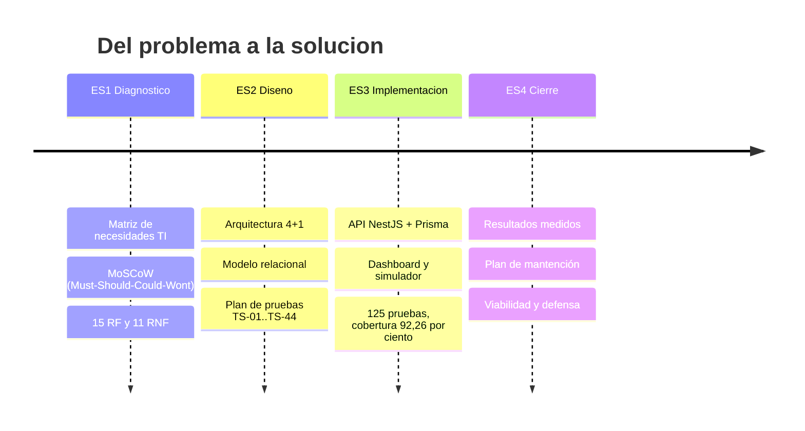

# 8. Presentación Final: Narrativa y Recursos Visuales

Este capítulo responde al aspecto 5: **relacionar diagnóstico, propuesta de mejora, diseño, implementación y resultados** apoyándose en recursos visuales profesionales. La clave es un **hilo conductor único** y una comparación honesta entre el punto de partida y el resultado.

## 8.1 El hilo conductor: del problema a la solución

Cada unidad responde una pregunta y entrega un producto concreto; la presentación final recorre ese recorrido en cinco movimientos:

1. **Diagnóstico (ES1):** un cultivo cuyos datos viven aislados y sin aviso automático.
2. **Propuesta (mejora):** centralizar, decidir a tiempo y crecer por etapas (los tres pilares de valor).
3. **Diseño (ES2):** arquitectura 4+1, modelo relacional y un plan de pruebas de 44 casos.
4. **Implementación (ES3):** el sistema construido y probado.
5. **Resultados (ES4):** las cifras medidas y las brechas declaradas.

## 8.2 Comparativa diagnóstico → resultado

El diagnóstico de ES1 describía la situación pero **no la medía** (no existía un sistema previo del cual tomar cifras). Por eso la comparación es honesta en dos partes: el «antes» es **cualitativo** y el «después» contiene **cifras reales**. No se inventan «antes» cuantitativos: donde el borrador ponía «45 min → 2 min», aquí se explica la **transformación** sin fabricar una medición que nunca se hizo.

| Dimensión | Antes (diagnóstico ES1) | Después (resultado ES4) | Evidencia |
|---|---|---|---|
| **Centralización** | Lecturas repartidas entre display local, app y firmware | **52 230** mediciones en **una** base PostgreSQL (19 modelos) | §9.1, capítulo 14 |
| **Visibilidad del estado** | Requería inspección física del cultivo | **Dashboard** con la última lectura por sensor y semáforo de frescura | `img/web-panel.png` |
| **Detección de anomalías** | Dependía de la observación humana | **Motor de reglas** con 4 reglas; alerta generada **en la ingesta** | Suites `alertas`, `reglas` |
| **Reacción a una alerta** | Sin registro ni seguimiento | **Resolución** con comentario y trazabilidad (3 → 2 activas) | `img/web-alertas.png` |
| **Control de acceso** | Sin control central | **JWT + RBAC**: 3 roles, 21 permisos, auditoría | Suites `auth` (8), `rbac` (11) |
| **Interoperabilidad** | Formatos *ad-hoc* por cliente | **API OpenAPI 3** con 35 rutas y contrato Zod | `/api/docs` |
| **Análisis histórico** | Sin series consultables | **Históricos** con filtro, gráfico y exportación CSV | `img/web-historicos.png` |
| **Pérdida de conectividad** | Implicaba pérdida de datos | **Búfer offline + idempotencia**: reenvío sin duplicados | `evidencia/sim-offline.txt` |
| **Trazabilidad operativa** | No existía | **Bitácora de auditoría** (1 052 registros al cierre) | Suite `auditoria` |
| **Reproducibilidad** | Dependía de la máquina | **Docker Compose** + migraciones versionadas | `docker compose config` → *exit 0* |

## 8.3 Lectura de negocio del resultado

- **Trazabilidad de punta a punta:** un dato del sensor se puede seguir desde su ingesta hasta la alerta y el panel; la auditoría registra quién hizo qué. Esto habilita mejorar el cultivo con base en evidencia, no en memoria.
- **Costo de operación menor que el de no tener sistema:** el sistema no reemplaza al encargado; le quita la tarea de **vigilar** y le deja la de **decidir**.
- **Base para crecer:** al ser *API-first*, integrar la app Android o un segundo invernadero no exige reescribir la lógica, sino reutilizar el contrato.
- **Límites reconocidos:** sin despliegue productivo, sin app Android validada y sin auditoría de accesibilidad; son el punto de partida de la mantención (capítulo 7), no un resultado que se pueda afirmar como logrado.

## 8.4 Recursos visuales de la presentación

| Tipo de recurso | Qué aporta | Dónde está |
|---|---|---|
| **Diagrama de arquitectura 4+1** | Entender la estructura en una mirada | §3.1 |
| **Diagrama de flujo extremo a extremo** | Mostrar cómo viaja un dato | §4.2 |
| **Diagrama de secuencia de la demo** | Orden de los componentes en vivo | §5.1 |
| **Captura del panel** | Ver el estado del cultivo | `img/web-panel.png` |
| **Captura de históricos** | Ver la serie y la banda mín/máx | `img/web-historicos.png` |
| **Captura de alertas** | Ver el ciclo de una alerta | `img/web-alertas.png` |
| **Tablas de métricas** | Respaldar cada cifra dicha en voz alta | capítulo 9 |
| **Gráfico de cumplimiento** | Mostrar logros y brechas de un vistazo | §9.4 |

## 8.5 Estructura de diapositivas (20 minutos)

| # | Bloque | Min | Diapositiva | Mensaje clave |
|---|---|---|---|---|
| 1 | Portada | 0:00–0:30 | Título, equipo, ES1→ES4 | «Cerramos el proyecto con la solución funcionando» |
| 2 | El problema | 0:30–2:00 | Diagnóstico ES1 | Datos aislados y sin aviso automático |
| 3 | La propuesta | 2:00–3:30 | Tres pilares de valor | Centralizar, decidir a tiempo, crecer |
| 4 | Arquitectura y *stack* | 3:30–8:00 | Diagrama 4+1 + tabla de *stack* | *API-first* en NestJS + Prisma + PostgreSQL |
| 5 | **Demostración** | 8:00–15:00 | En vivo (capítulo 5) | Del sensor al panel y a la alerta |
| 6 | Resultados | 15:00–18:00 | Métricas (capítulo 9) | 125 pruebas, 92,26 % de cobertura, p50 104,1 ms |
| 7 | Mantención y viabilidad | 18:00–19:00 | Plan ISO/IEC 14764 + *roadmap* | El sistema se sostiene y puede crecer |
| 8 | Cierre y brechas | 19:00–20:00 | Lo logrado y lo pendiente | «Honestos con lo que falta» |

El detalle de la exposición oral (reparto de bloques y oratoria) está en el capítulo 10; la preparación de la defensa, en el capítulo 11.
