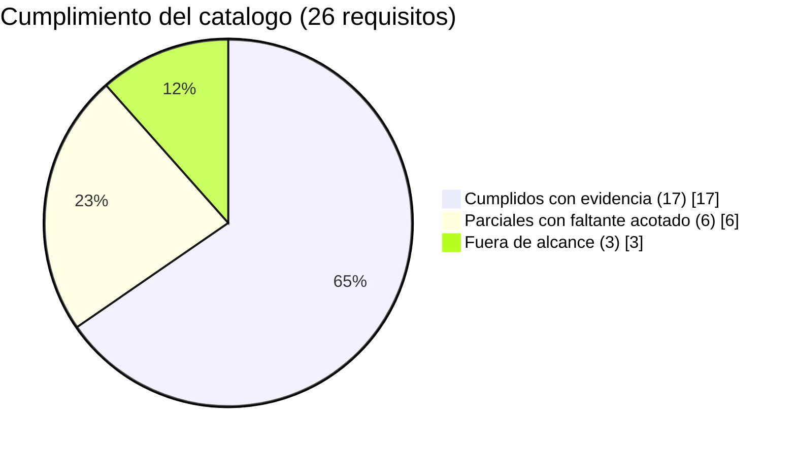

# 9. Presentación de Resultados Cuantificables

Este capítulo responde al aspecto 6: presentar **datos claros y cuantificables**, con tablas y gráficos que evidencien logros y brechas. Todas las cifras provienen de una **ejecución real** (pruebas, consultas a PostgreSQL, *scripts* de medición o inspección del repositorio). Cuando algo del borrador **no se midió**, se indica explícitamente.

## 9.1 Métricas de implementación

| Métrica | Valor real | Meta | ¿Cumple? |
|---|---:|---|:--:|
| Requerimientos Funcionales abordados | **14 / 15** (RF15 *Won't*) | 15 | 🟡 *(13 plenos)* |
| Requerimientos No Funcionales abordados | **9 / 11** (RNF04 y RNF09 *Won't*) | 11 | 🟡 *(4 plenos)* |
| Historias de Usuario trazadas | **10 / 11** (HU09 *Won't*) | 11 | 🟡 |
| Rutas REST publicadas en OpenAPI | **35** | ≥ 15 | ✅ |
| Módulos de backend | **12** | — | ✅ |
| Modelos de datos / tablas en PostgreSQL | **19 / 20** | ≥ 10 | ✅ |
| Mediciones persistidas | **52 230** | volumen de prueba | ✅ |
| Tipos de variable | **5** (TEMPERATURA, HUMEDAD, PH, DISTANCIA, CAUDAL) | ≥ 4 | ✅ |
| Sensores | **10** | ≥ 6 | ✅ |
| Dispositivos | **2** (`DEV-01`, `DEV-02`) | ≥ 2 | ✅ |
| Reglas de alerta activas | **4** | ≥ 4 | ✅ |
| Permisos RBAC / roles | **21 / 3** | 3 roles | ✅ |
| Pantallas de dashboard | **4** | ≥ 3 | ✅ |
| Modos del simulador | **3** (`online`, `offline`, `anomalia`) | — | ✅ |

> El borrador citaba «9 pantallas», «13 tablas», «12 sensores» y «6 reglas». Los valores reales son **4**, **20**, **10** y **4**, respectivamente. Se reportan los reales.

## 9.2 Métricas de calidad

| Métrica | Valor real | Meta | ¿Cumple? |
|---|---:|---|:--:|
| Pruebas automatizadas en verde | **125** (50 unitarias + 75 integración) | — | ✅ |
| Suites | **17** (8 unitarias + 9 de integración) | — | ✅ |
| Cobertura de **líneas** (combinada) | **92,26 %** | ≥ 70 % | ✅ |
| Cobertura de **sentencias** | **91,09 %** | ≥ 70 % | ✅ |
| Cobertura de **funciones** | **89,49 %** | ≥ 60 % | ✅ |
| Cobertura de **ramas** | **69,01 %** | ≥ 60 % | ✅ *(la más baja)* |
| Vulnerabilidades críticas/altas (OWASP ZAP) | **no ejecutado** | 0 | ⬜ |
| Puntuación Lighthouse (accesibilidad) | **no ejecutado** | ≥ 90 | ⬜ |
| Vulnerabilidades de dependencias (`npm audit`) | **66** (4 low, 16 mod, 45 high, 1 crit), todas transitivas | planificar *upgrade* | 🟡 |
| Cobertura de pruebas de *frontend* | **sin suite automatizada** (verificación manual en navegador) | — | 🟡 |

La cobertura se mide con `npm run test:cov`, que ejecuta las dos suites, **fusiona** los resultados y **falla el *build*** si no se alcanza el umbral (`apps/api/scripts/coverage-combinado.js`, umbrales 70/70/60/60).

## 9.3 Métricas de rendimiento

Medición sobre **25 repeticiones por *endpoint***, con **52 230** mediciones en la tabla:

| *Endpoint* / operación | mín | p50 | p95 | máx | Umbral (RNF03) | ¿Cumple? |
|---|---:|---:|---:|---:|---|:--:|
| `GET /dashboard/estado` | 88,4 ms | **104,1 ms** | 225,9 ms | 328,8 ms | < 2 000 ms | ✅ |
| `GET /mediciones/serie` (1 mes) | 231,5 ms | **573,7 ms** | 633,8 ms | 730,4 ms | < 5 000 ms | ✅ |
| `GET /alertas?porPagina=20` | 59,2 ms | **64,8 ms** | 86,2 ms | 91,8 ms | — | ✅ |
| Consulta de series en BD (`EXPLAIN ANALYZE`) | — | **≈ 2,2 ms** | — | — | — | ✅ |

**Escritura por lote** (`POST /mediciones/bulk`, 500 lecturas):

| Escenario | Tiempo | Mejora |
|---|---:|---:|
| Antes de la optimización R-01 | **16 410 ms** | — |
| Después (mediana de 3 corridas: 1 697 / 1 403 / 1 275 ms) | **1 403 ms** | **≈ 12×** |

```text
Rendimiento obtenido vs. umbral (RNF03)
══════════════════════════════════════════════════════════════
Panel (p50)          █░░░░░░░░░░░░░░░░░░░   104 ms  /  < 2 000 ms
Serie 1 mes (p50)    ██░░░░░░░░░░░░░░░░░░   574 ms  /  < 5 000 ms
Alertas (p50)        ░░░░░░░░░░░░░░░░░░░░    65 ms  /  —
Lote 500 (mediana)   ███░░░░░░░░░░░░░░░░░  1 403 ms (antes 16 410 ms)
══════════════════════════════════════════════════════════════
```

**Prueba de carga concurrente:** el borrador citaba «120 req/s». **No se midió** con k6 (no estaba disponible); el rendimiento se midió con un *script* HTTP propio. Se declara como brecha (**R-11**).

## 9.4 Cumplimiento consolidado del catálogo

De los **26 requisitos** del catálogo canónico (15 RF + 11 RNF):



- **Cumplidos con evidencia (17):** los RF *Must* funcionales (RF01–RF08, RF10–RF14) y los RNF01, RNF03, RNF06 y RNF10.
- **Parciales (6):** RF09 (comparativa en UI), RNF02 (uptime sin ventana), RNF05 (sin pruebas de usuario), RNF07 (un solo entorno), RNF08 (sin app Android) y RNF11 (sin retención automatizada).
- **Fuera de alcance (3):** RF15 (licenciamiento), RNF04 (particionado) y RNF09 (autonomía del firmware).

> **Sobre el «95,8 %» del borrador.** Esa cifra era un *placeholder*; el cumplimiento real, contado requisito por requisito, es **17 cumplidos + 6 parciales + 3 fuera de alcance sobre 26**. No se resume en un solo porcentaje para no ocultar los matices.

## 9.5 Métricas de colaboración

El control de versiones es **local** (rama `main`, sin remoto). Se reporta el estado real, contrastado con los *placeholders* del borrador:

| Métrica | Valor real | Borrador (*placeholder*) |
|---|---:|---:|
| *Commits* | **16** (medición al preparar este informe) | 187 |
| *Pull requests* fusionados | **0** | 34 |
| Ramas | **1** (`main`) | 41 |
| Revisiones de código | **0** | 34 |
| *Issues* cerrados | **0** | 28 |
| Sprints (según ES2) | 6 planificados | 6 |

Los *commits* agrupan **unidades coherentes de trabajo** (esquema → API → dashboard → simulador → CI → documentación) con mensajes *Conventional Commits*; el detalle de los incrementos de implementación está en ES3 §2.2. Todos los *commits* llevan la identidad del equipo (`Equipo AquaBrain`).

> **Honestidad.** No hubo *pull requests* ni revisiones formales porque el repositorio no tiene remoto. La colaboración fue **presencial y por rama única**; se declara como brecha metodológica, no como una métrica inventada.

## 9.6 Métricas de disponibilidad y reproducibilidad

| Métrica | Valor real | Meta | ¿Cumple? |
|---|---:|---|:--:|
| Monitoreo de *uptime* en una ventana | **no ejecutado** (existe sonda `/health`) | 99 % | ⬜ |
| Construcción de la imagen Docker de la API | **82,2 s** → `aquabrain-api:dev` (**162 MB**) | reproducible | ✅ |
| Validación de `docker-compose.yml` | `docker compose config` → *exit 0* | válido | ✅ |
| Arranque local completo verificado | API `:3000` (*health* `ok`), dashboard `:5173`, PostgreSQL | funcionando | ✅ |
| Tiempo de `docker compose up` | **no medido con precisión** | — | 🟡 |

## 9.7 Cómo leer estos resultados

Los resultados se presentan en tres planos, del más sólido al más débil:

1. **Logros verificados:** funcionalidad (35 rutas, 12 módulos), calidad (125 pruebas, 92,26 % de líneas) y rendimiento (p50 de 104,1 ms; lote ~12× más rápido). Son los números que el equipo puede defender sin reservas.
2. **Logros parciales con faltante acotado:** comparativa en UI, app Android, accesibilidad y retención de datos. Se conoce exactamente qué falta.
3. **Brechas no medidas:** ZAP, k6 y Lighthouse. No se ejecutaron; se declaran y se planifican. **No se convierten en cifras**.

Esta lectura es la que sostiene la exposición oral (capítulo 10) y la defensa (capítulo 11): cada cifra que se diga en voz alta existe en este capítulo y proviene de una ejecución real.
