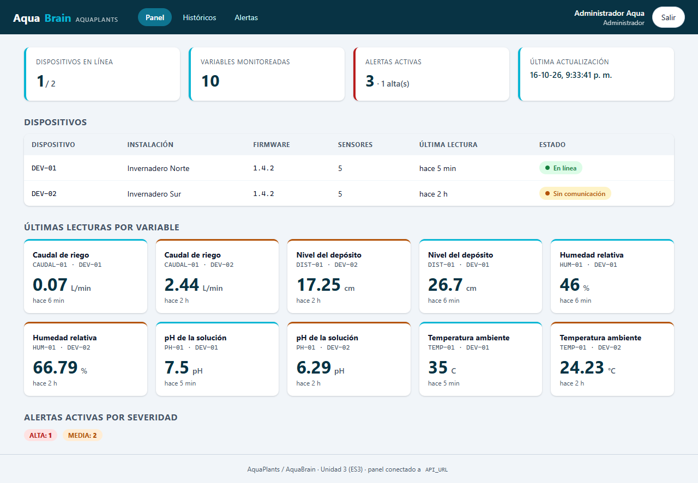
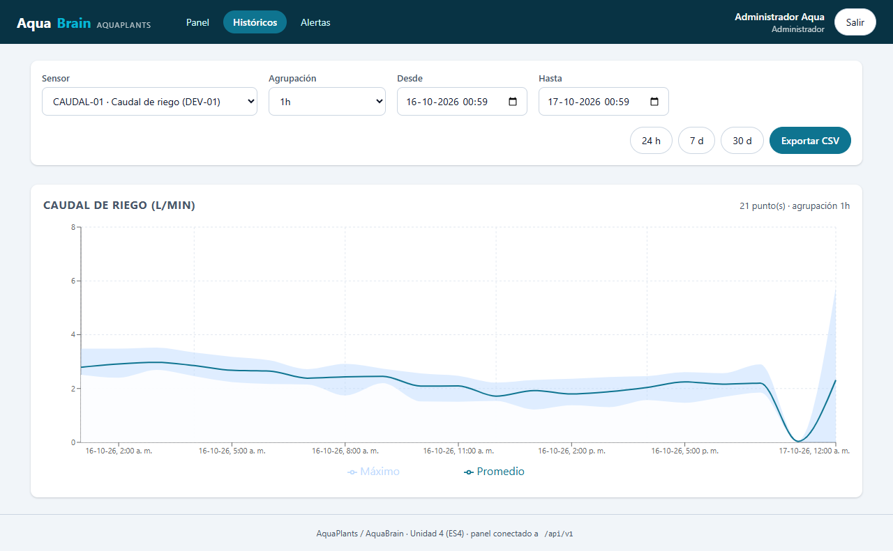
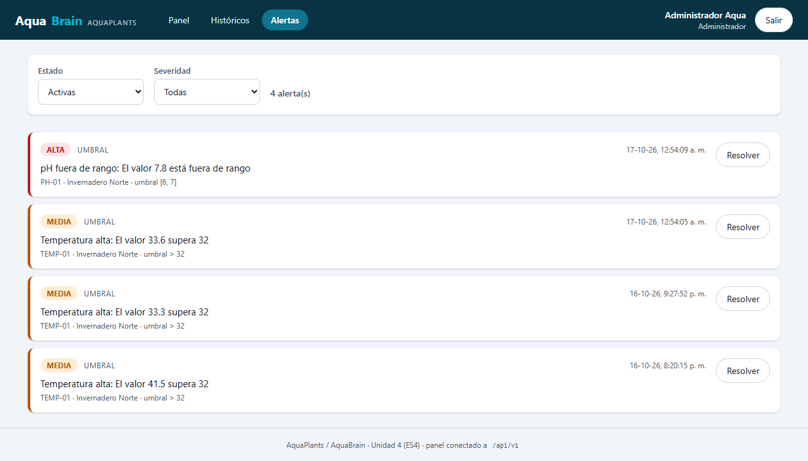

# 14. Anexos

## 14.1 Anexo A — Comandos de reproducción

Todos los comandos se ejecutan desde la raíz del proyecto (la ruta contiene espacios, por lo que se cita entre comillas al invocarla).

```powershell
# Dependencias y paquete compartido
npm install
npm run build --workspace @aquabrain/shared

# Base de datos (contenedor de desarrollo)
docker start aquabrain-pg
cd apps/api
npx prisma migrate deploy
npx prisma db seed

# API
npm run build
node dist/main.js            # http://localhost:3000/api/v1  y  /api/docs

# Dashboard
cd ../web
npm run dev                  # http://localhost:5173

# Simulador (ejemplo, modo offline)
cd ../simulator
npm run build
$env:API_URL='http://localhost:3000/api/v1'; $env:DEVICE_CODE='DEV-01'; $env:DEVICE_KEY='<clave>'
$env:MODO='offline'; node dist/simulador.js

# Pruebas y cobertura (con umbral)
cd ../api
npm test                     # unitarias
npm run test:e2e -- --runInBand
npm run test:cov             # combinada + umbral TS-44
```

## 14.2 Anexo B — Inventario de endpoints (35 rutas)

```text
POST   /api/v1/auth/login                      POST   /api/v1/auth/refresh
POST   /api/v1/auth/logout                     GET    /api/v1/auth/me
GET    /api/v1/usuarios                        POST   /api/v1/usuarios
GET    /api/v1/usuarios/{id}                   PATCH  /api/v1/usuarios/{id}
DELETE /api/v1/usuarios/{id}                   GET    /api/v1/roles
GET    /api/v1/permisos                        GET    /api/v1/sistemas
POST   /api/v1/sistemas                        GET    /api/v1/sistemas/{id}
PATCH  /api/v1/sistemas/{id}                   DELETE /api/v1/sistemas/{id}
GET    /api/v1/cultivos                        POST   /api/v1/cultivos
GET    /api/v1/cultivos/{id}                   PATCH  /api/v1/cultivos/{id}
DELETE /api/v1/cultivos/{id}                   GET    /api/v1/dispositivos
POST   /api/v1/dispositivos                    GET    /api/v1/dispositivos/{id}
PATCH  /api/v1/dispositivos/{id}               DELETE /api/v1/dispositivos/{id}
GET    /api/v1/dispositivos/{id}/sensores      POST   /api/v1/dispositivos/{id}/sensores
PATCH  /api/v1/dispositivos/{id}/sensores/{sensorId}
POST   /api/v1/dispositivos/{id}/rotar-clave   GET    /api/v1/sensores
GET    /api/v1/sensores/{id}                   GET    /api/v1/tipos-variable
GET    /api/v1/reglas                          POST   /api/v1/reglas
GET    /api/v1/reglas/{id}                     PATCH  /api/v1/reglas/{id}
DELETE /api/v1/reglas/{id}                     POST   /api/v1/reglas/probar/simulacion
POST   /api/v1/mediciones                      POST   /api/v1/mediciones/bulk
GET    /api/v1/mediciones/serie                GET    /api/v1/mediciones/ultimas
GET    /api/v1/mediciones/exportar.csv         GET    /api/v1/alertas
GET    /api/v1/alertas/{id}                    GET    /api/v1/alertas/resumen
POST   /api/v1/alertas/{id}/resolver           GET    /api/v1/dashboard/estado
GET    /api/v1/auditoria                       GET    /health   (sin prefijo)
```

## 14.3 Anexo C — Comandos de la demo (terminal)

```powershell
# 1) Iniciar sesión y guardar el token (ejemplo)
$login = Invoke-RestMethod -Method Post -Uri 'http://localhost:3000/api/v1/auth/login' `
  -ContentType 'application/json' `
  -Body '{"correo":"encargado@aqua.cl","contrasena":"AquaPlants2026!"}'
$h = @{ Authorization = "Bearer $($login.accessToken)" }

# 2) Estado del panel
Invoke-RestMethod -Uri 'http://localhost:3000/api/v1/dashboard/estado' -Headers $h

# 3) Serie de un sensor (últimos 30 días, por hora)
Invoke-RestMethod -Uri 'http://localhost:3000/api/v1/mediciones/serie?sensorId=1&agrupacion=hora&desde=2026-09-17&hasta=2026-10-17' -Headers $h

# 4) Alertas activas
Invoke-RestMethod -Uri 'http://localhost:3000/api/v1/alertas?estado=ACTIVA' -Headers $h

# 5) Resolver una alerta
Invoke-RestMethod -Method Post -Uri 'http://localhost:3000/api/v1/alertas/1/resolver' -Headers $h `
  -ContentType 'application/json' -Body '{"comentario":"Verificado en terreno"}'

# 6) Sonda de salud (sin token)
Invoke-RestMethod -Uri 'http://localhost:3000/health'
```

## 14.4 Anexo D — Rendimiento (TS-43)

Medición sobre **52 230** mediciones, 25 repeticiones por *endpoint*:

```text
endpoint                      muestras min_ms p50_ms p95_ms max_ms bytes
--------                      -------- ------ ------ ------ ------ -----
GET /dashboard/estado               25   88,4  104,1  225,9  328,8  3642
GET /mediciones/serie (1 mes)       25  231,5  573,7  633,8  730,4 77231
GET /alertas?porPagina=20           25   59,2   64,8   86,2   91,8  2017
```

Escritura por lote (`POST /mediciones/bulk`, 500 lecturas), antes y después de **R-01**:

```text
# Antes: 16410 ms     Después: 1697 / 1403 / 1275 ms (mediana 1403 ms, ~12x)
{ "recibidas": 500, "aceptadas": 500, "duplicadas": 0, "rechazadas": 0, "alertasGeneradas": 0 }
```

Artefactos: `docs/ES4/evidencia/perf-ts43.txt` y `docs/ES4/evidencia/perf-bulk.txt`.

## 14.5 Anexo E — Plan de consulta de la serie

```text
GroupAggregate  (cost=577.70..588.90 rows=277) (actual time=1.523..1.945 rows=49 loops=1)
  Group Key: date_bin('01:00:00'::interval, "timestamp", '2000-01-01'::timestamptz)
  Buffers: shared hit=17
  ->  Sort  (actual time=1.479..1.513 rows=295)
        ->  Bitmap Heap Scan on medicion  (actual time=1.214..1.342 rows=295)
              Recheck Cond: (sensor_id = ... AND "timestamp" >= ... AND "timestamp" <= ...)
              ->  Bitmap Index Scan on idx_medicion_sensor_ts  (actual time=1.175..1.176)
Planning Time: 1.624 ms
Execution Time: 2.217 ms
```

## 14.6 Anexo F — Transcripciones del simulador

- `docs/ES4/evidencia/sim-online.txt` — modo online (10 aceptadas, 1 alerta MEDIA).
- `docs/ES4/evidencia/sim-offline.txt` — modo offline (8 almacenadas, sincronizadas; el reenvío marca 8 duplicadas).
- `docs/ES4/evidencia/sim-anomalia.txt` — modo anomalía (2 fuera de rango, 1 alerta ALTA).

## 14.7 Anexo G — Capturas del dashboard

Panel en vivo (indicadores, dispositivos y las 10 variables):



Históricos con gráfico de líneas y banda de mínimo/máximo:



Bandeja de alertas con opción de resolución:



## 14.8 Anexo H — Empaquetado y dependencias

```text
$ docker build -f infra/api.Dockerfile -t aquabrain-api:dev .
#24 DONE 82.2s

$ docker images aquabrain-api
REPOSITORY       TAG    SIZE
aquabrain-api    dev    162MB

$ docker run --rm aquabrain-api:dev node -e "console.log(process.version, require('@aquabrain/shared').MAX_BULK_ITEMS, require('@prisma/client/package.json').version)"
v20.20.2 500 5.22.0
```

Auditoría de dependencias al cierre:

```text
$ npm audit
66 vulnerabilidades (4 low, 16 moderate, 45 high, 1 critical)
```

> Todas son **transitivas** del ecosistema NestJS 10. La acción recomendada es migrar a NestJS 11 (capítulo 7).

## 14.9 Anexo I — Variables de entorno

| Variable | Uso |
|---|---|
| `NODE_ENV`, `PORT`, `API_PREFIX`, `LOG_LEVEL` | Configuración general |
| `DATABASE_URL` | Conexión a PostgreSQL |
| `JWT_ACCESS_SECRET`, `JWT_REFRESH_SECRET`, `JWT_ACCESS_TTL`, `JWT_REFRESH_TTL` | Firma y vigencia de *tokens* |
| `BCRYPT_COST` | Factor de coste (12 en desarrollo/producción, menor en CI) |
| `DEVICE_KEY_PEPPER` | *Pepper* de las claves de dispositivo |
| `ALERT_SILENCE_FACTOR` | Ventana de silencio de alertas |
| `MAX_TIMESTAMP_SKEW` | Tolerancia de `timestamp` (RN-09) |
| `BODY_LIMIT` | Límite del cuerpo de las peticiones |
| `CORS_ORIGINS` | Orígenes permitidos |
| `REDIS_URL` | **Reservado** (no consumido por el prototipo) |

## 14.10 Anexo J — Datos de la base al cierre

| Tabla | Filas |
|---|---:|
| `medicion` | 52 230 |
| `medicion_idempotencia` | 2 030 |
| `auditoria` | 1 052 |
| `refresh_token` | 130 |
| `rol_permiso` | 39 |
| `permiso` | 21 |
| `sensor` | 10 |
| `estado_sensor_actual` | 10 |
| `tipo_variable` | 5 |
| `regla_alerta` | 4 |
| `usuario` | 3 |
| `alerta` | 3 (2 activas, 1 resuelta) |
| `dispositivo` | 2 |
| `sistema` | 2 |

*Conteo obtenido con `psql` sobre el contenedor `aquabrain-pg`; la tabla `auditoria` crece con cada operación sensible.*

## 14.11 Anexo K — Glosario

| Término | Significado |
|---|---|
| **AquaBrain** | *Gateway* físico (ESP32-S3) que integra sensores y conectividad |
| **Medición** | Lectura de un sensor en un instante, con calidad y origen |
| **Idempotencia** | Propiedad que evita duplicar un registro reenviado |
| **Frescura** | Indicador de si un dispositivo sigue comunicando |
| **MoSCoW** | Priorización Must / Should / Could / Won't |
| **RBAC** | Control de acceso basado en roles |
| **OpenAPI** | Especificación estándar del contrato REST |
| **p50 / p95** | Percentiles de latencia (mediana / cola) |

## 14.12 Anexo L — Enlaces y artefactos de la entrega

| Artefacto | Ubicación |
|---|---|
| Informe académico ES4 (este documento) | `docs/ES4/informe/` + `ES4-AquaBrain-informe.html` / `.pdf` |
| Entrega ES4 (documento de cierre) | `docs/ES4/` + `ES4-AquaBrain-entrega.html` / `.pdf` |
| Informe ES3 (implementación) | `docs/ES3/` |
| Diseño ES2 | `docs/ES2/` |
| Catálogo ES1 | `docs/ES1/` |
| Código fuente | Raíz del repositorio (rama `main`) |
| Documentación de API | `http://localhost:3000/api/docs` |
